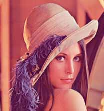

Klaus Klug Christiansen  
[kkc@apl.it](mailto:kkc@apl.it)
{ .byline }

In building a web gallery of (some of) my photos I quickly realised that I need as much of the process as possible to be automated. Making an APL program to do that shouldn’t be too hard, but at least in Dyalog loading and saving JPEG images would not be straightforward. From previous experience I knew of a comprehensive open source image library, which abundantly would fulfil the requirements of my present task.

## Developer’s Image Library

<div class="panel right" markdown="1">

 

</div>

The open source image library is available from [SourceForge](http://openil.sourceforge.net/) As can be seen from the link the project was originally named OpenIL, but it seems that in order to effectively avoid violation of trademarks etc. they decided for changing the name to Developer’s Image Library a.k.a. DevIL.

There are two manuals to document the use of DevIL: *The Reference Guide*, and the *Developer’s Manual*.

The former gives a list of calls in the DevIL API. Unfortunately this list is not comprehensive and gives details on neither arguments nor results. Besides it has not been updated for quite some time. The latter gives many more of the needed details but still it’s not comprehensive.

Details missing from both documents can be read from the header files: `lib\include\IL\il.h` holds all the constant definitions and function headers.

The whole package is easily accessible from modern APLs as it is nicely wrapped in three DLLs, which are easily called using `⎕NA`: `DevIL.dll`, `ILU.dll`, and `ILUT.dll`.

- `DevIL.dll` contains all top-level functions, which will suffice if you don’t intend to do much but loading, converting, and saving.
- `ILU.dll` contains the more sophisticated functions to use when doing image manipulation like e.g. resizing.
- `ILUT.dll` contains all remaining low-level functions, mainly for use in the other two DLLs , and so far I have not come to need any of these.

## APL

I have prepared a Dyalog APL Version 9 [workspace](christiansen/devil.dws) that contains functions which should make it easy to take advantage of the facilities of DevIL. At least it takes away the pain of figuring out the arguments for (some of) the calls to the DLLs.

There are at least 2 ways of approaching the code in the workspace: keeping image data in the APL workspace and simply using DevIL for reading and writing image files, or as well employing DevIL as a tool for manipulating the read images. In either case all code is contained in the `#.DevIL` namespace in the `devil.dws` workspace.

### Approach 1: Simple read and write

Two functions allow for simple reading and writing of image files: `#.DevIL.FileRead` and `#.DevIL.FileWrite`

`#.DevIL.FileRead filename` reads an image file and returns a vector of three elements: Error message, `bits`, and `cmap`.

- The error message is an empty vector if the operation completed without generating an error.
- `bits` holds the image data. If the image is RGB then the bits are encoded in the usual Dyalog style: `PIXEL←256⊥RED GREEN BLUE`
- `cmap` holds the image palette. Like `bits`, `cmap` adheres to the Dyalog convention and represents a palette as a matrix with 3 columns. If there is no palette then `cmap` has no rows.

In the function are listed the image file formats that DevIL is capable of reading. It automatically detects the format of the file when reading it.

Images with an alpha-channel can be loaded though the alpha-channel is discarded and so not returned. Alpha-channels are however fully supported by DevIL so it’s simply a question of editing the `#.DevIL.GetBits` function to get to it.

`(bits cmap) #.DevIL.FileWrite filename` writes an image file, returning an error message, which is an empty vector if no error occurred.

The left argument is a vector with two elements:

- `bits` holds the image data. If the image is RGB then the bits are encoded in the usual Dyalog style: `PIXEL←256⊥RED GREEN BLUE`
- `cmap` holds the image palette. Like `bits`, `cmap` adheres to the Dyalog convention and represents a palette as a matrix with 3 cols. If there is no palette then `cmap` has no rows.

DevIL automatically detects the desired format of the image file from the extension of the file name. The image file formats that DevIL can generate are listed in the function.

Please note that neither of these two functions accepts any attributes of the image file, like e.g. the compression ratio of a JPEG image file. All attributes will take default values, which in the case of the JPEG compression rate is maximum image quality.

### Approach 2: Deploying DevIL

A second way of approaching the use of DevIL could be to keep the image in the library and not load it into the APL workspace. To accomplish that first an instance of the DLL is required:

```
      img←#.DevIL.New
```

The variable `img` now holds a reference to a namespace, where all cover functions can be found. This means that all operations can now be performed from within the namespace. E.g. loading an image into this instance of the image library can be done like this:

```
      img.Load 'photo.jpg'
```

As most of the other functions the `load` function returns an error message, which is empty if no error occurred. Once an image is loaded it is possible to query its properties like this:

```
      bits←img.GetBits
      cmap←img.GetCMap
      cbits←img.GetCBits
      img.GetSize
600 800
```

The function `GetBits` returns the unprocessed image data and `GetCMap` the palette. `GetCBits` always returns RGB image data, i.e. it will convert any indexed (using a palette) image to RGB, thus rendering the palette superfluous.

In the same way it is possible to invoke the functions in the image library for which cover functions have been implemented. Say, you want to resize an image:

```
      img.Resize 200 320
```

As can be seen the sequence of the coordinates follow the usual Dyalog convension, giving vertical before horizontal. This goes for the cover functions only, though. Please note as well that the scaling on either axis can be chosen freely.

A left argument to the `Resize` function can be specified, which will indicate to the image library what resizing method to use. No translation to/from the enums employed by the library has been provided but all relevant ones are listed in the function.

Please note that only the three simplest resizing methods can be used on indexed images, i.e. images with a palette. The other six require the image not to be indexed. If needed, an indexed image can be easily converted:

```
      img.ilConvertImage 6407 5120
1
```

Like this the image is converted to RGB with 1 byte per channel per pixel. The untranslated error code 1 indicates success.

The two numbers in the right argument indicates the desired format and type of the resulting image. The format indicates the image encoding (indexed, RGB etc.) and the type the channel pixel size (byte, word etc.) No translation to/from the enums used by the library has been provided but all relevant ones are listed in the `#.DevIL.New` function.

In order to save space (to allow for more photos in the gallery), maybe the quality of the resulting JPEG image file should be reduced. No dedicated cover function has been implemented, but the desired quality level can easily be set with the variable `jpegQuality`.

```
        img.jpegQuality←80
```

Now that the image has been resized and desired quality set it might be time to save the result.

```
      img.Save 'newimage.jpg'
```

A left argument can be supplied, which will indicate the desired file format. The possibilities and corresponding enums are listed in the function. Normally this is not required however, as DevIL automatically detects the file format from the file name extension.

In the case of the photo gallery a thumbnail might come in handy. This is a simple operation, just make the image even smaller and save it again:

```
      img.Resize 50 66
      img.Save 'tn\newimage.jpg'
```

### Beyond

As already hinted this workspace only covers a fraction of what DevIL has to offer. More cover functions can easily be built for the facilities that are not already "covered". It should not present great difficulty to find the desired API function call in the mentioned `lib\include\IL\il.h file`, and once the structure of its arguments and result has been established a suitable `⎕NA` call can be built. The ones provided in the `#.DevIL.New` function should provide all information required to perform this task.

Interesting aspects to explore could be DevIL’s capabilities of e.g. keeping several images in the same instance or the interface to OpenGL.

## Heading on

Though the framework presented here is limited in scope there are a number of uncertainties and missing answers, which would require a more thorough examination of the C source code. One such is e.g. if generation of GIF image files is indeed supported or not. The DLL itself refuses to save GIF files whereas the project front page at SourceForge seems to imply that the required code is actually present. Judging from messages in one of the forums it’s the expiry of the Unisys patent that has not been fully adopted.

Another very interesting aspect about DevIL is its WinCE/PocketPC distribution, which would allow for its use even with Dyalog on a PocketPC. At least there used to be one such distribution but I have not investigated if it is even generatable anymore.
