Ajay Askoolum  
[ajayaskoolum@ntlworld.com](mailto:AjayAskoolum@ntlworld.com)
{ .byline }

In this article, I present a visual guide to building and deploying a C# COM (Component Object Model) Interrop DLL (Dynamic Link Library) for APL using Visual C# 2005 Express Edition. This is not a tutorial on either C# or on Visual C# 2005 Express Edition, but simply an illustration of the process for building COM DLLs in C#.

For a limited period and subject to conditions, Visual C# 2005 Express Edition is available as a free-download, together with installation instructions \[[1](#ref1)\].

The continuing evolution of the .Net platform has spawned a lot of documentation on the internet which appears to be misleading, at least from an APL point of view; a contributing factor in this confusion is that the documentation applies to several versions of the .Net framework and Visual Studio.net. This article redresses the situation by providing a template for building COM DLLs for APL. The actual code in the DLL is of a trivial nature and intended solely to illustrate how to build it.

A COM DLL is a server to a client; in the present context, the client is APL. The COM server exposes methods, properties, and events that the client can use irrespective of the native language of the DLL. In order to deploy such a DLL, the target computer must have the .Net Framework 2.0 installed; this is available as a free download \[[2](#ref2)\]. Visual Studio.Net 2005 uses the same framework and although the interface presented by the Express and full versions are different, it is possible to use Visual Studio 2005 instead of the Express edition. This article is based on the Express edition.

## File|New Project

Start the Express edition and click `File|New Project`. Figure 1 shows the dialogue that appears.

<figure markdown="1">
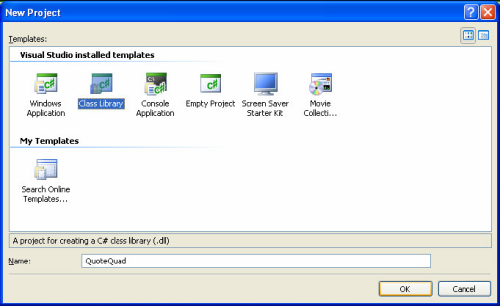
<figcaption markdown="span">Figure 1. Selecting the type of project</figcaption>
</figure>

<figure class="right" markdown="1">
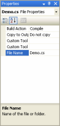
<figcaption markdown="span">Figure 2. Naming the class</figcaption>
</figure>

<figure class="right" markdown="1">
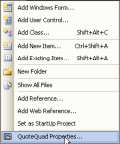
<figcaption markdown="span">Figure 3. Properties</figcaption>
</figure>

Select the Class Library template and specify the name as `QuoteQuad`, as shown above. This ensures that `QuoteQuad` is the name of the DLL. By default, the class library is not configured for COM usage.

## Modifying the DLL properties

In order to modify the properties of the DLL to enable it for COM, click `View|Properties Window` and then select `Class1.cs`; the objective is to change the class name. Figure 2 shows the class name *after* `class1.cs` has been renamed `Demo.cs`.

Clients will instantiate the DLL by using the *Library.Classname* convention; in this context, the reference is `QuoteQuad.Demo`.

## Setting COM properties

Next, click `Project|Quote Quad Properties`; this step is shown in Figure 3.

Next, Figure 4 shows the screen that becomes visible.

<figure markdown="1">
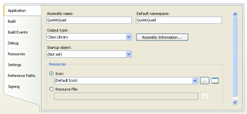
<figcaption markdown="span">Figure 4. Specifying COM properties</figcaption>
</figure>

Click `Assembly Information` in order to display the dialogue shown in Figure 5.

<figure markdown="1">
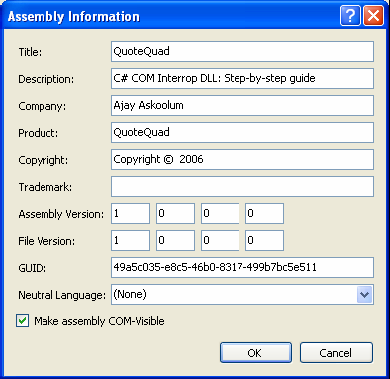
<figcaption markdown="span">Figure 5. COM visibility</figcaption>
</figure>

Tick the `Make assembly COM-Visible` the option.

Next, click `Build` in the left pane and specify the output path and tick `Register for COM interop` as shown in Figure 6.

<figure markdown="1">
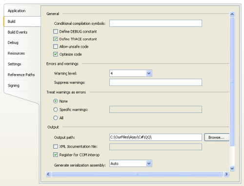
<figcaption markdown="span">Figure 6. COM Registration</figcaption>
</figure>

## Save the project

Click `File|Save All` in order to save the project. The dialogue shown in Figure 7 appears:

<figure markdown="1">
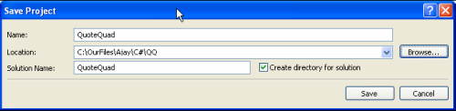
<figcaption markdown="span">Figure 7. Location of DLL</figcaption>
</figure>

For `Location` specify the fully qualified name of the location and then click `Save` to save all the files for the project. Note the option to `Create directory for solution`.

## Compiling the DLL

The DLL is ready for compilation. Click `Build|Build Solution` or press F6. However, the DLL does not have any methods, properties, or events to expose; therefore, there is little point in creating the DLL at this stage.

## Contents of the assembly

The first file, `Assembly.cs`, is ready and contains the following information:

```
using System.Reflection;
using System.Runtime.CompilerServices;
using System.Runtime.InteropServices;
// General Information about an assembly is controlled through the following
// set of attributes. Change these attribute values to modify the information
// associated with an assembly.
[assembly: AssemblyTitle("QuoteQuad")]
[assembly: AssemblyDescription("C# COM Interrop DLL: Step-by-step guide")]
[assembly: AssemblyConfiguration("")]
[assembly: AssemblyCompany("Ajay Askoolum")]
[assembly: AssemblyProduct("QuoteQuad")]
[assembly: AssemblyCopyright("Copyright © 2006")]
[assembly: AssemblyTrademark("")]
[assembly: AssemblyCulture("")]
// Setting ComVisible to false makes the types in this assembly not visible
// to COM components. If you need to access a type in this assembly from
// COM, set the ComVisible attribute to true on that type.
[assembly: ComVisible(true)]
// The following GUID is for the ID of the typelib if this project is exposed to COM
[assembly: Guid("49a5c035-e8c5-46b0-8317-499b7bc5e511")]
// Version information for an assembly consists of the following four values:
//
//      Major Version
//      Minor Version
//      Build Number
//      Revision
//
// You can specify all the values or you can default the Revision and Build Numbers
// by using the '*' as shown below:
[assembly: AssemblyVersion("1.0.0.0")]
[assembly: AssemblyFileVersion("1.0.0.0")]
```

Note that the code in this file is auto-generated from the configurations set using the graphical user interface dialogues.

## Adding methods, properties, and events

As mentioned, this does not provide a tutorial on C# or on C# Express; the objective is to provide a template for building C# COM DLLs. The functionality of the DLL is manually coded in the `Demo.cs` file. Its content is as follows:

```
using System;
using System.Collections.Generic;
using System.Text;
using System.Runtime.InteropServices;
namespace QuoteQuad
{
  public delegate void EventDel();
  [InterfaceTypeAttribute(ComInterfaceType.InterfaceIsIDispatch)]
  public interface UserEvents
  {
    [DispId(5)]
    void MyEvent();
  }
  [InterfaceType(ComInterfaceType.InterfaceIsIDispatch)]
  public interface _Demo
  {
    [DispId(1)]
    int MyMethod(int numarg);
    [DispId(2)]
    string MMethod();
    [DispId(3)]
    int MyProperty { get; set;}
    [DispId(4)]
    void eventm();
  }
  [ClassInterface(ClassInterfaceType.None)]
  [ProgId("QuoteQuad.Demo")]
  [ComSourceInterfaces(typeof(UserEvents))]

  public class Demo : _Demo
  {
    public event EventDel MyEvent;
    public Demo()
    {
    }
    private int myVar;
    public int MyProperty
    {
      get { return myVar; }
      set
      {
        MyEvent();
        myVar = value;
      }
    }
    public int MyMethod(int numarg)
    {
      return numarg + 10;
    }
    public string MMethod()
    {
      return "Ajay Askoolum";
    }
    public void eventm()
    {
      MyEvent();
    }
  }
}
```

The critical parts of the code are:

- The `DispId` attributes must be unique integers.
- Events are declared in the `public interface UserEvents` block and methods and properties are declared in the `public interface _Demo` block.

At this point, a C# language manual is necessary in order to be able to build reasonable functionality in the DLL.

## Building the DLL

In order to make the assembly, click `Build|Build Solution` or press F6. This process creates several files, including the DLL at the following location

```
C:\OurFiles\Ajay\C#\QQ\QuoteQuad\QuoteQuad\obj\Release
```

The location will vary depending on the specification for `Location`; see Figure 7.

The only file that is required for COM operation is:

```
C:\OurFiles\Ajay\C#\QQ\QuoteQuad\QuoteQuad\obj\Release\QuoteQuad.dll
```

On the *development* computer, no further action is necessary before using the DLL as the build process has already registered the DLL silently, and can be seen from APL+Win:

```
      '#' ⎕wi 'XInfo' 'QUOTE'
QuoteQuad.Demo ActiveObject QuoteQuad.Demo
```

## Deploying the DLL

<figure class="right" markdown="1">
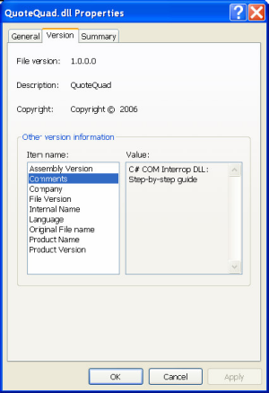
<figcaption markdown="span">Figure 8. QUOTEQUAD.DLL properties</figcaption>
</figure>

The DLL’s properties can be examined by collating it within the filing system and clicking the right mouse button: see Figure 8.

On the target computer, execute the following steps:

1. Ensure that there are no existing sessions of a client that will use the DLL.
2. Ensure that it has the .Net Framework 2.0 installed already.
3. Copy the DLL to a target computer at any suitable location.

In principle, it is inadvisable to copy the DLL to a system folder such as `System32`; a good location is the folder housing the application that will deploy the DLL. For the purpose to hand, the DLL is copied to `C:\MY APL APPLICATION`.

In order to make the DLL available, click `Start|Run` to display the dialogue shown in Figure 9.

In the `Open` box, type:

```
C:\WINDOWS\Microsoft.NET\Framework\v2.0.50727\RegAsm.exe
   /codebase "C:\MY APL APPLICATION\QuoteQuad.dll"
```

<figure class="left" markdown="1">
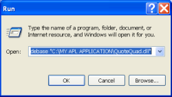
<figcaption markdown="span">Figure 9. Registering the DLL</figcaption>
</figure>

Click `OK`.

The code in the box shows the fully qualified name of `REGASM.EXE` followed by the switch `/codebase` and then the fully qualified name of the DLL. The file locations vary on your computer.

## Testing the DLL

At this point, the DLL is available on the target computer and is readily deployed by APL.

Using APL+Win, an instance of the DLL is created as shown in Figure 10.

<figure markdown="1">
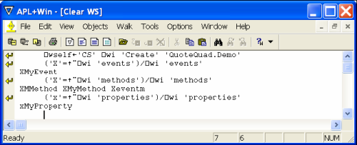
<figcaption markdown="span">Figure 10. APL+Win</figcaption>
</figure>

Using APLX, an instance of the DLL is created as shown in Figure 11.

<figure markdown="1">
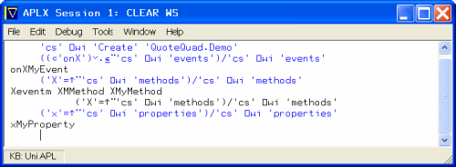
<figcaption markdown="span">Figure 11. APLX</figcaption>
</figure>

Using Dyalog, an instance of the DLL is created as shown in Figure 12.

<figure markdown="1">
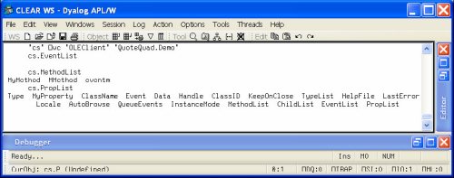
<figcaption markdown="span">Figure 12. Dyalog</figcaption>
</figure>

APL+Win and APLX are consistent in the enumeration of the events, methods, and properties of the DLL. However, it is unclear why Dyalog is unable to see the event.

## Demonstration

I shall use APL+Win to demonstrate the usage of the DLL. First the properties:

```
      ⎕wi '?MyProperty'
xMyProperty property:
  Value@Long ← ⎕WI 'xMyProperty'
  ⎕WI 'xMyProperty' Value@Long
```

The property `MyProperty` is a read/write property that is numeric.

```
      ⎕wi 'xMyProperty'           ⍝ Read
0
      ⎕wi 'xMyProperty' 100.75    ⍝ Write
      ⎕wi 'xMyProperty'           ⍝ Read
101
```

There appears to be an inconsistency! On closer examination of the code, it is apparent that the DLL coerces the value of the property to integer; hence, the result is `101` instead of `100.75`.

```
public int MyProperty
{
  get { return myVar; }
  set
  {
    MyEvent();
    myVar = value;
  }
}
```

This property will also raise the event `MyEvent` upon the value of the property being changed. However, the event was raised in the previous assignment but I had not specified an event handler. An event handler is specified in the usual manner, thus:

```
      ⎕wi 'onXMyEvent' '0.01×+\10/1' ⍝ Specify event handler
      ⎕wi 'xMyProperty' 190254 ⍝ Write & expect even handler to run
0.01 0.02 0.03 0.04 0.05 0.06 0.07 0.08 0.09 0.1
      ⎕wi 'xMyProperty' ⍝ Verify
190254
```

The event handler did fire and ran the APL handler; any APL+Win function may be called by the handler.

The method `eventm` also raises the event `MyEvent`.

```
      ⎕wi 'Xeventm' ⍝ Call method & expect MyEvent to fire
0.01 0.02 0.03 0.04 0.05 0.06 0.07 0.08 0.09 0.1
```

The method `MMethod` simply returns a static result:

```
      ⎕wi 'XMMethod' ⍝ This method returns a string
Ajay Askoolum
```

Finally, the method `MyMethod` takes a single argument and returns it incremented by `10`.

```
      ⎕wi '?MyMethod'
XMyMethod method:
  Result@Long ← ⎕WI 'XMyMethod' numarg@Long
  ⎕wi 'XMyMethod' 190254
190264
```

Although the methods, properties, and events in this demonstration C# COM DLL are simple, it is clear that it is now possible to write COM servers in the Microsoft flagship language, C#, for deployment with APL. Moreover, the template developed in this article for building and deploying such DLLs is minimalist, as would become clear from a study of the subject. For instance, I have completely circumvented the issues relating to strong names, the Global Assembly Cache and the debate related to managed code.

## The next step

The source code for the DLL is included in [qq.zip](askdll/qq.zip), as is `quotequad.dll`. The next step is for you to replicate the whole demonstration for yourself, using the source code, and then to write more purposeful methods and properties. In order to accomplish this, you will need a good reference on C# and an understanding of the conventions relating to COM objects. Also, use the `quotequad.dll` to test the deployment technique discussed above.

### References

1. <a id="ref1"></a>[http://msdn.microsoft.com/vstudio/express/visualcsharp/download/default.aspx](http://msdn.microsoft.com/vstudio/express/visualcsharp/download/default.aspx)
2. <a id="ref2"></a>[http://www.microsoft.com](http://www.microsoft.com) Search for `dot net framework 2.0 redistributable`
3. C. Nagel, B. Evjen, J. Glynn, M. Skinner, K. Watson & A. Jones, *Professional C# 2005*, WROX, ISBN-13 978-0-7645-7534-1
4. Ajay Askoolum, *System Building with APL+Win*, John Wiley, ISBN 0-470-03020-8
