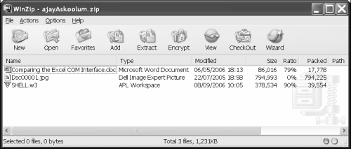

Ajay Askoolum  
[ajayaskoolum@ntlworld.com](mailto:AjayAskoolum@ntlworld.com)
{ .byline }

## Verify file

Verify whether a file exists using PathFileExists; this is an API call. If this declaration is not found in your INI file, add it, thus:

```
⎕wcall 'W_Ini' '[Call]PathFileExists=L(*C pszPath) ALIAS PathFileExistsA LIB shlwapi.dll'
```

The test to verify declaration is:

```
      ⍴⎕wcall 'W_Ini' '[Call]PathFileExists' ⍝ 0 = Missing
```

## Create empty Zip file

An empty Zip file can be created using the following function:

```
    ∇ Z←CreateZipFile R
[1]   ⍝ Ajay Askoolum
[2]   :if 0=⎕wcall 'PathFileExists' R
[3]      R ⎕xncreate Z←¯1+⌊/0,⎕nnums,⎕xnnums
[4]      ('PK¨←',(18⍴⎕tcnul),⎕tcnl,⎕tclf) ⎕nappend Z
[5]      ⎕nuntie Z
[6]      Z←1
[7]   :else
[8]      Z←0
[9]   :endif
    ∇
```

This function returns 1 if successful and 0 otherwise; the right-hand argument is a fully qualified filename.

```
      CreateZipFile 'c:\ajayAskoolum.zip'
1
```

## Signature of Zip file

The first 22 bytes of the file varies, depending on the application that created the Zip file. A file created thus can be used by WinZip. You can write a function to verify whether a particular file is a ZIP file by matching the first 4 bytes—see line \[4\].

## Add files to an existing Zip file

The following function will add a list of files to an existing Zip file:

```
    ∇ Z←L AddToZip R;⎕wself
[1]   ⍝ Ajay Askoolum
[2]   ⍝ L = Fully qualified name of an existing and valid Zip file
[3]   ⍝ R is a list of files to add or refresh inside ZIP
[4]   :if 0=⍴'ShApp' ⎕wi 'self'
[5]      ⎕wself←'ShApp' ⎕wi 'Create' 'Shell.Application'
[6]   :else
[7]      ⎕wself←'ShApp'
[8]   :endif
[9]   :while 0≠⍴R←,R
[10]     ⎕wi 'xNamespace().CopyHere' L (⎕io⊃R)
[11]     R←1↓R
[12]  :endwhile
    ∇
```

Note that the function does not delete the instance of the Shell Application object; this is deliberate and intended to save time creating the object when the function is used repeatedly.

```
      ⍝ Add a single file
'c:\ajayaskoolum.zip' AddToZip ⊂'c:\Comparing the Excel COM Interface.doc'
      ⍝ Add multiple files
files←'C:\aa(2)\DSC00001.JPG' 'C:\OURFILES\AJAY\APL\SHELL\SHELL.W3'
'c:\ajayaskoolum.zip' AddToZip files
```

## Using Winzip to explore

The file can be opened by WinZip; see below.

<figure markdown="1">

</figure>

## List file names within Zip file

The list of files in a given Zip file can be returned by this function:

```
    ∇ Z←L EnumZip R;⎕wself;i;j
[1]   ⍝ Ajay Askoolum
[2]   ⍝ Return list of files found in Zip file R
[3]   :if 0=⍴'ShApp' ⎕wi 'Self'
[4]      ⎕wself←'ShApp' ⎕wi 'Create' 'Shell.Application'
[5]   :else
[6]      ⎕wself←'ShApp'
[7]   :endif
[8]   Z←0/⊂''
[9]   :if 0≠⎕wi 'xNamespace()' R ⍝ Verify existence
[10]     ⎕wi 'xNamespace().Items>.tr' R
[11]     :if 0≠i←'.tr' ⎕wi 'xCount'
[12]        i←(-⎕io)+⍳i
[13]        j←(⊂'.tr') ⎕wi¨ (⊂⊂'xItem().Path'),¨i ⍝ Contents
[14]        L←(⊂'.tr') ⎕wi¨ (⊂⊂'xItem().IsFolder'),¨i
[15]        Z←Z,(~L)/j                            ⍝ Files
[16]        :if 0≠⍴L←L/j                          ⍝ Folders
[17]           R←(1≥+\'\'=R)/R
[18]           Z←Z,⊃,/EnumZip ¨(⊂R,'\'),¨L
[19]        :endif
[20]     :endif
[21]  :endif
[22]  :if 1=+/'EnumZip'^.⍉⎕si[;⍳7]
[23]     :if 0≠⍴'.tr' ⎕wi 'self'
[24]        '.tr' ⎕wi 'Delete'
[25]     :endif
[26]  :endif
    ∇
```

Note that this is a recursive function.

```
      EnumZip 'c:\ajayaskoolum.zip'
Comparing the Excel COM Interface.doc DSC00001.JPG SHELL.w3
      ⍴EnumZip 'c:\ajayaskoolum.zip'
3
      ⊃EnumZip 'c:\ajayaskoolum.zip'
Comparing the Excel COM Interface.doc
DSC00001.JPG
SHELL.w3
```

## Extracting files from Zip file

The following function will extract the files from an existing Zip file into a specified location:

```
    ∇ L ExtractZip R;⎕wself
[1]   ⍝ Ajay Askoolum
[2]   ⍝ L is the target location for extracted files
[3]   ⍝ R is the fully qualified name of Zip file
[4]   :if 0=⍴'ShApp' ⎕wi 'self'
[5]      ⎕wself←'ShApp' ⎕wi 'Create' 'Shell.Application'
[6]   :else
[7]      ⎕wself←'ShApp'
[8]   :endif
[9]      ⎕wi 'NameSpace().CopyHere' L ((⎕wi 'NameSpace().Items' R) ⎕wi 'obj')
    ∇

      'c:\zzz' ExtractZip 'c:\ajayaskoolum.zip'
      ⎕lib 'c:\zzz'
Comparing the Excel COM Interface.doc
DSC00001.JPG
SHELL.w3
```

Note that the target location must exist.

## What is missing?

Lots! If you examine the properties, methods, and events of the Shell object, it is clear that this object does not expose the compression properties or methods.

## Potential

It is possible to do lots more with these facilities; I’ll leave you to explore.
