Timothy K. Zirkel  
[zirkelt@lafayette.edu](mailto:zirkelt@lafayette.edu)
{ .byline }

Cellular automata are rules applied to structures. Mathematicians, computer scientists, and theoretical biologists use them to study the behaviour of systems based on local neighbourhoods within the system. The general principle is that a system is modelled by cells in some finite-dimensional space. Each cell can take one of a finite number of states. The next generation of the system is determined by applying some pre-determined rule to the neighbourhood of each cell. Modelling cell growth or crystallography are the most common uses of cellular automata, though they are also applied in other fields, such as cryptography \[[2](#ref2)\].

I first became aware of the Game of Life in an introductory computer science class. Our class was given the assignment of implementing Life using Java. Later, I encountered Life in a course on mathematical visualization. My visualization class implemented Life using J. I found the J version to be much more elegant and intriguing than anything I had seen in other programming languages. As a final project for the class I chose to investigate using J to expand the Game of Life to three dimensions, and that project evolved into this note.

## The 3D Game of Life

The Game of Life is a two-dimensional Boolean cellular automaton. It was created by John Conway in 1970. Cells reside in a square grid and can be in one of two states: ‘alive’ or ‘dead’. Each cell is surrounded by eight neighbours. A dead cell has a ‘birth’ if it has exactly three neighbours. An alive cell stays alive if it has two or three neighbours. All other configurations will result in a dead cell (either a dead cell remains dead, a living cell dies from overcrowding, or a living cell dies from exposure) \[[1](#ref1)\]. For an implementation of the Game of Life in J, see \[[5](#ref5)\] or Section 6.3 of \[[4](#ref4)\].

The concept of Conway’s Game of Life can be extended to three dimensions. There are, of course, a variety of possible rules to use. For an initial exploration, try (`4, 5, 6/4`). That is, a cell will remain alive if it has four, five, or six neighbours and a dead cell will be born if it has exactly 4 neighbours. We will use `1` to represent a living cell and `0` to represent a dead cell. The calculation for the local rule is based on multiplying the 3×3×3 Boolean array of cells by a 3×3×3 mask array. If the mask array has a 27 in the centre and ones everywhere else, then the cell will be alive in the next generation if the sum of the products is 4, 27+4, 27+5, or 27+6. So the local life rule will use `e.` to check if the sum of the products is in the list `4 31 32 33` as illustrated below.

```
  ]L=:3 3$(3 3$1),(1,1 27 1,:1),(3 3$1)  NB. the mask for local life
1  1  1
1  1  1
1  1  1

1  1  1
1  27 1
1  1  1

1  1  1
1  1  1
1  1  1

  llife3d=: +/@:,@(L&*) e. 4 31 32 33"_  NB. local life for a 3D grid
```

Consider a neighbourhood that has a live centre cell with four live neighbours:

```
   ]n0=: (i.3 3 3)e.1 2 10 13 25
0 1 1
0 0 0
0 0 0

0 1 0
0 1 0
0 0 0

0 0 0
0 0 0
0 1 0

  llife3d n0                              NB. local life on the neighbourhood
1
```

As expected, local life on neighbourhood `n0` yields a living centre cell for the next generation. Consider another neighbourhood, this time with a dead centre cell and only three live neighbours:

```
   ]n1=: (i.3 3 3)e.2 10 25
0 0 1
0 0 0
0 0 0

0 1 0
0 0 0
0 0 0

0 0 0
0 0 0
0 1 0

   llife3d n1                             NB. local life on the neighbourhood
0
```

Local life on neighbourhood `n1` gives a dead centre cell for the next generation, since the cell is dead and does not have the right number of living neighbours for a birth under the (4,5,6/4) rule.

To apply the local rule to tesselations of the array, use `_3 cut`. Before doing this it is necessary to consider the borders of the array. We want all members of the cube to have 26 neighbours, so we will periodically extend the input array in three dimensions using the function `perext` from Section 6.3 of \[[4](#ref4)\].

```
  perext=: {: , ] , {.

  perext3=: perext"1@:perext"2@:perext    NB. 3-dimensional periodic extension

  life3d=: 3 3 3&(llife3d;._3)@ perext3

  life3d n0
0 1 1
0 0 0
0 0 0

0 1 0
0 1 0
0 0 0

0 0 0
0 0 0
0 1 0
```

## Visualizing 3D Life

To produce a graphical representation of the 3D Game of Life we will use POV-Ray 3.6, a ray-tracing program from \[[3](#ref3)\]. Some of the functions we will use are from the `povkit2.ijs` script in \[[4](#ref4)\].

POV-Ray sets viewing parameters based on the idea of having a “camera” with certain orientations relative to the image.

```
  view_pars_sample=: 0 : 0                NB. viewing parameters; from povkit2.ijs
// set viewing parameters
camera{
  location <20,30,10>                     NB. viewpoint
  angle 45                                NB. vertical viewing angle
  up <0,0,1>
  right <0,1,0>
  sky <0,0,1>                             NB. up direction
  look_at<0,0,0>                          NB. centre of interest
  }
//#default{finish{ambient 0.3}}
object{light_source{<200,100,50> color rgb<2,2,2>}}
background {color rgb<1,1,1>}
)
```

The individual cells will be represented as boxes, which can be defined with a utility from `povkit2`. The left argument is an RGB triple. The right argument is two diagonal corners of the box. We can utilise `fmtbox` as follows:

```
  view_pars_sample fwrite povpath,'green_box.pov'

  (0 1 0 fmtbox 1 1 1 2 2 2) fappends povpath,'green_box.pov'
```

The file `green_box.pov` now contains viewing parameters and code for a box:

```
// set viewing parameters
camera{
  location <20,30,10>
      angle 45
      up <0,0,1>
  right <0,1,0>
      sky <0,0,1>
    look_at<0,0,0>
  }
//#default{finish{ambient 0.3}}
object{light_source{<200,100,50> color rgb<2,2,2>}}
background {color rgb<1,1,1>}
object{box{<1,1,1>,<2,2,2>}pigment{rgb<0,1,0>}}
```

<figure class="right" markdown="1">
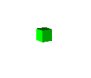
</figure>

Opening `green_box.pov` with POV-Ray and clicking `Run` will render an image of a green box:

We can gather more information on our 3D Game of Life by colouring the boxes according to the number of neighbours. To do this, we create unique RGB triples:

```
   ct=.1,(],-.,0&*)=i.3
   colors=.ct,(0.75*ct),(0.5*ct),(0.25*ct)
```

`colors` is a list of 28 triples with each co-ordinate of each triple in the range from `0` to `1`. Each triple corresponds to the number of live cells that could be in a neighbourhood (from `0` to `27`). The case where there are zero live cells corresponds to the triple (`1,1,1`), which is white. When zero live cells are in a neighbourhood no cubes will be created, so this colour will never be used, which is desirable since we are rendering cells on top of a white background.

We will need to count the cells in the 3×3×3 neighbourhood of every live cell to determine the colour of the cell. To do this we use:

```
  neigh3d=: * 3 3 3"_ +/@,;._3 perext3
```

Writing to the POV-Ray file requires `fwrite` and `fappends`, which are defined in `files.ijs`.

We are now ready to create a verb to make the POV-Ray file. This verb will store 100 iterations of 3D Life in a single file called `life3d.pov` which will be placed in the directory specified by the `povpath`. Some understanding of POV-Ray language directives is helpful. POV-Ray uses the float identifier `clock` to control animations. The value of `clock` ranges from `0` for the start frame to `1` for the end frame, with the other frames evenly spaced to values between `0` and `1`. Since we want our frames to be rendered in a specific order, we can use the clock value along with the fact that `0` is false and any non-zero value is true for the `#if` directive in POV-Ray to define the order of frame rendering.

```
  life3d_pov=: 3 : 0
k=.0                                      NB. index for the for loop
dx=.0.8                                   NB. the length of a side of a cube
pfn=: povpath,'life3d.pov'                NB. the output file
ct=.1,(],-.,0&*)=i.3                      NB. 7 different RGB triples
colors=.ct,(0.75*ct),(0.5*ct),(0.25*ct)   NB. 28 different RGB triples
pos=.{<@i."0 $ y.                         NB. boxed list of xyz coords in the array
view_pars_sample fwrite pfn               NB. creates some viewing parameters
'#declare I=-1;' fappends pfn
for_k. i. 100 do.                         NB. does 100 iterations of life3d
  '#declare I = I + 1;' fappends pfn      NB. each iteration has an index

  '#if(I-100*clock)#else' fappends pfn    NB. POV-Ray will choose which iteration
                                          NB. to create based on the index

  mask=.,y.                               NB. mask for the array
  c=.(mask#,neigh3d y.){colors            NB. gets colors for each cell according to
                                          NB. the number of neighbours

  xyz=.>mask#,pos                         NB. positions of live cells
  (c fmtbox xyz,"1 xyz+dx) fappends pfn   NB. draw the boxes
  y.=. life3d y.                          NB. run life3d on the input array
  '#end' fappends pfn
end.
)
```

We can create the `*.pov` file by running `life3d_pov` on a random Boolean array. Don’t forget to initialize `povpath`.

```
  rand=: 1=?10 10 10$3

  life3d_pov rand
```

In order to create a sequence of images of the configurations in `life3d.pov` we need to create a `*.ini` file.

```
  life3d_ini=: 0 : 0
Initial_Frame=0
Final_Frame=100
Subset_Start_Frame=0
Subset_End_Frame=99
Input_File_Name=life3d.pov

Cyclic_animation=Off
Pause_when_Done=Off
Output_File_Type=S

Sampling_Method=1
Antialias_Threshold=0.5
Antialias_Depth=2
Jitter=Off
Test_Abort_Count=100

  life3d_ini fwrite povpath,'life3d.ini'
```

Running the `*.ini` file creates 100 frames numbered `0` to `99`. With the help of the Image3 addon we can assemble these into a QuickTime movie as follows:

```
  load '~addons/image3/movie3.ijs'

  $fns=:'life3d*.png' files_in povpath

  4 fseq_to_png_mov fns; povpath,'life3d.mov'
```

Experimenting with different initial setups can give interesting results.

<figure class="left" markdown="1">
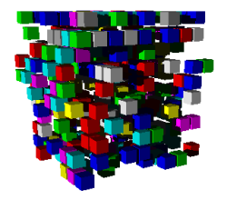
<figcaption markdown="span">A random 10×10×10 configuration:<br>`rand=: 1=?10 10 10$i.3`</figcaption>
</figure>

<figure class="right" markdown="1">
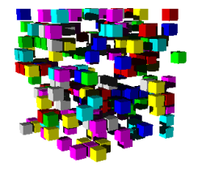
<figcaption markdown="span">The same configuration after 100 iterations</figcaption>
</figure>

 

<figure class="right" markdown="1">
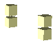
</figure>

This configuration is off-centre in a 6×6×6 array:

This will form a periodic pattern that repeats every ten iterations:

<p class="caption centred clear">
        	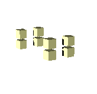
        	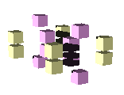
        	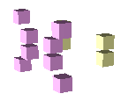
        </p>

<p class="caption centred">
        	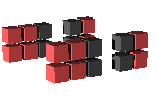
        	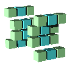
        	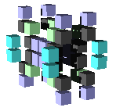
        </p>

<p class="caption centred">
        	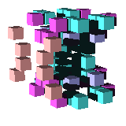
        	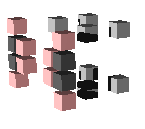
        	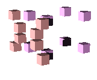
        </p>

<p class="caption centred">
        	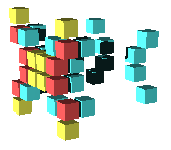
        	
        </p>

<figure class="right" markdown="1">
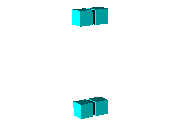
</figure>

A similar configuration centred in a 6×6×7 array:

 

<figure class="right" markdown="1">

</figure>

will yield this stable formation:

QuickTime movies of the evolution of these configurations are available from \[[6](#ref6)\].

The `life3d` function can easily be altered to experiment with different rules. As in the original Game of Life, it is possible to develop a variety of stable patterns and repeating cycles. J and POV-Ray allow easy study of these situations.

### References

1. Paul Callahan, “<a id="ref1"></a>What is the Game of Life?”, math.com, Online, 8 Dec 2005.
2. <a id="ref2"></a>[Cellular Automaton](http://en.wikipedia.org/Cellular_Automaton), Wikipedia, Online, 8 Dec 2005.
3. POV-Ray – The Persistence of Vision Raytracer, <a id="ref3"></a>[http://www.povray.org](http://www.povray.org)
4. C.A. Reiter, *Fractals, Visualization and J*, Autumn 2005 update to 2nd Edition,  <a id="ref4"></a>[http://ww2.lafayette.edu/~reiterc/j/fvj2/index.html](http://ww2.lafayette.edu/~reiterc/j/fvj2/index.html)
5. Cliff Reiter, “<a id="ref5"></a>[Time(r) for the Game of Life](trad/v213/cliff213.htm)”, *Vector*, 21:3 (2005) 88-98.
6. T. Zirkel, Auxiliary Materials for 3D Cellular Automata and the Game of Life,  <a id="ref6"></a>[http://ww2.lafayette.edu/~reiterc/mvq/zirkel/index.html](http://ww2.lafayette.edu/~reiterc/mvq/zirkel/index.html)
