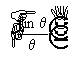
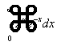

Ian Clark  
[earthspot2000@hotmail.com](mailto:earthspot2000@hotmail.com)
{ .byline }

Two years ago the decision was taken to make all future articles available on the *Vector* website (www.vector.org.uk). It was a natural decision to convert back-issue articles to the same format. The *Vector* production team reached the conclusion that HTML was a good definitive format for maintaining documents which needed to be published in a variety of forms (e.g. on the Web and in printed version). This set the pattern for the web-published archive.

It was considered that HTML versions of articles to be published on the *Vector* website ought to include minimal mark-up, consisting of no more than what is necessary to identify different sections of text, to be handled in different ways (e.g. narrative text, APL code, tables and placement of diagrams). As many options as possible ought to be deferred for controlling the appearance of the article on the screen.

This is a deceptively straightforward requirement. Most of it can be delivered by using a cascaded style sheet (CSS file), but it is also important to avoid browser features which act in such a way as to reduce our options in the future. It takes a lot of experience to know what these features are, plus the need to debate what represents good practice. Personal favourite constructs have to be sacrificed on the altar of compliance to the HTML 4 standard recommendation \[[1](#ref1)\], because at the time of writing this is considered the way to go for future XML migration.

## The history of *Vector* production

Camera copy for *Vector* was originally pasted up from panels of printed text and art-work produced in a variety of ways. Gradually page layouts became computer generated in increasingly standardised ways. By volume 4.2 (October 1987), substantially complete camera copy is extant in the form of Microsoft Word files. This is the sort of material to be found in the APL Madrid CD \[[2](#ref2)\], of which more below.

Nowadays camera copy takes the form of one or more PDF files, which are what is delivered to the printer. Interestingly the PDF files are generated not by Adobe Distiller, but by a system written in APL by Adrian Smith, taking as its source documents individual articles in HTML form compatible with those being Web-published for the *Vector* Archive. Assuming we have done our job properly, it would in principle be possible to republish back editions of *Vector* by regenerating PDF files from the web archive, to the extent of course that all the articles are there. Which they aren’t, and probably never will be, because much of *Vector* consists of ephemera. However what defines ephemera is a debatable question and nobody has debated it yet.

The author considers that there are many fine editorials going back to Vol 1.1 (1984) which can still be read with pleasure and profit – indeed whose content is extremely provocative in the light of subsequent developments. On the other hand when choosing which articles to varch next, i.e. to process for publication in the archive, some sort of priority asserts itself: articles of timeless application coming before articles focussing on obsolete technology.

## The APL Madrid CD

The APL Madrid CD was the first serious attempt to publish the whole *Vector* Archive for the benefit of members at large. The CD was produced in quantity and given to all delegates at APL Madrid 2002. The material on it however is incomplete, conforms to various different standards and is of variable quality. A variety of different APL fonts are in use (I-APL, APL2, APL\*PLUS, Dyalog APL, etc), these all having different `⎕AV` layouts. The DOC files which comprise the bulk of the material on the CD require a range of obsolete versions of Microsoft Word in order to display them, and even then this cannot be relied upon to work correctly (see below). It is only when you attempt to do so that you realise how badly Microsoft Word supports upward-compatibility, or historically has done so since 1984. Diagrams and mathematical formulae do not reproduce reliably. If you install a series of obsolete versions of Microsoft Word in order to display these files, you discover that these software antiques no longer perform on modern machines in quite the same way as they did when they were first released, not least because the author of a typical article dealing with APL has until very recently been pushing his word-processor to the limit. The result might be considered (by the vendor) good enough to import an old document for editing and re-issue, but in the author’s opinion it is not dependable enough to view a published document.

It soon becomes clear that to publish even the content of the APL Madrid CD on the Web is a shade more complicated than what the vendor would like you to believe, i.e. that you merely have to feed each DOC file into the latest release of Microsoft Word and select menu: “Save as Web Page…”. Migrating each paper in the archive to the web is an act of creative originality and support for the task cannot be purchased off-the-peg. Indeed the task has to be properly designed if it is to be consistent and economical to perform.

## Task design strategy

The following task design strategy has been arrived at by trial and error:

1. Extract the plain text of the narrative from the original DOC file (or whatever format the source file is in).
2. Insert appropriate HTML mark-up, in such a way as to repeat the action in a different way without having to repeat all the manual effort.
3. Scan anything “awkward” (i.e. awkward to reproduce in HTML) from the original printed page, in the form of a JPEG or GIF
4. Generate a test page and proof-read it, repeating the previous steps until the page looks satisfactory.
5. Upload it to the correct folder on the *Vector* server.

Fortunately Microsoft Word doesn’t make step 1 too difficult: if you import a DOC file into an APL variable you see a clearly discernible header and trailer which can be lopped to yield more-or-less acceptable plain-text.

Microsoft Word also helps with step 3 in certain limited but useful cases, especially where mathematical notation has been used. As mentioned, Word 2000 offers the option to save a DOC file “as a Web Page”. The code generated as a result is reminiscent of the early days of third-generation language compilers before optimisation came along. It is far from lean and mean, the vendors’ developers having felt obliged to emulate the most piffling features of the original document. However, where the source document defeats even their inspired ingenuity, Word generates a neat GIF which you can pick out and use in place of scanned artwork. This includes all mathematical notation.

## Handling APL code

Another place where Microsoft Word is relatively obliging is in the handling of APL code sections. All the information is there (usually) to restore the original code – though of course the characters which first appear bear little resemblance to the ones intended. But the APL primitives are generally 1-1 and so can be handled by a `⎕AV` conversion table. It is merely a question of deciding which table to use. Provided of course someone can deliver you a usable table in the first place. (They can’t).

A crude approach is found to work: simply build up a collection of tables as you go along. There must be 10 or so different layouts to be found in the APL Madrid CD, of which two predominate. So the task of building the table by eye gets easier and easier: for each fresh article you get to recognise the code layout required, and when you apply it, progressively more characters are coded correctly. The VARCH workspace (described below) warns you of APL characters hitherto unencountered in the chosen conversion table and invites you to tell it what APL characters they are meant to be.

## The joys of Microsoft Word

In all other cases Microsoft Word is the enemy, to be confronted, outmanoeuvred and finally defeated. One irritating trick it has is to force a newline inside a block of specially formatted code by means of a character indistinguishable from APL: `⊂`. Another trick (now thankfully obsolete) is the way in which Word once represented a non-standard character. Unlike the handling of italics and other such text formatting, which gets stripped out by the lopping process described above, a complex inline mark-up construct was used. The VARCH workspace user (the *varcher*) must recognise this by eye and replace it by the corresponding VARCH construct.

For example: how the paper loads into VARCH:

```
If ad ⍫symbol 186 \f "Symbol" \s 13ùò 1 mod n then exit
```

…how the VARCH regeneration function `sullivan123_70` converts it:

```
<p>If <i>a<sup>d</sup></i> &#x2261; 1 mod <i>n</i> then exit</p>
```

…the end appearance in Firefox (faithfully mirroring the hardcopy back-edition, p72 \[[3](#ref3)\]):

If *a<sup>d</sup>* ≡ 1 mod *n* then exit

Old papers employing mathematical notation don’t always display under later versions of Microsoft Word as intended. Here’s how Word 2000 corrupts some formulae in a DOC file dated 1994 from the APL Madrid CD:

<p class="caption centred">
					
					
				</p>

## Advantages and disadvantages of the VARCH approach

The advantages of the above task design strategy, or rather of the VARCH support for it, are:

1. There is no need to depend on Microsoft Word to do correctly what it claims to do, which is a major worry off one’s mind, not to mention a major time-waster circumvented.
2. Multifarious obsolete standards for representing APL fonts in print are replaced by one single standard based on Unicode. “One font to rule them all”, as Adrian Smith has put it \[[4](#ref4)\]. A useful by-product is that any code sample in the whole archive can be copied and pasted into the session of any modern APL, yielding identical behaviour (which is hopefully the one you want). You could say that APL has at last reached the happy state which ASCII-based languages have been in since the 1980s.
3. The mark-up process for generating and regenerating an article can be done in any order. Successful editing steps don’t have to be repeated.
4. An article can be regenerated one-touch with a different basic template, with additional mark-up, or a different `⎕AV` layout (or a corrected one).
5. Work done on the VARCH system to enable it to handle a given article benefits the processing of all subsequent articles.
6. There are no intermediate versions of articles stored anywhere, nor any intermediate cribs or tables.

VARCH takes the source material exactly as it appears on the APL Madrid CD and converts it to HTML in the currently approved way, storing the output of the manual mark-up task as a single APL function called a `paperfn`. The information a `paperfn` contains is an abstract description of the source text: it does not assume that any particular given HTML construct is going to be used. The actual HTML that gets generated is determined by the version of the VARCH workspace used to execute the `paperfn`.

Example of a `paperfn`: `langlet62_23`

The following is a short but sweet example of a `paperfn`, that of an archive article by the late Gérard Langlet \[[5](#ref5)\]:

```
    ∇ langlet62_23;selection;REPLAY
[1]   ⍝∇paper: 430 created: 18 December 2006, 22:44 using 1 VARCH44
[2]   ensure
[3]   fetch myname
[4]   ⍝AUTHOR←'G&eacute;rard Langlet'
[5]   AUTHOR←'Gérard Langlet'
[6]   ⍝PTITLE←APL "RISC Programming Style"'
[7]   PTITLE←APL ',2 qu 'RISC Programming Style'
[8]   CODETYPE←1
[9]   REPLAY←1
[10]
[11]   slx 536 3    ⋄ is_code 1      ⍝ ⎕IO
[12]   slx 1492 3   ⋄ is_code 1      ⍝ ⎕SS
[13]   slx 2610 3   ⋄ is_code 1      ⍝ ⎕IO
[14]
[15]   slx 1228 3   ⋄ is_code 1      ⍝ 100=⍴X
[16]   slx 1873 2   ⋄ is_code 1      ⍝ ∧⌿
[17]   slx 1877 2   ⋄ is_code 1      ⍝ +⌿
[18]
[19]   slx 0 0      ⋄ is_para        ⍝ In general
[20]   slx 333 0    ⋄ is_code 0      ⍝       ∇RÉC
[21]   slx 473 0    ⋄ is_para        ⍝ It works p
[22]   slx 650 0    ⋄ is_code 0      ⍝       ∇RÉC
[23]   slx 765 0    ⋄ is_code 0      ⍝       ⎕NSI
[24]   slx 868 0    ⋄ is_para        ⍝ COUNTALLV
[25]   slx 1236 0   ⋄ is_para        ⍝ Why use go
[26]   slx 1356 0   ⋄ is_para        ⍝ I have wri
[27]   slx 2156 0   ⋄ is_para        ⍝ The "RISC"
[28]   slx 2196 245 ⋄ is_list 'a'    ⍝  a) Simple a...
[29]   slx 2441 0   ⋄ is_para        ⍝ I even str
[30]   slx 3068 0   ⋄ is_para        ⍝ P.S. A com
[31]   slx 3500 0   ⋄ is_code 0      ⍝ (If you⊂
[32]   slx 3597 0   ⋄ is_para        ⍝ It might b
[33]  substws
[34]  proc 1 ⍝--use the appropriate variant
[35]  writeout
[36]  see
    ∇
```

Note that VARCH generates this APL fn after the first editing session of the article concerned. Subsequent sessions generate additional work lines in the session log, but do not tinker with the `paperfn` itself. This is left to the varcher to do, by copy/paste from the session log. The `paperfn` is not hard to hand-edit.

## Notes on the listing

Let’s go briefly down the listing, commenting on the code highlights:

```
    ∇ langlet62_263;selection;REPLAY
```

This function, when executed, will regenerate the paper by Langlet, Vol 6.2, page 23. VARCH uses a standing global: `INDEX` to get the author’s name plus title, and the existence of a varched paper and its Madrid source-file are written back into `INDEX`, which therefore serves as a work-schedule.

```
[2]   ensure
```

This fn checks whether `Init` has been run and if not runs it. `Init` sets up globals containing frequently used constants, especially paths to work folders. The varcher edits `Init` on installation to provide his/her own folder names, then forgets it.

```
[4]   ⍝AUTHOR←'G&eacute;rard Langlet'
[5]   AUTHOR←'Gérard Langlet'
```

Heritage code is left in-place for forensic purposes. In this case earlier versions of VARCH did not handle e-acute correctly if it was the APL+Win character (ASCII: `130`) and not the Unicode one: `#233`. Now it does. (It also handles APL characters in titles, e-acute being here an honorary APL character, or more correctly a character from the atomic vector of APL+Win.)

Commented-out line 4 was a fudge to force the browser to employ the so-called HTML entity: `&eacute;`. This HTML feature is recognised by both Microsoft Internet Explorer (IE) and Mozilla Firefox, but maybe it’s one of those features best avoided. It does at least say clearly what it is when you come across it, which `&#233;` or `&#xE9;` don’t. In the working code proper, VARCH doesn’t use specifications which are entangled with how they are implemented.

```
[6]   ⍝PTITLE←APL "RISC Programming Style"'
[7]   PTITLE←APL ',2 qu 'RISC Programming Style'
```

A similar consideration applies to the use of quotes in titles. Commented-out line 6 employed dumb-quotes, and since these too are honorary APL characters, VARCH doesn’t presume to smarten them up. However the tool-function `qu` surrounds a string with smart-quotes for embedding in HTML. Subsequent versions of VARCH are at liberty to implement smart quotes however they want (including quotes in titles), by altering the implementation of `qu`, which governs quotes throughout VARCH. This is an example of how VARCH typically defers a decision.

```
[8]   CODETYPE←1
```

This controls the behaviour of function `coded`, which generates embedded HTML for all types of code, whether J or a flavour of APL. Global `CODETYPE` controls a `:Select//:EndSelect` block inside `coded`. The default value is `1`, so line 8 is redundant. It is generated nonetheless because you might want to finesse the handling of code in this function at some future date. The experience of VARCH is that each new back-issue to be varched shows what you thought was the standard treatment to be the exception rather than the rule.

```
[9]   REPLAY←1
```

The behaviour of VARCH fns needs to differ when the given article is first edited by hand (`REPLAY←0`) and subsequently regenerated (`REPLAY←1`). Some fns are only valid on replay. In particular when `REPLAY←0` the function `selection` gets data from the editing panel using

```
      PANEL ⎕wi 'selection'
```

whereas when `REPLAY←1` the editing panel isn’t there and instead `selection` becomes a localised variable assigned by `slx` (see below)

```
[11]   slx 536 3    ⋄ is_code 1      ⍝ ⎕IO
```

This is the first *work line*. All previous lines are generated from a function template and differ little between paperfns. By dragging the cursor, the varcher has selected 3 chars of text in the editing panel starting at character `536` (viz. `⎕IO`) and pressed the button (or selected the menu) to run function `is_code 1`. (Incidentally all interactions with the editing panel are equivalent to entering some `htmfn` in the session log.) This action not only marks up `⎕IO` with the HTML construct to do the trick, but also generates a work line which, when re-executed at `REPLAY←1` time, will repeat the original editing action. Notice however that the work line is careful not to prejudice the actual HTML mark-up originally used, or to be used in the future. In fact (now line 4 has been superseded) there’s no literal HTML mark-up in the entire `paperfn`.

```
[19]   slx 0 0      ⋄ is_para        ⍝ In general
[20]   slx 333 0    ⋄ is_code 0      ⍝       ∇RÉC
[21]   slx 473 0    ⋄ is_para        ⍝ It works p
```

The argument of function `slx` is called a selection. Its form is always an integer 2-vec (`start len`), being determined by the GUI interface of APL+Win. The GUI numbers the first char in an Edit control as `0` (whatever the setting of `⎕IO`). If you either select it or place the cursor in front of it, the result is a selection commencing `0` (i.e. with `start=0`), as exemplified by line 19.

If the second number (`len`) is `0`, this means the cursor is a winking line and not a smeared-out strip. However, by convention, VARCH recognises this as a request to seek the next newline character (ASCII: `13`) and take that as the span of the selection. So the varcher can specify a paragraph by simply placing the cursor at the start of the line and running function `is_para`. A logical paragraph invariably starts a line in the edit window, but the converse is not always true.

This `len=0` trick also works with most blocks of code you encounter. Function `is_code 0` designates a pre-formatted block of code, generally to be marked-up: `<pre class="aplu">…</pre>`, whereas `is_code 1` designates a string of in-line code, to be marked-up (e.g.) thus: `<tt class="aplu">…</tt>`.

As a visual cue VARCH lifts the selected text at generating time and appends the first few characters as a trailing comment to the work line, white-spacing anything non-legible. This helps a lot when hand-editing the `paperfn` (not to mention debugging VARCH!). So, for instance, if the `htmfn` you called at generation time was the wrong one to use, or you need to craft a new one as a variant of some existing one, then you can simply overtype the fn name in the work line without needing to bring up the editing panel again. In fact as a varcher, faced with a section I don’t know how to handle, I often find myself clicking the button “placeholder” (to run `is_placeholder`). This is a no-operation in the editing panel but generates a work line I can subsequently hand-edit.

Notice too that the `start`-arguments of `slx` do not need to ascend. The work lines happen to be grouped into three sections, representing the three separate edit sessions which were needed before the HTML generated satisfactorily. However (unless selection spans overlap) the order of execution of work lines is immaterial.

```
[33]  substws
[34]  proc 1 ⍝--use the appropriate variant
```

The global: `TEMPLATE` is read from a given HTML file, which can be adjusted standalone to give the right appearance under both IE and Firefox. The current `TEMPLATE` uses the same CSS (cascading style sheet) as the most recent papers in the archive, hence changes to this CSS should alter the appearance of all archived articles in step. Function `substws` sets `PAGE←TEMPLATE` and replaces the tags: `{WS}`, `{VERSION}`, `{WHEN}`, `{PTITLE}`, `{AUTHOR}`, etc.

Function `proc` is largely heritage, there once being a supposed need for custom pre/post-processing. It still replaces special characters globally with the appropriate HTML entity. Also if the article contains frequent references to a given APL identifier (such as `vx` above) it can apply mark-up to these words wherever they occur, provided it is not inside designated code. As the final operation before writing to disk, `proc` does not need to maintain `ORIG`, which makes it somewhat easier to implement.

```
[35]  writeout
[36]  see
```

These fns write `PAGE` as a HTML file to the correct folder in the local website image and call the browser to show the latest HTML file generated.

## Text selection and mark-up

The hand-editing task is one of selecting sections of text and specifying how they are to be marked-up. As already remarked, editing steps can be carried out in any order and the work lines executed in any order. That’s because the selection in the argument of `slx` is in *orig* numbering, i.e. it is the selection you’d see if this was the first editing step to be performed.

VARCH converts actual selections at hand-editing time to orig selections in generated work lines, even though each deletion, insertion and mark-up operation shifts all the subsequent characters. On replay, the actual current selection is reproduced, however the situation stands.

The way VARCH does this is to set up a global `ORIG←⍳⍴VX` and maintain it in-step with `VX`, the buffer of marked-up text. This is sheer Homer Simpson programming and I’m embarrassed not to have developed a reliable `orig` conversion fn which works from a history of edit selections. But it’s a rock-hard implementation and I’m loath to replace it: failure of the `orig` function potentially wastes hours of varching work (not to mention embroiling you in hours of debugging) because the HTML page will then fail to regenerate properly from the `paperfn`. It goes without saying that the first attempt at generating HTML never does quite what you hope it will – or it does different things in IE and Firefox!

At each edit step using the editing panel, the appropriate `htmfn` is called and causes mark-up tags to appear in the edit window. This mark-up is however purely illustrative, since the sole purpose of the task is to generate a `paperfn`, since it is only the execution of a `paperfn` that saves the HTML file of a varched paper. As stated earlier, it is a design objective of VARCH to see that no explicit mark-up creeps into the `paperfn` itself. All mark-up is governed by the set of htmfns. These include:

```
is_APL            is_bullets        is_numlist        is_subscript
is_BLOB           is_c              is_omega          is_superscript
is_Eacute         is_caption        is_para           is_symb
is_J              is_code           is_para_b         is_tab
is_OBLOB          is_dash           is_para_n         is_table
is_addr           is_eacute         is_para_q         is_tabspec
is_addrSP         is_entity         is_placeholder    is_tagged
is_aelig          is_fig            is_refs           is_txt
is_alpha          is_figure         is_rule           is_uml
is_block          is_italic         is_safelytagged   is_verse
is_bold           is_last_action    is_short_caption
is_boxed          is_list           is_special
is_break          is_mxtab          is_subpara
```

They have tended to proliferate. Many are aliases of each other or straightforward variants. The reason is that it has been deemed safer to write a new `htmfn` where there is no clear existing one rather than go retrospectively generalising them, with the possible consequence that an old `paperfn` will no longer regenerate correctly. Also (in the case of aliases) a distinctive name holds out the possibility of a potentially different treatment in the future.

For example: `is_refs` currently runs `is_list 1`. However we may in time want a block of text spanned by `is_refs` to be marked-up as a table (HTML: `<table>…</table>`), allowing for finer control over its appearance than the current crude numbered list provides.

The overriding consideration governing htmfns is that they should specify the (varcher’s) intention, not the (current) implementation.

## The current state of VARCH

There are many valuable papers hidden in back-issues of *Vector*. Each time I encounter one, it stiffens my resolve to see that the archive gets substantially, if not wholly, Web-published before I kick the bucket. Some 90% (around 950 articles) of the *Vector* archive as listed in `INDEX` remains to be varched. At this rate it will take me 10 years, but I must confess it hasn’t been my sole activity during 2006, nor at times my top priority. However it’s too much for one man and we need volunteers.

VARCH has been well-honed for the tasks it handles, so productivity cannot be improved much for an experienced varcher. However there are a number of unskilled, time-consuming tasks for which volunteers will speed the process:

- Identifying figures, or “awkward” tabulations, and scanning them as JPEGs
- Hand-marking the hardcopy originals of *Vector* to identify in-line code, identifiers and italic text
- Proof-reading draft HTML and reporting errors

The latest version of the VARCH workspace is available for download \[[6](#ref6)\]. If you have the APL Madrid CD, some or all back-copies of *Vector*, and can run an APL+Win 3.6 workspace, then you can varch a few articles yourself, maybe in time becoming one of the anonymous yet blessed copyists of the sacred texts underpinning every major world religion 5,000 years hence. On a careful reading of history that’s no joke. Contact the author, or the editor of *Vector*.

### References

1. W3C, *HTML 4.01 Specification*, <a id="ref1"></a>[http://www.w3.org/TR/REC-html40/](http://www.w3.org/TR/REC-html40/)
2. British APL Association, <a id="ref2"></a>The APL Madrid CD, APL2002, Madrid
3. John Sullivan, “<a id="ref3"></a>[Multiprecision Arithmetic – Part III](trad/v123/sullivan123_70.htm)” *Vector* 12.3, 70
4. Adrian Smith, “<a id="ref4"></a>[One Font to Rule Them All](trad/v112/smith112_105.htm)”, *Vector* 11.2, 105
5. Gérard Langlet, “<a id="ref5"></a>[APL ‘RISC Programming Style’](trad/v062/langlet62_23.htm)”, *Vector* 6.2, 23
6. *Vector* Archive Project, <a id="ref6"></a>[latest VARCH workspace](../VARCH.w3)
