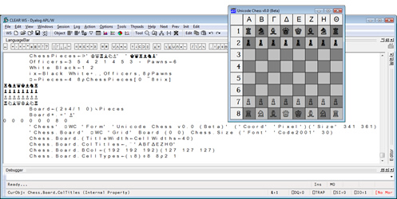
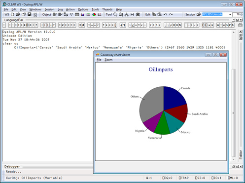

APL2000, Dyalog, Kx Systems, MicroAPL
{ .byline }

## APL 2000

### APL2000 User Conference 2008

The APL2000 User Conference 2008 will be held 10-11 November at the Hyatt Regency Bethesda, in Bethesda, Maryland. A special pre-conference weekend package, including breakfast, will be available for anyone wishing to spend a few extra days visiting Washington, D.C.

<figure markdown="1">

<figcaption markdown="span">Hyatt Regency Bethesda, MD</figcaption>
</figure>

The hotel is conveniently located on the Metro Red Line, just a short ride from downtown Washington, D.C., with easy access to all the monuments, museums and cultural centers. Near by the hotel is the Capital Crescent Trail for cycling, running and walking. Bethesda’s vibrant downtown, and its numerous restaurants and shops are within easy walking distance.

There are three airports in the Washington D.C. area – Ronald Reagan Washington National Airport, Washington-Dulles International Airport and Baltimore-Washington International Airport. Metro service is available from Ronald Reagan Washington National Airport to the hotel and shuttle service is available from all three airports to the hotel.

Plan to join us for an exciting conference filled with stimulating presentations, interesting demonstrations, shared ideas and camaraderie with the larger APL community.

## Dyalog

### Dyalog 2008

The User Group Conference this year will take place 12-15 October 2008.

Many of you will be pleased to learn that we will be returning to LO-Skolen in Elsinore in Denmark for this year’s Conference.

<figure markdown="1">

<figcaption markdown="span">LO-Skolen, Elsinore, Denmark</figcaption>
</figure>

For those of you who have not visited LO-Skolen before we can highlight the interesting architecture which has made this conference centre truly unique. The atmosphere in the main building is very inspiring and caters for intense networking as there are lots of areas throughout the venue for sitting down and having an informal talk. The kitchen has never failed to impress us deeply either.

From a transport point of view the venue is very easy to get to. From Central Copenhagen as well as from the airport there are trains straight to Elsinore – via Copenhagen Central Station (approx 1-hour journey). Train journeys are very reasonably priced in Denmark and a one way ticket can be had at DKK 90 (around £8.50) at current pricing.

We’re in the process of planning the conference in more detail and as always would be delighted to receive your input with regards to topics for presentations and training courses.

If you have a suggestion for a presentation you would like to give at the conference we'd also like to hear from you. Please email us.

For those of you who like to plan long-term already now we can announce that:

- Dyalog 2009 will take place in the USA in the autumn. Dates and venue to be announced nearer the time.
- Dyalog 2010 will take place in Berlin (Germany) – for the moment the timetable says July.

### Dyalog Version 12

**Support for Unicode character data** Version 12.0 allows applications to store and manipulate Unicode character data. Applications can now accept entry of data in any of the world’s writing systems – from Amharic through APL, Chinese and Tolkien’s Elvish script to Zulu. All components of Dyalog support Unicode: the development environment itself, the Dyalog language and file systems, built-in GUI objects, and interfaces to COM/OLE, .Net and ODBC.

The adoption of Unicode also means that data is no longer translated as it enters and leaves the Dyalog interpreter. APL source code can be stored in Unicode text files and edited using any editor which supports these files. A simple source-code management system and an interface to the popular Subversion system are included.

<figure markdown="1">

<figcaption markdown="span">Unicode in Dyalog Version 12</figcaption>
</figure>

**Conga for simplified communications** Conga is a mechanism for developing client and server components that communicate with other web or network components. Conga supports client/server programming, and includes sample code to implement web clients and servers. From version 12.0.2 Conga supports Secure communications using the Secure Socket Layer (SSL).

**Built-in charting** We’re happy to tell you Version 12 includes the Causeway product series: RainPro – including the .NET version, SharpPlot for high-quality business graphics, and NewLeaf for reporting and typesetting. You can produce a graphical representation of numerical data in seconds by clicking on a chart icon whilst running your session – or write your own APL scripts to produce high-quality reports with integrated business graphics.

<figure markdown="1">

<figcaption markdown="span">Built-in charting</figcaption>
</figure>

**Journalling component files** The built-in array file system is now a journalling file system, which means component files can no longer be damaged by network failures or system crashes which occur in the middle of a file update.

**Language bar** All APL symbols are presented in a Language Bar in the session, with tips to remind you of the definition of each – and a link to comprehensive on-line help. The language bar can be completely configured to provide help for your own functions.

**On-screen keyboard** (Microsoft Windows only) Hold the Control, Alt or AltGr key down for a split second, and you will be presented with a pop-up keyboard which shows the location of APL symbols on your keyboard, and allows you to pick them off using the mouse. Dyalog version 12.0 comes with standard Windows APL keyboards for a dozen languages – and you can easily edit your own keyboards using the Microsoft Keyboard Layout Creator.

**Unicode & Classic editions** When converting existing applications to use Unicode character data, some code conversion may be required. For many applications, the required changes may be trivial; some applications will run without any changes. However, large applications with many interfaces to external data may require significant work – if for no other reason than that the external databases and interfaces need to be upgraded in order to store Unicode data. Users who have developed Auxiliary Processors and Dynamic Link Libraries will need to upgrade these to handle Unicode data.

For this reason, version 12.0 and the next several versions of Dyalog will be available in two variants: a Unicode edition which uses Unicode for all external interfaces, and a Classic edition which uses the same interfaces and translate tables as 11.0 and earlier versions of Dyalog.

Workspaces and files can be shared between the Unicode and Classic editions. Both editions also provide extensive inter-operability with earlier versions. Component files can be shared with old versions subject to certain limitations (for example, the files must contain data which can be represented in the old systems).

**New online libraries for help and documentation** We have created two new online libraries which are now publicly available via the website. The Help library is created as a structured topic tree which you can expand. There is also a search function where you can either select from a menu or type in your search criteria.

The Documentation Centre contains all the available documentation and will be updated on a regular basis as and when new manuals and training materials becomes available. In connection with the Platinum release of Version 12 all the manuals will further be available as PDF downloads as well as print-on-demand via LuLu.

### New board member with extensive software development experience

<figure class="right" markdown="1">

<figcaption markdown="span">Michael Holmberg Andersen</figcaption>
</figure>

It gives us great pleasure to introduce Michael Holmberg Andersen, who joined the Board of Directors in April 2008.

Michael started his career as a teacher in Computer Science at the Technical University of Denmark, from which he stepped straight into software development and project management.

In 1991 Michael joined SimCorp, initially as a software developer and project manager, and during the first years in SimCorp Michael worked – among other things – with Artificial Intelligence.

Michael’s impressive career further includes the position as Managing Director of SimCorp Sweden A/S in the years 1999-2004 – covering the markets in Sweden and Finland.

In 2004 Michael was appointed Senior Vice President in SimCorp A/S specifically with the responsibility for Market Support, including areas such as Strategic Research and Partner Development.

Since 2008 Michael has occupied the position as Senior Vice President for the IMS Development Department where he is responsible for SimCorp’s software development activities.

Personally, Michael is married to Charlotte and a devoted father of Caroline and Frederik. He is a keen runner, and has completed several marathons including the Copenhagen and Stockholm Marathons. Michael also enjoys biking and has completed “Sjælland Rundt” and “Vattern Rundt” multiple times.

It gives us great pleasure to welcome Michael to the Board where we are looking forward to taking advantage of his extensive experience to further grow Dyalog Ltd in the years to come.

## Kx Systems

### Personal Developer Edition of Kdb+

Since making the 32-bit version of Kdb+ freely available more than 1,500 copies have been downloaded. It is our goal to encourage programmers around the world to learn q and Kdb+ in order to meet the increasing demand for talented Kx experts driven by the challenges of growing data volumes in the global financial markets. For more information visit http://kx.com/developers

### Code.kx.com

Kx programmers are continuing to make significant contributions to our global technical community via code.kx.com. This resource is now available to everyone and we would encourage you to take a look if you haven’t already done so. Contributions include examples of code for connecting to other applications and languages.

<figure class="right" markdown="1">

<figcaption markdown="span">Q for Mortals</figcaption>
</figure>

### Q for Mortals

Jeffry Borror’s long-awaited book on the q language, *Q For Mortals – A Tutorial in Q Programming*, is now available from Amazon. The book provides entry-level explanations for Q and Kdb+ users.

### New partner & OEM program

Rising data volumes are choking vendors and many applications are being redesigned and rewritten. Partly as a result of this Kx is receiving increased interest in partnerships from application vendors. We are always happy to work with new partners and to provide connectivity to Kx products or embedded versions of Kdb+. If you would like to find out more, please contact partners@kx.com.

### Customer events

Thank you to all those who were able to join us for our London party. If you’re in New York don’t forget our 15th anniversary celebration on 11 June. The party will be held during the SIFMA event in New York, which we are co-sponsoring. If you are a customer or a partner and have not yet received your invitation please email us at kxevents@kx.com. We’re very much looking forward to seeing you there.

### Drowning in data

The April edition of *Market Data Insight* carries an article by Simon Garland, Chief Strategist at Kx, on the challenges presented by growing volumes of data, and how to reduce latency.

## MicroAPL Ltd

The launch of APLX Version 4 has been very well received by new and existing users. It is available for all the platforms we support (Windows, MacOS, Linux, and AIX), in both Desktop and Server editions. The most important new feature is the extension of the APLX language specification to include object-oriented programming features (classes, objects and inheritance), using a syntax which we think will seem very natural for existing APL users. As well as user-defined classes written in APL, you can also directly use classes and libraries written in other architectures, including .Net, Java, and Ruby. Version 4 also includes many other important enhancements including regular-expression searching, a powerful new general array editor, direct import and export of data in a number of popular formats such as CSV, HTML and UTF-8, and a new ‘QuickSym’ input method.

We have also been working on enhancing our documentation and tutorials, and we will soon be making all our manuals and a new APL Tutorial available in HTML format on our website, in addition to the PDFs which are already freely downloadable.
