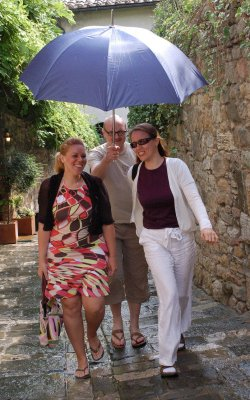
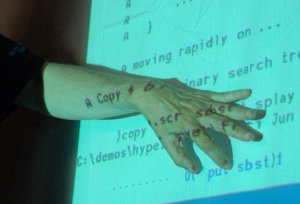

4-10 June 2007
{ .subtitle }

reported by Adrian Smith (adrian@apl385.com)
{ .byline }

## Acknowledgements

<figure class="right" markdown="1">

<figcaption markdown="span">San Quirico rain dogs</figcaption>
</figure>

Just a big thank-you to Paul Mansour for setting this up and inviting us out to experience Sienna and San Quirico d’Orcia. The atmosphere of the old Tuscan hill-top town was fantastic (we hit festival time), the culture was pretty impressive (Jet2 fly Leeds to Pisa, so guess how Richard & I travelled), and the food was really wonderful.

The great advantage of the ‘moot’ format is that everyone turns up with lots of interesting things to talk about, but there is *no programme* published ahead of time. The first morning was spent (after clearing away the breakfast and moving all the tables around) in deciding what was most interesting, and haggling over the order of play. This had the huge benefit that the later talks could be adjusted to respond to earlier ideas – Richard spent most of the second evening adding a couple of John Scholes’ language ideas to Rowan, so we could actually play with them 2 days later.

The layout ‘within the day’ was also a little radical and worked brilliantly. We went for a fairly early breakfast, cleared the tables and worked straight through (with regular breathers) to a deadline of a 3:00pm lunch. The restaurant was down 2 back lanes and around enough corners it felt like you had walked quite a way, and the lunch was so good we were probably still there at 4:30. Then it was ‘time off’ in the garden until the cool of the evening and our choice of evening meal. I think nearly all the time was well-spent, although my notes are vague to non-existent on the afternoon discussions.

## Clearing the Air on Unicode – *Morten Kromberg*

<figure class="left" markdown="1">

<figcaption markdown="span">San Quirico d’Orcia</figcaption>
</figure>

This was a very useful working introduction to Unicode, and an opportunity for Morten to air some of the knotty issues that Dyalog were beginning to trip over. For example the implications of having `⎕DR` report something other than `82` for character vectors was kicked about until we all understood the reasoning. Silly questions like “Which way to write Hebrew?” were debated, and the general view that these are *character vectors* in APL was felt to be defensible, so the answer is (phew) from left-to-right. What about allowing a lot more characters in assigned names? The unicode standard does suggest a reasonable subset here, so we could research these, but again the present collection of characters (Dyalog is quite permissive already – `Nestlé←123`) was thought to be good enough. Cyrillic and Greek are possible future extensions.

There were a couple of mapping issues at the ragged edge, for example the APL quote (I can't even show you one here) has no Unicode equivalent, but everyone in the room had long abandoned Ctrl+K in favour of the plain ASCII quote, so hopefully it is a non-issue. The underlined alphabet is a much knottier problem – there is no such thing in the Unicode standard! There is, however, a *circled* alphabet so the meeting wanted to explore the possibility of adding these glyphs into the APL385 font, and Adrian was sent off to the garden to play with FontLab. After some time, it became clear that trying to put an `A` into a circle and preserve the fixed-width of the character resulted in an unreadable and rather ugly blob. We agreed to leave this one aside until Minnowbrook (see later) where we knew Lee Dickey was coming, and Lee sat on the Unicode committees. When in doubt, consult the Oracle!

## Project Jasper – *Stefano Lanzavecchia*

“Suddenly, dynamic languages are cool!” was the theme of this rattle through something called [Jasper](http://blogs.msdn.com/aconrad/archive/2007/04/30/project-jasper.aspx), which is an attempt to wrap a database as a set of classes that are built for you on the fly. Essentially, it parses the entity-relationship diagram (implicit in your DataSet design) and creates classes on the fly to let you go digging around it, with all the stored procedures showing up as methods.

Hard to say how well the idea washed with the serious database techies present – there is a conflict at the core of the mapping process between the OO view of life (a hierarchy with inheritance) and the Relational view (a network with no fixed links). However, it set me running with some ideas that rapidly crystallised into a way to wrap Dyalog classes around Selections, which went through some very rapid prototyping and is written-up in full a few pages further on.

## Hyper-operators – *John Scholes*

> Higher-level operators in APL have been considered and rejected many times in the past … <span class="small">“Pure Functions in APL and J” – Ed Cherlin, APL91</span>

<figure class="right" markdown="1">

<figcaption markdown="span">Illumination on hand</figcaption>
</figure>

As you all know, the world is supported by four enormous elephants, which stand on the back of a great Turtle. As for what the Turtle stands on – what a dumb question “it’s Turtles all the way down …” of course.

John presented this material with greater than usual diffidence, clearly hoping that we would shoot it down in flames. He had even taken the trouble to paint some handy targets on it, and made sure to point them out!

**Watch out** Online readers please use IE7 (or later) or FireFox to read what follows. IE6 makes a total dog’s breakfast of it by substituting the line-draw characters with ones from another font, which don’t have the same width as the APL characters!

### John’s script, verbatim apart from formatting the HTML a bit

- If we proceed with caution we have a little freedom
- Paul’s Moot → Minnowbrook → Dyalog Conference → ???
- Why would I need something higher than an operator?
- Next in progression: function → operator → …
- Operators deal in functions, what deals in operators?

```
        ┌→───────────────────────────────────────┐
        │Food Chain: APL                         │
        │¯¯¯¯¯¯¯¯¯¯¯¯¯¯¯                         │
        │    ·      ·                            │
        │    '------HyperHyperators              │
        │    |      ↓                            │
        │    |      |                            │
        │    ↑      |                            │
        │    '------Hyperators                   │
        │    |      ↓                            │
        │    |      |                            │
        │    ↑      |                            │
        │    '------Operators                    │
        │    |      ↓                            │
        │    |      |                            │
        │    ↑      |                            │
        │    '------Functions                    │
        │    |      ⍒                            │
        │    |      |        Key: ↓ bind (curry).│
        │    ↑      |        ⍒ evaluate (reduce).│
        │    '------Arrays   ↑ are consumed by.  │
        │                                        │
        └────────────────────────────────────────┘

        ┌→────────────────────────────────────┐
        │|⎕⎕⎕⎕                                │
        │|⎕⎕⎕⎕                                │
        │|⎕⎕⎕⎕                                │
        │|⎕⎕⎕⎕   .--------------------------. │
        │|⎕⎕⎕⎕   |Prediction of sightings of| │
        │|⎕⎕⎕⎕   |various levels of function| │
        │|⎕⎕⎕⎕   '--------------------------' │
        │|⎕⎕⎕⎕                                │
        │|⎕⎕⎕⎕                                │
        │|⎕⎕⎕⎕                                │
        │|⎕⎕⎕⎕                                │
        │|⎕⎕⎕⎕                                │
        │|⎕⎕⎕⎕                                │
        │|⎕⎕⎕⎕                                │
        │|⎕⎕⎕⎕                                │
        │|⎕⎕⎕⎕    ⎕⎕⎕⎕                        │
        │|⎕⎕⎕⎕    ⎕⎕⎕⎕                        │
        │|⎕⎕⎕⎕    ⎕⎕⎕⎕    ____                │
        │+------------------------------------│
        │ Fns     Ops     Hype    HypeHype  ..│
        │                                     │
        └─────────────────────────────────────┘
```

Hyperators should bind left, like operators.

```
      ⍝ let:
      ⍝
      ⍝   1 2 3   be arrays,
      ⍝   + × ÷   be functions,
      ⍝   ∘ .     be operators,
      ⍝   X Y     be hyperators.

      ⍝ then:
      ⍝
      ⍝   1 × 2 + 3  →  1 × (2 + 3)   ⍝ fn-array binding
      ⍝   + . × ∘ ÷  →  (+ . ×) ∘ ÷   ⍝ op-fn binding
      ⍝   ∘ X . Y ∘  →  (∘ X .) Y ∘   ⍝ hype-op binding
```

An item of class `⍵` (>2) binds with its neighbour(s) of class &lt; `⍵` to derive an item of class `⍵-1`.

```
        ┌→──────────────────────────────────┐
        ↓                                   │
        │                      ⎕            │
        │        ⎕   ⎕       ⎕ ⎕ ⎕          │
        │      ⎕ ⎕ ⎕ ⎕ ⎕   ⎕ ⎕ ⎕ ⎕ ⎕   ⎕    │
        │    ⎕ ⎕ ⎕ ⎕ ⎕ ⎕ ⎕ ⎕ ⎕ ⎕ ⎕ ⎕ ⎕ ⎕ ⎕  │
        │    a f o f o f a f o h o f a f a  │
        ├──────────────────────────────────→┤
        │                                   │
        │                      ⍞            │
        │        ⍞   ⍞       ⎕ ⍞ ⎕          │
        │      ⎕ ⍞ ⎕ ⍞ ⎕   ⎕ ⎕ ⍞ ⎕ ⎕   ⍞    │
        │    ⎕ ⎕ ⍞ ⎕ ⍞ ⎕ ⎕ ⎕ ⎕ ⍞ ⎕ ⎕ ⎕ ⍞ ⎕  │
        │    a f o f o f a f o h o f a f a  │
        ├──────────────────────────────────→┤
        │                      ∧            │
        │        ∧   ∧       / ⍞ \          │
        │      / ⍞ \ ⍞ \     ⎕ ⍞ ⎕     ∧    │
        │      ⎕ ⍞ ⎕ ⍞ ⎕   ⎕ ⎕ ⍞ ⎕ ⎕ / ⍞ \  │
        │    ⎕ ⎕ ⍞ ⎕ ⍞ ⎕ ⎕ ⎕ ⎕ ⍞ ⎕ ⎕ ⎕ ⍞ ⎕  │
        │    a f o f o f a f o h o f a f a  │
        ├──────────────────────────────────→┤
        │                                   │
        │            ∧                      │
        │            ⍞ \       ⎕            │
        │      . ⎕ . ⍞ ⎕   ⎕ . ⎕ . ⎕        │
        │    ⎕ . ⎕ . ⍞ ⎕ ⎕ ⎕ . ⎕ . ⎕ . ⎕ .  │
        │    a   f   o f a f   o   f   a    │
        ├──────────────────────────────────→┤
        │                                   │
        │           ∧       ∧               │
        │         / ⍞ \   / ⍞ \             │
        │         ⎕ ⍞ ⎕   ⎕ ⍞ ⎕             │
        │       ⎕ ⎕ ⍞ ⎕ ⎕ ⎕ ⍞ ⎕ ⎕           │
        │       a f o f a f o f a           │
        ├──────────────────────────────────→┤
        │                                   │
        │                                   │
        │                                   │
        │         . ⎕ .   . ⎕ .             │
        │       ⎕ . ⎕ . ⎕ . ⎕ . ⎕           │
        │       a   f   a   f   a           │
        ├──────────────────────────────────→┤
        │                                   │
        │                                   │
        │                                   │
        │         ⎕   ⎕                     │
        │       ⎕ ⎕ ⎕ ⎕ ⎕                   │
        │       a f a f a                   │
        ├──────────────────────────────────→┤
        │                                   │
        │                                   │
        │         ∧   ∧                     │
        │       / ⍞ / ⍞ \                   │
        │       ⎕ ⍞ ⎕ ⍞ ⎕                   │
        │       a f a f a                   │
        ├──────────────────────────────────→┤
        │                                   │
        │                                   │
        │         ∧                         │
        │       / ⍞                         │
        │       ⎕ ⍞ . ⎕ .                   │
        │       a f   a                     │
        ├──────────────────────────────────→┤
        │                                   │
        │                                   │
        │         ∧                         │
        │       / ⍞ \                       │
        │       ⎕ ⍞ ⎕                       │
        │       a f a                       │
        ├──────────────────────────────────→┤
        │                                   │
        │                                   │
        │                                   │
        │                                   │
        │         ⎕                         │
        │         a                         │
        └──────────────────────────────────→┘
```

```
      ⍝  'hello' ∘ , 'world'
      ⍝  <--2--> 4 3 <--2-->
      ⍝  '---------'
      ⍝  ('hello' ∘ ,) 'world'
      ⍝  <-----3-----> <--2-->
      ⍝  '--------2----------'
```

The last step, the binding of a derived class-3 item with its neighbouring class-2 object(s) commissions an evaluation of the derived (class-3) function, to which all items in the binding hierarchy are exposed. For example, a dyadic function derived from a dyadic operator:

```
      ⍝     ∇ z ← l (f op g) r
      ⍝ [1]   ...

      ⍝ has access to left and right arguments and left and right operands.

      ⍝ "Header" syntax:

      ⍝   [0]  z ← a       d       g      ⍝ d is a dyadic function.
      ⍝   [0]  z ← a (b    d    f) g      ⍝   ..  ..  ..  operator.
      ⍝   [0]  z ← a (b (c d e) f) g      ⍝   ..  ..  ..  hyperator.

      ⍝ Dfns:

      ⍝   {
      ⍝       ⍺⍺⍺         ⍝ implies enclosing braces bound a monadic hyperator
      ⍝       ⍵⍵⍵         ⍝   ..      ..      ..      ..     dyadic  hyperator
      ⍝
      ⍝       ⍺ ⍵         ⍝ left and right arguments.
      ⍝       ⍺⍺ ⍵⍵       ⍝ left and right operands.
      ⍝       ⍺⍺⍺ ⍵⍵⍵     ⍝ left and right hyperands.
      ⍝       ∇∇∇         ⍝ hyperator self-ref.
      ⍝       ∇∇          ⍝ derived operator:      (⍺⍺⍺ ∇∇∇ ⍵⍵⍵)
      ⍝       ∇           ⍝ derived function:  (⍺⍺ (⍺⍺⍺ ∇∇∇ ⍵⍵⍵) ⍵⍵)
      ⍝   }
```

### Examples

```
      nwise
{           ⍝ N-wise reduction J.Brickman.
    d←⍴s←⍴⍵
    ⍺⍺/(,⍵)[((-⌽d↑⍺-1)↓s⍴⍳×/s)∘.+(⍳⍺)-⎕io]
}

      1 + nwise ⍳8
1 2 3 4 5 6 7 8
      2 + nwise ⍳8
3 5 7 9 11 13 15
      3 + nwise ⍳8
6 9 12 15 18 21
```

Let’s change / to \\ and see what happens …

```
      ⎕ed'nwise'
      1 + nwise ⍳8
1
2
3
4
5
6
7
8
           2 + nwise ⍳8
1  3
2  5
3  7
4  9
5 11
6 13
7 15
      3 + nwise ⍳8
1  3  6
2  5  9
3  7 12
4  9 15
5 11 18
6 13 21
      4 + nwise ⍳8
1  3  6 10
2  5  9 14
3  7 12 18
4  9 15 22
5 11 18 26
```

Ideally, we would like to pass / or \\ to nwise as a hyperand.

```
      987654321 ×nats 123456789       ⍝ product of large natural numbers
121932631112635269
      ×nats/⍳10*3                     ⍝ factorial 1000
402387260077093773543702433923003985719374864210714632543799910429938512
      398629020592044208398629020592044208486969404800479988610197196058
 …
      608292301353580818400969963725242305608559037006242712434169090041
      536901059339838357779394109700277534720000000000000000000000000000
      000000000000000000000000000000000000000000000000000000000000000000
      000000000000000000000000000000000000000000000000000000000000000000
      000000000000000000000000000000000000000000000000000000000000000000
      00000000000000000000000
      */2/2                           ⍝ 2*2
4
      */3/2                           ⍝ 2*2*2
16
      */4/2                           ⍝ 2*2*2*2
65536
      */5/2                           ⍝ 2*2*2*2*2     too big :-(
DOMAIN ERROR
      */5/2                           ⍝ 2*2*2*2*2     too big :-(
     ∧

      *nats/2/2                       ⍝ 2*2
 4
      *nats/3/2                       ⍝ 2*2*2
 16
      *nats/4/2                       ⍝ 2*2*2*2
 65536
      *nats/5/2                       ⍝ 2*2*2*2*2     not too big  :-)
 20035299304068464649790723515602557504478254755697514192650169737108940
      595563114530895061308809333481010382343429072631818229493821188126
 ...
      710326015571920237348580521128117458610065152598883843114511894880
      552129145775699146577530041384717124577965048175856395072895337539
      755822087777506072339445587895905719156736


      )copy dfns rats factors
C:\dfns\dfns saved Tue May 20 00:29:42 2008

      r34 ← 3 rats 4                  ⍝ rational 3r4
      r45 ← 4 rats 5                  ⍝   ..     4r5
      fmt←⍕rats                       ⍝ r-format

      fmt r34 +rats r45               ⍝ 3r4 + 4r5
31r20
      fmt r34 ×rats r45               ⍝ 3r4 × 4r5
3r5
      fmt r34 ÷rats r45               ⍝ 3r4 ÷ 4r5
15r16
```

nats and rats can cope with only *unsigned* arithmetic. <acronym title="wouldn't it be nice if…" class="smallcaps">WIBNI</acronym><sup><a href="#note1">\[1\]</a></sup> they could *share* a mechanism to do signed arithmetic:

```
      ⍝    123  - nats signed 456     ⍝ signed nats
      ⍝    r34  - rats signed r45     ⍝ signed rats
      ⍝ (    ⍺ ⍺⍺  ⍺⍺⍺    ∇∇∇   ⍵   )
```

Hyperator `signed` might look like this:

```
      ⍝   signed ← {
      ⍝       signs←'¯'=⊃∘⍕¨⍺ ⍵               ⍝ remember signs.
      ⍝       lft rgt←signs↓¨⍺ ⍵              ⍝ unsigned arguments.
      ⍝       fn ← ⍺⍺{fn←⍺⍺ ⋄ ⊃⎕cr'fn'}⍵      ⍝ fn operand.
      ⍝       '+'=fn: …    lft ⍺⍺ ⍺⍺⍺ rgt     ⍝ unsigned arith.
      ⍝       '-'=fn: …
      ⍝       …
      ⍝   }
```

Moving rapidly on … copy 4 binary search tree (BST) operators …

```
      'fmt'sbst (0('put'sbst)1)('put'sbst) 2              ⍝ simple BST insert
1=1.
   '2=2

      )copy dfns foldl
C:\dfns\dfns saved Tue May 20 00:29:42 2008

      'fmt'sbst 0('put'sbst)foldl 1 2                     ⍝ simple BST insert
1=1.
   '2=2

      'fmt'sbst     0 ('put'sbst    )foldl ⍳5             ⍝ simple BST insert
1=1.
   '2=2.
       '3=3.
           '4=4.
               '5=5

      'fmt'avl      0 ('put'avl     )foldl ⍳5             ⍝ avl tree insert
   .1=1
2=2|
   |    .3=3
   '>4=4|
        '5=5

      'fmt'redblack 0 ('put'redblack)foldl ⍳5             ⍝ redblack insert
           .[∘]
     .[1=1]|
     |     '[∘]
[2=2]|
     |           .[∘]
     |     .<3=3>|
     |     |     '[∘]
     '[4=4]|
           |     .[∘]
           '<5=5>|
                 '[∘]

      'fmt'splay    0 ('put'splay   )foldl ⍳5             ⍝ splay tree insert
1=1.
   '2=2.
       '3=3.
           '4=4.
               '5=5
```

<acronym class="smallcaps">WIBNI</acronym><sup><a href="#note1">\[1\]</a></sup> we could pass the tree operator as a parameter:

```
      try ← {'fmt'⍺⍺⍺ 0('put'⍺⍺⍺)foldl ⍵}         ⍝ ⍺⍺⍺ tree insert.

      ⍝        avl try ⍳5
      ⍝   redblack try ⍳5
      ⍝ and so on …
```

That’s all Folks!

## From Content to Web Layout – *Stephen Taylor*

> “This is worth a lot more, because there is a lot less of it.”

Generating a good web-site from a collection of text files is harder than it looks. What Stephen showed us was a very minimal bunch of Dfns which used all sorts of simple conventions in the file-names and the ability to embed simple APL code anywhere in the source material (such as `Copyright 2006 – {↑⎕TS}`) to make the construction process simple and easy to adapt. One day it may stabilise to the point where he can write it up for us!

## Wrap Up

<figure class="right" markdown="1">

<figcaption markdown="span">Ancient duck</figcaption>
</figure>

Yes, the Dyalog Duck has its origins in the 13th century!

Seriously, this was a good workout for everyone who came; we went away a good deal more bronzed and only a little more pickled in the local red wine. Morten made us all feel very unfit by cycling up most of the nearby mountains, while Richard & I earned several nutcase points by walking to the next town for the evening meal.

Several issues got explored with a lot more freedom than is possible in a formal conference setting, and I think the future of APL is just a little more secure as a result. Let’s do it again some time!

## Notes

1. <a id="note1"></a> <acronym class="smallcaps">WIBNI</acronym>: Wouldn’t it be nice if…?
