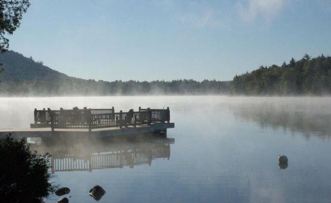
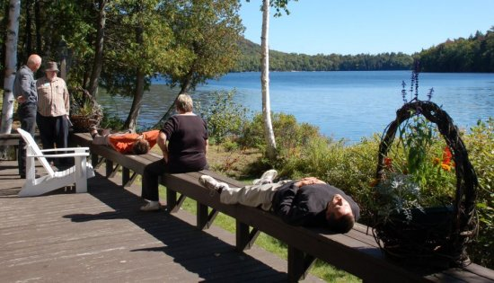
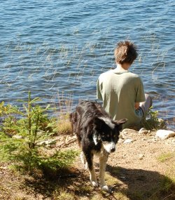
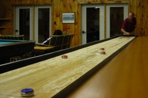
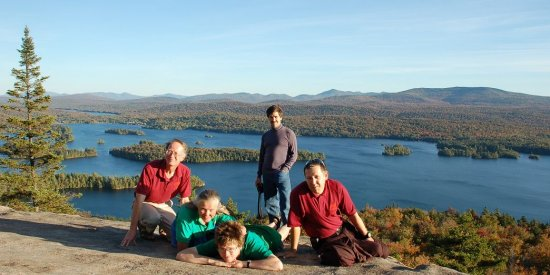

reported by Adrian Smith (adrian@apl385.com)
{ .byline }

## Acknowledgements

Minnowbrook was one of the great institutions of the APL world, which I never managed to get to. The idea was to bring together anyone who could lay claim to the term *implementor*, put them under a comfortable roof well away from the office, and get them to co-operate on new features and new ideas. Probably that is why almost everyone has `⎕FTIE` and `⎕FMT` and they basically behave in similar ways.

<figure markdown="1">

<figcaption markdown="span">Blue Mountain Lake</figcaption>
</figure>

The Minnowbrook Conference Center has long been an outpost of Syracuse University, and is set in a lovingly-rebuilt hunting lodge on Blue Mountain Lake in the Adirondacks. In the autumn, it is just a wonderful place to hang out, listen to the loons on the water and watch the maples turning gold before your very eyes. The WiFi network was accessible well out on the water, so it was possible to check your email while (if you were being sensible) someone else was paddling your canoe. Such places are always conducive to good thinking, and we have Roy Sykes to thank for reviving the Minnowbrook tradition with a speculative email early in the year, to which some twenty APL implementors replied in the affirmative. Here are a few of them unwinding after a heavy morning session in the classroom:

<figure markdown="1">

<figcaption markdown="span">Unwinding between sessions</figcaption>
</figure>

## What did we all learn?

It is hard to summarize the experience, as I am sure everyone came away with something different. For me, some of the highlights were:

- Joe Blaze (in the round table on marketing APL) admitting to some outstanding sales figures for their ‘lightweight array engine’ that forms the basis for APLNext. This is being sold at $50 per year through software clubs and forums, mostly in India. It made me think that we APL ‘insiders’ are probably aiming far too high and that a mass-appeal product needs to be much lighter and easier to get your brain around than any current APL.
- The total lack of supporting material on the Internet for anyone trying to start in APL. Maybe this is why you can succeed with a simple array engine, but not with a full APL environment?
- Sven Bodo-Schultz on his Single-Assignment C (SAC) project. See the [SAC-home on the Internet](http://www.sac-home.org/) for more background! This is a high-performance C compiler which is aimed specifically at exploiting parallel (multi-core) processors. Bob Bernecky has been targetting it with his APL->C translation tool for some while now, and is getting very promising results. From an APLer’s point of view, single-assignment dodges all the nasty problems with re-use of variables with different types. Every assignment gets a fresh name, and an immutable data-type. Problem solved!
- Dave Liebtag on Unicode. Dave tried *very hard* not to look superior as he pointed out that IBM has been fully Unicode for over 2 years now. They set the standard for the APL symbols in the first place, and they have also led the way in mapping APL functions to Unicode glyphs, where there is ambiguity. Fortunately, everyone else is now firmly in line astern. It was also agreed (thanks to Lee Dickey for being authoritative on this) that it was perfectly OK for APL to map out to the ‘circled alphabet’ with glyphs drawn as `ⒶⒷⒸⒹⒺ…Ⓩ` which makes a lot of pragmatic sense. Whether we should continue to use this alphabet in variable names is another matter, but it will take time to shake it out completely.
- Paul Mansour on FlipDB. This was a basic primer session on how to use his database, and a lot of the ideas made a great deal of common sense. If you want to know where he is coming from conceptually, I strongly recommend *Database in Depth* by C.J. Date (pub. O’Reilly) which I don’t always agree with but, like APL, it takes a solid theoretical model and sticks to it. Being able to navigate foreign-key trails with simple expressions like `SP[SNO].QTY` is a huge notational improvement on the traditional ‘join’ syntax, and adds power as well as clarity. Just as APL makes many programming challenges ‘trivial’ so FlipDB takes several of the ‘hard’ problems that often result in pages of dense SQL, and expresses them in one simple APL-like expression.
- Objects in Rowan were sketched out in the sessions (and no doubt on the canoe) and Richard implemented enough over the next few days in the cabin to have a working interpreter before we left the area. I’ll let him make sense of his notes here.

<figure class="left" markdown="1">

<figcaption markdown="span">Writing on the water</figcaption>
</figure>

The WiFi comfortably reached the shoreline, which made for some very cosy programming spots! Roy’s two dogs (notice the conference badge with her name on it) did a great job of shepherding us back indoors when the sessions were due to restart.

Other highlights were harder to pin down – listening to John Scholes and Bob Bernecky arguing strategies for memory management late into the night in the bar was one I remember, and of course mastering the ‘Minnowbrook Shuffle’ was high up the list for all of the delegates. For the uninitiated, *Shuffleboard* is a bit like table-curling. You skim a series of pucks down a sanded board, scoring for those which lie nearest the far end in a series of numbered beds. It got quite competitive after a few beers, with some very closely (and rather noisily) contested games.

<figure class="right" markdown="1">

<figcaption markdown="span">Vector dynamics</figcaption>
</figure>

You can see that the blue team has one just short of a high-scoring line, while the red team has been a lttle too conservative!

There was also a very good pool table, and lots of easy hill-walking straight out of the back door. I fear we missed out on the float-plane ride in favour of walking up Castle Rock, but it did spot us and give us a good wave with its wings as it went over!

<figure markdown="1">

<figcaption markdown="span">Adrian, Gill & Richard Smith with Dan Baronet and Morten Kromberg on Castle Rock, above Blue Mountain Lake.</figcaption>
</figure>

## Wrap-up

This felt to me like the kind of thing we should try to do every few years. The initial objective of synchronising APL developments is still extremely valid, as we all begin to make steps towards Classes and Objects, as well as interfacing to other languages (Java from APL2 and .Net from Dyalog and APLX). If we do move towards shipping some more lightweight array technology, agreement between the various APL providers will be very helpful in capturing the attention of the world’s programming community. The location was as good as it could be, so let’s hope to see it again before too long.
