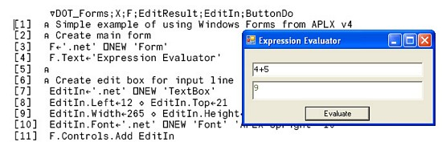
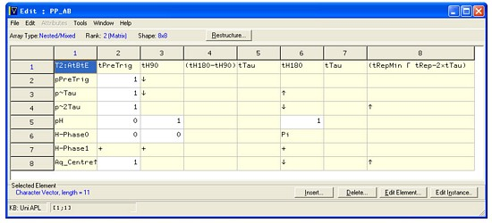
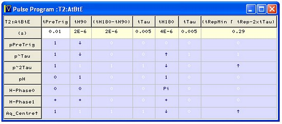
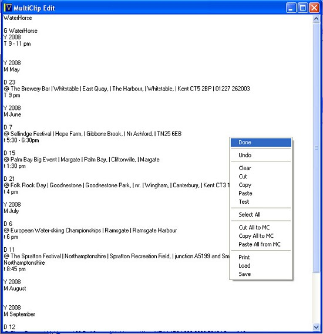
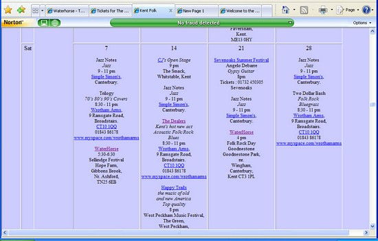
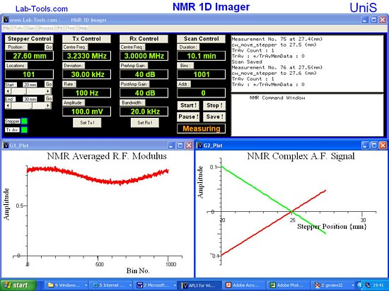

Dr Beau Webber, Lab-Tools Ltd  
[beau@lab-tools.co.uk](mailto:beau@lab-tools.co.uk)
{ .byline }

This article is discussed at  [comp.lang.apl](http://groups.google.com/group/comp.lang.apl/browse_thread/thread/11793b94e0a13faa/093430bc395ad31d#093430bc395ad31d)
{ .right }

## Which APL? Why APLX?

When I first read about APL in *Byte* magazine so many years ago (August 1980?), I realised it was *the* language for a working physicist, given its ability to apply complex manipulations to structures of data just by typing a few symbols. But in those days, having written my program in APL, I had to hand-translate it into <span class="smallcaps">Basic</span> to run it on a PDP-11. Then came APL\\11 on the VAX-750, as part of Unix – I upgraded our local copy, adding such features as Pipe<sup><a href="#ref1">\[1\]</a></sup>. The advent of APL68000, on the Atari ST, from MicroAPL, meant I could have a copy of APL running on the lab bench – as well as at home - and I applied it to everything from analysing Nuclear Magnetic Resonance (NMR) diffusion data to controlling the lights and sound for our village dramatics society.

I have used other versions of APL over the years, and have helped with the development of Tim Budd’s [APLc](http://home.earthlink.Net/~swsirlin/apl.html)<sup><a href="#ref2">\[2\]</a></sup> APL-to-C compiler, but have found that as the APL offerings from MicroAPL have developed over the years, this has been my favoured APL interpreter – and following that early use for sound and lighting control, APLX on PC has become my main software tool for control of my physics experiments.

National Instruments’ [LabVIEW](http://www.ni.com/labview/)<sup><a href="#ref3">\[3\]</a></sup> is a very powerful tool for instrument design – what is it about MicroAPL’s APLX, version 4 that now makes it, for me, the preferred design platform?

There are a number of answers to this, but above all, as I will demonstrate with particular examples from on-going projects, there is the ability to have a seamless join in a loop that goes from a screen-based front panel with buttons and drop-down menus, interacting with a number of asynchronously operating independent APL processes, some communicating over USB to firmware operating parallel hardware (at 100s of MHz) in gate-arrays that control the experiment and collect the data, which is then passed back over the USB to the APLX programs for analysis and adjustment of the instrumental parameters.

In addition, rather than

- hand-translating my APL source code to <span class="smallcaps">Basic</span> and <span class="smallcaps">Fortran</span>, as I did in the 1980s; or
- hand-translating (following writing and testing in APL) to LabVIEW VIs (visual/graphical programs), as I did in the 1990s; or
- translating to C using APLc (as I still sometimes do)

I can now apply them immediately to the experiment in hand, modifying them as needed to suit the data emerging from an experiment. Front-panels can be re-configured on-the-fly, to suit the needs of ‘soft-instruments’.

## New Features in APLX Version 4

Version 4 of APLX – currently 4.1.0 / 7.1 – is is major upgrade from the previous version 3.09. The document that comes with it has 108 pages summarising the changes, with examples, under the following main headings:

- Object-Oriented Programming in APLX v4
- Creating, editing, and modifying APL classes
- Using Internal (User-Defined) Classes
- Using External (.Net, Java, Ruby) Classes
- User-interface programming in .Net
- Using System Classes
- New System Functions for object-oriented programming
- System Method
- Other New System Functions
- Enhanced System Functions
- New System Commands
- Zilde
- New Structured-Control Error handling
- Enhancements to System Classes (Quad WI)
- Entering APL symbols using QuickSym
- User-interface enhancements

With so many upgrades in this new version, this must at best be a preliminary report, concentrating on those features that have been particularly relevant to the code I have been working on since this version was released just before last Christmas.

## Object-Oriented Programming

As can be seen, the biggest single development in this upgrade is to address a long-standing complaint against APL, in that it is said not to fit well with modern [Object-Oriented programming](http://en.wikipedia.org/wiki/Object_oriented) (OO) - at one stroke MicroAPL addresses this by adding OO syntax options to calls such as those for window creation and manipulation, as well as adding easy access to any OO programs installed on the same machine.

### Using External (.Net, Java, Ruby) Classes

Accessing the features of, say, .Net or Java is now vastly simplified:

**.Net**: Create an instance of the .Net `DateTime` class, defined in the .Net class libraries, but not specifying an initial date to the constructor of that class:

```
      NETDATE ← '.net' ⎕NEW 'System.Date.Time'
      NETDATE.ToString
0001-01-01 00:00:00
```

Here we see the zero date and time returned in ISO format, which is the preferred format on my machine.

**Java**:

```
      'java' ⎕CALL 'java.lang.Integer.toBinaryString' 37
100101
```

APLX has extensive built-in graphics ability, but with version 4 one can now also use Windows Forms directly from APLX:

<figure markdown="1">

<figcaption markdown="span">Figure 1. .Net graphics example, showing a section of the code in the update reference manual,<br>and running (a slightly modified version of) the code in the example files.</figcaption>
</figure>

## New system functions for object-oriented programming

APLX Version 4 includes the following new system functions to support object-oriented programming:

<table>
        	<tr><td class="code">⎕CALL</td><td>Call external static method</td></tr>
        	<tr><td class="code">⎕CLASS</td><td>Class hierarcy for object or class</td></tr>
        	<tr><td class="code">⎕CLASSES</td><td>References to user-defined and external classes</td></tr>
        	<tr><td class="code">⎕EVA</td><td>Event arguments</td></tr>
        	<tr><td class="code">⎕EVAL</td><td>Evaluate external expression</td></tr>
        	<tr><td class="code">⎕EVN</td><td>Event name</td></tr>
        	<tr><td class="code">⎕EVT</td><td>Event target</td></tr>
        	<tr><td class="code">⎕GETCLASS</td><td>Get reference to named class</td></tr>
        	<tr><td class="code">⎕IC</td><td>Insert into class</td></tr>
        	<tr><td class="code">⎕INSTANCES</td><td>Instances of a class or descendants</td></tr>
        	<tr><td class="code">⎕NEW</td><td>Create new instance of class</td></tr>
        	<tr><td class="code">⎕NULL</td><td>Return reference to null object</td></tr>
        	<tr><td class="code">⎕RECLASS</td><td>Change class of objects</td></tr>
        	<tr><td class="code">⎕REPARENT</td><td>Change parent of user-defined class</td></tr>
        	<tr><td class="code">⎕RECLASS</td><td>Set up external environment</td></tr>
        	<tr><td class="code">⎕THIS</td><td>Reference to current object</td></tr>
        </table>

As yet I have much work to do before I can fully apply this rich new capability.

## Other new system functions

<table>
        	<tr><td class="code">⎕EXPORT</td><td>Export APL array to file in specified format</td></tr>
        	<tr><td class="code">⎕IMPORT</td><td>Import data from file in specified format</td></tr>
        </table>

APLX has had the ability to exchange data with other software such as Excel for quite a while, but this has been extended with a range of other formats, including HTML.

This exchange can in fact be carried out by a number of mechanisms; see the section on the clipboard, at the end of this report, on enhancements to the user interface.

## User-interface enhancements

At this point I will take an item out of the above order, as it is a very significant one, that affects the way I create and manipulate data structures for my instrumentation:

### General Array Editor

> APLX Version 4 includes a powerful new General Array Editor. Subject to available memory, this allows you to edit almost any simple, mixed or nested APL array, the only limit being that the array cannot exceed five dimensions. You can edit any element and, if you wish, restructure it: for example, converting a numeric scalar element to a three-dimensional nested array. You can also restructure the whole array. The editor also supports editing arrays containing object references. (*APLX V4 Update Manual*)

What I have already found this so very useful for – in addition to just looking at the structures of data by just double-clicking on them – is to create complex data structures defining Nuclear Magnetic Resonance pulse sequences.

Given two nested lists, one defining pulse channel names, the other defining time-delays in terms of variables (that may later change on the fly), one creates an empty pulse-program skeleton, and then uses the General Array Editor to populate the significant transitions in the timing-structure:

```
 PP ← Channels pp_create PPnDelays;R;C
⍝
⍝ create a pulse program skeleton
⍝ given a list of Channel names and (Pulse Program Name + Delay time names)
```

<figure markdown="1">

<figcaption markdown="span">Figure 2. Creating an (90° – τ – 180° – τ – Echo) NMR Pulse Sequence with the General Array Editor.</figcaption>
</figure>

This is then evaluated, the remaining time-slots being filled in using the specified states and transitions in the default values. A facility closely related to the General Array Editor, the Grid tool, is used to display the result for checking, before the final stage of conversion to a binary pattern. This is then up-loaded over the USB to a stack-based sequencer implemented in an Altera gate-array module.

<figure markdown="1">

<figcaption markdown="span">Figure 3. First stage of compiling an (90° – τ – 180° – τ – Echo) NMR Pulse Sequence.</figcaption>
</figure>

The communication with the gate-array module is implemented by accessing the DLL routines that control the USB data transfer directly using APLX calls. This ability to talk directly to high-performance parallel-operating hardware over the USB is a major strength of APLX. This report ends with a further example of such instrumentation.

## Enhanced System Functions – string search and replace using regular expressions

A feature that I had requested has, with Version 4, been added to APLX – a built-in ability to employ Regular Expressions. Text is just a character array to APL, and while the standard APL search and replace function is very powerful when embedded inside APL’s array manipulation capabilities, the textual pattern-matching capabilities offered by ([Regular Expressions](http://en.wikipedia.org/wiki/Regular_Expressions)) (RE) can vastly simplify the specification of some tasks.

Up to now to use Regular Expression I have had to make calls on the Unix `sed` (stream-editor) and `grep` (global-recognition expression parser), using the shell `tcsh` in Cygwin. Now that RE parsing is built-in, I do not have to assume that Cygwin is installed, and I have the option of releasing some of these programs for more general use.

I am an avid fan of music, particularly good live music, and an example of such a program that makes extensive use of RE parsing is associated with [my music page](http://www.kentfolk.com)<sup><a href="#ref4">\[4\]</a></sup> that tells people about the live music in Kent. A program that I use regularly (but is still under development) makes use of APLX’s ability to access the web directly – I maintain a list of pointers to local musicians’ web pages, and (with their permission) read their gig-lists directly from their personal sites. There is then some fairly straightforward pattern matching to identify years, months and days, and ensure the dates found are in some sort of logical order. (One site lists months in reverse order, another puts archival gig photos with dates on the gig-listing page!) There is then what would, without REs, be some fairly lengthy code, that has to recognise any reasonable format of time of day (range) and then convert it to the format I use on my gig-listings.

The gig-listing page for the local Kentish group [Waterhorse](http://www.waterhorse.co.uk/)<sup><a href="#ref5">\[5\]</a></sup>, for instance, is shown in Figure 4. Note the pop-up box giving venue information for each event – this is correctly transfered by the gig reading program:

<figure markdown="1">

<figcaption markdown="span">Figure 4. Waterhorse gig-listing web page 2008-05-20</figcaption>
</figure>

Some bands bracket and hyphen one or both of dialling code and event times. As an example of RE pattern matching and replacement, the recognition and interpretation of bracketed event times is simplified if we first recognise and un-bracket these bracketed telephone numbers; as an example RE for this we can use:

```
      Txt←'Some text (01227) 123456 and (yet) more text'
      Mtch←'(^.*)( [( ]*)(0\d{3,7})([ )-]*)(\d{4,7})( *.*$)'
      Rplc←'\1 \3 \5 \6'
      2 16 ⎕SS Txt Mtch Rplc
Some text 01227 123456  and (yet) more text.
```

By combining the strengths of APL to manipulate arrays of text with that of Regular Expressions to define compact transformational expressions, we may use the web-aware facilities of APLX to access the gig-listing page directly from the above musicians and drop the transformed contents into an editor for checking and manual editing if necessary. (None was in this case). Figure 5 shows this gig calendar in raw KentFolk EventTable format – note the user defined pop-up menu:

<figure markdown="1">

<figcaption markdown="span">Figure 5. An editable gig-list in KentFolk raw EventTable format,<br>automatically transformed from the above Waterhorse web page, as of 2008-05-20.</figcaption>
</figure>

Currently I then use a hand-written HTML output stage to generate the KentFolk music calendar (by accessing various look-up tables) which is then uploaded to the server using further APLX commands. Now however APLX version 4 has added a native ability to transform text and tables into HTML, which should greatly simplify such a process. Currently the upload to the server is done via calls on FTP, but the new ability with APLX version 4 to access Microsoft .Net protocols directly should give both greater versatility and greater security for applications that need it.

A small section of a relevant KentFolk calendar page for June 2008 then looks like:

<figure markdown="1">

<figcaption markdown="span">Figure 6. KentFolk web calendar for June 2008, showing the transformed gig information for Waterhorse</figcaption>
</figure>

The regular-expression search engine used in APLX is based on version 7.1 of [Perl Compatible Regular Expressions (PCRE)](http://www.pcre.org/)<sup><a href="#ref6">\[6\]</a></sup>, an open-source product written by Philip Hazel, who did many good things in his time at the University of Cambridge.

## User-interface enhancements

I am still working my way through all the many enhancements, but one I have found useful in the preparation of this report is the ability to export to HTML. There is more than one way to do it, but what I have been doing is just using the Windows clipboard.

If one just copies a section of the contents of the APLX working window and, say, pastes it into a font-aware program, such as MS Word, one gets a copy with the APLX Upright font, with colours; however if one tries exporting this from MS Word as filtered HTML one sees (viewing the text in the `Vi` or `Vim` editor) one has characters that will be undefined if one does not have the APLX Upright font installed:

```
<p class=MsoNormal style='text-autospace:none'><span style='font-size:10.0pt;
font-family:"APLX Upright";color:blue'>       Txt ← 'Some text (01227) 123456
and (yet) more text.' </span></p>

<p class=MsoNormal style='text-autospace:none'><span style='font-size:10.0pt;
font-family:"APLX Upright";color:blue'>         ,Txt ← 2 16 ⎕SS Txt '(^.*)( [
( ]*)(0\d{3,7})([ )-]*)(\d{4,7})( *.*$)' '\1 \3 \5 \6'</span></p>

<p class=MsoNormal style='text-autospace:none'><span style='font-size:10.0pt;
font-family:"APLX Upright";color:black'>Some text 01227 123456 and (yet)
more text.</span></p>
```

If however one copies the contents of the clipboard explicitly as follows, one gets a copy on the clipboard that has been converted to HTML:

```
      '⎕' ⎕wi 'contents' ('⎕' ⎕wi 'text')
```

In particular one now gets a copy that uses the APL385 Unicode font, as is specified for these *Vector* articles:

```
<p>Txt &#8592; 'Some text (01227) 123456 and (yet) more text.' <br>
,Txt &#8592; 2 16 <span style='font-family:"APL385 Unicode"'>&#9109;</span>SS
Txt '(^.*)( [( ]*)(0\d{3,7})([ )-]*)(\d{4,7})( *.*$)' '\1 \3 \5 \6' <br>
Some text 01227 123456 and (yet) more text.</p>
```

This works *both* ways – one can copy the HTML of the APLX example code here, and paste it back into APLX v4 and then run it.

## Using APLX v4 for controlling instrumentation and collecting data

This is just an example of how one can apply APLX as the heart of an advanced set of instrumentation – hopefully a full discussion will come later – however the advantages of having a powerful array-manipulating language like APL intimately connected over the USB to gate arrays with parallel circuitry running at 100s of Megahertz can not be overestimated.

The easy configuration of on-screen menus, interactive text and other entry boxes, as well as buttons and ‘LEDs’, allow rapid creation of software-based front-panels – as well as on-the-fly reconfiguration of the front-panel at run time for ‘soft-instruments’. Direct access to .Net graphical objects will aid porting/interfacing non-APL instrumentation designs to APLX.

Here is one particular piece of kit, a one-dimensional NMR imager using novel technology, created by Lab-Tools for the University of Surrey Physics Department. The Radio Frequency (RF) stages were implemented in off-the-shelf modules using ASICS, the Intermediate Frequency (IF) signal processing and data capturing/averaging stages implemented in the gate-array as firmware, and the Audio Frequency (AF) and base-band signal processing and data fitting implemented in APL in the host processor (a lap-top, for field-portability):

<figure markdown="1">

<figcaption markdown="span">Figure 7. APL interface to gate-array controlled NMR 1D imager.</figcaption>
</figure>

<figure markdown="1">

<figcaption markdown="span">Figure 8. NMR hardware, for gate-array controlled NMR 1D imager.</figcaption>
</figure>

## And so what use have I made of APL, and APLX in particular?

All I can say is: go see my published papers.<sup><a href="#ref7">\[7\]</a></sup> I would not have been able to do a fraction of this research without APL to help me.

## References

1. <a id="ref1"></a> “A Pipe has two ends. Using APL in a multiprocess/multiprocessor environment. A proposal for a flexible but easy to use syntax.” J.B. Webber *APL Quad Quote* <strong>20</strong>(1), pp1-2, Sept 1989 (The proposal and implementation of a software mechanism now used by IBM.)  [http://doi.acm.org/10.1145/379199.379200](http://doi.acm.org/10.1145/379199.379200)
2. <a id="ref2"></a> APLc:  [http://home.earthlink.Net/~swsirlin/apl.html](http://home.earthlink.Net/~swsirlin/apl.html)
3. <a id="ref3"></a> LabVIEW:  [http://www.ni.com/labview/](http://www.ni.com/labview/)
4. <a id="ref4"></a> KentFolk:  [http://www.kentfolk.com](http://www.kentfolk.com)
5. <a id="ref5"></a> Waterhorse:  [http://www.waterhorse.co.uk/](http://www.waterhorse.co.uk/)
6. <a id="ref6"></a> Perl Compatible Regular Expressions (PCRE):  [http://www.pcre.org/](http://www.pcre.org/)
7. <a id="ref7"></a>  [www.kent.ac.uk/physical-sciences/publications/jbww.html](http://www.kent.ac.uk/physical-sciences/publications/jbww.html)
