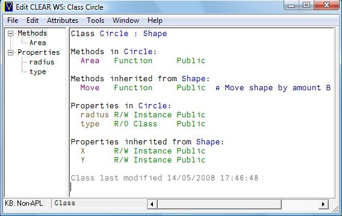
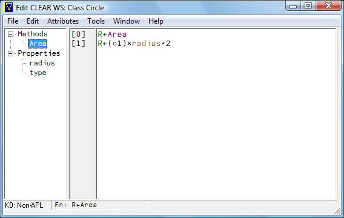

Simon Marsden, MicroAPL Ltd  
[microapl@microapl.co.uk](mailto:microapl@microapl.co.uk)
{ .byline }

### Introduction

APLX Version 4 adds object-oriented programming facilities to APLX’s core APL2-compatible language. These facilities are broadly similar to those implemented in other object-oriented programming languages (such as C++, C#, Java, or Ruby), but with the difference that APL’s array-programming approach applies to classes and objects in the same way as it applies to ordinary data. In addition, the APLX implementation is fully dynamic, that is to say classes and objects can be changed at run-time or when debugging.

Classes can be written in APL, or they can be written in other languages (such as C#), or they can be built-in to the APLX interpreter as System Classes (analogous to the familiar System Functions). In this tutorial, we’ll focus on classes written in APL. (If you want to try out the tutorial yourself, you can download a demonstration version of APLX Version 4 from [http://www.microapl.co.uk/apl](http://www.microapl.co.uk/apl).

### Jargon

The fundamental building block for object-oriented programming is the *class*. For example, in a commercial invoicing application, a given class might represent the attributes and behaviour of an invoice, and another class might represent a credit note. In an application concerned with geometry, a class might represent a sphere, or a rectangle, or a polygon. A class contains definitions both for program logic (functions and operators, known collectively as the *methods* of the class), and for data (named variables associated with the class, known as *properties*). The term *members* is used to describe both the properties and methods of a class.

In most cases, when you come to use a class, you need to create an *instance* of that class, also known as an *object*. Whereas the class represents an abstraction of (say) an Invoice, or a Sphere, or a Rectangle, an object represents a particular invoice, sphere or rectangle. Typically, you may have many instances of a given class, each containing independent copies of data (*properties*), but all supporting the same program logic (*methods*).

### Getting Started

To make this clearer, let’s use an example of a class representing a circle. To keep things simple initially, we will give the `Circle` class a single property representing the radius of the circle.

There are a number of ways to create the `Circle` class, but for now just we’ll start with a `CLEAR WS` and enter the following APL line, which creates a class and inserts a property called ‘radius’ into it:

```
      'Circle' ⎕IC 'radius'
```

This has created a new class, which we can see by using the `)CLASSES` system command, which is analogous to `)FNS` and `)VARS`:

```
      )CLASSES
Circle
```

To create an instance of the `Circle` class, you typically use the `⎕NEW` system function:

```
      FirstCircle←⎕NEW Circle
```

This has created a new instance (object) and assigned a reference to it in the variable `FirstCircle`:

```
      )VARS
FirstCircle
```

If you try to inspect the new object, APL will display it in the following format by default. Note that (unless you change the default display), the object is displayed by showing its class name in square brackets.

```
      FirstCircle
[Circle]
```

Now let’s assign a value to the new `Circle` object’s radius:

```
      FirstCircle.radius←10
      FirstCircle.radius
10
```

Note the *dot-notation* used to specify the object and property being assigned. Except that it’s a member of the object `FirstCircle`, the radius property behaves like any other APL variable:

```
      ⍳ FirstCircle.radius
1 2 3 4 5 6 7 8 9 10
      FirstCircle.radius=20
0
```

We can also create a vector containing five different circles:

```
      CircleList←⎕NEW ¨5⍴Circle
      CircleList
[Circle] [Circle] [Circle] [Circle] [Circle]
```

It is possible to set the radii of all of the circles in the same statement:

```
      CircleList.radius←10 50 20 30 20
      CircleList.radius
10 50 20 30 20
      CircleList.radius=20
0 0 1 0 1
```

Notice that APLX lists the radius values for all five circles in a single vector, which can be used in expressions.

We could also specify all the radii using a single scalar, in which case the scalar is assigned to the radius property in each object using scalar extension:

```
      CircleList.radius←20
      CircleList.radius
20 20 20 20 20
```

You cannot access a property if it does not exist in the class definition. For example:

```
      FirstCircle.Colour←'Red'
VALUE ERROR
      FirstCircle.Colour←'Red'
      ^
```

To add a new property it is necessary to modify the class definition, which we will cover in more detail later.

Now let’s add a method called `Area` to our `Circle` class. Again, there are many ways of editing classes in APLX, but for now you can use the following:

```
      )EDIT Circle.Area
```

Use the editor window to create the following method:

```
      ∇R←Area
  [1] R←(○1)×radius*2
      ∇
```

(You do not enter the `∇` characters or line number when using the editor window).

We can now call our new method using the following notation. (Notice that the new method can be applied to existing objects - try doing that in Java!)

```
      FirstCircle.Area
314.1592654
```

Within the method, the object’s radius can be referred to directly as just `radius`, without using dot notation. APL knows that the `Area` method has been called for the object `FirstCircle`, and hence uses the radius value contained in the object.

Again, if you have an array of objects you can apply the same method to each one.

```
      CircleList.radius←10 50 20 30 20
      CircleList.Area
314.1592654 7853.981634 1256.637061 2827.433388 1256.637061
```

Internally, APL will call the `Area` method on each of the objects in turn, in the order in which they occur in the object list.

It is also possible to have vectors containing references to objects of different classes. Suppose that we have a new class called `Square`, in addition to our `Circle` class, and that `Square` also has a class method called `Area`:

```
      FirstSquare←⎕NEW 'Square'
      ShapeList ← FirstCircle,FirstSquare
      ShapeList
[Circle] [Square]
      ShapeList.Area
314.1592654 100
```

Note that there is not necessarily any relationship between the `Area` methods in the `Circle` and `Square` classes.

What would happen if we create a new `Circle` object and immediately try to display its `radius` property?

```
      AnotherCircle←⎕NEW Circle
      AnotherCircle.radius
VALUE ERROR
      AnotherCircle.radius
      ^
```

Because the radius property of the new object has not been assigned, we get a `VALUE ERROR`; the new object is incomplete. Is there some way we can ensure that only completely-built objects are created by `⎕NEW`?

One way in which this can be done is to add a new class method called a *Constructor*. This is an APL method which has the same name as the class. The APL interpreter will call the constructor method automatically when a new object is created.

The Constructor for the Circle class might look something like this:

```
      ∇Circle R
  [1] radius←R
      ∇
```

*Note:* We haven’t worried too much yet about how to edit APL classes. APLX has a powerful class editor, which is what you would use in practice. For now, if you want to experiment with adding this constructor to your class, try:

```
      )EDIT Circle.Circle
```

The constructor method we added takes a right argument, which is the initial value of the new circle object’s radius. To create the circle, the value is passed as an argument to `⎕NEW`:

```
      AnotherCircle←⎕NEW Circle 100
      AnotherCircle.radius
100
```

In some object-oriented languages, constructors are the only way of assigning initial values to properties. In APLX, it is also possible to specify the default value of any properties in the class definition. Instead of using a constructor, we could have changed our Circle class to specify that the radius property of all new Circle objects should have an initial value of 10. This is discussed further in the section *Types of Property* below.

### System Methods

As well as user-defined methods like `Area` above, each object/class can make use of a number of *system methods*. There are around a dozen of these, but for now we will just note two. The system method `⎕CLASSNAME` returns the name of an object’s class as a character vector:

```
      FirstCircle.⎕CLASSNAME
Circle
```

The system method `⎕NL` can be used to discover the names of the methods and properties in a class (or an instance of that class):

```
      Circle.⎕NL 3
Area
      FirstCircle.⎕NL 2
radius
```

### Inheritance

Suppose that we wanted to re-write our example to handle two types of shape, circles and squares.

One way to do this would be to use a general class called `Shape`. We could add a property which specified the type of shape (0 for `Circle`, 1 for `Square`), and we could add an `Area` method, something like this:

```
    ∇R←Area
[1] :If type=0
[2]    ⍝ Circle
[3]    R←(○1)×radius*2
[4] :Else
[5]    ⍝ Square
[6]    R←sidelength*2
[7] :EndIf
    ∇
```

However, in object-oriented APL there is a much more elegant way to do this, by using *Inheritance*.

When you define a class, you can specify that it *inherits* from another class. The new class is said to be the *child*, and the class it inherits from is the *parent* or *base* class. Inheritance means that (unless you explicitly change their definition), all of the properties and methods defined in the parent class are also available in the child class. This works for further levels of inheritance as well, so that methods and properties can be inherited from the immediate parent, or from the parent’s parent, and so on. The terms *derived classes* or *descendants* are sometimes used to denote the children of a class, and the children’s children, and so on. Similarly, the term *ancestors* of a class is used to denote the parent, parent’s parent, and so on.

So you might have a class `Shape`, representing an abstract geometric shape. This might have properties called `X` and `Y` giving the centre point of the shape, and methods called `Move` and `Area`.

A `Circle` class might inherit from `Shape`, introducing further properties such as `radius`. Equally, a class `Polygon` might also inherit from `Shape`, and further classes `Triangle` and `Square` inherit from `Polygon`. All of the classes `Circle`, `Polygon`, `Triangle` and `Square` are *derived* from `Shape`. Because of the way inheritance works, they would all include the properties `X` and `Y`, and the methods `Move` and `Area`.

When a class inherits from another, you can specify that the definition of a given method of the parent (or the initial value of a property) is different in the child class. In our example, you would need to supply a different definition of the `Area` method for a `Circle` and a `Square`. This is known as *overriding* the method.

Definition of the `Area` method in the `Circle` class:

```
    ∇R←Area
[1] R←(○1)×radius*2
    ∇
```

Definition of the `Area` method in the `Square` class:

```
    ∇R←Area
[1] R←sidelength*2
    ∇
```

For classes defined in APLX, all methods can be overridden, and all methods are *virtual*, that is to say if method `A` in a base class calls another method `B`, and the second method `B` is overridden in a child class, then running method `A` in the child class will cause the overridden version of `B` to be called, not the version of `B` defined in the parent. For example, if you are running a method defined in the base class `Shape`, and that method calls `Area`, the version of `Area` which gets called will be `Circle.Area` or `Square.Area` as appropriate.

APLX uses an inheritance model known as *single inheritance*. This means that a child class can be derived from only one parent (which may itself derive from another class, and so on).

### Object References and Class References

When you create an object, i.e. an instance of a class (using the system function `⎕NEW`), the explicit result that is returned is not the object itself, but a *reference* to the object. This reference is held internally as just an index into a table of objects which APLX maintains in the workspace. If you assign the reference to another variable, the object itself is not copied; instead, you have two references to the same object. This is discussed in more detail below.

Of course, because APL is an array language, you can have arrays of object references, and you can embed object references in nested arrays along with other data. For example, you might have an array containing references to hundreds of `Rectangle` objects.

You can also have a reference to a class. This makes it possible for general functions to act on classes without knowing in advance which class applies.

### The Null object

As its name implies, the *Null object* is a special case of an object, which has no properties and no methods of its own (although System methods may apply to it). A reference to the Null object displays in the special form:

```
[NULL OBJECT]
```

A reference to the Null object can arise for a number of different reasons:

If you have an array of object references, the prototype of the array is a reference to the Null object. For example:

```
      VEC←⎕NEW ¨Rectangle Sphere Triangle
      VEC
[Rectangle] [Sphere] [Triangle]
      1↑3↓VEC
[NULL OBJECT]
```

An external call or System method may return a Null object, for example if you are looping through a linked list of objects and reach the last one. And APLX may be forced to set an object reference to Null, because it is no longer valid. For example, this will happen if you `)SAVE` a workspace which contains a reference to an external object (e.g. a Java or .NET object). On re-loading the workspace at a later date, the object reference is no longer valid since the external object no longer exists.

### Types of Property

When you define a class, you specify the names of the properties of that class, which can be used to hold data associated with the class. You can optionally specify a *default value* for the property, that is the value which the property will have in a newly-created instance of the class. You can also specify that the property is *read-only*, which means it is not possible to assign a new value to it.

Most properties are *instance properties*, which means that each instance of the class has a separate copy of the property (for example, the X- and Y-position of a `Shape`). Occasionally, however, it is useful to define a *class-wide property* (known in some other languages as a *static* or *shared* property). This is a property where there is a single copy of the data, shared between all instances. This is useful for cases such as keeping a unique incrementing serial number (the next invoice number, for example), or to define a constant (such as a text string to appear on all invoices) for all members of the class.

*Implementation note:* APLX uses a ‘create-on-write’ approach when you assign to an instance property. This means that, if you have never changed the value of a property for a particular instance since the instance was first created, the value which is returned when you read the property is the default value stored in the class definition. Thus, if you change the class definition so that the property has a different default value, the change will immediately be reflected in all instances of the class, unless the property has been modified for that instance.

### Name scope, and Public versus Private members

The members of a class (i.e its properties and methods) can be either *public* or *private*. Public members can be accessed from outside the class, whereas private members can only be accessed from within methods defined in the class (or from desk calculator mode, if a method has been interrupted because of an error or interrupt and the method is on the `)SI` stack). Private members can also be accessed by methods defined in a child (derived) class. If you are familiar with other object- oriented languages such as C++ or Visual Basic, this means that private methods in APLX correspond to ‘protected’ methods in those languages.

Methods and properties are, by default, public, just as in conventional APL variables referenced in a function are global. (You can make them private by using the class editor, or localising them in the class header using the del editor.)

If you want to access a public member of an object from outside the class (i.e. not within a method of the class), then you use *dot notation* to refer to it. This takes the form `ObjectReference.MemberName`. For example, suppose you have a variable `myrect` which is a reference to an object of class `Rectangle`. You could call the `Move` method and access the `X` and `Y` properties for that object as follows:

```
      myrect.X←45
      myrect.Y←78
      myrect.Move 17 6
      myrect.X
62
      myrect.Y
84
```

Within the methods of the class itself, you don’t normally need to use dot notation. This is because the search order for symbols encountered when executing a method is as follows:

1. First, APLX looks to see if the symbol refers to a member defined in the class of the object.
2. If not, it looks to see if the member is defined in the parent class (if any), iterating through each of the ancestors in turn.
3. If it is not found in any of the ancestors, it then looks in the local variables of the method.
4. Finally, it looks in the global symbol table.

Thus, a simple implementation of the `Move` method above (defined in the `Shape` class from which `Rectangle` derives) might be something like this:

```
   ∇ Move B
[1]  ⍝ Move shape by amount B specified as change to X, Y
[2]  (X Y)←(X,Y)+B
   ∇
```

### Canonical Representation of a Class

The canonical (text) representation of a class is returned by `⎕CR`, in exactly the same way as applies to ordinary APL functions and operators. The first line is the class header. This comprises the name of the class, followed (if the class inherits from another class) by a colon and the name of the parent class. Any private members of the class (i.e. names which are local to the class) are then listed, separated by semi-colons. The header line ends with a left curly brace `{` character.

The properties of the class are then listed, one per line. The name of the property is listed first. If it has a default value, an assignment arrow follows, and then the transfer form of the expression which initializes the property. If the property is read-only, two assignment arrows are used. If the property is class-wide (i.e. there is only a single copy shared between all instances in the workspace), then the whole line is enclosed in curly braces.

Any methods then follow, delimited by del characters, and a closing right curly brace ends the definition.

For example:

```
      ⎕CR 'Circle'
Circle : Shape {
radius
{type←←'circle'}

∇R←Area
R←(○1)×radius*2
∇
}
```

As you would expect, `⎕FX` can be used to turn the text form into a class definition in the workspace. In practice, though, you’ll normally tend to use the APLX Class Editor, which shows the class as a whole:

<figure markdown="1">

<figcaption markdown="span">APLX Class Editor</figcaption>
</figure>

… or allows you to edit a specific method or property:

<figure markdown="1">

<figcaption markdown="span">Method Editor</figcaption>
</figure>

You can also use the del editor, or you can edit individual methods or properties directly.

### Constructors

As we saw earlier, a *constructor* is a special type of method, which is run automatically when an instance of a class is created using `⎕NEW`. It can be used to initialize the object, optionally using parameters passed to `⎕NEW`. For example, you might use this mechanism to specify the initial position of a `Rectangle` object.

For a user-defined class, a constructor is defined as a method which takes a right argument, and which has the same name as the class itself. Any arguments to the constructor can be provided as extra elements on the right argument of `⎕NEW`. When the constructor is run, these extra elements are passed as the right argument to the constructor. If there are no extra elements, an empty vector is passed as the right argument to the constructor.

For example, suppose the class `Invoice` looks like this:

```
Invoice {
  TimeStamp
  Account
  InvNumber
  {Serial←0}

 ∇Invoice B
  ⍝ Constructor for class Invoice.  B is the account number
  Account←B
  TimeStamp←⎕TS
  Serial←Serial+1
  InvNumber←Serial
 ∇
}
```

This is a class which has a constructor and four properties. One of the properties (`Serial`) is a class-wide property, which means it has only a single value shared between all instances of the class.

When a new instance of this class is created, the constructor will be run. It will store the account number (passed as an argument to `⎕NEW`) in the property `Account`, and store the current time stamp in the property `TimeStamp`. It will then increment the class-wide property `Serial` (common to all instances of this class), and store the result in the property `InvNumber`. To see the properties, we can use the system method `⎕DS` which summarizes the property values:

```
      S←⎕NEW Invoice 23533
      S.⎕DS
Account=23533, TimeStamp=2007 10 11 15 47 34 848, InvNumber=1
      T←⎕NEW Invoice 67544
      T.⎕DS
Account=67544, TimeStamp=2007 10 11 15 48 11 773, InvNumber=2
```

Where a class inherits from another class, the constructor which gets run automatically is that of the class itself (if it has a constructor), or of the first ancestor class which has a constructor. Normally, in a constructor, you will want to do some initialization specific to the class itself, and also call the constructor of the parent class (using `⎕PARENT`) to do any initialization which it and its ancestors require. You can do this at any point in the constructor; there is no restriction on where you make this call to the parent’s constructor; indeed, you don’t have to call it at all if it is not appropriate.

In APLX, a constructor is also a perfectly ordinary method; it can be called in the normal way by one of the other methods in the class, or from outside (if it declared as Public). This can be useful for re- initializing an object.

Some object-oriented languages also include a special method called a *destructor*, which is called just before the object is deleted. APLX user-defined classes do not have destructors. This means that, if you need to release system resources (for example, close a file or a database connection), you need to call a method to do that explicitly before erasing the last reference to the internal object. However, APLX will automatically take care of deleting all the properties of the object, and releasing the memory back to the workspace.

### Creating objects (instances of classes)

As we have seen, the system function `⎕NEW` is the principal means by which you create an object, i.e. an instance of a class. The class can be either written in APL (an *internal* or *user-defined* class), or a built-in System class, or a class written in an external environment such as .Net, Java or Ruby (an *external* class). `⎕NEW` creates a new instance of the class, runs any constructor defined for the class, and returns a reference to the new object as its explicit result.

The class is specified as the right argument (or first element of the right argument). It can be specified either as a class reference, or as a class name (i.e. a character vector). Any parameters to be passed to the *constructor* of the class (the method which is run automatically when a class is created) follow the class name or reference.

If you specify the class by name, you also need to identify in the left argument the environment where the class exists, unless it is internal.

### Creating instances of internal (user-defined) classes

Normally, you create an instance of a user-defined class by passing the class reference directly as the right argument (or first element of the right argument). For example, if you have a class called `Invoice`, you can create an instance of it by entering:

```
      I←⎕NEW Invoice
```

What is really happening here is that the symbol `Invoice` refers to the class definition, and when it is used in this way, it returns a *reference to the class*.

Note that you can also pass the class name rather than a class reference. The following are alternative ways of creating an instance of a user-defined class:

```
      I←⎕NEW 'Invoice'
      I←'apl' ⎕NEW 'Invoice'
```

Why do we need this alternative syntax? The reason is that you can specify an external class name (i.e. a class written in a different language, and existing outside the workspace). For this case, the left argument specifies the external environment, and the right argument the class name. For example:

```
      JAVADATE←'java' ⎕NEW 'java.util.Date'
```

We won’t discuss external classes any further here - that is a whole subject in itself!

### Object references and object lifetimes

When you use `⎕NEW` to create a new object, that object persists until there are no more references to it in the workspace. It is then deleted immediately, if it is an internal or system object. If it is an external object, such as an instance of a .Net class, the fact that there are no more references to it in the APL workspace means that it available for deletion by the external environment (unless the external environment itself has further references to the same object). However, in typical external environments such as .Net, Java and Ruby, the actual deletion of the object may not occur until later.

Consider this sequence, where we create an instance of an APLX class called `Philosopher` which has a property `Name`:

```
      A←⎕NEW Philosopher
      A.Name←'Aristotle'
```

At this point, we have created a new instance of the class, and we have a single reference to it, in the variable `A`. We now copy the *reference* (not the object itself) to a variable `B`:

```
      B←A
      B.Name
Aristotle
```

We now have two references to the same object. So if we change a property of the object, the change is visible through either reference - they refer to the same thing:

```
      B.Name←'Socrates'
      A.Name
Socrates
```

Now we erase one of the references:

```
      )ERASE A
```

We still have a second reference to the object. The object will persist until we delete the last reference to it:

```
      B.Name
Socrates
      )ERASE B
```

At this point, there are no more references to the object left in the workspace, and the object itself is deleted.

It follows from this that, if you use `⎕NEW` to create an object, and do not assign the result to a variable, it will immediately be deleted again.

### Using Classes without Instances

So far in this tutorial, we have concentrated on using objects as instances of classes. However, classes can also be very useful in their own right, without the need to make instances of them. There are two major reasons why you might want to define a class which can be used directly: defining constants, and keeping a namespace tidy.

#### Defining a set of constants

If you define a class with a set of read-only properties, those properties can be used as a set of constant values or ‘enumerations’. For example, you might have a class called Messages, which holds all the messages which your application displays to the user:

```
Messages {
OutOfMemory←←'There is not enough memory to continue'
AskModelName←←'Enter the name of the model'
OpComplete←←'Operation Complete'
AskReset←←'Do you want to reset the model?'
…etc
}
```

You can then use this class in your application (without having to make an instance of it) to encapsulate all the messages and refer to them by name:

```
    ∇R←CheckWS
[1]   :If R←⎕WA<MIN_FREE_WS
[2]     ShowError Messages.OutOfMemory
[3]   :EndIf
    ∇
```

This keeps all the messages together in one place, allows you to refer to them by a name which is easy to remember and is self-documenting, but does not pollute the global symbol space with hundreds of APL variables.

#### Keeping namespaces tidy

In traditional APL systems, it often used to be the case that the number of global functions was very large. By placing related functions in a class, the workspace can be kept tidy, without having to resort to local or dynamic functions.

For example, in a statistical application, you might have a class `Average` which contained methods for calculating many different types of average (mean, median, mode, etc). As long as these methods do not write to any property of the class, there is no need to make an instance of the class to run them; you can just run them using dot notation as `Average.Mean`, `Average.Median` etc.

Note that, in APLX classes, there is no pre-determined difference between a method which can only be run inside an instance (sometimes known as an *instance method*), and a method which can be run as a class member without an instance being created (sometimes known as a *static method*). The only difference is that, at run time, if a method writes to a property, an error will be generated if there is no instance to write to.

### Finding out more

There is a lot more to APLX classes beyond this simple introduction. To find out more, take a look at the MicroAPL website and particularly the document “[New Features in Version 4.0](http://www.microapl.co.uk/apl/APLXv4_Update_Reference.pdf)”, which includes a longer version of this tutorial.
