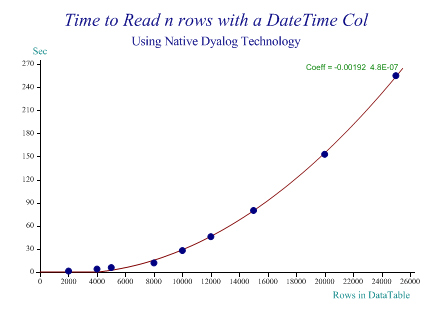
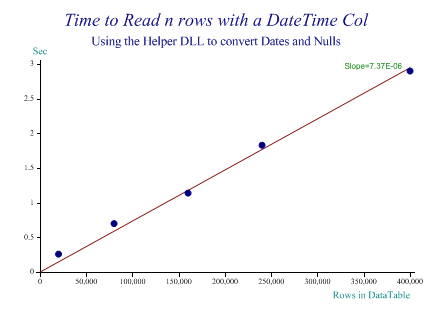
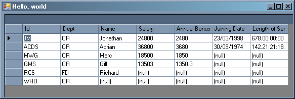

Adrian Smith ([adrian@apl385.com](mailto:adrian@apl385.com))
{ .byline }

## Acknowledgements

This material was prepared initially for Paul Mansour’s wonderful moot in San Quirico, and was improved during the presentation by several of those present, notably Stefano. Thanks to everyone who mucked in to help.

## Motivation

One of the wonders of .Net is just how much stuff you get for nothing. One of the little gifts it gives you is a perfectly usable relational database, which they would love to have you backend onto SQL Server, but which is quite adequate running completely stand-alone. I rather like playing with databases, so I spent half a day fooling with this, partly as a way to explore the Dyalog .Net interface. I quickly discovered that wrapping one of Dyalog’s new classes around it could add quite a bit of fun to the experience, but it also became obvious that handling anything more than a few thousand rows would be amazingly slow unless all the data types were directly mapped into simple APL arrays. As soon as you hit *nulls* or (worse) *dates* APL converts each item into a namespace reference and things slow exponentially.

So this takes on from my note on new tricks for old dogs<sup><a href="#ref1">\[1\]</a></sup>, and shows how you might actually make use of this stuff in a real working system, at a very reasonable speed. Nervous readers should note that there is some C# code involved, but it is very low on intellectual content, and consists mostly of all the loops that we don’t want to see in APL.

## Getting started with the DataSet class

I am taking it as read that anyone who has read this far knows roughly what a database is, so I will run quickly though how .Net handles the idea of tables and relationships. We will build the little EmpDept example (with random variations) that Oracle shipped back in the 70s.

The very first thing you need is a `DataSet` which is a wrapper for your `DataTables` and the `Relationships` between them:

<pre>
 ⎕USING←'' 'System.Data,System.Data.DLL' 'Causeway,D:\tools\aplc\<a href="smithdat/dbs.dll">dbs.dll</a>'
 pr←⎕NEW DataSet(⊂'Payroll')
</pre>

There is very little a `DataSet` can do on its own, but if you have a quick look at its methods, you will see something rather useful:

```
 prps←{⍵.⎕NL ¯2}
 meths←{{⍵/⍨~'_'∊¨⍵}⍵.⎕NL ¯3}
 meths pr
  … GetXml … WriteXml …
```

When you are done, you can save your entire database to disk in a (remarkably) clean XML format which you can then rebuild later on. For small, self-contained projects, this seems a very good solution, as well as being completely free. By small, I mean anything up to a few hundred thousand rows.

Of course we need some tables, and the tables need some columns. The .Net <abbr title="software developer’s kit">SDK</abbr> help file is really well written, and walks you through the process at a good pace, if you want to explore this more deeply. For now I just want to get something I can play with in APL, so here we go:

```
⍝ The Emp table will need some columns, with type information
⍝ Start by collecting the datatypes we will need (String is the default coltype)
 int32←System.Type.GetType∘⊂'System.Int32'
 double←System.Type.GetType∘⊂'System.Double'
 datetime←System.Type.GetType∘⊂'System.DateTime'
 timespan←System.Type.GetType∘⊂'System.TimeSpan'

 empid←et.Columns.Add∘⊂'Id'
 empdept←et.Columns.Add∘⊂'Dept'
 empname←et.Columns.Add∘⊂'Name'

 sal←et.Columns.Add'Salary'int32
 sink←et.Columns.Add'Annual Bonus'double'Salary / 10'

 join←et.Columns.Add'Joining Date'datetime
 service←et.Columns.Add'Length of Service'timespan
```

A couple of things to note in passing – getting a `Type` object in APL is strangely messy. There may be a better way of doing this, but I haven’t found it yet. Also note how bonus is set to salary/10, in the definition of the table. I don’t really see the use of this in a real system, but it is quite surprising that you can do simple arithmetic directly in the table definitions. Finally, under *coding habits* I suggest you file away the idea of always using a jot against methods where you have to enclose the ‘string’ argument. This is redundant here, but makes it visually obvious that you are not really passing an enclosed array – just flagging it for enclosure by the called function. Also it will allow you to use *each* on an argument array without swearing. Another good habit is to set up `true` and `false` as standard globals to make your APL code look a little more like the examples in the help files. Now we hit a small brick wall and get the first taste of some C# assistance:

```
⍝ We need this as APL cannot pass an array of DataColumns here?
 Db.SetPrimaryKey(et,1)    ⍝ Static call on the library

⍝ This has one primary key which cannot have duplicates
 empid.(AllowDBNull Unique)←false true
⍝ Just to show we can store custom properties (string type only for XML use)
 et.ExtendedProperties.Add'Owner' 'Adrian'

⍝ We must have a deptid
 empdept.AllowDBNull←false
```

In order to set the primary key, I need to pass an array of `DataColumn` objects. I don’t think there is any way for Dyalog to do this (please prove me wrong, someone) so I dived over to TextPad and wrote a trivial bit of C# to do the job, given the column index or indices:

```
// Much more comfortable just to pass column numbers when creating tables!
 public static void SetPrimaryKey(DataTable table, int col)
 { SetPrimaryKey(table, new int[] {col}); }
 public static void SetPrimaryKey(DataTable table, int[] cols)
 { DataColumn[] keys = new DataColumn[cols.Length];
   for(int ct=0; ct<cols.Length; ct++)
     keys[ct] = table.Columns[cols[ct]-1];
   table.PrimaryKey = keys;
 }
```

This code is included in the source for dbs.dll, along with a lot of other stuff I was expecting to have to write. One day it should become redundant.

Of course the department table will just be more of the same:

```
 deptid←dp.Columns.Add∘⊂'DeptId'
 sink←dp.Columns.Add∘⊂'Department'
 deptid.(AllowDBNull Unique)←false true

 Db.SetPrimaryKey(dp,1)
```

Finally, we draw a mental line between the tables (a real line if you always sketch these before you start typing) to enforce the link between them:

```
⍝ Finally link them up to enforce the foreign-key relationship
 aff←ds.Relations.Add'Affiliation'deptid empdept ⍝ Parent->child
 aff.ChildKeyConstraint.DeleteRule←Rule.Cascade  ⍝ Default but say it anyway
```

This means that anything you type in the Dept column of the Emp table *must* match an existing entry in the DeptId column of the Dept table. (And if you delete a department, then all the employees conveniently evaporate. This might not be the best option in production code …)

As the final step, let’s just add a few random departments and employees:

```
 ⎕USING←'' 'System'

⍝ Depts must be loaded first
 dept←ds.Tables[1]
 nr←dept.NewRow
 nr[0]←⊂'OR' ⋄ nr[1]←⊂'Operational Research'
 dept.Rows.Add nr

 nr←dept.NewRow
 nr[0]←⊂'GD' ⋄ nr[1]←⊂'General Dogsbody'
 dept.Rows.Add nr

⍝ Now the employees
 emp←ds.Tables[0]

 nr←emp.NewRow
 nr[0]←⊂'JM'
 nr[1]←⊂'OR'
 nr[2]←⊂'Jonathan'
 nr[3]←24800
 nr[5]←DateTime.Parse∘⊂'23/3/1998'
 nr[6]←TimeSpan.FromDays 678
 emp.Rows.Add nr

 …

⍝ Now lets try the bulk insertion method
 emp.BeginLoadData

 sink←emp.LoadDataRow('MWG' 'OR' 'Marc' 18500 0)true
 sink←emp.LoadDataRow('GMS' 'GD' 'Gill' 13503 0)true
 sink←emp.LoadDataRow('RCS' 'GD' 'Richard')true    ⍝ Default salary
 sink←emp.LoadDataRow('WHO' 'GD')true              ⍝ Default name to DBNull

 emp.EndLoadData
```

Note that I bottled out on using the bulk method with `DateTime` and just allowed our last four employees to have null values here. Bulk insert is much better done with a bit more C# help, so we can walk on by and play with the limited data we have.

## Playing with Selections

We can do a fair amount of processing in plain APL now, starting from the `pr` object (the `DataSet` instance we made at the beginning) and digging down layer by layer:

```
      pr
System.Data.DataSet
      pr.DataSetName
Payroll
      pr.Tables
System.Data.DataTableCollection
      ⌷pr.Tables
 Emp  Dept
```

Note the excellent monadic *squad* `⌷`, which converts a collection into an array. (We APLers likes arrays, just like we Pirates always speaks in the present tense – sorry. On we go …)

```
      emp←↑⌷pr.Tables                  ⍝ Just the employee list
      ss←emp.Select∘⊂'salary>20000'    ⍝ What have we here?
      ss
 System.Data.DataRow  System.Data.DataRow
      ⊃ss.ItemArray
 JM    OR  Jonathan  24800 2480  23/03/1998 00:00:00  678.00:00:00
 ACDS  OR  Adrian    36800 3680  30/09/1974 00:00:00  142.21:21:18.9000000
      +/4⊃¨ss.ItemArray
61600
```

The good news is that you can get your data back out again, selected and ordered. The bad news is that you get it back in exactly the way you didn’t want – as an array of `DataRow` objects. APL will run through these for you grabbing each row as a nested array, but note that each item in the DateTime column is actually a *namespace reference* so if we have a few thousand employees, this innocent expression is going to run up the fan on your laptop for quite a while. Several years in fact, for a not-unreasonable sample. A more pressing problem is that none of the things an APLer wants to do (like find the median salary) are easy to achieve with this model. Time to step back and have a little think.

## What do we *really* want here?

Clearly, we wants arrays, and we wants ’em *now*. It would be really great if the selection could be an instance of a Dyalog class, with all the columns as properties. Something like:

```
sel←Select emp 'salary>20000'   ⍝ Get a selection
      sel.Salary
24800 36800
      sel.Salary[2]
36800
      sel.Salary[2]×←1.05
      sel.Salary
24800 38640
```

This way a column in a selection behaves much like an external variable – we can index it and use any reasonable selective specification to update it. The other things we need are a good strategy for replacing \[null\] with a chosen numeric value, and a good way to represent `DateTime` objects and `TimeSpan` objects:

```
      sel.ColumnNames
 Id  Dept  Name  Salary  Annual Bonus  Joining Date  Length of Service
      sel.JoiningDate
35877 27302
      sel.LengthofService
58579200 12345678.9
```

I chose to form the property names by compressing out blanks from the column names, and to represent the dates as the traditional ordinal values. `TimeSpan`s are trickier, as these are 64-bit integers in .Net and my APL cannot handle these just yet. I chose decimal seconds as the least bad option. If we reselect the whole table and just grab everything, you will see my default null substitutions:

```
      sel←Select emp ⋄ sel.GetMatrix  ⍝ Grab the whole table (NB dates/nulls)
 ACDS  OR  Adrian     38640   3864   27302 12345678.9
 GMS   OR  Gill       13503   1350.3    ¯1        0
 JM    OR  Jonathan   24800   2480   35877 58579200
 MWG   OR  Marc       18500   1850      ¯1        0
 RCS   FD  Richard   ¯32768 ¯32768      ¯1        0
 WHO   OR  (null)    ¯32768 ¯32768      ¯1        0
```

… but we can change this with another handy property:

```
sel.NullFillers[4 5]←0          ⍝ Change how nulls appear
sel.GetMatrix                   ⍝ Grab the whole table (NB different nulls)
 ACDS  OR  Adrian    38640 3864   27302 12345678.9
 GMS   OR  Gill      13503 1350.3    ¯1        0
 JM    OR  Jonathan  24800 2480   35877 58579200
 MWG   OR  Marc      18500 1850      ¯1        0
 RCS   FD  Richard       0    0      ¯1        0
 WHO   OR  (null)        0    0      ¯1        0
```

Of course the `[null]` stuff is fully reversible – setting an element to the current filler for that column results in a `[null]` in the table. The only remaining issue to illustrate is the speedup we can get by farming some of the grunt-work out to C# – I made a simple clone of a typical ‘ticker’ datafeed to give the engine enough data to chew on:

```
     LoadTicker 1
     sel←Select tk  ⍝ To play with it
     sel.ColumnNames
 What  When  Value
      sel.Rows
40000
      +/sel.Value
200499.74
```

This is pretty well instantaneous after the brief delay while the table is populated for the first time. For a rough guide to the alternative, I offer the following chart:

<figure markdown="1">

</figure>

If you compute the regession equation for 40,000 rows you will get `4.3e¯7 × 40000*2` giving 688s or a little over 11 minutes just to create the array of rows. Probably you will get a Syserror and your interpreter will exit stage left (pursued by a bear) long before the expression completes. For comparison:

<figure markdown="1">

</figure>

This one has the added benefit of being linear rather than quadratic – note the x-axis had to be extended by a factor of about 20 to get meaningful times. That will do for showing you around the examples – what we need to do now is to show how the trick is pulled.

## Farming out the loops

Whatever you say about conventional languages, they are good at doing simple things quickly. Here is the code that sits at the back of the column reference:

```
 public Array GetCol(int cinx)
 // Grab whole Column (ensure APL gets the right datatype)
 { int col = cinx-1;             // Fix for 1-origin
   Type coltype = APLTypes[col];
   Array coldata = Array.CreateInstance(coltype,Selection.Length);
   for(int row=0;row<coldata.Length;row++)
     coldata.SetValue(GetItem(row,col),row);
   return coldata;
 }
```

The full C# source code can be [downloaded](smithdat/dbs.zip)<sup><a href="#ref2">\[2\]</a></sup> if you want to read all the preamble. The DLL maintains an array of data-types which APL has for the various columns, and starts by creating an array of the right type and size. It then simply hammers round the elements in the column populating the array, which is returned to APL. This calls the lower-level function:

```
 private object GetItem(int row, int col)
 // Return one cell, checking for type and null
 { object cellvalue = Selection[row][col];
   if(System.DBNull.Value == cellvalue)    // APL really hates these
     cellvalue = nullFillers[col];         // Plug in current filler instead
   else if(isDate[col])
     cellvalue = ((DateTime)cellvalue).ToOADate();
   else if(isSpan[col])
     cellvalue = ((TimeSpan)cellvalue).TotalSeconds;
   return cellvalue;
 }
```

After checking whether the data item is `[null]`, it special-cases the two complex types that can upset APL and converts the cell content to something that can be returned as a simple numeric value. In the common case where APL can cope, this is just a fall-through which returns the right element from the selection. The code to update the selection when you assign something to the APL property is (if anything) even simpler:

```
 public void PutCol(int cinx, object[] newValues)
 // Update data colwise (always an entire column)
 { int col = cinx-1;
   for(int row = 0;row<Selection.Length;row++)
     PutItem(row,col,newValues[row]);
 }
```

This assumes that the APL side returns an array of the right length, which is always the case if you update a property with indexing or selective specification. It just does the reverse conversions:

```
 private void PutItem(int row, int col, object newValue)  // Fix one cell
        { Selection[row][col] = Dyalog2Data(col,newValue); }

 private object Dyalog2Data(int col, object dataitem)
 // APL types --> Database types
 { Type coltype = APLTypes[col];

   object newValue = Convert.ChangeType(dataitem,coltype);

   if(NullFillers[col].Equals(newValue))
      newValue = System.DBNull.Value;
   else if(isDate[col])
      newValue = DateTime.FromOADate((double)newValue);
   else if (isSpan[col])
      newValue = TimeSpan.FromSeconds((double)newValue);

   return newValue;
 }
```

I think that shows you enough of the back-end processing to convince you that there really is no rocket science or magic going on. Now we need to hook up the Dyalog class mechanism to the other end of the process to make it all really developer-friendly.

## Making a nameless class on the fly

It is a real benefit of working in a dynamic language that you can lay the floor as you walk across it. Old hands are used to the trick of generating functions on the fly (often locally), fixing them and running them. Now we can do the same with classes – by fixing an unnamed class from a localised script, we can return an instance of something which never existed in the workspace at all. This is what happens when you type:

```
 sel←Select emp 'Dept=''OR''' 'Salary'
      sel
Selection from Emp where Dept='OR' (5 rows selected)

        sel[3]
  ACDS  OR  Adrian  1000 100 27302 12345678.9
```

The *display form* of the class has been set to return a nice description of the selection, just to make it all look like the SQLPLUS command prompt I remember from a previous life. The `Select` function takes a reference to a table and optionally a selection expression (in SQL) and one or more column names to use as sort keys. It calls the C# code in the constructor for the db helper, passing across the table and the selections. Note that we can localise `DB` here:

```
 ⎕USING←'' 'Causeway,D:\tools\aplc\dbs.dll'    ⍝ Adjust to taste!

 DB←⎕NEW Db table
 colnames←DB.ColumnNames~¨' ' ⋄ writeable←DB.Writeable

 scr←':Class' ':Access Public' ''
 scr,←'∇ Create arg' ':Access Public' ':Implements Constructor'
 scr,←' DB←arg' ' ⎕DF DB.ToString' '∇ '
```

If I temporarily de-localise the script, we can see part of what it wrote for us (indexers are slightly special – we need a *shape* function so Dyalog knows when to call INDEX ERROR on us):

```
:Property Numbered Default DataRows
:Access Public
∇ value←shape
 value←DB.Rows
∇
∇ value←get arg
 value←⊂DB.GetRow arg.Indexers
∇
∇ set arg
 DB.PutRow arg.Indexers (↑arg.NewValue)
∇
:EndProperty

∇ value←GetMatrix
:Access Public
 value←DB.GetMatrix
∇
```

By setting an indexer as the default property, we can treat the entire selection as a simple vector, so fetching/updating it by row is trivial. There are several other pass-through calls like `GetMatrix`, and then we come to the only really dynamic part. Because the `Select` function has the list of (despaced) column names, it can easily make a property definition for every column:

```
 :For ct :In ⍳↑⍴colnames
  ⍝ Expose all columns read-write unless they are marked readonly
   pname←ct⊃colnames
   scr,←''(':Property ',pname)':Access Public'
   :If ct⊃writeable
     scr,←'∇ set arg'(' DB.PutCol ',(⍕ct),' (arg.NewValue)')'∇ '
   :End
   scr,←'∇ value←get'(' value←DB.GetCol ',⍕ct)'∇ '
   scr,←⊂':EndProperty'
 :End
```

A typical (generated) entry looks like:

```
:Property Salary
:Access Public
∇ set arg
 DB.PutCol 4 (arg.NewValue)
∇
∇ value←get
 value←DB.GetCol 4
∇
:EndProperty
```

You may want to add some `:Trap` blocks, as you may get a crash in the C# on updating the data, and not want to get hung up in Dyalog’s generated setter function, for example:

```
      sel.Salary←1 2
EXCEPTION
set_Salary[1] DB.PutCol 4(arg.NewValue)
             ∧
      )si
[#.[[Unnamed]]] #.[Namespace].set_Salary[1]*
```

A little more validation on the APL side of the fence would do no harm here either! Having made the entire script, the final act is to make a transient class, and return an instance of it:

```
 scr,←'' ':EndClass'
 seln←⎕NEW(⎕FIX scr)DB
```

As I said before, both `scr` and `DB` can be locals, so this is remarkably tidy in its use of the workspace. As a final bit of fun, let’s whistle up a .Net `DataGrid` and point it at our table. If you download the workspace and try this out, you will see that as you type expressions in the APL session, the grid follows the changes automatically.

```
 ⎕USING∪←'System.Collections' 'System'
 ⎕USING∪←⊂'System.Windows.Forms,System.Windows.Forms.dll'

 f←⎕NEW Form
 f.Text←'Hello, world'
 f.Visible←1

 emp←pr.Tables[0]
 ev←emp.DefaultView
 ev.AllowNew←false

 dg←⎕NEW DataGrid

 dg.(Top Left)←4 4
 dg.(Width Height)←f.(Width Height)-4 4
 dg.Anchor←AnchorStyles.(Bottom+Top+Left+Right)

 dg.SetDataBinding ev''       ⍝ Single table view
⍝ dg.SetDataBinding pr'Dept'  ⍝  or the drill-down variety

 f.Controls.Add dg
```

<figure markdown="1">

<figcaption markdown="span">Display and editing in a .Net DataGrid</figcaption>
</figure>

Or, of course, you can just use it as a handy editor for the data!

## Wrap up

In summary, there is a very competent relational database sitting on your computer, and it is totally free. To save your work on the nearest hard-drive, all you need to do is:

```
pr.WriteXml 'C:\temp\payroll.xml' false  ⍝ Save DataSet (with Schema)
emp.WriteXml∘⊂'c:\temp\emp.xml' ⍝ Save table to disk (data only)
```

The XML you get is designed to be readable, and indeed editable, for example:

```
<Payroll>
  <Emp>
    <Id>JM</Id>
    <Dept>OR</Dept>
    <Name>Jonathan</Name>
    <Salary>24800</Salary>
    <Annual_x0020_Bonus>2480</Annual_x0020_Bonus>
    <Joining_x0020_Date>1998-03-23T00:00:00+00:00</Joining_x0020_Date>
    <Length_x0020_of_x0020_Service>P678D</Length_x0020_of_x0020_Service>
  </Emp>
```

If I make a trivial change (adding Marc’s middle initial) in Notepad, then start from cold:

```
      ⎕USING←'' 'System.Data,System.Data.DLL'
      pr←⎕NEW DataSet(⊂'Payroll')

      pr
System.Data.DataSet
      pr.ReadXml∘⊂'C:\temp\payroll.xml'
ReadSchema
      ⌷pr.Tables
 Emp  Dept
      emp←↑⌷pr.Tables  ⍝ Recover the employee list
      sel←Select emp   ⍝ Get a selection
      sel.GetMatrix
 ACDS  OR  Adrian     36800   3680   27302 12345678.9
 GMS   GD  Gill       13503   1350.3    ¯1        0
 JM    OR  Jonathan   24800   2480   35877 58579200
 MWG   OR  Marc W     18500   1850      ¯1        0
 RCS   GD  Richard   ¯32768 ¯32768      ¯1        0
 WHO   GD  (null)    ¯32768 ¯32768      ¯1        0
```

With Dyalog classes, you can put a wrapper around it that makes columns in selections behave almost like variables in the workspace. With a little help from a C# DLL, it can be made to run quite fast enough to support a realistic application. You can download the Dyalog 12 (Unicode) workspace and supporting C# source code (compilation instructions included)<sup><a href="ref2">\[2\]</a></sup> and use it as you wish. Please let me know of any improvements you make to either side.

## References

1. <a id="ref1"></a> “New Tricks for Old Dogs: Making Sense of Classes and Namespaces”, Smith, A., *Vector* <strong>23</strong>(1&2) p113-117  
    [http://www.vector.org.uk/archive/v231/smith.htm](../art10011620/)
2. <a id="ref2"></a> Source code for this article:  
    [http://www.vector.org.uk/archive/v233/smithdat/dbs.zip](trad/v233/smithdat/dbs.zip)
