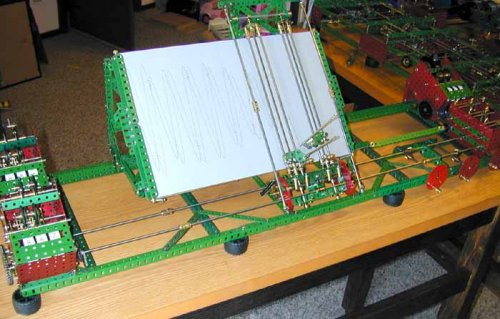
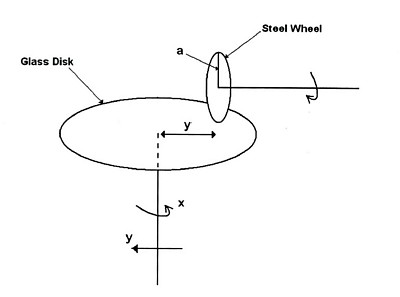
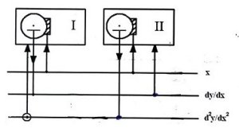
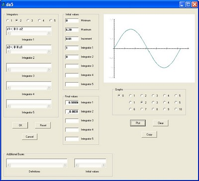
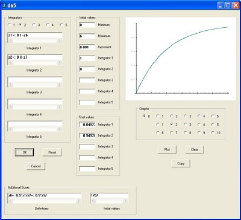

Keith Smillie  
[smillie@cs.ualberta.ca](mailto:smillie@cs.ualberta.ca)
{ .byline }

This article is discussed at  [comp.lang.apl](http://groups.google.com/group/comp.lang.apl/browse_thread/thread/11793b94e0a13faa/)
{ .right }

## Introduction

The first differential analyzer to be constructed mostly of Meccano parts was built in 1933 at the University of Manchester by Professor Douglas Hartree assisted by his research student Arthur Porter about two years after the first differential analyzer was built by Vannevar Bush at the Massachusetts Institute of Technology. With the successful completion of the Meccano model funds were obtained for the construction of a full-scale machine which was built commercially. During World War II this machine and several similar ones were used for military purposes. At present there is considerable interest in the construction of Meccano models and their use in education.

The pioneering Manchester work is described in Porter (2003). Two papers, Robinson (2005a) and Robinson (2005b) give, respectively, a history of the Meccano models and a description of the contemporary construction of one such machine.

<figure markdown="1">
[](http://www.meccano.us/differential_analyzers/robinson_da/ "Tim Robinson’s Differential Analyzer")
<figcaption markdown="span">Tim Robinson’s Differential Analyzer</figcaption>
</figure>

This paper describes a five-integrator simulator implemented in J and gives two examples of its use. The [script file](smillie/da406.ijs "da406.ijs"), which will run on Versions 406 and 504 of J, may be downloaded.

## Integrators

Integration with a differential analyzer is performed by one or more integrators, identical in design and differing only in their interconnections with other components of the machine. As shown in the figure below an integrator consists of a small vertical wheel which turns on a horizontal axis as it rolls on the surface of a horizontal disk which rotates on a vertical axis. The displacement of the wheel from the centre of the disk varies as the disk rotates and is proportional to the value of the dependent variable. The rotation of the disk gives the change in the independent variable.

<figure class="left" markdown="1">

<figcaption markdown="span">Figure 1: Integrator</figcaption>
</figure>

Suppose that the disk rotates through a small angle ∆x and the wheel is at a radial distance y from the centre of the disk. Therefore the wheel turns an amount

∆z = (y∆x)/a

where a is the radius of the wheel. Thus after a given period of operation the total rotation of the wheel is proportional to ∫ydx. Since the wheel rests lightly on the disk so that it may slide freely along a radius as the value of the dependent variable changes, its torque must be amplified before its motion may be transmitted to another part of the analyzer. As this simulation models only the logic of the differential analyzer, the design and construction of torque amplifiers may be ignored although they are an important feature in the Meccano models.

Let us assume now that the disk rotates in discrete steps of size ∆x and that the rotation of the disk begins when x has the value x<sub>0</sub>. Also assume that the initial radial displacement of the wheel on the disk is y<sub>0</sub> and that subsequent displacements are y<sub>1</sub>, y<sub>2</sub>, … . Then the successive rotations of the wheel are (∆x)y<sub>1</sub>/a, (∆x)y<sub>2</sub>/a … . Therefore, the total rotation of the wheel after n steps is proportional to the sum

(∆x)y<sub>0</sub> + (∆x)y<sub>1</sub> + (∆x)y<sub>2</sub> + … + (∆x)y<sub>n</sub>

As ∆x becomes smaller, this sum will correspond more closely to the rotations of the physical disk and wheel, and thus become a better approximation to the value of the desired integral.

## Simulator

The simulator has five integrators and eleven buses. The first bus corresponds to the independent variable in the differential equation, the next five buses to the five integrators, and the remaining five to auxiliary (non-integrating) buses. The buses are numbered 0, 1, 2 … 10, and the values representing their cumulative rotations by the variables `z0`, `z1`, `z2`, … `z10`. (The variable `z0` has the synonyms `x` and `t`.) The connections of the integrators with the buses are defined by dyadic functions, one for each integrator, and named `I`, `II`, `III`, `IV` and `V`. The left argument of a function gives the number of the bus associated with the rotation of the horizontal disk for the corresponding integrator, the right argument gives the displacement of the vertical wheel for that integrator, and the result the total rotation of the wheel which gives an approximation to the desired integral up to that stage of the integration. Successive pairs of values of the independent and dependent variables are stored as the rows of a two-column table associated with the integrator, and named `TABLE1`, `TABLE2`, `TABLE3`, `TABLE4` and `TABLE5`.

## Simple harmonic motion

In this section we shall give an example of the use of the simulator to solve the second-order ordinary differential equation for simple harmonic motion

d<sup>2</sup>y/dx<sup>2</sup> = –y

with the initial conditions y(0) = 0 and dy/dx(0) = 1 which has the solution

y = sin x

<figure class="right" markdown="1">

<figcaption markdown="span">Figure 2: Simple harmonic motion</figcaption>
</figure>

The connections to the buses of the two integrators required to solve this equation are shown in the schematic to the right. In the first integrator the right vertical line indicates that the first bus corresponds to the independent variable which controls the rotation of the horizontal disk, and the left vertical line that the third bus corresponds to the dependent variable given by the displacement of the vertical wheel on the disk. The middle vertical line indicates that the output of the integrator, i.e., the rotation of the wheel, controls the rotation of the second bus. (The small circle at the lower end of the connection with the third bus indicates that the value passed to the integrator is negated.) Similar statements may be made regarding the connections of the second integrator to the buses.

From this schematic we may derive the definitions

```
z1=: 0 I –z2
```

and

```
z2=: 0 II z1
```

for the integrators.

<figure markdown="1">
[](smillie/figure3.jpg "Click for full-size image")
<figcaption markdown="span">Figure 3: Simulator solution of the equation</figcaption>
</figure>

Figure 3 shows the simulator solution of this equation. Note that we have plotted the solution against the independent variable x by selecting radio button 0 in the first row and radio button 2 in the second row in the box below the graph. This may be done either initially and then clicking the OK button to run the simulation, or after the simulation has been done and then clicking the Plot button. (The default selection of the radio buttons is 0 in the first row and 1 in the second which in this example will give the graph of the cosine funcion.) Also by selecting either radio buttons 1 and 2 in the first and second rows, or radio buttons 2 and 1, we obtain a circular plot. The Copy button below the graph box may be used to give a graph independent of the Windows form of the currently displayed graph which may be cut or copied into the clipboard and then pasted into any desired document.

## Exponential distribution

The exponential distribution arises in the statistical study of the strengths of certain materials and in the analysis of waiting times between random events. The probability density function is

p(x) = λ℮<sup>–λx</sup>

where x is in the range 0 ≤ x &lt; ∞ and λ > 0 is a parameter, and the cumulative density function is

P(x) = 1 – ℮<sup>–λx</sup>

We shall use the simulator to find the cumulative distribution function for the arbitrary value of 0.5 for λ.

<figure markdown="1">
[](smillie/figure4.jpg "Click for full-size image")
<figcaption markdown="span">Figure 4: Exponential distribution</figcaption>
</figure>

Since the differential equation dy/dx = –y has the solution y = ℮<sup>–x</sup>, the first integrator in the simulator may be defined by the expression

```
z1=: 0 I -z1
```

Now we could write the expression

```
z1=: 0 I –0.5*z1
```

for the solution of the equation `dy/dx = –0.5*y`. However it is more realistic to have the multiplication performed by one of the auxiliary buses as it would be in an actual differential analyzer. Therefore the first integrator could be defined by

```
z1=: 0 I -z6
```

where `z6=: 0.5*z1`. The second integrator is defined by

```
z2=: 0 II z7
```

where `z7=: 0.5*z1` which may be used to give the cumulative distribution function. We should note that the definitions of the auxiliary buses and their initial values are entered in the Windows form in the Auxiliary buses boxes as the lists

```
z6=: 0.5*z1/z7=: 0.5*z1/
```

and

```
1/0/
```

respectively, with each definition or initial value terminated by a forward slash /. The graph displayed in the Windows form is that of the cumulative density function of the exponential distribution.

## Acknowledgements

I wish to thank Arthur Porter for stimulating my interest in Meccano differential analyzers and for his continuing interest, and Tim Robinson for his many helpful comments throughout the course of this work.

### References

1. Lawrence, Bonita, 2007. Personal communication.
2. Porter, Arthur, 2003. “Building the Manchester differential analyzers: A personal reflection.” *Annals of the History of Computing*, Vol. 25, N°2, pp. 86-92.
3. Robinson, Tim, 2005a. “The Meccano set computers.” *IEEE Control Systems Magazine*, Vol. 25, N°3, pp. 74-83.
4. Robinson, Tim, 2005b. Tim Robinson’s Differential Analyzer.  [http://www.meccano.us/differential\_analyzers/robinson\_da/](http://www.meccano.us/differential_analyzers/robinson_da/)
