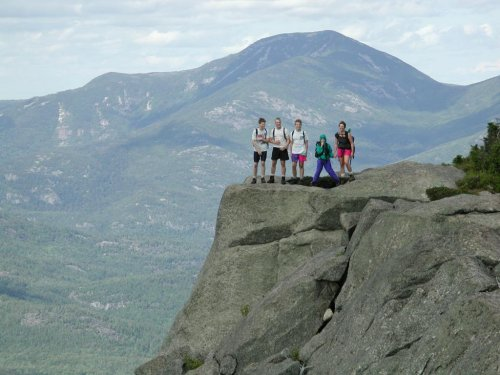
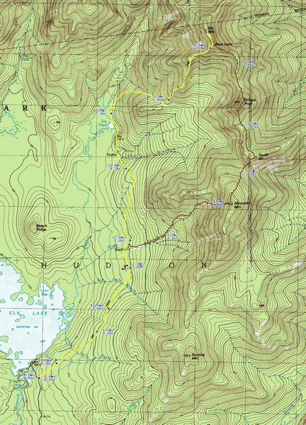
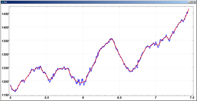

Cliff Reiter  
[reiterc@lafayette.edu](mailto:reiterc@lafayette.edu)
{ .byline }

This article is discussed at  [comp.lang.apl](http://groups.google.com/group/comp.lang.apl/browse_thread/thread/11793b94e0a13faa/)
{ .right }

## Prologue

Last year I bought a runner’s GPS based watch to get accurate feedback on the time and distance of my runs. Soon thereafter, an article appeared in the college paper \[[3](#ref_ma)\] encouraging running. It showed several routes on local maps. That inspired me to try to create maps that showed my runs. GIS (Geographic Information Systems) are becoming common and there are web sites devoted to making maps of running routes. However, my attempts to utilise them were frustrating. I found public sources for scanned USGS topographic maps and I began overlaying them with the GPS data using J. Soon I was routinely displaying the routes for my local runs.

<figure markdown="1">
[](http://ww2.lafayette.edu/~reiterc/hikes/adir/2000/08/mid0155.jpg "Click for full-size image")
<figcaption markdown="span">Swiss Family Reiter</figcaption>
</figure>

My next goal was to use this method to show routes on hiking maps. In a paint program, I had hand-marked hiking routes for many years for my Adirondack hiking gallery maps \[[6](#ref_adir)\]. The prospect of automating the process using higher quality topographic maps with accurate position data intrigued me. I successfully created some hiking route maps that way and began to ponder further possibilities such as automatically enhancing the maps with mile markers and other information.

I had years of experience hiking in the Adirondacks. I had tens of thousands of photographs from those hikes. I had recently found the process of publishing the third edition of my visualisation book \[[7](#ref_fvj3)\] at [Lulu.com](http://www.lulu.com) efficient. Now, I also had a fairly routine way to create hiking route maps. I decided to write an Adirondack hiking guide \[[8](#ref_wfw)\]. Writing the hiking guide was joy. “Off gathering data for my book” became a code phrase for “gone hiking”, and when I was back, there was the fun of analysing the data in J.

However, unforeseen challenges were ahead. As I enhanced the book to include time and distance data along the route, I realized the distance accumulator on the watch sometimes ran backwards. Apparently it measures progress in the direction of motion. Thus, if you are running, it is perfectly accurate (so long as you are not running in a small circle). However, if you are grinding your way up a steep trail making tight switchbacks, the distance meter was often running backwards. Fortunately the latitude-longitude-altitude data was also saved so recovering the distance data was a matter of some interesting modelling directly from latitude-longitude-altitude data. I eventually realized that the altitude data from the hike could be used to compute “cumulative ascent” which seems useful for gauging the difficulty of a route, and is not given in the standard trail guide \[[2](#ref_goo)\]. However, the raw altitude data is very noisy and some more modelling is needed. The next section describes the general way in which J was used to create the base maps but this note focuses on the subsequent process of enhancing the maps with GPS data.

## Maps

While the first USGS maps I worked with were from Pennsylvania \[[5](#ref_gis_pa)\], I will describe the general process of preparing the New York maps from \[[4](#ref_gis_ny)\] to create the base maps that were used for my hiking guide. The 7.5 minute maps from the Adirondack region are mostly doubles. They are typically around 9475×6100 pixels. These were scanned from hard-copy topographic maps and stored as huge TIF files. I wanted to break these into pieces that can be easily enhanced in J. Then, since my routes will not respect map boundaries, relevant pieces can be reassembled as necessary. The scanned maps typically were misaligned about half a degree from horizontal; that could mean an error of over a hundred pixels. They were too large to rotate using the `image3` addon in a 32-bit version of J. Careful rotation of the maps in GIMP \[[1](#ref_gimp)\], followed by trimming (the maps had significant margins) tended to leave images that had edge artifacts that were usually less than ten pixels across. Reading the trimmed images (`raw_read_image`) into J and using the `image3` addon allowed for systematic splitting of the doubles and rescaling images so that each 7.5 quadrant was 5460×3934 pixels. The rescaling was done by a variant of `resize_image` from `image3` that does not preserve aspect ratio, as follows.

```
   rescale_image=: 4 : 0
szi=.2{.$y
szo=.|.x
ind=.(<"0 szi%szo) <.@*&.> <@i."0 szo
(<ind){y
)
```

There was a bit more to accomplish before the base maps were ready. In a few spots landmark names needed to be added. Trickier was that many trails had changed.

If a portion of a trail had been rerouted, the GPS route would overdraw only a portion of the dash-dash-dash trail from the original map, leaving the dashes where the trail had been rerouted. If the rerouted portion was small enough, those dashes are a sort of quaint historical piece of information. However, if a trail was on private land and is now closed, or had been completely decommissioned, then it was important to remove all the dashes marking the old trail to avoid confusing hikers.

I marked the trails for removal in a broad unused colour (magenta) on a copy of the map and then used a filter to guess whether to replace black pixels in the original that corresponded to magenta in the marked image with a suitable colour. Selecting the suitable colour is complicated: there is a desire to preserve contour markings when possible and use and appropriate background colour for forest, marsh or open rock in general. Our algorithm is probably not optimal, but we simply ordered possible colours based upon the likely importance; for example, the colour of contours was highest; for the filter we used the highest ranked colour that appeared in a small neighbourhood of the pixels that needed to be replaced. The details are beyond the discussion here.

We will now presume we have obtained a suitable base map, we know the latitude and longitude of its corners, and we want to add GPS route information to it. However, we first discuss the GPS data.

## GPS Data

Exporting the GPS data from the watch led to XML files containing quite a bit of information. Since each exported data set approached 100Mb and had overlapping data, and we wanted to archive our running/hiking information every couple of weeks, it became inefficient to reparse every lap from every GPS history file every time we wanted some tracking data. Thus, we actually have a J utility that checks for new GPS data files, parses them, and creates appropriate J arrays giving summary and trackpoint information to be archived. The beginning of the XML version of hike 175 in those archives is given below. On average a trackpoint is saved every few seconds.

```
   <Lap StartTime="2007-08-21T11:07:34Z">
          <TotalTimeSeconds>33836.120000</TotalTimeSeconds>
          <DistanceMeters>19909.160156</DistanceMeters>
          <MaximumSpeed>2.483250</MaximumSpeed>
          <Calories>7284</Calories>
          <Intensity>Active</Intensity>
          <Cadence>255</Cadence>
          <TriggerMethod>Manual</TriggerMethod>
          <Track>
            <Trackpoint>
              <Time>2007-08-21T11:07:34Z</Time>
              <Position>
                <LatitudeDegrees>44.020833</LatitudeDegrees>
                <LongitudeDegrees>-73.827731</LongitudeDegrees>
              </Position>
              <AltitudeMeters>645.181885</AltitudeMeters>
              <DistanceMeters>0.000000</DistanceMeters>
              <SensorState>Absent</SensorState>
            </Trackpoint>
            <Trackpoint>
              <Time>2007-08-21T11:07:35Z</Time>
              <Position>
                <LatitudeDegrees>44.020825</LatitudeDegrees>
                <LongitudeDegrees>-73.827749</LongitudeDegrees>
              </Position>
              <AltitudeMeters>645.181885</AltitudeMeters>
              <DistanceMeters>1.611095</DistanceMeters>
              <SensorState>Absent</SensorState>
            </Trackpoint>
```

Since the format for exported data presumably varies with the GPS device, we do not attempt to offer a general purpose script for extraction. However, a few utilities give the core that we required.

First is a function `headnum` that finds the number that is the leading portion of a string.

```
   headnum=:[: ".@, (0 i.~ ] e. '0123456789.-'"_){.]
```

Next is a function to convert to timestamps (with thanks to Raul Miller).

```
   toTS=: 0 ". e.&(~.":i.10)`(' '&,:)}
```

The dyad `cuts` cuts on the text given as a left argument, disgarding the text.

```
   cuts=: 4 : '(x E. y) <@((#x)&}.) ;.1 y'
```

Once the data has been cut into laps, the trackpoint information can be extracted with `tpx_in_lap`, given below. The result is a five column matrix. The columns correspond to ‘time from start (hours)’, ‘latitude’, ‘longitude’, ‘altitude (metres)’, and ‘distance from start (miles)’.

```
   tpx_in_lap=:3 : 0
y=.('<Trackpoint>' E. y)<;.1 y
y=.'<Time>'&cuts&> y
z0=.,/(i.&'<'{.]) &> y
y=.'<LatitudeDegrees>'&cuts&> y
z=.,headnum &> y
y=.'<LongitudeDegrees>'&cuts&> y
z=.z,.,headnum &> y
y=.'<AltitudeMeters>'&cuts&> y
z=.z,.,headnum &> y
y=.'<DistanceMeters>'&cuts&> y
(3600000%~(-{.)tsrep toTS z0),. z,.,0.0006214*headnum &> y
)
```

For example, if we load the example data provided on the link at \[[9](#ref_gis_j)\] in the path, `pathi`, we see the first few sets of GPS track point information.

```
   4{.tpx_in_lap fread pathi,'dw02_lap.txt'
          0 44.0208 _73.8277 645.182          0
0.000277778 44.0208 _73.8277 645.182 0.00100113
 0.00166667 44.0209 _73.8278  643.74 0.00573542
 0.00305556 44.0209 _73.8278 641.337 0.00912691
```

## Plotting Routes

The plotting of routes on the maps was done by opening a drawing window using the adverb `show_raw_map` that is based upon the drawing functions in the `dwin2.ijs` script from the `fvj3` addon. For these maps, an entire map far exceeded the screen coordinates, but the drawing window, despite only being partially visible, allowed all the pixels to be manipulated. The adverb `show_raw_map` is used to open a drawing window and then copies a raw image into the window. A raw image (in the sense of the `image3` addon) is a `h` by `w` by `3` array of ASCII characters representing RGB values. The function `gis_to_win` modifies the rescaling function `SC` (which does window coordinates to pixels conversion) so that drawing can be done using longitude-latitude data; its left argument is the longitude-latitude bounds for the map shown.

```
   show_raw_map=:1 : 0
:
WIN_WH=:|.2{.$y
x dwin m
glpixels 0 0,WIN_WH,,(256 256 256&#.@(a.&i.))"_1 y
)

   gis_to_win=:4 : '(1 _1*x)+"1 SC |."1 y'
```

We will describe many details of the route plotting, but all the details may be found in scripts and sample data on a link at \[[9](#ref_gis_j)\]. First we read the hike trackpoint data from a raw data file. Then the time, latitude, longitude, altitude, and distance data are separated.

```
   tpx0=:ja_read pathi,'hike175.ja'

   't0 la0 lo0 a0 d0'=:|:tpx0
```

The given times are fine, but the distance data needs to be modelled by the function `trek_d` that we will discuss in detail in the next section.

```
   ts=:t0

   ds=:trek_d tpx0
```

We next obtain the positions in the data for mile markers and a final marker. The latitude-longitude track points are split into three pieces so that the trail-less portion can be shown in a different colour. The text to annotate is computed.

```
   i=:ds I. (i.@>.,]){:ds                  NB. position of mile markers

   tps=:(la0),.lo0                         NB. track points

   tps0=:(n0=:440){.tps                    NB. first segment on trail
   tps1=:(n1=:2040){.n0}.tps               NB. trail-less segment
   tps2=:(n0+n1)}.tps                      NB. last segment on trail

   TXpt=:i{tps                             NB. mile marker latitude-longitude
   TX0=:(4j1 ":,.i{ds),"1 'mi'             NB. mile marker text
   TX1=:(4j1 ":,.i{ts),"1 'hr'             NB. mile marker times
```

We set an offset of a few pixels. This can account for misregistered maps or the offset from a pen's coordinates and its center.

```
   dxdy=:_10 _5                            NB. map registration offset
```

We read a full topographic base map and then select a suitable portion using `n_adj_b`. That function selects a portion of an image according to proportional 0-to-1 coordinates as it left argument (lower left and upper right corners are specified).

```
   a=:raw_read_image pathi,'h48.png'

   view_image b=:(nc=:0.3 0.1 0.9 0.7) n_adj_b a
```

Next the map portion is shown, and the three portions of the hike are drawn in appropriate colours. Then mile markers and labeling text are drawn. Some details are suppressed, but all the details appear in \[[9](#ref_gis_j)\].

```
   (nc n_adj_co h48_co) 'lc' show_raw_map b

   NB. draw three segments using appropriate colors
   Ctext=:50 0 150                         NB. color for text
   Ctrail=:255 255 0                       NB. color for trails
   Ctless=:140 50 0                        NB. color for trail-less routes

   dxdy(Ctrail;5 0) draw_trek tps0
   dxdy(Ctless;5 0) draw_trek tps1
   dxdy(Ctrail;5 0) draw_trek tps2

   NB. draw mile points
   dxdy (Ctext;15 0) draw_trek"2 ,:~"1  TXpt

   NB. add some of text to map
   gltextcolor '' [glrgb Ctext
   15 20 '"Lucida Console" 16 bold' draw_text (nn{.TX0) (nn=:8){.TXpt
```

Lastly, since the text may be difficult to read against some backgrounds, we apply a filter, `textedge`, to create a 2-pixel wide white shadow around the text. A side effect of the drawing commands was that a global variable, `trek_z`, giving the image was created.

```
   view_image c=:2 textedge trek_z
```

The result of constructing and enhancing this map as above is shown in Figure 1.

<figure markdown="1">
[](reiter/dw02.png "Click for the full scale version")
<figcaption markdown="span">Figure 1. A Dix Wilderness Route</figcaption>
</figure>

## Distance modelling

As we have noted, the distance data obtained directly from the watch is fine for runs, but is not accurate for hiking, most notably in situations where many small switch backs are being used. We used the function `trek_d` to obtained the desired distance data. The core of that modelling is using a formula for converting pairs of latitude-longitude data into distance data based upon viewing the earth as an ellipsoid. Some global data and the function `lalo_to_d` to accomplish that are given below. It is based upon an implementation by Chris Veness \[[10](#ref_ven)\] of the Vincenty formula \[[11](#ref_vin)\]. The arguments are two latitude-longitude pairs in degrees and the result is the miles between the points.

```
   lalo_a=:6378137
   lalo_b=:6356752.3142
   20j15":%lalo_f=:(lalo_a-lalo_b)%lalo_a

   lalo_to_d=: 4 : 0"1
'la1 lo1'=.x
'la2 lo2'=.y
L=.(2p1%360)*lo2-lo1
U1=._3 o.(1-lalo_f)*tan (2p1%360)*la1
U2=._3 o.(1-lalo_f)*tan (2p1%360)*la2
lam=.L
lamp=.2p1
while. 1e_12<|lam-lamp do.
  sins=.%:(*:(cos U2)*sin lam)+*:((cos U1)*sin U2)-(sin U1)*(cos U2)*cos lam
  coss=.((sin U1)*sin U2)+(cos U1)*(cos U2)*cos lam
  s=._3 o. sins%coss
  sina=.(cos U1)*(cos U2)*(sin lam)%sins
  cos2a=. 1-*:sina
  cos2sm=.coss-2*(sin U1)*(sin U2)%cos2a
  C=.(lalo_f%16)*cos2a*4+lalo_f*4-3*cos2a
  lamp=.lam
  lam=.L+(1-C)*lalo_f*sina*s+C*sins*cos2sm+C*coss*_1+2**:cos2sm
end.
u2=.cos2a*((lalo_a^2)-lalo_b^2)%lalo_b^2
A=.1+(u2%16384)*4096+u2*_768+u2*320-175*u2
B=.(u2%1024)*256+u2*_128+u2*74-47*u2
ds=.B*sins*cos2sm+(B%4)*(coss*(_1+2**:cos2sm))-(B%6)*cos2sm* …
                                            (_3+4**:sins)*_3+4**:cos2sm
0.0006214*lalo_b*A*s-ds
)
```

Here are a few other utilities used for the distance determination. Others are loaded as part of `filter1.ijs` which is loaded when the scripts at \[[9](#ref_gis_j)\] are run. The main function, `trek_d`, gently smoothes the latitude and longitude data. The horizontal distance is computed using the `lalo_to_d` function on the smoothed data. Then the altitude data is smoothed (twice) by the fairly intense 15-point wide Spencer averaging. Then, using the Pythagorean theorem, the horizontal and vertical distances are blended. While one might argue for many variant schemes, we selected several test data sets and selected this scheme for our perception of its accuracy and robustness. The test data included runner’s runs, where we expected to duplicate built-in distances, up-down hikes, where we expected the ascent to be slightly larger than the descent (due to mini switch backs), and a couple of standard hikes, where we compared to distances in \[[2](#ref_goo)\] (prioritised in that order). Replacing the Spencer averaging with a wide Gaussian filter would also have been effective.

```
   Filt1d=: 1 : 0
(# m)"_ +/@:(m&*)\ ]
)

   len2=:+&.*:"1

   diff=:}. - }:

   ]wts=: (|.,}.)74 67 46 21 3 _5 _6 _3%320
   locspen=: (+/ . *)&wts
   spencer=: 15 locspen\ (7 # {.) , ] , 7 # {:

   trek_d=:3 : 0
't0 la0 lo0 a0 d0'=.|:y
sla=.(1 gauss 3)Filt1d conext^:1 la0
slo=.(1 gauss 3)Filt1d conext^:1 lo0
stp=.sla,.slo
sa=.spencer a0*0.0006214
td=.(spencer diff sa) len2 (}.stp) lalo_to_d }:stp
+/\0,td
)
```

In the context of the example given in the previous section and \[[9](#ref_gis_j)\] we can compare the watch distance, `d0`, and the modelled distance, `ds`, as follows. Notice that at each step the differences are small, but the total effect is significant.

```
   5{.d0,.ds
         0          0
0.00100113 0.00163509
0.00573542 0.00425683
0.00912691 0.00704023
0.00964432   0.010248

   _5{.d0,.ds
12.3476 14.2734
 12.354 14.2789
12.3599 14.2854
12.3677 14.2914
12.3716 14.2953
```

## Cumulative Ascent modelling

The altitude data obtained from the GPS watch is notably noisy. That was indirectly noted in the previous section where the altitude data received heavy smoothing. Based upon visual inspection of familiar routes, it appears that the altitude data shows unreal bumps, often near buildings, underpasses, cliffs, cols and summits. In this section we are interested in obtaining a single ‘intensity of hike’ statistic, namely the cumulative ascent over the entire hike.

We handle the noise in the altitude data by applying Gaussian smoothing. We use fairly heavy-handed smoothing, using a 21-point wide Gaussian filter. Since track points are typically a few seconds apart, this means that the smoothed data typically results from a couple of minutes’ worth of hiking data. Figure 2 shows some of the altitude data from our hike (over South Dix and Hough and then part-way up Dix) along with the smoothed version of the altitude data. Again, many variants could be chosen, but we selected several hikes where we had a good sense of what the answer should be, and selected this particular model due to our perception of its accuracy.

<figure markdown="1">
[](reiter/alt_dw02.png)
<figcaption markdown="span">Figure 2. Altitude and Smoothed Altitude (click for the full scale version)</figcaption>
</figure>

Computing the cumulative ascent is accomplished by smoothing the data and summing the positive differences via the function `cum_alt` below. The result is given in feet.

```
   cum_alt=:3 : 0
3.2808399 *+/(#~0&<)diff(7 gauss 21)Filt1d y
)

   cum_alt a0
5375.66
```

This is an intense hike indeed. It is over 14 miles long, much of it is trail-less, and it ascends more than a mile along the way.

## Conclusion

We found J very useful for the routine addition of hiking routes to base maps where the GPS data was from a runner’s watch. J also allowed for some standardisation and enhancement of the base maps. J really shone when it became clear that in order to obtain accurate hiking distance and altitude data we needed to model them from the raw GPS data.

### References

1. Spencer Kimball, Peter Mattis, Michael Natterer, Sven Neumann, et al., *GIMP* (GNU Image Manipulation Program), <a id="ref_gimp"></a>[GIMP](http://www.gimp.org).
2. Tony Goodwin, ed., <a id="ref_goo"></a> *Adirondack Trails, High Peaks Region, 13th edition*, The Adirondack Mountain Club, Inc., 2004.
3. Brian Mason,  <a id="ref_ma"></a>[Run, Lafayette, Run!](http://media.www.thelaf.com/media/storage/paper339/news/2007/04/06/Sports/Run-Lafayette.run-2826192.shtml) , *The Lafayette*, 6 April 2007.
4. New York State GIS Clearinghouse, 1:24,000 Digital Raster Quadrangles,  <a id="ref_gis_ny"></a>[http://www.nysgis.state.ny.us/gisdata/quads/drg24/index.htm](http://www.nysgis.state.ny.us/gisdata/quads/drg24/index.htm) .
5. PA Spatial Data Access, 7.5 minute Digital Raster Graphics for Pensylvania,  <a id="ref_gis_pa"></a>[http://www.pasda.psu.edu/data/drg24k/](http://www.pasda.psu.edu/data/drg24k/).
6. Cliff Reiter, *Take a Hike with Cliff, Adirondack Hikes*  <a id="ref_adir"></a>[http://www.lafayette.edu/~reiterc/hikes/adir/index.html](http://www.lafayette.edu/~reiterc/hikes/adir/index.html).
7. Cliff Reiter, *Fractals, visualisation and J, 3rd Edition,*  <a id="ref_fvj3"></a>[http://www.lafayette.edu/~reiterc/j/fvj3/index.html](http://www.lafayette.edu/~reiterc/j/fvj3/index.html) , Lulu.com, 2007.
8. Cliff Reiter, *Witness the Forever Wild, A Guide to Favorite Hikes around the Adirondack High Peaks*,  <a id="ref_wfw"></a>[http://www.lafayette.edu/~reiterc/wfw/index.html](http://www.lafayette.edu/~reiterc/wfw/index.html), Lulu.com, 2008.
9. Cliff Reiter, GPS and J Propel an Adirondack Hiking Guide Example,  <a id="ref_gis_j"></a>[http://www.lafayette.edu/~reiterc/j/vector/index.html](http://www.lafayette.edu/~reiterc/j/vector/index.html).
10. Chris Veness, Vincenty formula for distance between two Latitude/Longitude points, *Movable Type Scripts*,  <a id="ref_ven"></a>[http://www.movable-type.co.uk/scripts/latlong-vincenty.html](http://www.movable-type.co.uk/scripts/latlong-vincenty.html).
11. T. Vincenty, Direct and Inverse Solutions of Geodesics on the Ellipsoid with Application of Nested Equations, <a id="ref_vin"></a> *Survey Review*, XXII, 176, 88-93, 1975.
