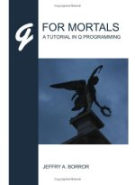

[{ style="width: 100px" }](http://www.amazon.com/Q-Mortals-Tutorial-Programming/dp/1434829014/ "Buy it from Amazon")
{ .left }

## Fire from Heaven

## Adrian Smith (adrian@apl385.com)

*q For Mortals*, Jeffry Borror, CreateSpace, ISBN 978-1434829016, 478pp, Mar 2008

Kx Systems recently released a personal edition of its q programming language, free for non-commercial use. This is more or less the first appearance of Kx’s terse language, an APL descendant specially tuned for ultra-fast database analysis, outside the heavily protected environments of investment banks. Borror’s introduction to the language was published simultaneously. *Ed.*
{ .ednote }

To learn a new language, you need an environment to fool around in, and a good textbook. The Kx people provide the former at [kx.com/developers/license2.php](http://kx.com/developers/license2.php) where you can grab a time-limited copy of kdb+ for personal use, and Jeffry Borror has provided the second. In the good old days, we had a mainframe to fool with and Gilman and Rose to read – maybe those days are here again? This review will document my attempt to find out.

You can judge as we go if prior knowledge of APL and a smattering of SQL (lightly dusted with Paul Mansour’s flipdb engine) is a help or a hindrance. My feeling is that it will help with the array-thinking part and hinder with the database query language. I will probably trip over the q keywords in a big way – I already tried to use `ss` as a scratch table name and there are bound to be others in the pipeline. Fortunately, Arthur has not yet used `qq` to mean anything important!

### Getting started

Just as `helloworld.c` is the hardest C program you will ever write, `2+2` is generally the hardest expression in any of the APL family. Once this works, you have cracked the installation, got your laptop working again, and generally calmed down. In this respect, the free kdb+ is much better than most, but it does have a couple of minor annoyances:

- Please will someone decide whether this thing is called **q** or kdb+. For the newbie it is not particularly clear that *personal kdb+* is what you need to run the q examples.
- The install suggests unzipping under `c:\q` without the option – I tried `d:\tools\q` and of course it died on me. In fact you can set `QHOME` to be anywhere you like, but the readme ought to tell you!

Either way, you will probably want a tiddly batch file like:

```
@echo off
Rem Kick off q from anywhere with optional script
set QHOME=d:\Tools\q

if ""=="%1" goto clear
d:\tools\q\w32\q.exe %1.q
goto exit

:clear
d:\tools\q\w32\q.exe

:exit
```

So you can hang about wherever you put your toy scripts and just type `q fluff` to kick off the q engine with your script already loaded. Here we go…

```
D:\>q
KDB+ 2.4 2008.03.31 Copyright (C) 1993-2008 Kx Systems
w32/ 1()core 502MB Adrian blue 192.168.2.103 TIMEOUT 2009.04.01

q)2+2
4
q)\\

D:\>
```

Gas, are we cooking with… let’s try something a little more challenging:

```
D:\data\q>q sp
KDB+ 2.4 2008.03.31 Copyright (C) 1993-2008 Kx Systems
w32/ 1()core 502MB Adrian blue 192.168.2.103 TIMEOUT 2009.04.01

q)select from sp where qty>200
s  p  qty
---------
s1 p1 300
s1 p3 400
s2 p1 300
s2 p2 400
s4 p4 300
s1 p5 400
```

I think that concludes the first phase – now to get moving on the review proper.

## Overview and Language Basics

One of the hardest choices an APL author has to make is the ordering of the material. Jeffry is aiming this at programmers (which probably includes anyone who has read any kind of science subject at university these days) so he starts with a lot of things his readers will already know.

### Functions and Atoms

This sets the tone for the rest of the book – Jeffry is kind but firm and makes no bones about the need to understand *functions* in the mathematical sense. There are a couple of typos here – the missing space in the code example (bottom of p.8) is a bad one. Yes it is trivial, but it undermines the reader’s faith in the code having been pasted from a running system. I am sure it will be fixed in the next printing.

I like the constant distinction between the *q gods* who write perfect code every time (and have no need of whitespace or comments) and *mere mortals* who should use meaningful names and split complex operations over multiple lines. I have even taken to writing `//` for comments, partly to save finger reprogramming, and partly to make TextPad’s syntax colouring work properly! I also like the little sample program Jeffry shows us right at the beginning – as he says “We promise that by the time you reach the end of this tutorial, this program will be easy, and you’ll feel right as rain.”

*Atoms* are the basics of any language, so it makes sense to introduce them early. Jeffry does his best to put ‘verbose language’ programmers at ease by starting with a clear table of equivalences from what they already know. I *think* I would label the 4th column ‘.net’ rather than ‘C#’ though – C# coders would always say `bool x;` rather than `System.Boolean x;` but of course `int` in C# can mean Int32 or Int64 depending on the platform, so he is right to quote the more pedantic style of name. All the types are listed with simple examples, and this feels like a few pages which will get well-thumbed on the odd occasion you actually need `byte` data and can’t recall the suffix. I am still a little unclear why a *symbol* isn’t a legitimate implementation of a *string*, as my C# brain is happy with the idea that strings are immutable. I suppose they do have *Length* and the `String` class does support an indexer, but that’s about as far as it goes. The table of infinities and the section on *null values* is informative and helpful. Database gurus go hairless arguing about nulls, so it is good to see **q** taking a rather pragmatic approach which will work fine in all sensible situations.

### Lists

APLers pay attention – this takes Trenchard More’s array theories and hits them well onto the next court but one. These be *Lists* and Jeffry is very consistent in calling them *Lists* just to keep us awake. That said, the only surprise is that atoms have a count of 1 and that we can skip the brackets in indexing expressions (indexing is just a function, after all). The more verbose notation for lists is used consistently so we have `l1:(1;2;3)` where `l1:1 2 3` will generally work in the same way. This makes sense as soon as you hit a nested list like `m1:(1 7;2 9;8 9)` where our APL habits would be `(1 7)(2 9)(8 9)` and would lead us astray. Indexing is very nicely brought in here, with the classic ‘matrix’ syntax:

```
q)m1[1;1 0 1 0 1]
9 2 9 2 9
```

being approached via the idea of indexing at depth with `m1[1][1 0 1 0 1]` which gives exactly the same result. By the end of Chapter 3 I think most readers should have grasped the basics, and will probably have a well-used q console with lots of ‘I wonder what this does’ expressions in it. They should take a well-earned break to let it sink in.

## Primitives and Functions

The primitives are no great surprise to an APL guy, but it is worth paying careful attention to the sections on *nulls* and *infinities* as well as the extensions to dates and times. Jeffry takes the ‘no precedence’ rule on the chin nice and early, and gives plenty of good examples of the sort of expressions that can puzzle anyone brought up on the C execution order. He also flags up a key difference from APL-derived languages (including k) in that there are no overloads on *valence* (so no monadic `-`) but there are overloads on *type* in functions such as `?`, for example:

```
q)3?5
3 2 2
q)1 2 3?3 2
2 1
q)?12
'?
```

User-defined functions follow on nicely, particularly as Jeffry already showed us that we can type `+[2;3]` or even `(2+)3` in the previous chapter. He again starts with the most verbose form, and gradually eliminates the redundant parts as the examples progress.

```
q)sqr:{[x] x*x}
q)sqr 3
9
q)sqr:{x*x}
q)sqr 4
16
q){x*x} 12
144
```

I think I would like him to make it clearer that I can’t have a user-defined dyad, and the rules for what is returned are explained very oddly on p.100 – I think that a lone `:` reads as *return* and that otherwise the result of the function is the result of the last expression executed. I would also like to see a big fat warning about this one:

```
q)sqr:{r:x*x;}
q)sqr 3
q)
```

If you have spent any time in the C family (which includes scripting tools like PHP) you get a bit of a semi-colon reflex in your fingers, which often results in an empty statement as the last one in your function. I am not sure about the claim that ‘functions are nouns’ in 4.1.6 – for example:

```
q)plus:+
q)plus[3;4]
7
q)incr:plus[1;]
q)incr 12
13
q)0 plus/8 9
17
```

Surely the primitive `+` and the user-defined function `plus` have the same syntactic status in the language? If it walks like a verb and quacks like a verb, I say it’s a verb. Shame you can’t use it with *amend* though. Maybe it’s only a verb when it feels like it!

The section on *function projection* has no such quibbles, and I found the section on *adverbs* simple and clear. The final section on *index, apply, dot* feels a bit hard – if it was in the TeX manual it would have 3 ‘dangerous bend’ signs. Probably essential reading for the serious **q** systems developer but I’m afraid your reviewer started turning over pages in search of something less strenous.

### Casts and Enumerations

Something in me wonders if this shouldn’t come a little earlier, probably after the chapter on lists. Casting is something that programmers are very used to, and there is nothing very strange about the way **q** handles it. Enumerations are just factored lists, and although the process will take some getting used to, there is nothing very startling here either.

## The Serious Stuff – Dictionaries and Tables

This is where the power of **q** cranks up a notch. Anyone with an APL or J background has probably been saying “so what?” up to this point, although we can hope that C++ and VB kids may have got excited by now. The next two sections are the reason **q** has been taking the world of timeseries database by storm, as they extend the raw language into the domain of database programming, but without the limitations imposed by years of SQL thinking.

### Dictionaries – a statement of the bleedin’ obvious?

Open any Javascript or PHP book at the section on *arrays* and you will find something like this:

> “You can assign an index when using the `array()` function as follows: `$list = array (1=>"apples",2=>"bananas",3=>"oranges");`. The index value you specify does not have to be a number, you could use words as well. This technique of indexing is very practical for making more meaningful lists.”

That was from *PHP for the World Wide Web, Visual Quickstart Guide, 2001* but anything will do. The point is that APL (and J) purport to be array languages, and neither of them support something that most modern scripting tools take as a given. In **q** we find that we can type:

```
q)fruit: (1 2 3!`apples`bananas`oranges)
q)fruit 2
`bananas
q)fruit 2 1 1 3
`bananas`apples`apples`oranges
```

We can even add new elements (again like PHP) by indexing with a non-matching key:

```
q)fruit[23]:`pears
q)fruit
1 | apples
2 | bananas
3 | oranges
23| pears
```

Jeffry takes *dictionaries* at a steady pace, and I am fairly sure I came out of this section with a clear feel for what they are and how I could use them. The section builds nicely via *column dictionaries* where the content has more than one value (these examples are my maunderings in the **q** session, by the way. The fact that I got all of them right at the first attempt is a tribute to both **q** and Jeffry):

```
q)emp:(`id`name!(1001 1002;`Adrian`Richard))
q)emp
id  | 1001   1002
name| Adrian Richard
q)emp[`name]
`Adrian`Richard
q)emp[`name;0]
`Adrian
```

… and as if by magic, we arrive at *tables* and a whole new world lies before us:

```
q)et:flip emp
q)select id from et
id
----
1001
1002
q)select from et where id=1001
id   name
-----------
1001 Adrian
```

I think I would like a little more advice from a systems-design angle on when to use a *dictionary* and when to use a *table* in constructing a real life application. There are so many helpful tools in **q** to make working with tables simple and painless that maybe Jeffry has told us rather more about dictionaries than we really need to know? I guess we will have to await his next book to find out!

### Tables like you never seen ’em before

At this point you can swap in your SQL brain and take on a few more surprises. What is most appealing is the way that anything that acts on a table returns a table, so expressions can build on each other:

```
q)select name from select id,name from et
name
-------
Adrian
Richard
```

This would make Chris Date<sup><a href="#ref1">\[1\]</a></sup> *very happy indeed*. Having been provoked by Paul Mansour into reading most of the C.J. Date books on advanced database design, I suspect **q** complies with virtually all his criteria for a *true* relational database, which no traditional SQL-based system does. The other big bonus is that you can do arithmetic directly on the columns. I know standard SQL has some pretty cool `Alter table` stuff but you can only do the things the SQL designers thought of at the time. In **q** you can do anything Ken Iverson thought of, which adds the full gamut of array power to table syntax:

```
q)et.xx: (+\)et.id
q)et
id   name    xx
-----------------
1001 Adrian  1001
1002 Richard 2003

q)add2:{x+2}
q)et.xx: add2 et.id
q)et
id   name    xx
-----------------
1001 Adrian  1003
1002 Richard 1004
```

So simple to create a scratch column using a bit of **k** to accumulate the values, or to apply our own (incredibly complex) data-processing expression encapsulated in a function. I begin to see why Richard came back from Cantor Fitzgerald with a big grin on his face – algorithmic work against databases does begin to look very simple when you can write code in this way.

### Primary keys and keyed tables

Time to concentrate a little – we arrive at section 7.4 and a cup of strong coffee is called for. Up to this point Jeffry has led us by the hand through green pastures, from now on in the path winds uphill, and you might find yourself coming back here several times as you begin to build serious applications. The syntax for creating and indexing a keyed table is clear enough:

```
q)et:([id:1001 1002] name:`Adrian`Richard;pay:1234 12345)
q)et
id  | name    pay
----| -------------
1001| Adrian  1234
1002| Richard 12345
q)et 1001
name| `Adrian
pay | 1234
```

which brings us (via multiple keys and other stuff) to section 7.5 where we hit *foreign keys* and *virtual columns*. I found this fairly comfortable reading, but I have been immersed in database design for longer than I care to remember<sup><a href="#ref2">\[2\]</a></sup> and was responsible for lots of APL utilities for handling just these concepts in my Rowntree years. I think that this section could really use some diagrams – even for the simplest toy database, I find myself reaching for the back of the nearest envelope and drawing boxes on it! Essentially the foreign keys define the lines on the diagram, and enforce ‘referential integrity’ meaning that you can’t have an employee working in a department that doesn’t exist. In **q** we find that we are revisiting the *enumeration* which is the construct that implements the ‘refers-to’ or ‘is composed of’ database semantics:

```
q)dp:([id:23 34] descr:("Op Research";"General Dogsbody"))
q)dp
id| descr
--| ------------------
23| "Op Research"
34| "General Dogsbody"
q)et:([id:1001 1002] name:`Adrian`Richard; dept:`dp$34 23; pay:1234 12345)
q)et
id  | name    dept pay
----| ------------------
1001| Adrian  34   1234
1002| Richard 23   12345
```

So far we have something very like the toy database in my experiments with `System.DataSet`<sup><a href="#ref3">\[3\]</a></sup> but in **q** you can take things one step further by using the *dot* notation to look down the chain of relationships without having to write lots of obscure *join* syntax in the SQL:

```
q)et
id  | name    dept pay
----| ------------------
1001| Adrian  34   1234
1002| Richard 23   12345

q)select name,dept.descr,pay from et
name    descr              pay
--------------------------------
Adrian  "General Dogsbody" 1234
Richard "Op Research"      12345
```

One of the ‘tough challenges’ you are set in the Oracle training programme is “Find the employees who earn more than their manager”. With the addition of an appropriate column to our department table, this sort of inter-table cross-referencing becomes quite trivial:

```
q)dp:dp,'([] mgr:`et$1001 1001)
q)select id,name from et where pay>=dept.mgr.pay
id   name
------------
1002 Richard
```

Of course there is a lot of advanced stuff on tables that I can skip over here – refer to it when you need it – but the basics are simply explained, and my experience is that by tabbing over to a **q** session and following along (with examples of your own) you will ‘get the drift’ very quickly. Next up is 80 pages telling us a lot more about **q-sql** which I think I am going to enjoy. Time to make a little script out of those *emp-dept* examples so I can keep fooling with it after my free **q** has timed out.

## Working with Queries in q-sql

This is very plain sailing, up to the point where you hit *Grouping and Aggregation* which deserves close attention. In SQL these are tightly bound up, whereas **q-sql** gives you the option to preserve the content of the groups in the resulting table. Paul Mansour copied this in flipdb and used his Minnowbrook session to show us lots of nice examples of ‘hard’ problems that just fall out if you have some set functions to hand. A trivial example could be:

```
q)select pay by dept from emp
dept| pay
----| -----------------
23  | ,23451
34  | 12345 32141 51324
```

Note how **q** gives us a heavy hint that the singleton is a 1-element list, *not* a scalar here. There may be a way Dyalog could discriminate between these with the session syntax colouring (hint, hint) these days, as the visual similarity often leads newbies astray. Of course you can also throw in your own code here:

```
q)select {(sum x) % count x}pay by dept from emp
dept| pay
----| --------
23  | 23451
34  | 31936.67
```

This one just reproduces the built-in `avg` keyword, but there are plenty of other things you could do here, like quartiles, which **q-sql** doesn’t support directly. Entire queries can be ‘canned’ with the usual function syntax (Jeff calls these *parameterized queries* but they just look like functions to me).for example:

```
q)q1:{select name,pay from emp where id in x}
q)q1 1003 1004
name pay
----------
Gill 32141
Tim  51324
```

Of course you would normally name the argument(s) here (as Jeff does in the examples) to make things clearer. *Views* are implemented using the underlying *alias* syntax (which I’m sure I recall seeing somewhere in earlier chapters):

```
q)v1::select Name:name,Department:dept from emp
q)v1
Name    Department
------------------
Adrian  23
Richard 34
Gill    34
Tim     34
```

Finally, we hit the *functional forms* of both *select* and *exec* (which returns the underlying data rather than a table, incidentally) which are what **q-sql** parses your statements down to before it runs them. Being able to call these forms directly can be essential if the user can build the query dynamically in some fancy front-end. It saves a huge amount of hassle creating the query string (with appropriate string escapes) that we APLers have had to face for years when talking to DB2 or Oracle. It all looks pretty hairy in the examples, but I’m sure that with a little practice you can write these expressions as comfortably as you can write the *select* templates. Let’s tab over to the **q** session and have a try…

```
q)?[emp;();0b;`Id`Name!(`id;`name)]
Id   Name
------------
1001 Adrian
1002 Richard
1003 Gill
1004 Tim
q)?[emp;(enlist (in;`id;1001 1002));();`name]
`Adrian`Richard
```

There we are, that wasn’t *so* hard, was it now? I am not clear how it knew that the first expression was a select and the second one an exec, but I’m sure some q minor deity will explain it to me if I ever really need to know. Time to skip over 13 pages of ‘things to do with a trading system’ and move on!

## Loops, Files, Namespaces and other Matters

Yes, you can write boring procedural stuff in **q** but at least you don’t get told how until right at the back of the book. Error-trapping and debugging support (there isn’t any) rate a couple of pages, as do scripts and startup parameters. Finally (page 301) we get to read and write files, parse .csv input, and chatter with other **q** processes over the network. This is clearly how trading systems are written in the real world (lots of little tasks watching feeds and nattering to each other) and I don’t think I am competent to say how well this section of the book works as an introduction. I had less trouble with the section on *contexts*, although it appears from some of the warnings that these are not quite all they appear, and you may want to keep your code only one level deep!

Finally we get the usual summary of system commands and variables, and a couple of appendices list all the functions and the rather minimal set of error messages. The index looks pretty thorough, but I have yet to give it a decent test.

## Summary

This book is hard to fault. It has taken me on a very well-planned exploration of the strange land of **q** and I feel that I could already find my way around quite a lot of it unaided. I also know where to look to remind myself of the more obscure parts of the language that will never stick in the brain until I need to use them for real. Anyone with an interest in the APL language family should probably get a copy, if only to keep them alert to possible future extensions in the APL of their choice! I shall be agitating for *dictionaries* at future Dyalog conferences, and I might revisit my experiments with the .net DataSet class to see how much of the **q-sql** syntax it is possible to fake. Maybe a few exercises would be a good addition, although it is easy enough to make up your own challenges as you go along. If there is another book on the way, I will be first in the (as it were) <strong>q</strong>ueue to get my hands on it.

## References

1. <a id="ref1"></a> *Database in Depth*, C.J. Date, O’Reilly, 2005
2. <a id="ref2"></a> “Structuring Data with APL”, Adrian Smith, *Proceedings of APL Business Technology 83*, p175
3. <a id="ref3"></a>[“Using the .Net DataSet with Dyalog 12”](../art10011840/), Adrian Smith, *Vector* 23.3 p.89
