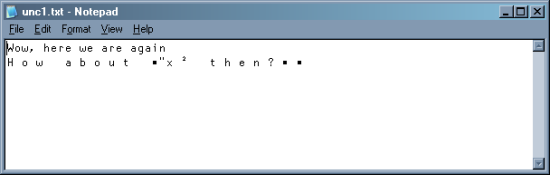
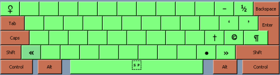
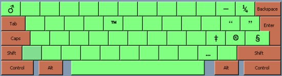

by Adrian Smith (adrian@apl385.com)
{ .byline }

**Abstract** This is a first summary of the experience I have had in moving the bulk of my daily schedule across to Dyalog 12 (Unicode edition). The little traps this process set you in no way invalidate the decision to move, but they can really spoil your day if you don’t take good care of them. I will take things mostly in order of importance, starting with possible application crashes and moving on to minor presentational annoyances which can be fixed over a longer time.
{ .abstract }

## Things to Test in the Interpreter

In spite of a long beta period, it was impossible to catch all the ‘funnies’ that the interpreter came up with. There may well be some gremlins left, for example I very recently discovered (when updating the source for one of my help files) that when I selected some text and hit Ctrl+B it was correctly wrapped with &lt;b>tags&lt;/b>, but when I did the same with Ctrl+I nothing appeared to happen. Hmmm – then when I just tried to type the tag manually into the edit field, the first character I typed magically produced the ‘i’ for me.

Along the same lines, I was teaching a new Dyalog user the basics of CPro, and we got to the point where I needed to type a typical indexing expression such as `inx⊃myvec` into the dialogue designer. That was when I found that AltGr+C and AltGr+V were firmly wired to Copy/Paste and completely ignored my keyboard definition!

This sort of thing is *almost* impossible to test for, and I’m sure there will be other similar little annoyances. The moral of this story is to believe what you see (even if you only see it once) and let someone know about it. Dan (Baronet) is the man who can repro pretty well anything if you give him a good few clues where to look.

## Things that may Break your Application

### Things they tell you about

There are two places code has to change: any `⎕NA` calls will need some revision, and any calls to `⎕DR` to check for character data will definitely not work any more.

Most `⎕NA` calls can be fixed automatically with the new star syntax, for example:

```
     ∇ ret←GetCurrentDirectory;func;buffer_size
[1]   ⍝ Cover for the windows GetCurrentDirectory function
[2]   ⍝ Returns the current directory name
[3]    buffer_size←10000
[4]    'func'⎕NA'U4 kernel32.dll.C32|GetCurrentDirectory* U4 >0T'
[5]    ret←func buffer_size buffer_size
[6]    :If 0≠⊃ret ⍝ Function OK
[7]      ret←2⊃ret
[8]    :Else
[9]      ret←''
[10]   :EndIf
     ∇
```

This will call the correct DLL function (`GetCurrentDirectoryA` for Dyalog 12, or `GetCurrentDirectoryW` for 12-unicode) and so you can share these functions between interpreter versions. The only place I got snagged was with:

```
     ∇ {RC}←HANDLE PutString NV;SUBKEY;VALUE;RegSetValueEx
[1]   ⍝ Stores a text value in a Registry SUBKEY
[2]   ⍝ HANDLE is the handle for an existing Registry Key
[3]   ⍝ Function by JS based on  SE.WSDoc.GetRegKeyValue
[4]    (SUBKEY VALUE)←NV
[5]    ⎕NA'I ADVAPI32.dll.C32|RegSetValueEx* U <0T I I <0T I4'
[6]    RC←RegSetValueEx HANDLE SUBKEY 0 1 VALUE(1+2×⍴,VALUE)
     ∇
```

This is the Unicode version – spot the `2` in the last line! I spent quite a while wondering what was eating my registry settings (e.g. the last saved file in the Rain viewer) as every time I read the settings and re-saved them, the length halved!

Checking for numeric data-type used to be done like this:

```
      1=0=1↑0⍴2 3 4
1
```

… with something very similar for character. Maybe old ways are best:

```
      ⎕dr 'Fat cat'
80
      ⎕dr 'Let’s try ∑x also'
160
```

I had various bits of code looking for `82` here, and of course things tended to crash some way down the track, as the test ‘works’ but returns the wrong answer. I suggest:

```
      ' '=1↑0⍴∊'Let’s try ∑x also'
1
```

This should keep working for ever! It also gives you a good way to test if you are in a Unicode interpreter:

```
      unc←80=⎕dr ' '
```

### Things you find out the hard way

The only real nasty I have hit so far is with native files – the problem here is that you may have a long-running logfile (saved out as plain text) to which you occasionally append messages.

```
      'c:\temp\unc1.txt'⎕NCREATE ¯1
      ('Hello',⎕av[4 3]) ⎕nappend ¯1
      ('World',⎕av[4 3]) ⎕nappend ¯1
      ⎕nuntie ¯1
```

This may have started life several years ago in a previous version of APL, and to start with all seems fine when you move your application:

```
      'c:\temp\unc1.txt'⎕ntie ¯1
      ('Wow, here we are again',⎕ucs 13 10) ⎕nappend ¯1
      ('How about x²',⎕ucs 13 10) ⎕nappend ¯1
      ('How about ∑x² then?',⎕ucs 13 10) ⎕nappend ¯1
DOMAIN ERROR
      ('How about ∑x² then?',⎕UCS 13 10)⎕NAPPEND ¯1
     ∧
```

This can strike at any time, if you allow the user to edit the log message, and the user has the ability to type some symbol that falls outside the base 256 characters. Even if you clear the file down, you still have the problem unless you always specify the translation:

```
       0 ⎕nresize ¯1
      ('Wow, here we are again',⎕ucs 13 10) ⎕nappend ¯1 160
      ('How about ∑x² then?',⎕UCS 13 10)⎕NAPPEND ¯1 160
```

… and you have to be really careful not to mix translations in the same file:

```
      0 ⎕nresize ¯1
      ('Wow, here we are again',⎕ucs 13 10) ⎕nappend ¯1
      ('How about ∑x² then?',⎕UCS 13 10)⎕NAPPEND ¯1 160
      ⎕nuntie ¯1
```

This appears to have ‘worked’ but if you open the file in Notepad, it looks like this:



Analysing such a file at some point in the future will be a nightmare. So what to do? I have a couple of ‘old faithful’ utilities for writing and reading text files, so these were the obvious place to start:

<pre>
     ∇ {r}←fi Putcrv txt;fh;cr;lf;msk;pos;⎕TRAP
[1]   ⍝ Put a ⎕TCNL vector to file <fi>
[2]   ⍝ Returns 1 if OK; errors if failed.
[3]    ⎕IO←1 ⋄ r←0 ⋄ (lf cr)←⎕AV[3 4]
[4]
[5]   ⍝ Try for existing file (includes 'prn' etc.) ...
[6]    ⎕TRAP←(22 'E' '→New')(19 'E' '⎕SIGNAL ⎕EN') ⋄ fh←fi ⎕NTIE 0
[7]
[8]   ⍝ We cannot tell if this is a printer, so if the resize fails just carry on!
[9]   Resize:⎕TRAP←22 'E' '→Append' ⋄ 0 ⎕NRESIZE fh ⋄ →Append
[10]
[11]  New:⎕TRAP←22 'E' '⎕SIGNAL ⎕EN' ⋄ fh←fi ⎕NCREATE 0
[12]
[13]  Append:⎕TRAP←22 'E' '⎕SIGNAL ⎕EN'
[14]  ⍝ Pair CR/LF from ⎕TCNL
[15]   msk←txt=cr ⋄ pos←msk/⍳⍴msk
[16]   txt←(1+msk)/txt
[17]   txt[1+pos+0,+\¯1↓(⍴pos)⍴1]←lf
[18]
[19]   :If 160≤⎕DR txt ⍝ Make it UTF8 - and mark it with ef bb bf
[20]     txt←⎕UCS 239 187 191,'UTF-8'⎕UCS txt
[21]   :End
[22]
[23]   txt ⎕NAPPEND fh ⋄ ⎕NUNTIE fh ⋄ r←1
     ∇
</fi></pre>

This writes UTF-8 files rather than full 2-byte Unicode files which has the advantage that most text-editors can handle them, and the file size is generally much smaller. To read either this or any other common format, we have to examine the header bytes and decode appropriately:

```
     ∇ txt←Getcrv fi;fh;ptn;⎕IO;⎕TRAP
[1]   ⍝ Read entire text file as vector
[2]    txt←'' ⋄ ⎕IO←1
[3]    ⎕TRAP←22 'E' '⎕SIGNAL ⎕EN'
[4]    fh←fi ⎕NTIE 0
[5]    txt←unpick ⎕NREAD fh 83(⎕NSIZE fh)
[6]    ⎕NUNTIE fh
     ∇

     ∇ txt←unpick bytes
[1]   ⍝ See what we read from file and decode depending on the leading byte(s)
[2]   ⍝ Make sure it is unsigned, and drop the UTF-8 marker bytes if present
[3]    bytes+←256×bytes<0
[4]    :If 239 187 191≡3↑bytes    ⍝ UTF-8 marker
[5]      bytes↓⍨←3
[6]      txt←'UTF-8'⎕UCS bytes
[7]    :ElseIf 255 254≡2↑bytes    ⍝ Unicode (normal byte order)
[8]      bytes↓⍨←2
[9]      txt←⎕UCS 256⊥⍉⌽((0.5×⍴bytes),2)⍴bytes
[10]   :ElseIf 254 255≡2↑bytes    ⍝ Unicode (big end up)
[11]     bytes↓⍨←2
[12]     txt←⎕UCS 256⊥⍉((0.5×⍴bytes),2)⍴bytes
[13]   :Else   ⍝ Don't try UTF-8 as we may have chars >127 in here
[14]     txt←⎕UCS bytes
[15]   :End
     ∇
```

Obviously, if you want a logfile to persist across a Dyalog-12 upgrade, you should re-create it using something similar, or just check for 160 in the message-type and ‘do something’ to make sure you don’t simply trash the file. I think a good solution would be to check for the 160 case, convert the text to UTF-8 as above, check if the first 3 bytes of the file had the UTF-8 marker and regenerate the entire file if not. Otherwise the only safe option is to substitute a ‘standard’ marker character (‘?’ is normal) for anything above `⎕UCS 256` which will at least keep things running while you think about it.

## Mappings that Stop Working

In the ‘non-catastrophic’ section, we may have been exploiting the DIN mapping from `⎕AV` to the font position for several of the APL characters. When Chris Lee first developed this Windows font layout, he tried to choose ‘good’ associations, for example the APL comment symbol was mapped to the © character. Dyalog copied the mapping fairly faithfully, and we have all got to know it over the years. For example, I regularly use:

- *delta* and *del* for the ‘typographic’ single quotes. *grade up* and *grade down* are the “speechmarks” also.
- *execute* is – *endash* and *format* gives you a • *bullet*.
- *reverse* and *transpose* (rather surprisingly) give superscripts²³ which is nice for equations.
- *jot* is good for the *degree* symbol, as in °C in chart captions

I am sure there are others – it took me best part of a day to find and fix all of these in the examples in RainPro. You also need to be aware that *some* of these fixes are a one-way door to Unicode. If you attempt to `)LOAD` a workspace with any text outside the normal range, it will simply say TRANSLATION ERROR and refuse at the first fence. Identifying the cause of the problem can be a bit tricky, so here is another little helper I wrote to get me moving:

```
     ∇ list←Scan4u ns;nl;fn;cr;ok;dodgy;nslist;vn;var;badchars
[1]   ⍝ Report any dodgy functions - chars not in ⎕AV are dangerous
        … as these won't copy into Classic 12
[2]   ⍝ We know Rain12 has a test called Unicode which should report here
[3]   ⍝ Takes a namespace as argument - scans current NS if empty
[4]   ⍝ Returns 2-column matrix with namespace.function name
        …  and distinct uncopyable chars
[5]   ⍝ By ACDS Dec 2007
[6]   ⍝
[7]
[8]    :If 0∊⍴ns
[9]      ns←''⎕CS''
[10]   :End
[11]
[12]   nl←(ns⍎'⎕NL')¯2
[13]   list←0 2⍴''
[14]   nslist←(⊂ns,'.'),¨(ns⍎'⎕NL')¯9.1
[15]   badchars←'‘’“”–—'    ⍝ These will load in classic, but map incorrectly!
[16]
[17]   :For vn :In nl
[18]     var←⍕∊ns⍎vn
[19]     ok←∧/(var∊⎕AV)∧~var∊badchars
[20]     :If ~ok
[21]       dodgy←∪(var~⎕AV),var∩badchars
[22]       list⍪←(ns,'.',vn)dodgy
[23]     :End
[24]   :End
[25]
[26]   nl←(ns⍎'⎕NL')¯3
[27]   :For fn :In nl
[28]     cr←,(ns⍎'⎕CR')fn
[29]     ok←∧/(cr∊⎕AV)∧~cr∊badchars
[30]     :If ~ok
[31]       dodgy←∪(cr~⎕AV),cr∩badchars
[32]       list⍪←(ns,'.',fn)dodgy
[33]     :End
[34]   :End
[35]
[36]   :For ns :In nslist ⍝ Go walkies
[37]     list⍪←Scan4u ns
[38]   :End
     ∇
```

One other thing that caught me here – I had a global variable in the workspace to check for ‘ascii’ characters which included the `^` (ASCII caret) character. When I moved the workspace across, this became an APL `∧` logical *and* which stopped this particular function working in a rather hard-to-detect way.

A side-effect of losing the mappings, was that I suddenly found that it was *really hard* to type these very useful characters. For chart captions and the like, you often want “proper” quotes and dashes, as well as expressions like 3x²+2x to label regression lines. The pragmatic solution was to grab a few more keystrokes and set myself up with a little typographic pad on Ctrl+\[\] and nearby keys:



… with a similar collection on the shifted keys. Most of these were a straight copy from Aldus Pagemaker, and they cover nearly everything you need in day-to-day typing. As you can see from the first character in this paragraph, they also come in quite handy when typing HTML text into Notepad! No *degree* symbol yet though … poor old *ellipsis* might be for the chop, although that ® looks a bit vulnerable too!



Either way, being able to build your own keyboard map and use it everywhere in Windows is really great.

## Removing Workarounds

Now we hit the downhill part of the ski-run – getting rid of all the nasty stuff we had to do to get around the 256-char limit. A typical example I had was writing SVG (a very picky XML format) files to represent my charts. Any characters above ASCII-128 must be encoded as `&#nnnn;`, and several common characters in the 145 range (like the quotes) required the pukka Unicode values. I won’t bore you with the messy stuff I had before – all I need now is to use the native character translator which automatically gives me all the right numbers:

```
⍝ Hex any remaining hi-bit characters (reliable translation now)
 vec←,vec ⋄ asc←128>⎕UCS vec ⋄ hi←(~asc)/⍳⍴vec
 :If 0<⍴hi
   aix←⎕UCS vec[hi]
   hex←,(((⍴aix),2)⍴'&#'),('ZI4'⎕FMT aix),';'
   vec←(1+6×~asc)/vec
   hi←hi++\¯1↓0,(⍴hi)⍴6
   vec[,hi∘.+0 1 2 3 4 5 6]←hex
 :End
```

…and of course I had to beef up my C# translator to handle this:

```
      cc.chk 'x←⎕ucs 65 67 3348'
       x     ←     ⎕ucs  65 67 3348
 MARK  NOUN  ASGN  VERB  NOUN
 x = AE_ucs(new int[] {65,67,3348});   // Using ...

static string AE_ucs(int[] iv)  // Int array translate
{
  char[] charvec = new char[iv.Length];
  for(int i=0;i<iv.Length;i++)
    charvec[i]=(char)iv[i];
  return new String(charvec);
}
```

This spins off a suitable helper function the first time it sees a particular call (I just supported the 4 obvious variants with scalars and vectors either way round) and then calls it in-line.

## Wrap-up

There is clearly some pain involved, but I think the gain beats it hands down. I do like throwing away code! Fewer lines always means fewer bug-opportunities, and translate tables are a great place for bugs to hang out.
