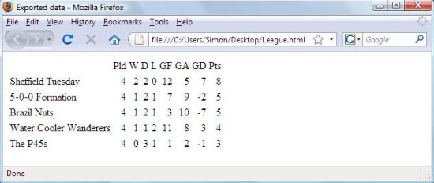

Simon Marsden, MicroAPL Ltd  
[microapl@microapl.co.uk](mailto:microapl@microapl.co.uk)
{ .byline }

This article was originally presented as a talk at the BAA AGM in June 2008.
{ .ednote }

APL has always been a great language for trying things out, changing and experimenting until you’re happy with an application. That’s why it is often referred to as a ‘tool of thought’.

My purpose in this talk is to demonstrate how the design of APLX encourages the user to work this way even when writing object-oriented code. In other words, to show how you can design and modify the class hierarchy as you go along, even when you have instances of the classes you are changing.

To do this, let’s consider a concrete example, one small enough to explore here but large enough to demonstrate some interesting features of interactive OOP development. Imagine that we work for a company called BigCorp and have been given the job of organising a 5-a-side football tournament for its employees.

## Creating our first class

To start off with, we need to get a list of employees from the company’s personnel database. We can do this very easily in APLX using `⎕SQL`.

```
    1 ⎕SQL 'connect' 'aplxodbc' 'DSN=BigCorpDB;PWD=xx;UID=root;'
0 0 0 0
    1 ⎕SQL 'do' 'use bigcorp'
0 0 0 0
    fields←'FIRSTNAME,LASTNAME,SEX,EMAIL,EMPLOYEENUMBER,DEPARTMENT'
    (rc errmsg employeeData)←1 ⎕SQL 'do' 'select',fields,'from employeedata'
```

We decide on an object-oriented solution to our 5-a-side problem, and that our first class should represent an `Employee`. This will have a number of properties like `firstName`, `lastName`, etc, and a constructor to initialise them when an object is created.

To save space, let’s omit the step of using the APLX class editor to create the class. Here is the listing of the finished class. The first part of the `⎕CR` listing shows the properties, followed by the constructor. (In APLX, the constructor always has the same name as the class).

```
      ⎕CR 'Employee'
Employee {
firstName
lastName
sex
email
employeeNumber
department
 
∇Employee arg
(firstName lastName sex email employeeNumber department)←arg
∇
}
```

We now have a new workspace entry called `Employee`, which is a class reference which we can use to create new instances of the class. Here we create a vector with an object representing each employee:

```
      )CLASSES
Employee
      Employee
{Employee}

      employees←⎕NEW ¨⊂[2]Employee,employeeData
      ⍴employees
44
      3↑employees
[Employee] [Employee] [Employee]
```

Notice that the default display of the first three list elements is not very helpful – it just tells us that we have three objects of type `Employee`. We can examine an individual object (or many) using `⎕STATE`:

```
       employees[1].⎕STATE 0
firstName                         Bert
lastName                         Brown
sex                                  M
email           Bert.Brown@bigcorp.com
employeeNumber                      24
department                           C
```

However, it would be nice to have a quick way of telling `Employee` objects apart, and we can do this by changing the default Display Format of an object using the system method `⎕DF`:

```
      employees.⎕DF '[',¨employees.lastName,¨']'
      3↑employees
[Brown] [Ptolemy] [Oakum]
```

## Let’s play football

The next thing to do is to tell everyone about the 5-a-side competition and invite them to play. We can do this fairly easily by sending everyone in the company an e-mail:

```
      SM←'⎕' ⎕NEW 'SendMail'
      SM.host←'smtp.bigcorp.com'
      SM.user←'bigcorp'
      SM.password←'sesame'
      SM.Open
0
      SM.from←'simon@bigcorp.com'
      SM.to←¯1↓∊employees.email,¨','
      SM.subject←'Five-a-side Tournament'
      SM.body←'Would you like to play five-a-side football?'
      SM.SendMessage
0
      SM.Close
0
```

Let’s imagine that we have had replies to our e-mail and that 25 people are interested in playing. We’ll choose 25 random players for the sake of the example:

```
     wantingToPlay←employees[25↑(⍴employees)?⍴employees]
```

Now we need to allocate them into teams of five players. We’ll use a very simple new class `Team` which has no constructor and no methods yet, and just has properties called `name` and `players`.

```
      ⎕CR 'Team'
Team {
name
players
}
```

We can then create an object to represent each team:

```
      numTeams←⌊(⍴wantingToPlay)÷5
      teams←⎕NEW¨numTeams⍴Team
      teams.players←,⊂[2](numTeams,5)⍴wantingToPlay
      teams[1].players
[Brown] [Ptolemy] [Oakum] [Fry] [Wittering]
```

## Saving Objects

Since the 5-a-side tournament is going to last for several weeks, we need to save the details of the teams somehow.

Imagine for a moment that you were writing this application in another object-oriented language like C# or Java, or even another interpreted object-oriented language like Ruby. In this case, you would need to write the team details to some kind of external file, either a plain text file or something more elaborate. You would also need to write code to read back the details from the file and recreate the team objects.

In APLX, things are much simpler. APL objects continue to exist if you `)SAVE` the workspace and reload it at a later date. Although this seems natural to an APL programmer, it’s only possible because APL uses the concept of a workspace. It’s interesting both because you have to write less code, and because it allows you to experiment freely with how classes should be structured…

## Re-factoring classes

Let’s go back a step and imagine that we only had 24 people who want to play football. Unfortunately, we don’t now have enough players to make five complete teams, so some people will be left out:

```
      wantingToPlay←24↑wantingToPlay
      numTeams←⌊(⍴wantingToPlay)÷5
      teams←⎕NEW ¨numTeams⍴Team
      teams.players←,⊂[2](numTeams,5)⍴wantingToPlay
      wantingToPlay~∊teams.players
[Smith] [Jones] [Khan] [Pasty]
```

However, they ‘have this mate who plays a little football.’ He’s not a company employee, but can he play anyway?

The new player doesn’t have an employee number or a department, so it looks like we made a mistake with our initial design of the `Employee` class. We need to move most of its properties into a new class `Person` and then make `Employee` inherit from it.

This is where the interactive nature of APLX starts to get interesting, because we can accomplish this without needing to re-do everything from scratch. We can modify the class structure but carry on using all our existing objects! This is very unusual in the world of object-oriented programming languages.

To create the new `Person` class, we could use the APLX class editor to create the class and then add the constructor and all the properties we need, one at a time. For a small class this would not take too long but there is a quicker way to do it, because the system functions `⎕CR` and `⎕FX` have been extended to work with classes:

Get a text representation of `Employee`:

```
      text←⎕CR 'Employee'
```

Edit this text to rename the class as `Person` and delete the two unwanted properties `employeeNumber` and `department`:

```
      text
Person {
firstName
lastName
sex
email
 
∇Person arg
(firstName lastName sex email)←arg
∇
}
```

Fix the new class

```
      ⎕FX text
Person
```

Having created the new `Person` class, we want to make `Employee` into a child class which inherits from it by using the system function `⎕REPARENT`:

```
      )CLASSES
Employee        Person

      Employee.⎕PARENT
[NULL OBJECT]
      Employee ⎕REPARENT Person
      Employee.⎕PARENT
{Person}
```

Finally, we change the class definition of `Employee` to delete the properties which we’ve moved into `Person`, and change the constructor as follows:

```
      ∇Employee arg
      ⍝
      ⍝ Call the constructor of our parent class
      Person 4↑arg
      ⍝
      ⍝ Initialise extra fields
      (employeeNumber department)←4↓arg
      ∇
```

(Notice how a constructor can be called just like an ordinary method. Here we call the base class constructor, `Person`.)

All the objects we’ve already created continue to exist:

```
      3↑wantingToPlay
[Brown] [Ptolemy] [Oakum]
```

Now we’ve changed our class hierarchy we are ready to bring in the extra player from outside the company to make up the fifth team:

```
      newplayer←⎕NEW Person 'Ronaldo' 'Moreira' 'M' ''
      newplayer.⎕DF '[Ronaldinho]'
      newteam←⎕NEW Team
      newteam.players←newplayer,wantingToPlay~∊teams.players
      teams←teams,newteam
      ⍴teams
5
```

Notice that the new team is of mixed composition:

```
      newteam.players.⎕CLASSREF
{Person} {Employee} {Employee} {Employee} {Employee}
      +/Employee=newteam.players.⎕CLASSREF
4
```

## Any questions?

You may have some questions at this point. First of all, what happens to an existing object if you delete its class? The answer is that the object still exists but you can no longer do much with it:

```
      )SAVE football
2008-06-02 14.10.32
      teams[1]
[Team]
      teams[1].players
[Brown] [Ptolemy] [Oakum] [Fry] [Wittering]
      )ERASE Team
      teams[1]
[DELETED CLASS]
      teams[1].players
VALUE ERROR
      teams[1].players
      ^
```

How about if, instead of deleting the class `Team` we just delete the `players` property? Because the property no longer exists, APLX immediately deletes it from any object instances and reclaims the memory, whilst leaving the objects otherwise untouched

```
      )LOAD football
SAVED 2008-06-02 14.10.32
      )ERASE Team.players
      teams[1].players
VALUE ERROR
      teams[1].players
      ^
```

However, before doing so, APLX will check to see whether the parent class contains a property of the same name. If so, the object’s property value is still accessible and is not deleted. (This is why it was important to re-parent our `Employee` class before deleting its unwanted properties, so that we didn’t change any existing `Employee` objects).

How about trying to create circularities in the class inheritance hierarchy?

```
      Employee ⎕REPARENT Person
      Person ⎕REPARENT Employee
DOMAIN ERROR
      Person ⎕REPARENT Employee
      ^
```

## Creating a football league

It’s now time to assign names to the teams. Again we’ll use the `⎕DF` trick to make it easier to identify different `Team` objects:

```
      teams.name←'Sheffield Tuesday' 'Water Cooler Wanderers' 'The P45s'
                 '5-0-0 Formation' 'Brazil Nuts'
      teams.⎕DF '[',¨teams.name,¨']'
      1↑teams
[Sheffield Tuesday]
```

The last class we need to create is a `Match` class. This will have three properties – the two teams who will play, the `score` (initially 0,0), and a Boolean `played` indicating whether the match has taken place yet. The class also has a constructor, and a method `Winner` which returns the winning team. Here is the listing of the completed class:

```
    ⎕cr 'Match'
Match {
played
score
teams
 
∇Match arg
⍝
⍝ Store object references for the two teams who will play the match
teams←arg
⍝
⍝ Match not played yet
played←0
score←0 0
∇
 
∇R←Winner
⍝
⍝ Returns winning team as 1-element vector,
⍝ or empty vector if match is a draw or not yet played
⍝
R←played/(×-/score)↑teams
∇
}
```

Having created the `Match` class, we can create a vector of all the matches, assuming that each team plays every other team once:

```
      numTeams←⍴teams
      x←x≠∨\x←(2⍴numTeams)⍴(numTeams+1)↑1
      x
0 1 1 1 1
0 0 1 1 1
0 0 0 1 1
0 0 0 0 1
0 0 0 0 0
      matches←⎕NEW¨Match,¨(,x)/,teams∘.,teams
      ⍴matches
10
      matches[1].teams
[Sheffield Tuesday] [Water Cooler Wanderers]
```

## Changing the class of an object

What would happen if one of the employees leaves the company but wants to continue playing? We can use the `⎕RECLASS` system function to change the class of an object instance:

Pick someone to leave and check a few things:

```
      leaver←wantingToPlay[?⍴wantingToPlay]
      leaver
[Jones]
      leaver.⎕CLASSREF
{Employee}
      leaver.employeeNumber
5
```

Change the class, and note how some properties are no longer accessible:

```
      Person ⎕RECLASS leaver
      leaver
[Jones]
      leaver.⎕CLASSREF
{Person}
      leaver.employeeNumber
VALUE ERROR
      leaver.employeeNumber
      ^
```

The normal use of `⎕RECLASS` is to change the class of an object to another related class, as in the example above. However, there is nothing stopping you changing to a completely unrelated class if you wish.

## Send in the clones

Now suppose that someone is injured and has to drop out of the tournament completely, so that their team needs to bring in a new player.

It’s easy enough to modify the appropriate `Team` object, but if we do so we’ll no longer have any record that the injured player took part in the earlier matches. It would be quite nice to keep a record of who actually played in each match.

To do this, we can use the system method `⎕CLONE` to make a copy of each team object at the time that a match is played. After adding a new `Match` property called `whoPlayed`, we can do:

```
      matches[1].played←1
      matches[1].score←3 2
      matches[1].whoPlayed←matches[1].teams.⎕CLONE 1
```

The `⎕CLONE` method has produced one duplicate copy of each of the two teams. The clone objects are independent from their original parents; changing the teams will not affect the copies.

## Producing a League Table

Next, we want to be able to produce a League Table which shows the teams’ positions as the 5-a-side tournament progresses. To do this, we choose to modify the definition of our `Team` class to add the following methods:

MatchesPlayed
:   Return a vector with one element for each match the team has played

MatchesWon, MatchesDrawn, MatchesLost
:   Return a vector with one element for each match the team has won, drawn or lost.

GoalsFor, GoalsAgainst
:   Return the number of goals scored and conceded.

Here, for example, is the first new method. Note how the niladic system function `⎕THIS` is used within the class method to find out whether our team matches any of the teams playing:

```
∇R←MatchesPlayed
⍝ Returns a list of all the matches the team has played in
⍝
⍝ Get a list of all the matches that have been played so far
→(0=⍴R←(matches.played)/matches)/0
⍝
⍝ Did we play as either team in each match?
R←(∨/¨⎕THIS=R.teams)/R
∇
```

And here is the global function which will produce the league table:

```
      ∇League[⎕]∇
      ∇R←League;points;goalDifference
[1]  ⍝ Return league table of current positions
[2]  ⍝
[3]  ⍝ First calculate points and Goal Difference
[4]  ⍝ (3 points for a win, 1 for a draw)
[5]   points←(3×∊⍴¨teams.MatchesWon)+(1×∊⍴¨teams.MatchesDrawn)
[6]   goalDifference←teams.GoalsFor-teams.GoalsAgainst
[7]  ⍝
[8]  ⍝ Now create the league table
[9]   R←teams.name
[10]  R←R,(∊⍴¨teams.MatchesPlayed,teams.MatchesWon,teams.MatchesDrawn,
      teams.MatchesLost)
[11]  R←R,teams.GoalsFor,teams.GoalsAgainst,goalDifference,points
[12]  R←⍉(9,⍴teams)⍴R
[13] ⍝
[14] ⍝ Sort it. For teams with the same number of points,
[15] ⍝ sort on least matches played, then on Goal Difference, then Goals
     Scored
[16]  R←R[⍒⍉⊃[2](points)(-∊⍴¨teams.MatchesPlayed)(goalDifference)
      (teams.GoalsFor);]
[17] ⍝
[18] ⍝ Add the column headings
[19]  R←(('')('Pld')('  W')('  D')('  L')(' GF')(' GA')('GD')('Pts')),[1]R
      ∇
```

Let’s imagine that the results are in, and the final positions are these:

```
      matches.played←1
      matches.score←(3 2)(0 0)(7 1)(2 2)(0 0)(1 5)(8 0)(1 1)(0 1)(0 0)

      League
                        Pld   W   D   L  GF  GA GD Pts
 Sheffield Tuesday        4   2   2   0  12   5  7   8
 5-0-0 Formation          4   1   2   1   7   9 ¯2   5
 Brazil Nuts              4   1   2   1   3  10 ¯7   5
 Water Cooler Wanderers   4   1   1   2  11   8  3   4
 The P45s                 4   0   3   1   1   2 ¯1   3
```

## One more thing…

Finally, we need to publish the results so that the teams can see how they did. We can easily export the League Table to HTML format for inclusion in a web page:

```
League ⎕EXPORT 'C:\Users\Simon\Documents\LeagueTable.html' 'html'
```

Here is the HTML file opened in a web browser. Although you cannot tell from the screenshot, APLX has produced a properly formatted HTML table, not just a simple text representation.

<figure markdown="1">

</figure>

## In conclusion

A recent article about objects in the C# programming language included the sentence: “Unfortunately, though, objects are like snowmen; they live happily for a brief period of time before disappearing into the spring sunshine”. In APLX, this is by no means the case. APL objects are persistent; they can be saved in a workspace and even survive and adapt as you modify and extend your classes.
