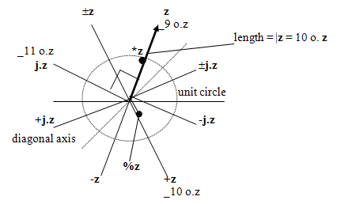
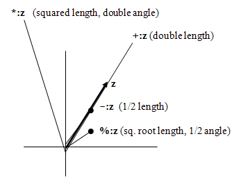
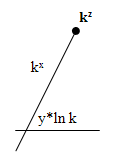

Norman Thomson
{ .byline }

This article is about the facilities available in J for handling complex numbers, something which is greatly helped by a few simple diagrams.
{ .abstract }

## 1. The two complex number constructors

Although complex numbers are readily input using numeric constants, e.g. `12.5j_7.9`, in meaningful applications the components are more likely to be expressions from which complex numbers are *constructed*. J has two tools for constructing complex numbers, namely `j.` and `r.` These correspond to their two possible representations, namely as 2-lists of Cartesian (that is x-y) coordinates, and as 2-lists of polar coordinates (that is \{length, angle\}). The way in which `j.` and `r.` work is illustrated by

```
   (2 j.1),(2 r.1)  NB. the two complex no. constructors
2j1 1.0806j1.68294
```

The second of these results shows that 2 times the coordinates of the end point of a radius of the unit circle at an angle of 1 radian are approximately (1.08, 1.68). For primary input in the form of 2-lists use *insert*:

```
   (j./2 1),(r./2 1)
2j1 1.0806j1.68294
```

Informally, `j.` compresses x-y coordinates into complex numbers, and `r.` converts polar representation to complex number form. Monadic `j.` is dyadic `j.` with a default left argument of 0, while monadic `r.` is dyadic `r.` with a default left argument of 1. It is not a coincidence that these defaults are the identity elements of addition and multiplication. `r.k` where `k` is real returns the Cartesian coordinates of the point on the unit circle whose polar coordinates are (1,k), for example

```
   r.1      NB. coords of radius at 1 radian
0.540302j0.841471
```

`r.k` is represented by <span class="math">e<sup>ik</sup></span> in maths and thus by `^j.k` in J, an operation also available through the circle verb as `_12 o.k`. The fact that `r.` and `^j.` are synonyms links the two complex number constructors. More generally the circle functions with arguments in the ranges \{9…12\} and \{\_9…\_12\} are directly relevant to complex number construction, and they too have synonyms which will emerge as the discussion continues. The equivalence of `r.` and `^j.` will come to the fore later in section 6 when discussing complex powers.

## 2. The complex number deconstructors

The construction process is reversed (that is complex numbers are converted back to 2-lists) by `+.` for Cartesian coordinates and `*.` for polar coordinates:

```
   +.2j1 1.0806j1.682941    NB. +. reverses j./
      2       1
 1.0806 1.68294
   *.2j1 1.0806j1.682941    NB. *. reverses r./
2.23607 0.463648
      2        1
```

The *circle* verb provides the opportunity to obtain the components of `+.` and `*.` one by one:

```
   9 11 o.2j1               NB. 9 o. is x. , 11 o. is y
2 1
   10 12 o.2j1              NB. 10 o. is length, 12 o. is angle
2.23607 0.463648
```

The following is a ‘rule of thumb’ table which summarises the meanings of the circle verbs and incorporates the above ideas :

<table id="circleverbs" class="code">
          <caption>Meanings of the circle verbs</caption>
          <tbody>
            <tr><td>n o.</td><td colspan="2"></td><td>n o.</td></tr>
            <tr><td>_9</td><td colspan="2" class="center plain">identity</td><td></td></tr>
            <tr><td>_10</td><td colspan="2" class="center plain">conjugate</td><td></td></tr>
            <tr><td></td><td class="center plain">construct</td><td class="center plain">deconstruct</td><td></td></tr>
            <tr><td>_11</td><td class="center">j.</td><td class="center">+.</td><td>9, 11</td></tr>
            <tr><td>_12</td><td class="center">r.(^j.)</td><td class="center">*.</td><td>10, 12</td></tr>
          </tbody>
        </table>

## 3. Monadic operations with complex numbers

J provides alternative routes for several common complex numbers operations. In the diagrams below, a complex number **z** is represented by the arrowed line, and other points represent the results of the fundamental monadic arithmetic operations of addition, subtraction, multiplication and division, separately and in combination with `j.` as well as those of the circle functions which are synonyms.

 

The symbol `±` is used here to denote either of the verbs `+@-@j.` or `-@+@j.` since they are equivalent. The points `z ±z -z +z` represent a rectangle formed by reflections in the x and y axes with vertices visited anti-clockwise, while the points `j.z ±j.z -j.z +j.z` represent a rectangle formed by reflections in the diagonal axes with vertices visited clockwise. In addition to the three circle function synonyms shown for circle functions, `_12 o.` is a synonym for `r.` as noted earlier.

The symmetries of rectangles can be represented by groups of verbs of order 4 in which `I` is the identity verb :

<table id="rectangles">
        	<caption>The symmetries of rectangles</caption>
          <tbody>
            <tr>
              <td>Rotations</td>
              <td>{<code>I - j. -j.</code>}</td>
              <td><code>j. -j.</code> are anticlockwise/clockwise rotations of π/4</td>
            </tr>
            <tr>
              <td>Reflections</td>
              <td>{<code>I - + ±</code>}</td>
              <td><code>+ ±</code> are reflections in main axes,</td>
            </tr>
            <tr>
              <td></td>
              <td>{<code>I - ±@j. +@-j.</code>}</td>
              <td><code>±@j. +@-j.</code> are reflections in diagonal axes</td>
            </tr>
          </tbody>
        </table>

From these as starting points the full order-8 group table for the symmetries of the square can easily be obtained.

## 4. Basic dyadic operations

The basic operations `+ - * %` behave as expected, and rules such as the following are obeyed:

```
   |5j2*3j4                 NB. modulus of a product is ..
26.9258
   (|5j2)*(|3j4)            NB. .. the product of moduli
26.9258

   12 o. 5j2*3j4            NB. the angle of a product ..
1.3078
   +/12 o. 5j2 3j4          NB. .. is the sum of the angles
1.3078
```

Also

```
   +/5j2*3j4
7j26
```

is equivalent numerically to

<table class="equation math">
        	<tr>
        		<td>
        			<table class="matrix">
        				<tr><td>5</td><td>–2</td></tr>
        				<tr><td>2</td><td>5</td></tr>
        			</table>
        		</td>
        		<td>
        			<table class="matrix">
        				<tr><td>3</td></tr>
        				<tr><td>4</td></tr>
        			</table>
        		</td>
        		<td>=</td>
        		<td>
        			<table class="matrix">
        				<tr><td>7</td></tr>
        				<tr><td>26</td></tr>
        			</table>
        		</td>
        	</tr>
        </table>

and

<table class="equation math">
        	<tr>
        		<td>
        			<table class="matrix">
        				<tr><td>3</td><td>–4</td></tr>
        				<tr><td>4</td><td>3</td></tr>
        			</table>
        		</td>
        		<td>
        			<table class="matrix">
        				<tr><td>5</td></tr>
        				<tr><td>2</td></tr>
        			</table>
        		</td>
        		<td>=</td>
        		<td>
        			<table class="matrix">
        				<tr><td>7</td></tr>
        				<tr><td>26</td></tr>
        			</table>
        		</td>
        	</tr>
        </table>

showing that multiplication of complex numbers is equivalent to the inner product `+/ .*` for matrices of the form

<table class="italic matrix">
  				<tr><td>a</td><td>–b</td></tr>
  				<tr><td>b</td><td>a</td></tr>
  			</table>

When multiplication takes the angle outside the range \[-π, π\], `*.` and `12 o.` automatically make a wraparound to bring the angle back into range, for example

```
wrap=.3 :0
t=.(o.2)|y.
if.t>o.1 do.t=.t-o.2 end.
)
    +/12 o._5j2 _3j4        NB. sum of angles exceeds pi
4.97538
   12 o._5j2*_3j4
_1.3078
   wrap 4.97538             NB. 4.975.. + 1.307.. = 2pi
_1.3078
```

Complex numbers raised to real powers are the subject of de Moivre’s theorem. This depends on the fundamental relation

*e <sup>iθ</sup>* = cos *θ* + *i* sin *θ*

which in J expresses the fact that the verbs `^@j.` and `j./@(2 1&o.)` are equivalent. De Moivre’s theorem says that

(*re <sup>iθ</sup>*) <sup><i>n</i></sup> = *r <sup>n</sup> e <sup>inθ</sup>* = *r <sup>n</sup>* \{cos *nθ* + *i* sin <i>nθ</i>\}

so to raise complex **z** to the power *n* its modulus should be raised to the power *n* and its angle multiplied by *n*. To see this in action raise `2j1` to the powers 1, 2 and 8 in first Cartesian and then polar form:

```
   +.2j1^1 2 8
   2    1                   NB. modulus = sqrt(5)
   3    4                   NB. modulus = 5
_527 _336                   NB. modulus = 625 = 5^4

   *.2j1^1 2 8
2.23607 0.463648            NB. (length,angle) for 2j1
      5 0.927295            NB. (length,angle) for 2j1 ^2
    625   _2.574            NB. (length,angle) for 2j1 ^8
```

The angle in the last line above can be confirmed by

```
   wrap 8*0.463648
_2.574
```

It may be tempting to use the circle function `_3 o.` *arctan* to obtain angles, but this only works in simple cases because the range of *arctan* is \[-π/2, π/2\]. The range for complex numbers is double this because *arctan* makes no distinction between (-x)/y and x/(-y), whereas the difference between second and fourth quadrants *is* significant in dealing with complex numbers.

## 5. The enhanced arithmetic operations

The second diagram illustrates the actions of the J verbs which are obtained from the basic arithmetic operations by adding ‘colon’ to make a di-gram:



Only one of these four forms – namely `%:` – extends to the dyadic case, for example `4%:z` means (4th root of length, ¼ angle).

In the case of di-grams formed by adding full-stop `1-.z` is the same as with real numbers and `%.` and `%` are exactly equivalent. If either `*.` or `+.` are applied to real scalar numbers the results are 2-lists made by joining zeros. This can be used as a method of stitching 0s as in

```
   +.3 4
3 0
4 0
```

With real numbers dyadic `*.` and `+.` are LCM and GCD respectively, but these should not be used with complex arguments in the expectation of obtaining the separate GCDs and LCMs of their components. For example

```
   (5j6 +. 10j3),(5j6 *. 10j3)
0j1 75j_32
```

## 6. Complex Powers and Logarithms

To understand complex powers, start with the synonym relationship between `r.` and `^j.` (or `_12 o.`), which at first sight should lead to `j.` and `^.r.` also being synonyms. This is indeed true in some cases:

```
   (j.2j1),(^.r.2j1)
_1j2 _1j2
```

but not always:

```
   (j.12j10),(^.r.12j10)
_10j12 _10j_0.566371
```

This is because, unlike in real arithmetic, the logarithm of a complex number is not a single-valued function. In Cartesian coordinates, x and y values stretch out indefinitely in both directions, but in polar coordinates angles wrap around in cycles of 2π in the manner defined by the verb `wrap` above. In mathematical notation,

<p class="math" markdown="span"><span class="word">ln</span>(z) = <span class="word">ln</span>(re<sup>πiθ</sup>) = <span class="word">ln</span>(r) + i(θ + 2kπ)</p>

where k is an integer. As a matter of arbitrary (but natural!) choice, J returns the unique angle which lies in the range \[-π, π\]. The same wrapping process applies when real numbers are raised to complex powers :

```
   *.2^4j4.5 4j4.6
16  3.11916                 NB. unwrapped
16 _3.09471                 NB. wrapped
```

More specifically, if k is real and <span class="math">z=x+iy</span>, then k<sup>z</sup> is illustrated by


```
   *.2^2j1 3j2
4 0.693147                  NB. k to power x, y times ln(k)
8  1.38629                  NB. with angle doubled
```

The cases ‘complex raised to real’ (de Moivre’s theorem) and ‘real raised to complex’ have now been covered, leaving only the case ‘complex raised to complex’ to be dealt with. An interesting starting point is the number *i<sup>i</sup>*, which at first sight should be about as complex as it gets:

```
   0j1^0j1                  NB. i to the power i
0.20788
```

Not so! To explain this result, consider first <span class="math"><span class="word">ln</span>(i<sup>i</sup>)=i×<span class="word">ln</span>(i)</span>. Using the formula

<p class="math" markdown="span"><span class="word">ln</span>(re<sup>πiθ</sup>) = <span class="word">ln</span>(r) + i(θ + 2kπ)</p>

and choosing <span class="math">k=0</span> (as J does) to make the logarithm single-valued, gives <span class="math"><span class="word">ln</span>i = 0+iπ/2</span> which, when multipled by i, gives -π/2. i<sup>i</sup> must therefore be e<sup>-π/2</sup>, which has the value 0.20788 to 5 decimal places. This sequence of calculations is confirmed by

```
   (^.0j1), (^.0j1^0j1), (^-o.0.5)
0j1.5708 _1.5708 0.20788
```

Here is the i<sup>i</sup> calculation spelt out in a single line:

```
   ln=.(^.@{. , }.)@*.      NB. log length, angle
   (^@*j./@ln)0j1           NB. i to the power i
0.20788
```

The verb `ln` fulfils the familiar ‘reduce multiplication to addition’ property of logarithms of real numbers, that is <span class="math">
            <span class="word">log</span>(<i>ab</i>) =
            <span class="word">log</span><i>a</i> +
            <span class="word">log</span><i>b</i>
          </span>, for example:

```
   ln 1j2*3j4               NB. ln ab
2.41416 2.03444
   +/ln 1j2 3j4             NB. ln a + ln b
2.41416 2.03444
```

For powers where both w and z are fully complex (that is, have non-zero imaginary parts) the following sequence of equivalences

w<sup>z</sup> = (e<sup>ln w</sup>)<sup>z</sup> = (e<sup>z</sup>)<sup>ln w</sup> = e<sup>zln w</sup>

leads to, for example

```
   2j1^1j3                  NB. 2j1 to the power 1j3
_0.537177j0.145082

   ^1j3*j./ln 2j1           NB. e to the power ln w
_0.537177j0.145082
```

It is not easy, perhaps impossible, to visualise the relationship of wz to w and z diagrammatically, that is the link of `_0.537177j0.145082` with `2j1` and `1j3` is a numerical rather than a graphical one. The same is true for other functions which can accept complex arguments, for examples trig ratios and their inverses. Also the logarithms concerned must be to the base e. e is one of the five most fundamental numbers in the universe, namely 0, 1, e, π and i, which are connected by the equation <span class="math">1+e<sup>πi</sup>=0</span>. It is reasonable to suppose that advanced intelligent communicators from outer space (if such there be) would certainly try to convey this set of numbers to us as an immediate *lingua franca*. This equation can be expressed in J in the following three equivalent ways:

```
   (1+^o.j.1),  (1+_12 o.o.1),  (1+r.o.1)
0 0 0
```

The equation <span class="math">1+eπi=0</span> can be rewritten <span class="math">ln(-1)=πi</span>, which, since <span class="math">ln(-r)=ln(r)+ln(-1)</span>, means that the natural logarithms of negative real numbers are obtained by appending `j`π to the logarithm of the corresponding positive number. For example:

```
   ^.5.2 _5.2   NB. (ln r), (ln -r)
1.64866 1.64866j3.14159
```

## 7. Extension to Quaternions

Given a matrix of the form

<table class="italic math matrix">
  				<tr><td>a</td><td>–b</td></tr>
  				<tr><td>b</td><td>a</td></tr>
  			</table>

where *a* and *b* are real numbers, e.g.

```
   M=.2 2$2 _3 3 2
```

and an inner product of `M` with a 2-list such as

```
   M +/ .* 2 _1
7 4
```

the same information could be obtained by multiplying two complex scalars:

```
   2j3*2j_1
7j4
```

Similarly finding the determinant of `M` is equivalent to a couple of operations on a complex scalar:

```
   (det=.-/ .*)M            NB. determinant of M
13
   *:10 o.2j3               NB. sum of squares of 2 and 3
13
```

Thus complex numbers can be used as a means of reducing the rank level of some operations. An ‘obvious’ question is then: if complex data can reduce rank-2 operations to rank 1, can it correspondingly reduce rank-3 operations to rank 2? This speculation is not unique to J, in fact the question was answered in the mid-19th century by Sir William Hamilton, who discovered that this progression is multiplicative rather than additive; that is, that the next step up is not from 2 to 3 but from 2 to 4.

First define a verb which transfoms a 2-list of real scalars into a matrix of the above form:

```
   r2ltom=.,._1 1&*@|.      NB. matrix from real 2-list
   r2ltom 2 3
2 _3
3  2
```

Next observe that is possible to have a matrix with complex coefficients which nevertheless has a real determinant, for example:

```
   C =. 2 2$4j3 6j_2 _6j2 4j3
   det C
39
```

The matrix `C` has the form

<table class="matrix">
        	<tr>
        		<td><i>P</i><code>j</code><i>Q</i></td>
        		<td>(–<i>R</i>)<code>j</code>–<i>S</i></td>
        	</tr>
        	<tr>
        		<td><i>R</i><code>j</code><i>S</i></td>
        		<td><i>P</i><code>j</code><i>Q</i></td>
        	</tr>
        </table>

which is the form

<table class="italic math matrix">
  				<tr><td>a</td><td>–b</td></tr>
  				<tr><td>b</td><td>a</td></tr>
  			</table>

extended to complex elements. Straightforward arithmetic shows that the determinant of a matrix of the above form has a real part <span class="math">
            (<i>P</i><sup>2</sup>–<i>Q</i><sup>2</sup>+<i>R</i><sup>2</sup>–<i>S</i><sup>2</sup>)
          </span> and an imaginary part <span class="math">2(<i>PQ</i>+<i>RS</i>)</span> and so, if <span class="math"><i>PQ=–RS</i></span>, as is the case with `C`, the determinant is real, otherwise not. In the ‘all real’ case, <span class="math"><i>Q</i>=<i>S</i>=0</span> and <span class="math"><code>det</code>(M)=<i>P</i><sup>2</sup>–<i>R</i><sup>2</sup></span>.

If the form is now changed to

<table class="matrix">
        	<tr>
        		<td><i>P</i><code>j</code><i>Q</i></td>
        		<td>(–<i>R</i>)<code>j</code><i>S</i></td>
        	</tr>
        	<tr>
        		<td><i>R</i><code>j</code><i>S</i></td>
        		<td><i>P</i><code>j</code>–<i>Q</i></td>
        	</tr>
        </table>

that is,

<table class="italic matrix">
  				<tr><td>a</td><td><span class="overbar">–b</span></td></tr>
  				<tr><td>b</td><td><span class="overbar">a</span></td></tr>
  			</table>

where the dashes denote complex conjugates, then the determinant is arithmetically guaranteed to be real for *all* values of *P*, *Q*, *R* and *S*. If this is now taken as a standard form then four fundamental matrices obtainable by setting each of *P*, *Q*, *R* and *S* to 1 and the other three to zero correspond to unit points on the axes of a four-dimensional geometrical space as denoted by <span class="math">(1,0)</span>, <span class="math">(0,1)</span>, <span class="math">(i,0)</span> and <span class="math">(0,i)</span>. A verb analogous to `r2ltom` which constructs the above matrix from a 2-list of complex scalars is

```
   c2ltom=.,.+@|.@(*&1 _1) NB. matrix from complex 2-list
   c2ltom 2j3 4j5
2j3 _4j5
4j5 2j_3
```

Define variables to correspond to <span class="math">(1,0)</span>, <span class="math">(0,1)</span>, <span class="math">(i,0)</span> and <span class="math">(0,i)</span>:

```
   ]'I i j k'=.c2ltom &.> 1 0 ;0 1;0j1 0;0 0j1
+---+----+--------+-------+
|1 0|0 _1|0j1    0|  0 0j1|
|0 1|1  0|  0 0j_1|0j1   0|
+---+----+--------+-------+
```

and self-multiply each of these matrices:

```
   times=.+/ .* &.>         NB. matrix multiply
   times~ i;j;k             NB. squares of i, j and k
+-----+-----+-----+
|_1  0|_1  0|_1  0|
| 0 _1| 0 _1| 0 _1|
+-----+-----+-----+
   times~^:2 i;j;k          NB. 4th powers of i, j and k
+---+---+---+
|1 0|1 0|1 0|
|0 1|0 1|0 1|
+---+---+---+
```

which shows that <span class="math">i<sup>2</sup>=j<sup>2</sup>=k<sup>2</sup>=–I</span> and <span class="math">i<sup>4</sup>=j<sup>4</sup>=k<sup>4</sup>=I</span> where I is the identity matrix. Now multiply i, j and k by each other:

```
   (i;j;k)times(j;k;i)      NB. result is k;i;j
+-------+----+--------+
|  0 0j1|0 _1|0j1    0|
|0j1   0|1  0|  0 0j_1|
+-------+----+--------+

   (j;k;i)times(i;j;k)      NB. result is (-k);(-i);(-j)
+---------+----+--------+
|   0 0j_1| 0 1|0j_1   0|
|0j_1    0|_1 0|   0 0j1|
+---------+----+--------+
   det&> i;j;k              NB. determinants equal 1
1 1 1
```

If i, j and k are raised to third powers a further three matrices not previously encountered arise:

```
   ]'ci cj ck'=.(i;j;k)times(i;j;k)times i;j;k
+----+--------+---------+
| 0 1|0j_1   0|   0 0j_1|
|_1 0|   0 0j1|0j_1    0|
+----+--------+---------+
```

but now, however much the set of eight matrices `I, -I, i, j, k, cj, ck, ci` are intermultiplied, the result is always another member of the set, for example:

```
   (i;j;k)times cj;ck;ci    NB. result is ck;ci;cj
+---------+----+--------+
|   0 0j_1| 0 1|0j_1   0|
|0j_1    0|_1 0|   0 0j1|
+---------+----+--------+
```

The set of eight matrices possesses the properties of a *group*, more specifically the *quaternion group*. Although there are eight elements in the group these are all related to each other, and the whole set of seven excluding the identity matrix can be generated from any two. For example if `i` and `j` are chosen as generators, `k` is `ij`, `ci` and `cj` are defined as powers of `i` and `j`, and `ck` is `cj` multiplied by `ci`. The seventh matrix is the common value of i<sup>2</sup> and j<sup>2</sup>.

If, analogous to `j`, J were to contain two further independent number constructors `k` and `m` such that `2j3k4m5` were a scalar, and the same rules <span class="math">i<sup>2</sup>=j<sup>2</sup>=k<sup>2</sup>=–I</span> and <span class="math">i<sup>4</sup>=j<sup>4</sup>=k<sup>4</sup>=I</span> applied where <span class="math">I=<code>l</code></span>, <span class="math">i=<code>0j1k0m0</code></span>, <span class="math">j=<code>0j0k1m0</code></span>, <span class="math">k=<code>0j0k0m1</code></span> then these scalars would be recognised mathematically as *hypercomplex numbers*. The four basic hypercomplex numbers for which the real elements are (1 0 0 0), (0 1 0 0), (0 0 1 0) and (0 0 0 1) would follow the same multiplication structure as the set of eight matrices, and form a group isomorphic with the quaternion group.

A scalar such as `0j3k4m5` whose first element is zero corresponds to a *pure quaternion* and so pure quaternions exactly match points in three-dimensional space, or quantities such as E, B, H which define electro-magnetic fields as three-dimensional entities. Such equivalences are of course only useful if the operations employed on them are guaranteed to produce further pure quaternions.
