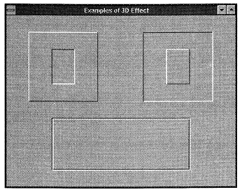

*by George MacLeod*
{ .byline }

This is a summary of the presentation given by George MacLeod at the BAA meeting in March 1993.

The presentation discussed MacLeod’s views on business graphics, how his ideas had been implemented in the graphics part of the Impetus product and how these ideas had been further developed by prototyping a new business graphics package (code named Trellis) which will run under Windows and is being implemented in Dyalog APL/W.

The underlying principles of Impetus Graphics are threefold.

1. It must be easy to produce simple graphs.
2. It must be possible to produce elaborate graphs when needed.
3. The graphs when printed should be of a high quality.

The third item is based on the belief that most graphics programs concentrate on the presentation on the screen rather than on the printed graph. Although many executives use Personal Computers there is still a need to produce regular high quality printed graphical output for distribution to senior management.

There were considerable difficulties in implementing these aims in Impetus as the GSS graphics drivers supplied with most DOS based APLs were not bug-free. This was particularly true when use was made of variable-pitch fonts. This resulted in graphs which could take several hours to print, and which were still incomplete. A paper on this implementation was presented to the BAA in 1991. Since that time there have been new releases of the graphics drivers and the problems are now resolved.

In the Windows world there are a wide variety of graphics applications programs, but most of them are really drawing programs that also have some ability to produce business graphics. The modern spreadsheet offers graphs tightly integrated into the spreadsheet data, and it is possible to produce graphs of considerable elaboration – although many of the features of a good business graphics system are not available.

Trellis graphics has the same underlying aims as did the earlier Impetus graphics but is intended to offer a more complete range of graph types and to take advantage of the Windows Graphical User Interface. As with Impetus graphics, the data and the graph properties are kept separate. Fundamentally Trellis works on three variables. The first is the Graphics Description which is a complicated nested variable containing many properties. The data is contained in a simpler nested variable known as the Data Source.

A Data Source may be used with more than one Graphics description, and more importantly, a Graphics Description can be used with more than one Data Source.

The third variable is the Script. This is an editable variable which is equivalent to a batch file in DOS. It uses a very simple and limited language, and facilitates the production of regular batches of graphs.

MacLeod’s own introduction to business graphics came via the use of the Boeing Executive Information Services (EIS) product in the late 1970s. Boeing EIS runs on an IBM mainframe and has extensive business graphics facilities. The user has great control over the graphs that are produced, but the syntax of the command structure is complex and has to be learned and would be totally unacceptable on a modern PC.

At the heart of Boeing EIS is the recognition that most business and manufacturing data is time-related. For example, salaries may be paid monthly, VAT may be paid quarterly and rent every six months. A capital purchase is made at a point in time. We call this data “Time Spread” data and Trellis will support daily, weekly, monthly, quarterly, semi-annual and annual time spread data. Such data is defined by three properties. The periodicity (monthly, weekly, etc.), the start date (day, month and year) and a simple vector of values.

Time-spread data has a number of advantages. Firstly you do not have to provide the labels for the time dimension on a graph – the labelling is inherent in the data. Secondly the total duration of the data is clearly defined, for example, there is no ambiguity about any data before the start date. Thirdly it is possible to plot a graph of data with different periodicities, for example, monthly data can be plotted with quarterly data by automatically summing the months into quarters. Cumulated data is readily available to produce cumulative graphs, and finally it is possible to have a time window set to limit the data that will appear in a particular graph.

The underlying architecture of a Graphics Description is as follows:

```
     Page Level Properties
          Graph Level Properties (Graph 1)
               Plot Properties (Plot 1)
               Plot Properties (Plot 2)
               Plot Properties (Plot 3)
                    etc.
          Graph Level Properties (Graph 2)
               Plot Properties (Plot 1)
               Plot Properties (Plot 2)
               Plot Properties (Plot 3)
                    etc.
          etc.
```

**Page level properties** are concerned with such things as should there be a box around the page, should there be a time stamp, what is the background colour, etc.

**Graph level properties** relate to matters such as graph type, description of the axes, grids, etc. These properties can be specified for each graph on a page.

Most graphs have more than one plot. For example a Line Graph will often show more than one line of Plot. Plot properties relate to such matters as line types, bar patterns, where the data comes from, etc. As it require a large number of properties to draw a graph it is important that most properties take default values and are only changed when the user wishes to change them. Trellis will be delivered with a complete set of defaults for all of the graph types. When a Graphics Project is first created a complete set of the system defaults will be placed in it.

The concept of heredity will be used in much the same way as with Object Oriented Systems. A Plot is the child of a Graph, which in turn is the child of a Page which is the child of a Project. For example, if we are producing a line graph and we are about to draw the first line Trellis will look for the properties of the line at the Plot Level. If it finds nothing it will look at the Graph level, if it again finds nothing then it looks at the Page level and if nothing is specified there then it looks at the Project level, where everything is specified.

This means that properties for the first line to be drawn in a line graph may be found at a number of levels. Not all properties can be treated in this way. For example the location of a graph on the page has to be specified at the graph level. If it was specified at the page level then all graphs on a page would be superimposed. (It may be useful to define the size and aspect of a graph at the page level so that several graphs on a page will have the same size and aspect.)

Trellis will use the facilities of the Windows GUI to provide Users with interactive facilities to enter data and to organise the “look” of a page of graphs. Provision will be made for the actual display and printing of graphs to be driven using Dynamic Data Exchange (DDE) from other Windows applications.

Most Trellis users will be unaware that Trellis is written in APL and most users will not have heard of APL! However, Trellis will be especially convenient for users writing application programs in Dyalog APL/W. They will be able to produce a Data Source in their program and then share this with Trellis. A definition of the structure of a Data Source will be available together with code that can be used to check that a Data Source produced by an application program is structurally correct.

### Addendum: Getting that 3D Look

## 

George showed the results of a number of experiments he had been making with the look and feel of the Windows GUI interface. One effect that was surprisingly effective, yet very easy to achieve was the generation of three dimensional effects in a window with a grey background. The example above shows a pairs of raised and recessed effects created by drawing white and dark grey lines on the light grey background.

(webpage generated: 5 December 2005, 18:50)
