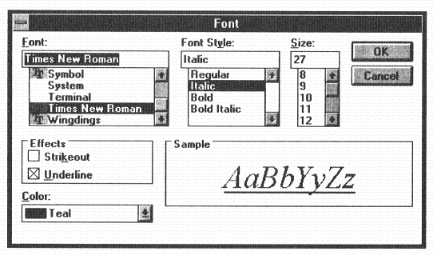

*by Duncan Pearson*
{ .byline }

The following is a description of the use from Dyalog APL/W of the common dialogue box for choosing fonts within Windows 3.1. Dyalog APL/W does not provide a means of doing this within its GUI interface, but with `⎕NA` it is possible to call any function in a dynamic link library. The sets of functions which drive Windows are all located in DLLs and so with access to the Software Developer’s Kit manuals, or their equivalent, we can use parts of the Windows GUI that Dyadic did not include in Dyalog APL, perhaps for reasons of compatibility with Motif under UNIX.

The process of using a standard font dialogue box is in five parts:

1. Get a block of memory in which to put the current font definition. We use the `GlobalAlloc` function to get the memory and the `GlobalLock` function to lock it into place and tell us where it is.
2. Put the current font data into the block using the `hmemcpy` function that copies data from one location to another.
3. Pass the address of the block to the `ChooseFont` function as part of a complicated data structure.
4. Read the changed data from the block into APL using the same `hmemcpy` function that we used to copy it into the block.
5. Free the memory for use by other applications, using the `GlobalFree` function which takes the identifier (returned by `GlobalAlloc`) and returns the memory to the pool.

All the functions used are in the KERNEL.EXE dynamic link library except `ChooseFont` which is in COMMDLG.DLL. Both of these DLLs are part of Windows.

The font data structure, in which the font specification is passed to and from the `ChooseFont` function, is listed in the appendix but it is basically five integers (two bytes each) followed by eight single byte values followed by a null terminated string. The first and last of the integers are the size and weight of the font, the first three of the byte values, if they are non-zero, indicate bold, underline and strikeout and the null terminated string is the font name.

The way that we use these C functions is to ‘associate’ them with function names in the workspace. We use the `⎕NA` function which associates a name in the APL workspace (the left argument) with a function in a DLL, specified in the right argument. That name becomes of class 3 (a function) and whenever we use that name in an APL expression the function in the DLL is called.

The way that the arguments to the APL function are translated into the arguments of the DLL function and that the result of the DLL function is translated into an APL object is determined by the first and last parts of the right argument to `⎕NA`.

### Memory Allocation

For example:

```
     'alloc'⎕NA'U2 kernel.exe.P16|GlobalAlloc U2 U4'
```

associates the name ‘alloc’ in the workspace with the DLL function `GlobalAlloc`. If we call alloc with two integer arguments

```
     handle←alloc 0 50
```

the first will be converted into a two-byte unsigned number (the memory type) and the second into a four-byte unsigned number (how many bytes we want). The two-byte result from `GlobalAlloc` will be converted back into a positive integer.

The effect of the function is to reserve 50 contiguous bytes of global memory for our use, the returned result being an identifier for that memory. We need to fix the location of that memory so that we can write data into it. `GlobalLock` is the Windows function that fixes memory and it returns the address at which it has fixed it. We pass the two-byte positive integer identifier and get back a four-byte integer pointer.

```
     'lock'⎕NA'I4 kernel.exe.P16|GlobalLock U2'
     ptr←lock handle
```

### Copying the Font Data

To read from and write to our little block we use a function called `hmemcpy`. It is a very simple function but it is very versatile. It takes two pointers, a source and a destination, and a number of bytes to copy. It copies the specified number of bytes from the source to the destination. The versatility comes in the way we associate the function.

Here we will copy the integers to the memory area.

```
     'putints'⎕NA 'kernel.exe.P16|hmemcpy I4 <I2[] I4'
     putints ptr(¯36 0 0 0 400)10
```

The arguments to the function are, from left to right, the destination pointer, the source pointer and the number of bytes to copy. In the first association the source is defined as an input array of two byte integers. On execution the interpreter will take the integer vector passed, create a C array of two-byte integers and pass a pointer to that array to the DLL function. The third argument should be twice the length of the vector, as that is the actual number of bytes. The negative number given as the size is a value in points.

Then we copy the byte values:

```
     'putbytes'⎕NA 'kernel.exe.P16|hmemcpy I4 <U1[] I4'
      putbytes(ptr+10)(1 1 0 0 0 0 0 0) 8
```

Here we are saying that the second element of the argument, the source data, should be translated as an array of bytes. In APL parlance they are indices into `⎕AV`. Notice that when we call the function we pass not the address of the memory but the address of the eleventh byte of the memory, where we want it to put the byte values.

Lastly we insert the name of the font:

```
     'putstring'⎕NA 'kernel.exe.P16|hmemcpy I4 <0T I4'
     putstring(ptr+18)'Times New Roman' 32
```

The interesting feature of this association is the &lt;0T which specifies a translated null terminated string. When the function is called we pass a text vector which is translated from the `⎕AV` to the normal ASCII character set and copied at the pointer. After the last character of the string the interpreter places a 0. This is included in the number of bytes to copy so our name must be no more than 31 characters long.

### Running the `ChooseFont` function

We are now ready to call the `ChooseFont` function, well, nearly ready. All we need to do is associate the function and run it. Unfortunately, while the function only takes one argument, it is a pointer to a horrendous C data structure, one part of which is the pointer to our font data. However, if we define the structure when we associate the function, we can pass a nested array corresponding to it. As with the simple arrays, the interpreter will pass a pointer to it. The official structure definition is part of the appendix but the line below defines it well enough for the association.

```
choose_struct←'{I4 I2 I2 I4 I2 I4 U1[4] I4 I4 I4 I2 I4 U2 I2 I2}'
'changefont'⎕NA'U commdlg.dll.P16|ChooseFont =',choose_struct
```

Things to note are that the U1\[4\] is an array of red, green and blue intensities for the display, the second I4 is the pointer to our font data and the third I4 is the combination of some Boolean values to tell the function what fonts to allow and whether there is meaningful data in the font structure. The “=” before the font structure in the association is an indication to the interpreter that when the function has run we would like to see what it has done to the data in the structure. We are most interested here in the colour part.

The definition of the individual bits is included in the appendix as a set of “#define CF\_\*\*\* 0x00\*\*\*” statements that are pretty self-explanatory. We are going to use CF\_SCREENFONTS, CF\_INITTOLOGFONTSTRUCT and CF\_EFFECTS, the last of these to enable the user to choose underline and colour.

```
     flags←2⊥1 0 1 0 0 0 0 0 1
```

The first element of the structure is its length in bytes and everything else in it that I haven’t mentioned can be set to 0. Thus the function call looks like this.

```
     changefont⊂15 46 0 0 ptr 0 flags(0 128 128 0)
```

We get a dialogue box that looks like this:

## 

and the result:

```
1  46 0 0 137822208 360 321  128 0 128 0  0 0 0 0 0 8452 0 0
```

Because we specified one of the arguments as “=” the data for that argument is returned with the result of the function in a nested array, the first element being the result of the function and the second, the contents of the structure. The result of the function is non-zero, indicating that the user pressed OK, and the seventh element of the structure is 128 0 128 0, indicating that he changed the colour from ‘teal’ to ‘purple’ (takes all sorts to make a world). We can use this indication to set the colour of any text associated with this font.

### Retrieving the Font Data

We now need to query the font structure to find what font attributes the user has changed. To get data out of our block of memory we use the same function that we used to get data in. This time we specify an array as the destination (first argument) and the pointer to the memory block as the source (second argument).

```
     'getints'⎕NA 'kernel.exe.P16|hmemcpy >I2[] I4 I4'
     'getbytes'⎕NA 'kernel.exe.P16|hmemcpy >U1[] I4 I4'
     'getstring'⎕NA 'kernel.exe.P16|hmemcpy >0T I4 I4'
```

Instead of `<I2[ ]` (corresponding to an integer vector argument) which means

\- take a vector  
\- turn it into integers  
\- pass its address to the function  
\- then forget it

we have >I2\[ \] (corresponding to an integer argument) which means

\- allocate space for the specified number of integers  
\- pass its address to the function  
\- convert what the function leaves there into an int. vector, 2 bytes per number  
\- return the vector

What we pass as this argument is the expected length of the result.

```
     getints 5 ptr 10
¯48 0 0 0 700
```

In the case of the integers we expected five integers (first argument) which meant that it had to copy ten bytes (third argument). The first integer is the new point size and the fifth is the weight.

We then get the attributes. We can only set the underline and italic but we might want to know if the user has set strikeout in order to warn him that it will not be implemented.

```
     getbytes 3(ptr+10)3
0 0 1
```

Finally we get the name:

```
     getstring 32(ptr+18)32
Courier New
```

### Cleaning Up

It is good practice to give the memory back to Windows even if it is only 50 bytes, and for this we use the `GlobalFree` function.

```
     'free'⎕NA'U2 kernel.exe.P16|GlobalFree U2'
     free handle
0
```

As you can see it takes a memory identifier and returns 0 if it managed to free the memory. If it had failed it would have returned the handle.

So that was easy wasn’t it? You would be surprised what you can do with the DLL functions. You can be serious and write a low-level interface to Oracle using the functions in the ORA6WIN.DLL supplied with EXCEL or you can be flippant and start writing raw graphics all over other applications’ windows, whatever flips your switch.

### Font Sizes

A short note about font sizes. You pass a point size to the font structure and get a point size out. Font sizes in Dyalog APL/W are specified in pixels. There are 72 points to the inch and you can calculate the number of pixels to the inch from the DEVCAPS property of the root object. This is unfortunately not all. For some reason, best known to the morons at Microsoft, when you specify 36 point in the font structure it shows the font in 36 point (according to the above definition) but says that it is in 27 point. Likewise, if the user chooses 36 point in the box, the number in the font structure is -48 and the user sees 48 point. Don’t ask me to explain it.

### Appendix

The full APL session transcript:

```
     'alloc'⎕NA'U2 kernel.exe.P16|GlobalAlloc U2 U4'
     handle←alloc 0 50
     'lock'⎕NA'I4 kernel.exe.P16|GlobalLock U2'
     ptr←lock handle
     'putints'⎕NA 'kernel.exe.P16|hmemcpy I4 <I2[] I4'
     putints ptr(¯36 0 0 0 400)10
     'putbytes'⎕NA 'kernel.exe.P16|hmemcpy I4 <U1[] I4'
     putbytes(ptr+10)(1 1 0 0 0 0 0 0) 8
     'putstring'⎕NA 'kernel.exe.P16|hmemcpy I4 <0T I4'
     putstring(ptr+18)'Times New Roman' 32
     choose_struct←'{I4 I2 I2 I4 I2 I4 U1[4] I4 I4 I4 I2 I4 U2 I2 I2}'
     'changefont'⎕NA'U commdlg.dll.P16|ChooseFont =',choose_struct
     flags←2⊥1 0 1 0 0 0 0 0 1
     changefont⊂15 46 0 0 ptr 0 flags(0 128 128 0)
1  46 0 0 137822208 360 321  128 0 128 0  0 0 0 0 0 8452 0 0
     'getints'⎕NA 'kernel.exe.P16|hmemcpy >I2[] I4 I4'
     'getbytes'⎕NA 'kernel.exe.P16|hmemcpy >U1[] I4 I4'
     'getstring'⎕NA 'kernel.exe.P16|hmemcpy >0T I4 I4'
     getints 5 ptr 10
¯48 0 0 0 700
     getbytes 3(ptr+10)3
0 0 1
     getstring 32(ptr+18)32
Courier New
     'free'⎕NA'U2 kernel.exe.P16|GlobalFree U2'
     free handle
0
```

The font data structure – from WINDOWS.H

```
/* Logical Font */
#define LF_FACESIZE     32
typedef struct tagLOGFONT
{
     int          lfHeight;
     int          lfWidth;
     int          lfEscapement;
     int          lfOrientation;
     int          lfWeight;
     BYTE          lfItalic;
     BYTE          lfUnderline;
     BYTE          lfStrikeOut;
     BYTE          lfCharSet;
     BYTE          lfOutPrecision;
     BYTE          lfClipPrecision;
     BYTE          lfQuality;
     BYTE          lfPitchAndFamily;
     char          lfFaceName[LF_FACESIZE];
} LOGFONT;
```

The data structure to pass to the `ChooseFont` function – from COMMDLG.H

```
typedef struct tagCHOOSEFONT
{
     DWORD          lStructSize;          /* */
     HWND          hwndOwner;          /* caller's window handle   */
     HDC          hDC;               /* printer DC/IC or NULL    */
     LOGFONT FAR*     lpLogFont;          /* ptr. to a LOGFONT struct */
     int          iPointSize;          /* 10 * size in points of selected font */
     DWORD          Flags;               /* enum. type flags         */
     COLORREF     rgbColors;          /* returned text color      */
     LPARAM          lCustData;          /* data passed to hook fn.  */
     UINT          (CALLBACK* lpfnHook)(HWND, UINT, WPARAM, LPARAM);
                              /* ptr. to hook function    */
     LPCSTR          lpTemplateName;     /* custom template name     */
     HINSTANCE     hInstance;          /* instance handle of.EXE that
                               * contains cust. dlg. template
                               */
     LPSTR          lpszStyle;          /* return the style field here
                               * must be LF_FACESIZE or bigger */
     UINT          nFontType;          /* same value reported to the EnumFonts
                               * call back with the extra FONTTYPE_
                               * bits added */
     int          nSizeMin;          /* minimum pt size allowed & */
     int          nSizeMax;          /* max pt size allowed if    */
                              /* CF_LIMITSIZE is used      */
} CHOOSEFONT;
```

The settings for the flags in the CHOOSEFONT structure - from COMMDLG.H

```
#define CF_SCREENFONTS               0x00000001
#define CF_PRINTERFONTS           0x00000002
#define CF_BOTH                     (CF_SCREENFONTS | CF_PRINTERFONTS)
#define CF_SHOWHELP               0x00000004L
#define CF_ENABLEHOOK               0x00000008L
#define CF_ENABLETEMPLATE          0x00000010L
#define CF_ENABLETEMPLATEHANDLE          0x00000020L
#define CF_INITTOLOGFONTSTRUCT          0x00000040L
#define CF_USESTYLE               0x00000080L
#define CF_EFFECTS               0x00000100L
#define CF_APPLY                    0x00000200L
#define CF_ANSIONLY               0x00000400L
#define CF_NOVECTORFONTS          0x00000800L
#define CF_NOOEMFONTS               CF_NOVECTORFONTS
#define CF_NOSIMULATIONS          0x00001000L
#define CF_LIMITSIZE               0x00002000L
#define CF_FIXEDPITCHONLY          0x00004000L
#define CF_WYSIWYG               0x00008000L     /* must also have CF_SCREENFONTS
                                    *  & CF_PRINTERFONTS */
#define CF_FORCEFONTEXIST          0x00010000L
#define CF_SCALABLEONLY               0x00020000L
#define CF_TTONLY               0x00040000L
#define CF_NOFACESEL               0x00080000L
#define CF_NOSTYLESEL               0x00100000L
#define CF_NOSIZESEL               0x00200000L
```

(webpage generated: 5 December 2005, 18:50)
