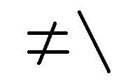

by Anthony Camacho (compiled)
{ .byline }

The Vector working group decided that we could not do justice to Gérard Langlet in an obituary from our own resources. Maybe we will reprint something from *Les Nouvelles d’APL* or elsewhere when we see what people write. We agreed to collect mementoes and so sent out email messages asking people to contribute a paragraph to include in the collection.

We had many apologies from people who felt their English wasn’t up to it or who didn’t know Gérard well enough. Below are the contributions we have received so far that we feel able to include.

### Dieter Lattermann (APL Club of Germany)

“While preparing for APL96 at Lancaster I received a letter from Gérard from the hospital. He offered a talk on the famous “difference scan”, which he considered to be the key to the “theory of everything”. The programme committee initially was hesitant to accept his offer. There was a feeling that not much new information could be expected. However, it was eventually decided to listen once more to Gérard. I think, nobody attending his sessions regretted this. I had not taken his stay at he hospital too seriously and was glad to meet him again at Lancaster. There he indicated that this was probably his last APL conference. This utterance struck me and I refused to believe it. Unfortunately, as you all know, he was right.  
I regret very much that I never managed to get him to perform at a meeting of the APL Club of Germany (my mastering of the English language is poor, but I think “performance” describes closely what we missed).  
The APL community has lost a great, innovative promoter of APL and, at least as important, a human being who helped to make the life in this community so enjoyable. We will never forget him.”

### Anthony Camacho

“Long convinced that Gérard had hold of the tail of the dragon that might lead to the secret of the universe, I did my best to get Vector to support his endeavours. (See the Editorial in Vector 11.2) While holding the tail of the dragon, he managed to be entertaining, engaging, witty and thoughtful. He gave me a T-shirt that displayed difference-scan for all the world to see. I still wear it, but less often than in 1994 (not because I am less convinced but for fear of wearing it out). I wish I had known him when I was younger and cleverer. I wish I spoke French well enough to appreciate all he wrote (Sylvia and I have tried, in vain, to do him justice in translation).”

### Howard A. Peelle

“I remember, with delight, Gérard’s delight in watching his wife learn APL during the “boat conference” after APL92 in St. Petersburg.”

### Dick Holt

“Thanks for doing a tribute to Gérard Langlet. Below is my email to c.l.a. I wrote it at a time when I was emotionally upset by his death. Upon reflection, I’ve decided not to change it.  
The c.l.a. message below from Christian Scherer needs no translation.

The APL community deeply mourns the death of Gérard Langlet. His witty, learned, and creative work will long be treasured by his colleagues. Speaking personally, I’ll remember, and miss, him for the rest of my life.  
\>Gérard Langlet est mort le 22 décembre.  
\>Il sera enterré au cimetière de Jouy-en-Josas le vendredi 27 décembre à  
\>10h45  
\>Christian Scherer”

### Eric Lescasse

“Gérard was a researcher, a real researcher. Once Gérard had discovered APL, his life changed: he quickly became an expert in APL and used it ever since for his work, but also spent considerable efforts trying to communicate to others his passion for this language. And he did succeed, many of his fellow researchers at CEA having become APL users, following him. He had a rare and enormous work power, still finding the time to read a real lot of books. He became interested in seeing how APL could be applied to a lot of different areas crystallography, physics, biology, mathematics, poetry, etc. and published countless scientific articles and research papers in particular in the French APL Association review *“Les Nouvelles d’APL”* which he has been setting up himself for the last 2 years of his life. Through these articles he could expose important scientific discoveries he had made in all these domains, thanks to his particular use of APL and deep comprehension of some APL primitives and operators (not equal scan) on booleans. Many admire him for his researches and discoveries; all should have a real great respect for the courage he has shown throughout his illness, going on writing articles and publishing *“Les Nouvelles d’APL”* until the very end of his life and with never a complaint.”

### Michel Dumontier

I have just this evening to write a memory of Gérard Langlet and I shall try to be concise: I have so many memories of him as we have known each other for a long time...

“Gérard Langlet was better than a friend or a brother for me, our relations were different than with other people, because we had some affinity and we understood each other, which is not commonly the case for a friend, even for a brother. The chief thing that made a strong relationship between us was, (everybody has guessed it!) ... APL of course.  
But there is not only that: scientific understanding of biology, mathematics, languages, human behaviour, the way to feel things, to make relations between things, and we can add: our common understanding of things through APL, which is very different (I assert it strongly) and not comparable with the understanding of what I call a ‘classic’ \[1\] person who has not in mind the special, the only tools of thought cabled in the neurons by a long practice of APL.  
Gérard would not contradict me as he said sometimes: ‘To practise APL you need to have your neurons positioned (orienté in French) in a particular way’... We did not have the same ideas on all the domains or matters but we naturally avoided speaking in these domains, so we remained good friends. (All persons are different even twins or clones; in nature all entities are different even electrons or smaller particles: a single reason is that they cannot be in the same place at the same time and here also, Gérard would not contradict me because of his belief in APL difference scan (≠\\).)  
The first time that I met Gérard was either at an APL AFNOR meeting in Paris or an APL AFCET conference. Even though I practised APL since 1969, I cannot have met him before 1974 as it was only at this time that he began to be interested in APL, after having been subjugated by meeting a screen in a corridor which was displaying APL characters. That puzzled him and he was curious to know what it meant, because he had some natural curiosity about languages.  
He confided to me that he spent six months to withdraw from his mind all the false things that they taught him in FORTRAN...to accept APL understanding. We have in common 11 APL congresses since 1985. I think that it was for him as for me, perhaps not with the same intensity, a kind of bliss to meet APL friends, generally for two weeks because we remained for APL ISO standard meetings.  
The week-end between APL congress and APL ISO meeting, he rented a car and we visited together or with other APL friends some beautiful countryside around and also various restaurants! I have many photos since 1985 and video records since 1988 of those precious moments.  
I shall give just one anecdote to show our empathy and perhaps our behaviour (some would say French behaviour... I am not so sure!). During the week-end I spoke of above, in 1993, we visited a beautiful area near the Niagara falls where I remember there was a peach festival. During a walk in the streets of the village, we saw a prestigious hotel. I had no difficulty in convincing Gérard to visit the hotel where there was, if I remember it well, a sale by auction. In a great lounge, we saw a piano and naturally, we played one after the other some classical pieces of music and nobody said anything to us, we left as we came... we had also the love of music in common...  
Naturally, we have not only exchanged many ideas but also much software, especially APL software. We wrote also papers in the same journals especially the French APL review: *‘Les Nouvelles d’APL’* where he was the chief editor.  
His last issue was that of December 1996. His last APL conference with me was that of Lancaster. As he had difficulties in walking, I brought him, his wife, my wife and my daughter in my car from his home to the conference. As with us, I think that it was a good memory for him.  
He also said that nothing purely haphazard, but rather what in English you call chance or coincidence, and he said for instance that it was not by haphazardness that we met each other.”

I have surely a special memory of Gérard that I have never had for any other person and I think, as many people do, that Gérard will be missed in APL circles.

\[1\] I call also ‘classic’ mathematics, the mathematics (of the 17th century) that is only and still now taught at school. The mathematics of a person who doesn’t know APL and has consequently no tool of thought.

You will find at the following URL a biography of Gérard, two speeches at the cemetery, one from his boss Edgar Soulie, another from a common APL friend Sylvain Baron, a condolences book, the articles of the French APL review and other useful hypertext references: http://www.ensmp.fr/~scherer/langlet/

### Curtis Jones

“My favourite memory of Professor Langlet was at his symposium at the NY/SIGAPL’s Tool of Thought in January 1993. He kept a large crowd of us packed into a small meeting room interested and amused as he led volunteers through several exercises on successive differences in binary vectors. I’m still curious about how an edge of a triangle of bits from not-equal scan can be a Fourier transform. It was the call for papers with some relation to the parity scan that goaded me to write about inner-product scans for that Tool of Thought seminar. In my next paper I wanted to show “my” inner-product scan generation of a Fibonacci series and cast it in a form that used Langlet’s geniton. I looked at his paper in the APL94 proceedings \[1\] for a geniton, and found he had already demonstrated an inner-product scan to generate a Fibonacci series!”

```
+.×\9⍴⊂2 2⍴1 1 1 0
```

“I’m sorry that Gérard will not be able to write the book I think is needed to explain his work. It was good to see at APL96 in Lancaster that Michael Zaus is explaining and building on Langletian ideas of parity logic.”  
\[1\] Gérard A. Langlet, *“The APL Theory of Human Vision”*,  
APL Quote Quad, Vol. 25, No. 1, pp. 105-121 (APL94, Sep. 1994)

### Eugene McDonnell

“Gérard Langlet was an inspiring and inspired teacher of APL. I have met many people who were introduced to APL in one of his classes. He was a theorist whose novel ideas have given us much to think about. And he was diligent in attending the meetings of the APL standards group, where he was a steady contributor to the work of that group.”

Curtis Jones points out that Gene was the recording secretary of the APL standards group.

### Norman Thomson

“Gérard was entertaining, provocative, endlessly self-confident while at the same time warm in his enthusiasm for just about anything he put his hand to. He was undoubtedly one of the greatest characters who turned up at almost all the APL conferences, and will be missed there by many.”

## 

(webpage generated: 18 August 2007, 10:36)
