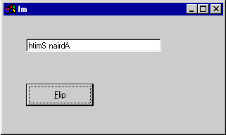

*some experiments by Adrian Smith*
{ .byline }

## Background

Those of you who build applications in Causeway (shareware or Pro) will know that its main design objective was to take away from the programmer (*me*) the responsibility of remembering which Gui objects needed to be updated when some underlying data changed. Now I think it is fair to have the programmer state explicitly the dependencies (“this field will need fixing when any of the following change ...”) although the screen design software can usually make a fair guess just by stripping the valid names out of the object’s data expression; what is *not fair* is to have to remember to ‘notify’ the change to some variable when you run a callback that re-assigns it. Surely the interpreter knows that you assigned some new data to `user_name` – why can’t it just tell the program?

## Where do Watchpoints come into it?

The concept of watchpoints has been around in ‘real’ development environments for years, and several old mainframe APLs (Xerox, Burroughs?) had something similar. Dyalog actually demonstrated `)watch` in an early version of Dyalog/386 at a BAA meeting (to general acclaim) but somehow it never made it into the Windows interpreter. J has a related idea in the 4!:5 conjunction which reports all the names which changed since you last called it. For debugging, watchpoints are just amazingly useful. For example in my Rain graphics engine, I build the description of the chart as a simple character vector of PostScript code. This involves a lot of APL like ...

```
R←R,'[ ',(CH∆FMT XPOS,TLF,XPOS,YL),' ] ',ATT,' ps_pL ',nl
```

... to draw a polyline (I think this may be a Y-axis). Quite often, my fingers get ahead of my brain and I forget to format the co-ordinates. APL is horribly tolerant of this kind of misdemeanour, so everything carries on until I hit WS FULL (because I now have some horrid nested heterogeneous miscegenation lurking in my workspace) or until I try to view the chart, save it to file etc.

Now at the end of each block of code, the temporary variable `R` gets catenated to a global buffer with an expression like:

```
CH⍙PG←CH⍙PG,ps
```

... just suppose we could ‘watch’ this buffer and pull up short the moment it ceased to be a pure character vector? Well now we can, and it is amazingly easy to set it up:

```
      ⎕watchpoints←1 2⍴'CH⍙PG' '~^/CH⍙PG∊⎕av'
chPlot ⍳12
WATCH POINT TRIGGERED
~^/CH⍙PG∊⎕av
^
    )si
⎕WATCHPOINT[1]
CH∆cat[6]
chPlot[22]
```

So what happened, and where am I? Every time I make an assignment to the buffer, the expression `~^/CH⍙PG∊⎕av` is evaluated. If it is *true* (non-zero) then my code is immediately suspended in a phantom function called `⎕WATCHPOINT`, and I can look at the stack to see which line of my code caused the problem. Note that the help file is misleading here – it states *“The first column holds the name of the variable whose imminent change in value will trigger evaluation of the expression in the second column; ...”* which implies that the suspension will occur before the damage is done. In fact it does the assignment first, but at least you have the smoking gun to hand.

Now, you can call functions in that right-hand column (whinge #2 – the help file states *“If the function returns a zero or no result, execution will not be suspended, but whatever code the function contains will have been executed.”* but in fact you must return a result) and you can run as many expressions as you like against the same variable ...

```
      ⎕watchpoints←3 2⍴'x' '⎕←''x has changed'' x'
      x←12
 x has changed 12
 x has changed 12
 x has changed 12
```

... but don’t think you can abuse it with things like ....

```
     ⎕watchpoints←1 2⍴'x' '⎕←''x has changed'' (x←x+1)'
```

While we are in the mood, whinge#3 – the help file is quite explicitly wrong in stating *“Note also that the single character variable name “Z” must be raveled to a vector before assignment; scalars are not accepted.”* – scalars are accepted, as in the example on the previous page.

This all begins to feel rather useful, not just as a debugging tool but quite possibly as part of a real application. Suppose we are running a +Win OLE server using Excel as the Gui interface. Maybe this is running some fancy statistical model, and it might maintain some intermediate variables to show how it is getting on. Perhaps the spreadsheet could display these variables as they change? Now all we have to do is to ‘watch’ the variables in our server and use the `Notify` method on root to tell Excel that something changed, and probably what it is and the new value. Which brings me to ....

## A 1-Line Causeway Engine

Remember, Causeway is all about things changing, and other things getting told about it. Suppose we have:

```
      ∆name
Adrian Smith

    ∇ Flip
[1]   ⍝ The famous Causeway 'Flipper' using watchpoints
[2]    'fm' ⎕WI 'Create' 'Form' ('where' 24 12 12 40)
[3]    'fm.ed' ⎕WI 'Create' 'Edit' ('where' 2 4 1.2 24)
[4]    'fm.ed' ⎕wi 'text' ∆name
[5]    'fm.bb' ⎕WI 'Create' 'Button' ('caption' '&Flip')('where' 6 4 2 12)
[6]    'fm.bb' ⎕wi 'onClick' '∆name←⌽∆name'
[7]
[8]    ⎕watchpoints←1 2⍴'∆name' '''fm.ed'' ⎕wi ''text'' ∆name'
[9]
[10]   'fm' ⎕WI 'Wait'
    ∇
```

 Then Bob, as they say, is your uncle. Whether this is sensible, and if so how one might set about implementing it for real, remain open questions. However it works so simply and reliably I can’t help feeling that it has to be a technology worth exploiting. Watch this space!

***
