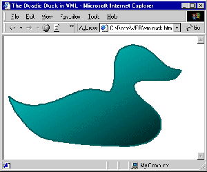
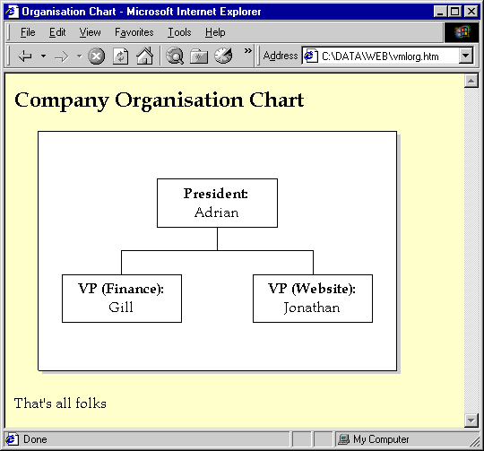
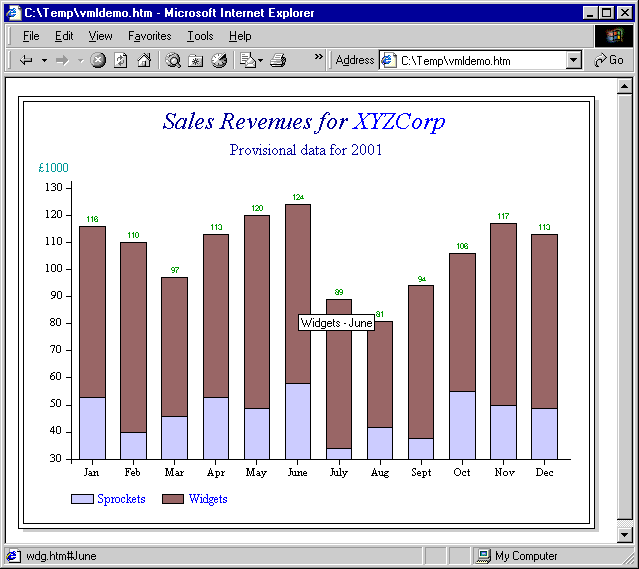

*by Adrian Smith ([adrian@causeway.co.uk](mailto:adrian@causeway.co.uk))*
{ .byline }

## Introduction

This is a shortened and slightly updated version of the handout used at the Finnish Forests seminar in February. It gives some background to the new vector-graphics capability being introduced to the web, and shows how you can easily generate Vector graphics from [Causeway *RainPro*](http://www.causeway.co.uk/products/).

\[July 2001: VML graphics can now be generated on the fly from an ASP script with [GraPL.NET](http://www.grapl.net), which uses the *RainPro* engine under APL+Win.\]

## What is VML?

VML stands for “Vector Markup Language” – it is a simple way of adding vector drawings to your web page without resorting to pictures. Full details can be found on the World Wide Web Consortium page at *[www.w3c.org](http://www.w3c.org)* where the original specification was lodged in May 1998. Another good place to look is *[www.vmlsource.com](http://www.vmlsource.com)* which has an increasing collection of examples and links. As ever, politics has complicated things since then – Microsoft have charged ahead and implemented a reasonable subset of the standard while the standards group has grown many new affiliates and has moved on to something called “Scalable Vector Graphics” (SVG) which is almost (but not quite) upwardly compatible. Of course nothing yet implements SVG, but there is hope - JASC (the PaintshopPro people) have a demo version of an SVG authoring tool for download from their website. Just to give you a flavour ...

{ width="300" height="249" } The entire outline of this famous bird can be condensed to a mere 12 Bézier curves, and (this is a Microsoft product after all) silly special effects like the graded fill come free.

The most obvious difference is just how much less came up the line to do that - the entire webpage is only 1917 bytes! The other, less obvious, benefit is that everything was ‘in line’ – the browser never needed to reconnect to the site to request an embedded picture. A final advantage only shows when someone prints your page – rather than a steppy bitmap you get the shape smoothly rendered on the printer.

The magic words which you will need in your HTML page look like this:

```
<head>
 <title>Let's Play with VML</title>
 <xml:namespace prefix="v"/>
 <style>v\:* {behavior=url(#default#VML)}</style>
</head>
```

As you might guess, VML is one of the infinite variety of ‘XML-compliant’ languages which can now be hosted by your browser. XML is basically a grammar which states that things come in paired tags, and that the prefix which begins each tag determines the ‘namespace’ in which the tag is executed. The XML parser (built in to the browser) is just a router which checks for tags, parses the tag parameters and hands the result as a nice easy-to-swallow array to the appropriate engine.

What this header says is “whenever you see a tag beginning &lt;v:xxx stuff="123"> wind up something called *#default#VML* and hand it the ‘stuff’ property with the string value ‘123’.” A tag like:

```
<v:group style='width:200pt; height:200pt'
         coordorigin="0 0" coordsize="175 175">
```

... is typical. It defines a rectangular patch of screen and sets a co-ordinate system on it. As is characteristic of most Microsoft products, it does not make total sense, as you may notice a strange mix of two syntaxes – the style parameter uses ‘Cascading Style Sheet’ conventions (property:value separated by semicolons) but the rest of it uses standard XML (property="value" separated by white space). It all adds to the fun!

## Why should I be interested?

You might just like to keep up with the crowd! Microsoft are heavily into this stuff as part of the HTML publishing capability of Office 2000 (which is why VML has so many outrageous capabilities to do with text distortion – they want to do WordArt!) so it will certainly pay to know what is happening here.

You might want to publish some diagrams, for example the people at Boeing might like field engineers to be able to get rapid access to technical drawings showing them where to plug the engines in. These could be supplied as GIFs, but the quality is poor and there is no way the drawings can be extracted from the page, zoomed, panned, annotated and so on. VML permits all of this.

You might want to have the site-map on your portal customise itself to show the fields of interest that you know a particular user has explored before. These would arrange really nicely as a coloured ‘bubble chart’ but to make this on the fly as a GIF is a real pain. With VML you just generate it in-line as text and down the socket it goes.

Maybe you have some geographically-based data (bird observations in your local national park) which it would be good to show graphically? Anyone browsing your site might like to click on the bird (shown as a suitable drawing) to get more details, or just hear the song!

How about an ‘organisation chart’ server which shows your branch of the company hierarchy diagram, working up or down as many levels as you ask for. How about a heraldry server which takes the spec for your coat of arms and sends back a nice drawing ... this idea of in-line vector artwork opens up lots of new possibilities and (I hope you agree) an APL data-processing engine sits very comfortably at the back of many of them.

## How do I make it work?

Let’s take that example of a company organisation chart and develop a simple VML drawing. I will take it as read that you have some code which will draw trees of boxes from tree-structured data – Gary Bergquist covered all this very nicely in his Zark APL Tutor News back in 1988 (reprinted in Vector Vol.15 No.4). Say we have a structure like:

```
President: Adrian
   Vice President (Finance): Gill
   Vice President (Website): Jonathan
```

... which we would like to draw in the traditional boxed structure. The first thing to do is to lay out the playing field, with a comfortable co-ordinate system. I like to set these on a shadowed, edged sheet of paper like this:

```
<h2>Company Organisation Chart</h2>

<div style='margin-top:12pt; margin-left:18pt'>
<v:group style='width:300pt; height:200pt' coordsize="3000,2000">

 <!-- Paper is white with a simple drop-shadow -->
 <v:rect style='width:2000; height:3000' fillcolor="white">
  <v:shadow on="true" offset="4pt,3pt" color="silver" />
 </v:rect>

</v:group>
</div>

<p>That's all folks</p>
```

Working through this one tag at a time ...

```
<div style='margin-top:12pt; margin-left:18pt'>
```

This uses normal CSS1 attributes to get the spacing how I want it.

```
<v:group style='width:300pt; height:200pt' coordsize="3000,2000">
```

This defines a region 300 points wide by 200 points high with the (x,y) co-ordinate system sized so that I can use 10th-points as integers. This saves typing in lots of decimal points to get the precision I might need.

```
 <!-- Paper is white with a simple drop-shadow -->
 <v:rect style='width:2000; height:3000' fillcolor="white">
```

The first line is a standard HTML comment, then we begin to define a white rectangle which occupies the whole region. Notice that the fill colour is simply an attribute of the ‘rect’ tag, but that if we want to do anything more complex we must step in one level with ...

```
  <v:shadow on="true" offset="4pt,3pt" color="silver" />
```

This describes the ‘shadow’ child of the rectangle. This is very typical of VML – simple properties get defined by attributes, complex properties get defined in child tags. If we wanted a fancy dash-line edging or graded fill we would use child ‘line’ and ‘fill’ tags here. Note also one sneaky shortcut allowed by the XML grammar – if a tag has nothing to enclose you can short-circuit the &lt;tag>&lt;/tag> convention with a single &lt;tag />. Very handy for lazy human typists, probably a real pain for the guys who wrote the XML parser!.

```
 </v:rect>

</v:group>
</div>
```

Cancels all the remaining open tags.

OK, we made a sheet of paper! Now to draw a labelled box ...

```
<!-- The President -->
<v:rect style='position:absolute;top:400;left:1000;width:1000;height:400' >
 <v:textbox>
   <p><center><b>President:</b><br>Adrian</center></p>
 </v:textbox>
</v:rect>
```

Hopefully, you can now follow quite easily what is going on here.

I will add the next two boxes to include our vice-presidents and add the lines to join up the boxes:

```
<!-- Stub vertical line down from President -->
<v:line from="1500,800" to="1500,1000" />
<!-- Polyline bridge between VPs -->
<v:polyline points="700,1200,700,1000,2300,1000,2300,1200" />
```

... which finishes the drawing off quite nicely:

{ width="540" height="503" }

## Making a ‘Drill-down’ Graphic in RainPro

You can try out this example in *RainPro* for Dyalog APL or for APL+Win – the application code is identical, bar the addition of a few ‘.’ characters to delimit the `ch` namespace in Dyalog. Here is code for APL+Win:

```
    ∇ r←XYZCorp;rev;mm;msg
[1]   ⍝ Illustrates use of VML drilldown from a simple finance chart
[2]   ⍝ Also HTML jumps from headings just 'in the normal course of events' ...
[3]    rev←23 35+[2] ?12 2⍴36
[4]    mm←','CH∆csvton 'Jan,Feb,Mar,Apr,May,June,July,Aug,Sept,Oct,Nov,Dec'
[5]    chSet 'hmar' 48 64
[6]   ⍝ Jump from the heading to our corporate home page
[7]   ⍝ Note that the 'title' attribute comes through as a pop-up tip here!
[8]    chSet ('Head' 'Sales Revenues for <a href="xyzcorp.htm"
          title="Jump to our magnificent home page">XYZCorp</a>')
          ('Subhead' 'Provisional data for 2001')
[9]    chSet 'xlabs' mm
[10]  ⍝ Use 'atend' here as VML renders vertical text quite badly
[11]   chSet ('style' 'stacked,boxed,values')('ycap' '£1000')('ystyle' 'atend')
[12]  ⍝ Jump from the key to the right part of the products page
[13]   chSet ('Key' '<a href="prod.htm#spr">Sprockets</a>'
          '<a href="prod.htm#wdg">Widgets</a>')
[14]  ⍝ Matrix of jump targets for each data element
[15]  ⍝ This should exactly match the shape of the data
[16]   chHref ((⊂'spr.htm#'),¨mm),[1.5]((⊂'wdg.htm#'),¨mm)
[17]  ⍝ We can title these too is we want too (maybe too fussy here?)
[18]   chHint ((⊂'Sprockets - '),¨mm),[1.5]((⊂'Widgets - '),¨mm)
[19]   chBar rev
[20]   PG←chClose
    ∇

VMLTest 'XYZCorp'  ⍝ To write out a stand-alone HTML file
```

{ width="639" height="569" }

The mouse was being waved over the June bar for widgets! Probably you can see that there are normal jumps from both the main heading and the data legends.

This style of web-graphic works particularly well in a framed layout, where you can leave the graph in place in your main frame, and show the detailed figures in a ‘footnote’ frame just below. See the examples of 10 years of climate data on the Causeway [website](http://www.causeway.co.uk/demos/climate/rainview.htm), and compare the quality and byte-count of the same charts shown in VML and as conventional pictures.

***

{ width="0" height="0" }
