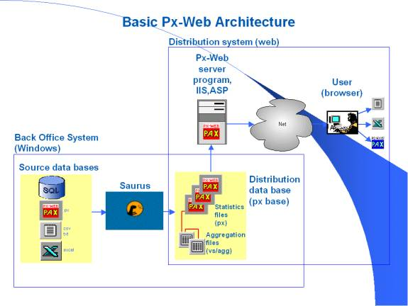
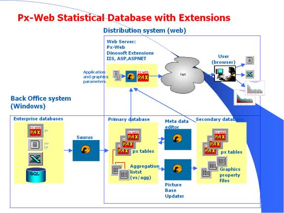
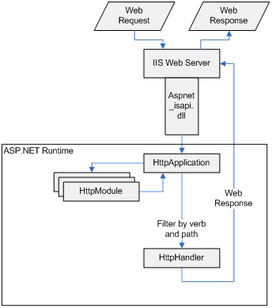
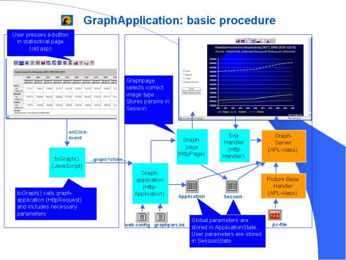
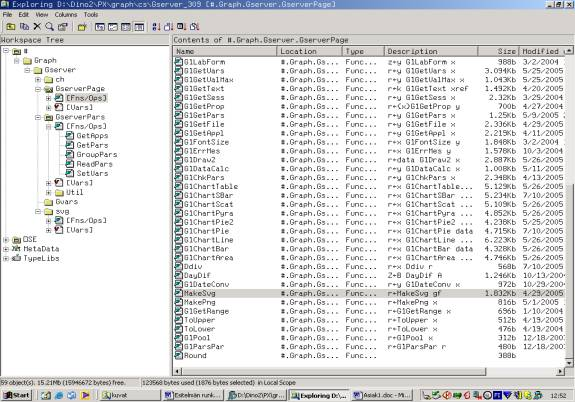

Pertti Kalliojärvi, Dinosoft Oy
{ .byline }

## <a id="_Toc117273388"></a>Contents

Using DyalogAPL based .NET extensions in ASP.NET applications

[Contents](#_Toc117273388)

[Introduction](#_Toc117273389)

[PX-Web publishing system](#_Toc117273390)

[Extensions by Dinosoft](#_Toc117273391)

[Programming in the  ASP.NET / .Net environment](#_Toc117273392)

[The ASP.NET Http Pipeline](#_Toc117273393)

[HttpModules](#_Toc117273394)

[HttpHandlers](#_Toc117273395)

[Using DyalogAPL with PX-Web?](#_Toc117273396)

[Why DyalogAPL?](#_Toc117273397)

[Building your own HttpModules](#_Toc117273398)

[Cookie HttpModule](#_Toc117273399)

[Case: DyalogAPL version/cookie](#_Toc117273400)

[Building your own HttpHandlers](#_Toc117273401)

[Case: Svg-Handler](#_Toc117273402)

[How to build and use general plugins?](#_Toc117273403)

[Pros and cons of using DyalogAPL](#_Toc117273404)

[Conclusion](#_Toc117273405)

[References](#_Toc117273406)

## <a id="_Toc117273389"></a>Introduction

Building Web applications usually includes many evolutionary stages where different programming languages and tools have to be combined. With the new .NET - framework it is relatively easy to add dynamic DyalogAPL components as .NET classes into various parts of IIS/ASP.NET applications and even into the HTTP - pipeline. As a case study we will show how to add several functional extensions (dynamic image generation, dynamic components etc.) into a third party statistical web application called PX-Web. PX-Web belongs to a widely used family of PX - products, which are authored by a consortium of statistical offices in Europe (the main developer being Statistics Sweden).

This extended Web application is used to publish statistical data and automatically created vector graphics using techniques and languages like ASP, ASP.NET, C#, SVG, JavaScript and of course DyalogAPL and RainPro. We will also discuss the difficulties in learning and using .Net and also the pros and cons of involving DyalogAPL in such a complex environment.

## <a id="_Toc117273390"></a>PX-Web publishing system

PX-Web is a system for storing statistical data and publishing it on the web. It belongs to the group of PX-product which are based on open architecture. The main platforms for running PX-Web are Windows 200X Server Families and IIS web servers.

What is PX-Web?

- Web publishing system developed by Statistics Sweden (SCB)
- PX-Web is used for distributing basic statistical data
- Designed for professionals to use statistical data for different purposes
- Used by Statistical offices and international organizations in almost 20 countries
- Used also by public institutions and  municipalities
- Development is guided by international “PX-Axis reference group”

{ width="575" height="432" }  
**Figure 1. Px-Web Architecture**

PX-Web features include

- Navigation in hierarchical database structure
- Text search to find certain statistical tables directly
- Data selection by classification
- Aggregation of data
- Many different download formats including Excel
- Basic business raster graphics + maps
- Multilanguage application

Px-DataBase features include

- All Px-products use special file standard: “PX-file”, which defines the layout of a statistical table
- Files are stored in text format and can be edited with text editors
- PX-FileSystem is a standard hierarchical file system with little support for concurrent updates etc.
- Xml version of the file standard is currently being developed

## <a id="_Toc117273391"></a>Extensions by Dinosoft

Px-Web is an ASP application, which is the older version of Microsoft Active Server Pages technology.  Eventually there will some day be an ASP.NET release and we had to design our software extensions to be able to function correctly even with the future releases. This was a very strong argument in favour of independent and pluggable technical solutions.

Px-Web extensions can be grouped into four categories:

- a module for creating dynamic graphical images using SVG vector graphics
- a module for dynamic menus, which can use custom authentication and authorization
- a new picture database, which extends static images to automatically updated dynamic ones
- independent modules for logging user activities, error handling, custom authentication and authorization

In this paper we will not be covering the  functionality of these extensions because other articles will be available for that purpose. Therefore next sections will mainly concentrate on showing the techniques and basic ideas how you can add modularity to your applications and how DyalogAPL is used in this context.

The next figure shows the PX-Web functionality after adding Dinosoft extensions:

{ width="575" height="432" }  
**Figure 2. Extended Px-Web Architecture.**

## <a id="_Toc117273392"></a>Programming in the  ASP.NET / .Net environment

Programming and run-time environment management for ASP.NET applications has more “moving parts” than one might guess. 

The following list shows the different environments and versions into which we currently have to adjust our software.

- **IIS** (Internet Information Server) as the web server: versions 5.0 ( W2000 Servers), 5.1 (XP Development), 6.0 (W2003 Servers), \[7.0 beta\]
- **ASP** (Active Server Pages)  as server application runtime environment: ASP, ASP.NET  versions 1.0, 1,1, \[2.0 beta\]
- **.Net Framework**: versions1.0, 1.1, 1.1.x.x, \[2.0 beta\]
- **C#**: versions 1.0,  \[2.0 beta\]
- **DyalogAPL**: versions 10.0, 10,1,  \[11.0 beta\]
- **JavaScript/EcmaScript** as the client side scripting languages
- **Client Browsers**: Internet Explorer, NetScape, FireFox, Mozilla, ...
- **Client Browser Plugins**: Adobe’s SVG Viewer, ...
- Etc.

So there is a lot of variety regarding possible problems with software updates, testing, troubleshooting etc. Sooner or later development and testing becomes a nightmare unless there is a way to utilize components and modularity. Especially bugs found in a single software module should not force any large recompilation and testing in other application modules.

Here is a sample screenshot, where user has selected some statistical table from her personal menu and gets a graphical output image of that data.

{ width="588" height="367" }    
**Figure 3. Basic Screen Layout for Menu and Graphics**

In the figure above

- The left side menu is an aspx  page (C#), which calls DyalogAPL class for customizing menu data for each user. Client side activities use JavaScript to launch new functionality to the other window frame on the right.
- The main part of the right side window is an aspx page with dynamically created controls generated with C# code on the server.
- Graphical image in the middle is  rendered by Adobe’s IE plugin-software and it gets its data from  C# and DyalogAPL based server resources. The actual data for the image is generated using RainPro in DyalogAPL on the server.   

One way to add modularity to your applications is to use the tools provided by the .Net framework and ASP.NET. They can easily be utilized in software development and help you to build pluggable and maintainable solutions, which customers can further extend according to their needs.

### <a id="_Toc117273393"></a>The ASP.NET Http Pipeline

Before going into details of implementing .Net related components, let’s first have a brief overview of the Request Pipeline and its functionality.

[{ width="344" height="389" }](dino4.gif)  
**Figure 4. HttpRequest Pipeline (Copyright Microsoft).**

When the client browser sends a request to IIS, it maps the extension of the received request according to stored configuration parameters and passes .aspx, .asmx, plus other extensions to aspnet\_isapi.dll, which is an ISAPI filter. This in turn starts a new ASP.NET runtime (a chain of managed objects dubbed the HTTP Pipeline). An object of the HttpApplication class, which is the class behind your global.asax file, is created and started and it acts as the host for the ASP.NET Web application. This functionality differs between different versions of IIS and ASP.NET, but usually the following steps are the same

- HttpApplication reads the application (web.config) and machine configuration files (machine.config).
- It passes the request to a members of HttpModules, which return the request after providing some preprocessing on the request. Each module has its own functionality and each one responses to a certain predefined event.
- HttpApplication figures out what type of handler can best handle the request and finally passes the request to the selected and instantiated handler. The selection is based on the verb and path of the request.
- The handler processes the request and returns corresponding response.

In ASP.NET you can extend, replace or reconfigure any of the module or handler classes or provide your own custom modules and handlers. Both of these can be configured on the application level or globally on machine level with \*.config files. 

### <a id="_Toc117273394"></a>HttpModules

HttpModules are in fact eventhandlers: they respond to a certain event fired in the HttpPipeline. A module subscribes to en event by providing a method, which gets executed.

The request pipeline has a predefined set of events which all will be fired in a certain order (BeginRequest, AuthenticateRequest,...EndRequest) during the lifetime of the request. There are also other events which can be processed with HttpModules (for instance ApplicationError). 

It is good to remember that these modules will be executed for all requests and therefore performance issues should be considered carefully before adding your own modules into the pipeline. 

For defining a module you need to implement the module interface **IHttpModule** in your class definition and add to your web.config file the following section

<pre>&lt;httpModules&gt;<br>&lt;add name = "ModuleName" type = "ModuleType"/&gt;<br>&lt;/httpModules&gt;</pre>

where name stands for an arbitrary chosen module name and type is defined as “ModuleNameSpace.ModuleClass, ModuleAssembly”. 

You hook a module to your application by copying its dll to /bin - directory and adding the code above to your web.config file.

HttpModules can be used for URL-rewriting, authentication, authorization and for anything where the needed data is included in the request or response. Logging user activity is one example.

### <a id="_Toc117273395"></a>HttpHandlers

HttpHandlers are programs responsible for serving requests. Each time you define an aspx-page, you actually make a new HttpHandler. This is because a handler is defined by implementing an interface called **IHttpHandler** and that is what the System.Web.UI.Page class does. A handler for a certain resource serves the request by delivering a corresponding response.  Defining a handler is very similar to defining a module: you implement the IHttpHandler interface and add some configuration information to your web.config file:

<pre>&lt;httpHandlers&gt;<br>&lt;add verb="*"path="*.<i>extension</i>" type="HandlerType" /&gt;<br>&lt;/httpHandler&gt;   </pre>

Here verb stand for the verb used in the request (GET,SET,POST) and path defines path and extension for this handler (the URL in the request). Type is once again defined as “HandlerNameSpace.HandlerClass, HandlerAssembly”.

Adding a handler to your application works the same way as with modules: copy assembly to /bin and edit web.config.

One more thing has to be done, if you define a totally new extension: IIS must be configured to pass this request to the ASP.NET runtime. Otherwise IIS will try process it itself and the request will never reach your handler.

With handlers you can easily serve requests for special resources and as a side effect implement web pages which do not actually exist. 

With HttpModules and HttpHandlers it is possible to get

- re-useable components and modularity
- very easy installation and removal with web.config
- application independent solutions
- well defined programming interfaces for your components
- avoid the burden of recompiling existing solutions

## <a id="_Toc117273396"></a>Using DyalogAPL with PX-Web?

### <a id="_Toc117273397"></a>Why DyalogAPL?

The background for integrating DyalogAPL components into PX-Web was that we were asked to explore the possibility of making a vector graphics extension in addition to the existing Px-Web graphics component, which is still raster based.

As we were familiar with RainPro’s capabilities (and that time SharpPlot did not exist) we decided to try to make a component in DyalogAPL. The other alternative of using various control libraries seemed to be too difficult to handle after trying some of them.

Because statistical data is often multidimensional, one thing soon led to another and we ‘forced’ to make more components in DyalogAPL.   

We tried APL in various forms (AplScripts, aspx-pages, class libraries) but somehow we are gradually moving towards solutions where apl is only used as pure a .Net class without any UI components. There are several reasons for doing so the most important one being the reusability of such classes.

Currently Px-Web Extensions include DyalogAPL in

- Graphics application (SVG graphics with Rainpro)
- Dynamic menu (based on each user’s authorization).
- Dynamic image database (which is automatically updated when source data changes)

The technical ways of using DyalogAPL are

- pure independent .Net classes (used by other classes)
- functional classes used with interfaces (graphics generator, menu)
- pure .Net classes for database handling (custom databases i.e. picture base)
- utility libraries

Because the traditional use of APL is something we all are familiar with, the next chapters will cover topics perhaps not so widely known. First example shows how to design a HttpModule both in C# as well as in APL. The second case study show a combination of both languages in implementing a HttpHandler.

## <a id="_Toc117273398"></a>Building your own HttpModules

In Px-Web we have used custom HttpModules for

- Custom authentication and authorization
- Error logging
- Session management

While building these modules we needed to get access to a third party software which used a customized cookie based authentication. The test phase was carried out to generate similar cookies in a HttpModule, which could be plugged to any application.

### <a id="_Toc117273399"></a>Cookie HttpModule

Implementing a HttpModule is just as simple as using the corresponding interface class as the base class and writing  your versions of every needed method and property.

Interface for HttpModules contain only two methods: Init and Dispose. Init is used for assigning your eventhandler method to an event and Dispose is just a dummy method belonging to this interface.

So we have (in C#):

```
namespace Graph.Modules {
     using System;
     using System.Web;

     public class CookieWriter: IHttpModule {
          public void Init (HttpApplication application) {
                    application.BeginRequest += (new
                    EventHandler(this.WriteCookie));
     }
     public void Dispose() {
     }
```

CookieWriter class implement IHttpModule with two public methods. Init method just assigns our Writecookie method to BeginRequest event so that this method will be called on every request.

This is very dangerous, but this class is only used for test purpose.

Then we need the code for the WriteCookie method:

```
private void WriteCookie(Object source, EventArgs e) {
          HttpApplication app = (HttpApplication) source;
          HttpContext context = app.Context;
          string cdata = String.Empty;
          ... Get cookiedata from somewhere ....
          cdata = ...
          HttpCookie ck = new HttpCookie(cookiename,cdata);
          context.Request.Cookies.Set(ck);
        }
```

It gets cookie data from somewhere and then makes a new HttpCookie instance. This instance is added to the Collection of the current request. (It would have been better to use a copy, but this is an example.)

After compiling our class to a dll (Cookie.dll) and moving it to /bin directory, we only have to change our web.config by adding the following module information into &lt;httpModules> section.

```
<httpModules>
  ...
<add
         name =⍒cookie1⍒ type = "Graph.Modules.CookieWriter, Cookie" />
```

### <a id="_Toc117273400"></a>Case: DyalogAPL version/cookie

The DyalogAPL version is quite similar, but there are minor changes. I have tested this solution and it works, but there might be more elegant solutions for passing the eventhandler information to application events.

```
      )ns CookieTest
#.CookieTest
```

```
      )cs CookieTest
#.CookieTest
```

```
      ⎕using←'System' 'System.Web,System.Web.dll' 'Util, Util.dll'
```

```
      'CookieGenerator' ⎕wc 'NetType' ('Interfaces' 'IHttpModule')
```

```
      )cs CookieGenerator
#.CookieTest.CookieGenerator
```

```
      )ed Init
      )ed Dispose
      )ed AddCookie
```

```
      'Init[⎕]'
   [0]   Init appl;eh
   [1]   ⍝ Init is the basic method for IHttpInterface where you
   [2]   ⍝ first create a new eventhandler and then assign it to
   [3]   ⍝ some event in the HttpPipeline
   [4]   ⍝ appl: HttpApplication
   [5]
   [6]   ⍝ Let's create a new eventhandler to be called
   [7]   eh"EventHandler.New(⎕OR'AddCookie')
   [8]
   [9]   ⍝ Next we assign it to application BeginRequest event
   [10]  ⍝ Here we use a little utility class to do the
   [11]  ⍝ actual assigning
   [12]  Util.EvUtil.BeReqAdd appl eh      'Dispose[⎕]'
   [0]   Dispose
   [1]   ⍝ Dispose is part of the IHttpModule interface
   [2]   ⍝ Do nothing in this context      'AddCookie[⎕]'
   [0]   AddCookie x;appl;args;req;cookie
   [1]   ⍝ This is a callback function for some web application event
   [2]   ⍝ It takes standard arguments: source, args.
   [3]
   [4]   appl args"x
   [5]
   [6]   ⍝ Source refers to HttpApplication Object, which has a HttpContext property
   [7]   ⍝ which in turn has a HttpRequest property.
   [8]
   [9]   req"appl.Context.Request
   [10]
   [11]  ⍝ Then we generate a new HttpCookie and assing our data to it.
   [12]  cookie"HttpCookie.New 'mycookie' 'this is data: a very important cookie test string'
   [13]
   [14]  ⍝ And finally we add this new cookie to request's CookieCollection
   [15]  req.Cookies.Set cookie
```

The little C# - method in Util-namespace only assigns our eventhandler to an application event (here BeginRequest):

```
namespace Util {
    using System;
    using System.Web;
    public class EvUtil {
           public static void BeReqAdd (HttpApplication application,
                                           EventHandler eh)
           {
           application.BeginRequest += eh;
           }
....
}
```

I moved this simple assignment statement outside APL due to syntax difficulties, which might occur with some events. The utility can also be used from any .Net language and at the same time one does not have to worry about operational difficulties with multicast delegates. So far this has only been used in test environments.    

Next we have to assign the .Net related properties to our new functions:

- Init takes a HttpApplication argument and returns Void
- Dispose takes no arguments and returns Void
- AddCookie takes typical eventhandler arguments: Object and EventArgs and returns Void

After this we are ready to Export our workspace to a dll library and copy it to applications /bin directory.

The last thing we still need to do is edit our web.config by adding information to **&lt;HttpModules>** section before our cookiegenerator is ready to be used.

When next time a user request arrives for this application, each request will be added a custom cookie by our new HttpModule.

I used different class names so that both version actually run at the same time. The reason for this is the way that events are assigned: each event has several eventhandler delegates and they all will be called when the event (BeginRequest) fires. After that we have two extra cookies in our request.  

Of course you can always use the *traditional way* of handling application events by adding your code directly to **global.asax** file, but then you have to recompile this (perhaps a code behind) file. In this case you will lose the dynamics of true plugins where code can be added and removed without touching any parts of the actual application.

In **global.asax** this would be :

```
...
protected void Application_BeginRequest(Object sender, EventArgs e)
{
          new CookieTest.CookieGenerator().AddCookie(sender, e);
}
...
```

## <a id="_Toc117273401"></a>Building your own HttpHandlers

The second case study uses C# code for building the HttpHandler and  DyalogAPL classes to do the actual dirty work. Of course this time you can do it directly in APL without C#, but when you look at the code, you’ll see a comment explaining why we use C#. 

Steps we need to make:

- create a class that implement IHttpHandler
- create a DyalogAPL class that does the actual work (i.e. generates svg)
- modify web.config
- let IIS know about the new resource

In fact we are implementing the rightmost parts of the following true scenario:

{ width="575" height="432" }  
**Figure 5. Basic steps in invoking dynamic graphics.**

Here we have a HttpHandler which serves requests assigned to ‘.svg’ extensions and return svg image definitions (xml to be precise) for the client.

### <a id="_Toc117273402"></a>Case: Svg-Handler

Svg-handler generates images using url-parameters, global data from the workspace, and data from  global initial parameters (called when application starts) and it stores global data in the apl workspace.

The skeleton for the Httphandler is very simple:

<pre>// DemoHandlers.cs
// By Dinosoft
namespace Graph.Handlers 
{
    using System;
    using System.IO;
    ....
    /// &lt;summary&gt;
    /// Summary description for SvgHandler.
    /// Author: Dinosoft Oy - PK
    /// &lt;/summary&gt;

    public class SvgHandler: IHttpHandler,IRequiresSessionState 
    {
public override void ProcessRequest(HttpContext context) 
{
string output = string.Empty;

// first we just check that this request is for a dynamic image
if (context.Request.Path.IndexOf(GraphApplication.Graphserver)&gt;-1)
{
// Get some parameters from the request and/or from user session 
            NameValueCollection rs=context.Request.QueryString;
            string par1 = (rs["parname1"])...;
            string par2 = (rs["parname2"])...;
            string par3 ...
            ...
            // Get corresponding px-data from the picture base 
//(which uses DyalogAPL classes)  
            GraphFile gf=new GraphFile(par1,par2,...);<br>            // Create a instance of our graphics generator 
 //(which is a DyalogAPL class)
            GserverPage gp=new GserverPage(par3,par4,...);
            
            // Pass database information for the generator 
// to make the desired image  
            output=gp.MakeSvg(gf); 
}
else 
{

            // This request was for a static recource, 
 // so get it from somewere else
 // We don't want to drag this stuff into apl 
 // do we ?
        
       }
       // and finally write the response        
       context.Response.ContentType="image/svg+xml";
       context.Response.Write(output);
     }

       public virtual bool IsReusable
       {
           get { return false; }
       }
}  </pre>

What the code above does is:

- we create a handler class from IHttpHandler base class and add IRequiresSessionState interface just to be able to use and store Session variables.
- IHttpHandler has two methods: ProcessRequest, which does all the work and IsReusable, a boolean method which can be set to return false in this context.
- ProcessRequest gets a HttpContext class as input and uses one of its properties to find the actual Request instance.
- After that we dig some variables from the Request URL and use some of them to get data from the database
- GraphFile class is a DyalogAPL class, which manages the whole Picture Base
- We get a new instance to GraphFile and pass it to another DyalogAPL class called GServerPage, which in turn makes graphical images with the help of RainPro
- MakeSvg method of this class returns xml text to be flushed into Response object.
- Finally the client browser receives this response and passes it to a client plugin (Adobe’s SVG Viewer) which renders this xml code into an image.  

We won’t be showing any DyalogAPL code in this example, because the space is limited. the following figure will give you an idea what is happening inside the apl workspace.

{ width="575" height="402" }  
**Figure 6. DyalogAPL classes for making graphical images.**

In web.config we still have to add some configuration information<b>:</b>

```
<httpHandlers>
        <add verb="*" path="*.svg" type="Graph.Handlers.SvgHandler,Graph.Handlers" />
....
```

This time we also have to configure IIS to pass ‘.svg’ extensions to ASP.NET. That can be done easily using the IIS Manager.

Every request following this application path that has the extension ‘.svg’ will be forwarded to our new HttpHandler. It is supposed to manage all internal exceptions and return a response corresponding the client side expectations of the responses contents type. 

## <a id="_Toc117273403"></a>How to build and use general plugins?

In fact things are not that simple as the two examples above may suggest. If we want to pass startup parameters to our new modules or handlers, we should do it in a similar way: independently of the current application. This can also done with web.config by adding a section where we place our configuration information.

Luckily asp.net provides us most of the framework needed to read this information, but complex data has to be dealt otherwise.

Another thing is to find a way to use customer/third party extensions which are designed to extend our own application extensions i.e. when someone has derived a class from our base class and we should be able to use it in our application.

One of our HttpModules (coded in C#) uses this kind of approach where customer can implement her/his own derived class to be used instead of our base class. .Net Framework also provides  the facilities for building such plugin solutions. 

  Here are some general principles for passing information and designing general plugins for both asp.net and windows applications.

- Create your own interface or a base class to be derived from
- Create a functional class that implements this interface (or have someone program it for you )
- Configure your application to find the information about this new plugin class (web.config in asp.net or  App.Config in Windows.). Basically it is just a new section in the configuration file.
- Create a parser that reads this configuration information i.e. the type of the class and perhaps some parameters for it (for it’s constructor). Register this parser as a configurationhandler. if your interface is simple enough, you can use existing parsers as in the example below.
- Read the configuration information, instantiate the new class with a special class called **System.Activator** and cast it to the base class. \[Here we need the inheritance schema and virtual methods from C#, because the derived class does not even exist when we deliver our base class application.\]
- Invoke this new instance of your base class by calling its methods.

So far we haven’t tried this in DyalogAPL, but there is actually no reason why it should not work after minor adjustments.

Below we have an example of a section in configuration file, which defines a new group called &lt;graph.logs>. This section just groups a set of subsection for us. The subsection &lt;userLog> contains the relevant information:  which implementation of userLog should be used. The type field tells the class name and assembly information to be passed to our application. This class is a derived class from our base class, and was implemented afterwards.

```
<configuration>
          <!-- Allows for a new section group to the Web.config -->
          <configSections>
          <sectionGroup name="graph.logs">         
                    <section
                    name="userLog"
                    type="System.Configuration.SingleTagSectionHandler,
                    System, Version=1.0.5000.0, Culture=neutral,
                    PublicKeyToken=b77a5c561934e089" />
          </sectionGroup>
          </configSections>
          <graph.logs>
                    <userLog
                    type="Graph.Logs.XmlUserLog, Graph.Modules.Logs"/>

                    <!⌈-
                    <userLog
                    type="Graph.Logs.CompFileUserLog,
                    Graph.Modules.Logs" />
                    -->
                    </graph.logs>
...
```

## <a id="_Toc117273404"></a>Pros and cons of using DyalogAPL

Here is a short list of pros and cons of using DyalogAPL to be used as a reference in further discussions.

### Pros

- It is the best language for multidimensional data
- Lots of tested code to be reused in .Net
- Dyalog development tools (trace, thread tool, ...)
- Workspace structure allows special tricks (if documented )
- Code security: it is difficult to generate source code from a runtime assembly 

### Cons

- Installation is difficult for ASP.NET applications
- Debugging has to be done inside apl
- Workspace structure allows special tricks (if not documented)
- The interface to .Net is slow
- You cannot make a module instead of an assembly
- Sometimes it takes a long time to figure out the correct syntax to use .Net from apl
- Expensive to call apl from apl via .Net interfaces

## <a id="_Toc117273405"></a>Conclusion

We have touched the surface of the wonderful world of HttpModules and HttpHandlers and shown some examples how DyalogAPL has been used in this context. Hopefully there will be more elegant examples and shared solutions to be seen in the near future. 

## <a id="_Toc117273406"></a>References

Several articles in the MSDN library written by Scott Mitchell, Atif Aziz, Roy Osherove, Dino Esposito, Rick Strahl and others.

### About the Author

Pertti Kalliojärvi is one of the senior partners and founders of Dinosoft Oy (Finland) and has been working with APL for the past 20 years. 

October 2005
