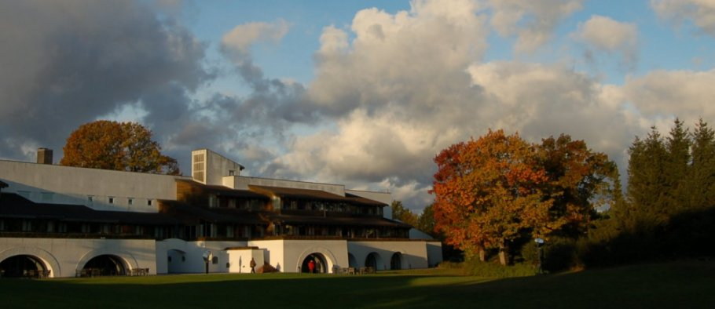
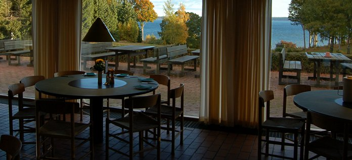
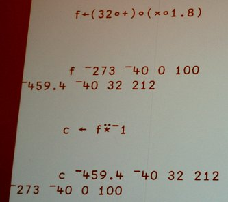
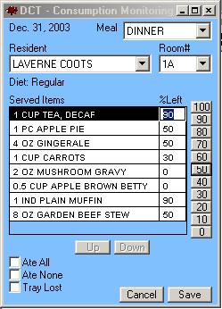
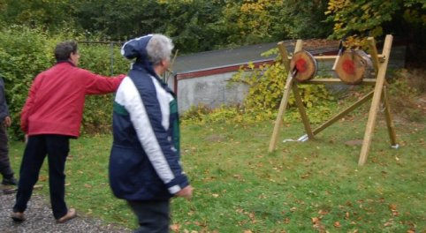

*first impressions, by Adrian Smith (adrian@apl385.com)*
{ .byline }

### Disclaimer

*I could not go to all the talks, and was probably fairly zonked in some of the talks I did attend. Please don't take offense if I missed you completely or (worse) if my notes completely missed the point of your talk. Find someone who didn't miss the point and bite them in the ankle until they promise to write it up. Then have them send it to Stephen and it will be up on this site the next day.*

## Location

Architecture and modern art, sun, sea, woodlands, knife-throwing, 9-pin bowling ... need I go on? This was Denmark at its best, and almost everyone there really enjoyed themselves. LO-skolen was built by the Danish Trades Union movement in the 60s, as a showpiece of all that is most characteristically Danish. The whole place is plain, simple, beautifully crafted out of good materials and just feels 'right'.

This picture was taken from the garden, which runs down to the little railway, and then to the sea. The view from the breakfast table was lovely, with Sweden in the distance across the blue sea. It almost made you want to get up in the mornings! I think Morten and Gitte are set on returning to the same venue next year, and it is hard to see anyone objecting.

This was also the setting for the conference banquet, which has to be rated as one of the best ever - on a par with APL88 for those who remember Sydney. The entertainer was a very professional magician, who pitched the show just right for a bunch of nerds who were really very interested in how the tricks were done. I was sandwiched between Richard Smith (who escaped from Cambridge for the duration) and Brooke Allen who both spent the rest of the evening testing out card tricks on anyone they could find. I had the honour of being picked as the stooge for the 'cut the rope' trick - and in spite of knowing quite well how this is done, I can report that I was completely taken in, even from 2 feet away!

## Conference Highlights

In no particular order (personal choice, of course) ...

- John Scholes on language extensions. John's usual low-key style was the perfect foil to some really exciting new stuff. The 'power' operator is a great addition to the language, and the ability to raise functions to power(-1) may look like a toy, but has got to have some really useful applications.
- Stephen Taylor on Agile development. I do enjoy speakers who can hold an audience with minimal notes and no PowerPoint.
- John Miller on Hologram. Slicing and dicing made all the more powerful by being a very thin cover on APL. I know we have seen dozens of these before, but this one actually looked like a professional product with a properly engineered Gui.
- Discovering an unexpected personal talent for knife-throwing.

## Day-1 Wednesday October 19th

### Welcome and overview of Version 11 *Gitte and Morten*

Gitte welcomed us (all 99 of us) and took us through the new logo, the new colour, and the new ownership structure. Gitte is a shrewd business-lady and I get the strong impression she knows where this ship is headed and will make very sure it stays profitable. I think the Insight team may have taken control at a very good time for the company, and that from now on the only way for Dyalog Ltd is up. A personal opinion, it's true, but reinforced by the feeling of a strong surge of support from everyone present.

Morten took us very quickly through the up-coming features in the new release. Core language extensions are *the power operator*, *squad indexing*, *least common multiple* and *greatest common divisor* (not too sure about the last two, but I guess they are harmless). Morten also touched on the 64-bit version, and on the idea of *classes* which are an attempt to bring APL a little closer to mainstream OO thinking without throwing away all the flexibility that we anarchist programmers have learned to rely on. Oh, one other thing that caught my attention - the ability to have *trigger functions* which fire whenever a variable is changed. CausewayPro could make use of these to great effect, and also I could see huge benefits for debugging - now you can see exactly which line of code just trashed your precious data!

### Hologram - Intelligent Business *John Miller*

I have worked with John on and off over the years, but this was the first time I have seen his new system demonstrated. He does all the usual things (extracting data from huge tables, summarizing it instantly in APL, drawing nice graphs and reports) but with a very scalable architecture and the option of a zero-footprint web front-end. Interestingly, he is happy to interface out to R (basing the interface on Sasha's presentation to FinnAPL 2 years ago) rather than attempting to code up his own statistics library. I liked the look of this system a lot, and I can appreciate the amount of work that has gone into the backend processing, with proper load-balanced servers handling the serious grunt-work.

### Version 11 language extensions *John Scholes*

Yes, the new *power operator* can be a lot of fun. I can see it being used all over the place with arguments of 0 or 1 (e.g. in the obvious 'enclose if simple' utility) but it can do lots of other tricks too. This example takes something that looks very like a J tacit definition, applies it to some temperatures in Centigrade to get the Fahrenheit equivalent, then applies the inverse function to reverse the transformation. I can see Phil Last (of [napkin](nap221.htm) fame) having a ball with this one!

Squad indexing is much less fun, in that it simply provides a functional equivalent to the (admittedly anomalous) square brackets and semi-colons which J banned years ago. You can use it to the left of assignment, but not for 'reach' indexing which is one of those nice Dyalog things that the APL2 people never caught up with. However it does work nicely with operators (*each* being the obvious one) so I can see it gradually creeping into my code.

Now why would you want to extend *and* and *or* to cover LCM and GCD on integers? I am really rather unsure about the value of this one, as these are pretty trivial to code as dfns when you need them. I would rather have had a C-style bitwise variant which is much messier to code around in APL, and is going to be very necessary as soon as APL hits the real .Net classes, with expressions like `FontStyle.Bold|FontStyle.Italic` where you *can* get away with adding the flags, but not when you want to test if your own flags are present in some preset combination.

### Version 11 object-oriented features *John Daintree*

This is far too large a subject for me to cover adequately here. There are things about it that I like a lot, things that I really don't like at all, and things that I am completely unsure about! So to get an argument started, here are some of the things I like:

- You can make an *instance* of a namespace really easily. If a function dies half way through (as APL code always does, particularly when liberally dosed with jots) you just hit ShiftEnter, fix it and carry on running. When the instance goes away, your changes really are saved back in the original namespace. Wonderful. I want this, and I want it now!
- There are lots of new magic words (preceeded by colons such as :Access public) which give the APLer a smart and simple way to add declarative stuff to functions which can then be saved out as real .Net libraries.

... and here are a couple of things that I feel could really spoil my day:

- Having made your instance, you can assign arbitrary crud into it at any time. This goes right against the normal OO rules, and has the huge downside that simple spelling errors may look like they worked but actually they just assigned a value to a name somewhere. I think this is dreadfully misguided, and I hope that there is (at the very least) a big fat switch that disables it.
- Someone needs to have a hard think about nameclass. Now we have Gui things AND namespaces AND classes AND instances all sharing nameclass 9. Oddly, Classes don't show up in `)obs` even though they are in the same nameclass. I really think that this is a false economy, and that these are very distinct types of things.

The thing that bothers me most is why we need *two* new beasts here. Surely a Class is just a Namespace with a few extra attributes set and almost nothing else changed. OK, an *instance* is a wholly different animal and should be recognised as such, but there seems to be an awful lot of baggage here to do something fundamentally simple. Probably I am missing something, as usual. Read Morten's *Introduction to OO for APLers* and form your own opinions.

### A keyboard viewer for Dyalog APL *Kai Jäger*

This was a nice little toolkit which was basically a DIN editor (a much needed tool in the Dyalog world) but could also be used by novices to locate the more obscure APL symbols on the keyboard. Let's hope it shows someone at Dyalog the way to a simple APL toolbar that attaches to your current edit session and allows anyone (even me) to go mousing for things like *notmatch* which have to be there somewhere!

### Is that an APL system in your pocket? *Richard Procter*

The screenshot says it all, really! Richard is working with the Canadian health service on a system to improve nutritional planning for hospital meals. Of course you can plan all you like, but if the patient throws the tray on the floor then your estimates may be way off the mark!

So bring on the Pocket PC which can be used in the hospital to record what the patients are actually getting to eat, not just what went on the tray in the kitchen.

### From Dyalog to pure .Net runtime *Adrian Smith*

As it happens, this followed on really nicely from Richard Proctor's talk, as one of the things I showed was how easy it is to ship a compiled APL application on the pocket PC. I rather enjoyed giving this talk - helpful APLers in the audience kept offering me the laser pointer (and failing that a simple stick) but leaping about trying to indicate stuff on the projection screen is much more fun.

### The PX-Edit statistical table editor *Veli-Matti Jantunen*

This is a nice example of a little piece of utility code taking on a life of its own and spreading way beyond its author's expectations. There is a very well known text format for statistical data called PX (a bit like CSV but with a lot more metadata) so any software which wants to do stats should be able to read it. Then of course it is a good idea to be able to fix errors in it! PX-Edit grew from this simple beginning to a very flexible tool for managing data held in this file format, and now pops up all over the world as part of a huge variety of other statistical tools.

### After dinner entertainment - Lists *John Scholes*

OK, John needs to write this one up. I *think* that all the code shown was completely useless (from a practical perspective) unless you suddenly need to implement a LISP system in APL. But it sure made you think, and the few remaining active grey cells did their best to keep up.

### Homage to Ken Iverson

This being the first anniversary of Ken's death, we once again ran the film of the 1974 discussion on APL design, and then followed this up with a series of reminiscences and tributes from many of those present who knew Ken well. This struck just the right balance, and was attended by almost everyone, even though the time was pushing towards 11:00 before it was done.

## Day-2 Thursday October 20th

### Tutorial - introducing OO to APLers *Morten Kromberg*

Morten had the stamina to run this entire show twice in one day. I went to the afternoon rerun, and greatly enjoyed the experience. The advantage of having the workspaces on the conference keydisk was that is was really easy to play along with the presenter, and of course to try a few experiments along the way. Morten's notes will be serialised in this and the next few Vectors, so it is probably best to leave my report at that.

### Using APL-based extensions in ASP.Net *Pertti Kalliojärvi*

Dinosoft chose Dyalog APL for this project because they needed SVG charting, so they had to build on a platform that ran RainPro, and could be accessed from ASP. Fascinating - now if we had been able to offer them SharpPlot 2 years ago, maybe they would not have used APL at all? Who knows.

## The Viking Challenge

Yes, it was Axes again, and blowpipes too, but this time we had pistol-shooting and knife-throwing as well. The weather rather let us down, with some very poor light (not ideal for the blowpipes as it was almost impossible to see what you had hit) and a bit of rain towards the end of the session. As you can see from the picture, our team managed at least two axes on target.

As before, the winning team got a special version of the tee-shirt. It will be interesting to see the full breakdown of the scores when the Insight team finally manage to decode the rather scrappily written sheets from the various events.

### ARQUE - Assessing the quality of university examinations *Alan Sykes*

You can read Alan's paper in full in this Vector, so just a few comments here. This is yet another example of a user-written system which has escaped from its first home and is now setting out to conquer the world. In Alan's case, he is starting with the market he knows best - the universities of Wales - and then gradually honing the software to make it more generally useful.

## Day-3 Friday October 21st

### Assembly and Morning Song *Michael Baas*

Just think what your local church could save on hymnbooks and service sheets if it invested in a decent projector and a simple computer system (written in APL, of course). Michael has created a very nice interface which uses the dual-monitor capability of the PC to project the words of any song in his library while the congregation sing along to each verse. Simple stuff, but nice to prove that it worked in practice, with a little help from Paul Mansour on guitar.

### Array languages at Morgan Stanley *David Crossley*

What a puzzling talk this was! Morgan Stanley (never abbreviate it to MS, on pain of eternal damnation) have a huge investment in array thinking, and array languages. They started with APL, then had A+ written just for themselves, then partially abandoned it, finally moving to license Kdb from the man who they originally hired to write A+ ... and through all this they still have Dyalog APL in there somewhere.

### Agile development *Stephen Taylor*

Now this was fun, so much so that I completely failed to take notes and thus absolutely failed to learn anything at all from Stephen's excellent presentation. Except, I suppose that the 'waterfall model' of systems development relies on reliable communication between people, and so is about as much use as a chocolate teapot. Which I knew anyway. I am sure this will all come out in Vector soon enough, so be patient and keep doing what APLers do anyway - sit beside the user and code what they tell you. As Stephen illustrated over and over again, there is only one way to tackle a complex problem - find an expert user with a bunch of test cases and write code until they all work. Never mind if you can't follow the logic - all that the real world needs is the right outputs from the chosen inputs!

I think this used to be called common sense, until the software engineers got their mitts on it and tried to make software development into a quantifiable discipline. Unfortunately, the BCS (of which the BAA is part) seems to believe in all this waterfall stuff. Maybe if we rubbish it loudly enough, they will throw us out for being a bunch of no-hopers? We can give it a try, in fact maybe I just started something with that last paragraph?

## Wrap Up

This was a tough schedule, with a huge amount of good material and excellent speakers. Most sessions were very well attended, even the early starters on the second day. An amazing number of people made breakfast before 8:00 on all three days, which says a lot for their committment to the APL cause.

And it was in a very good location. Easy to get to, pleasant to walk around, and gorgous to look at from almost any angle. Even the bowling alley was an engineering joy. If they are back here next year, do find an excuse to come.
