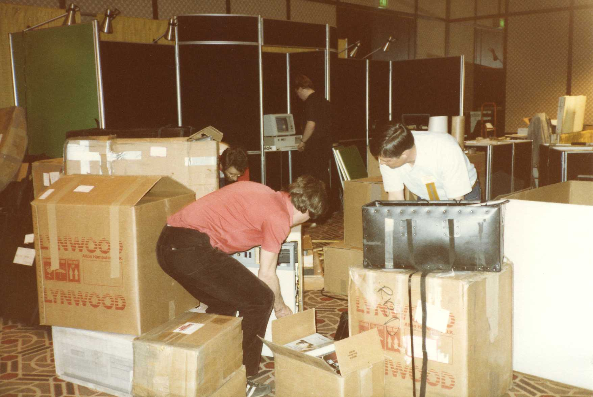
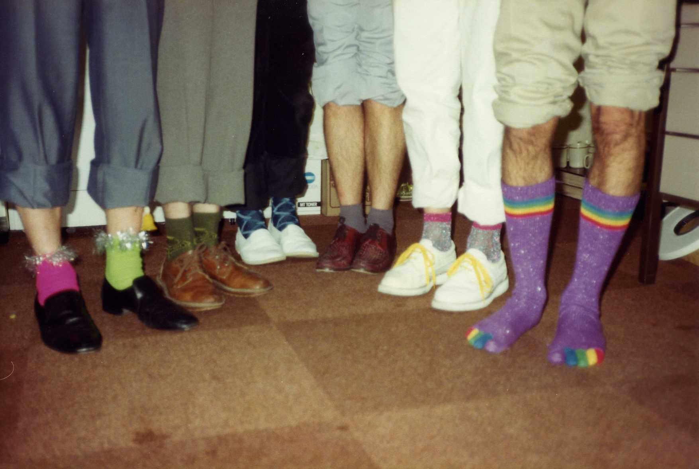

Karen Shaw
{ .byline }

Karen Shaw worked at Dyadic from May 1992 to March 2003. She joined as their ‘Girl Friday’ and worked on administration, so she tends to have facts like that at her fingertips. *Ed.*
{ .ednote }

I had left my work at Wiggins Teape in 1989, when my first child was due. In 1992, with Jo now three years old, I was looking for a suitable job. From the first meeting, I felt I hit it off with Pete and Pauline, and was drawn by the “family feel” of the little company. While other firms were offering better money, I was experienced enough to value the attitudes I found at Dyadic.

There were six in the company when I started: Pete, Pauline, John Scholes, Geoff Streeter, Andy Shiers and John Daintree, who had started the previous autumn. I was looking after some of their simplest needs, such as tea, coffee and stationery as well as invoicing customers and shipping APL.

It was a sharp immersion into the world of geeks. I had an IBM PC for my work, but no standard software. Previously I had used Lotus for office applications; at Dyadic I used the Unix `vi` text editor and home-grown word-processing software Pete had written. Without the graphical user interfaces we now all take for granted, I marked up plain text to indicate where I needed bold type, and so on.

One of my first projects was to organise the Dyadic stand at APL92 in St Petersburg. Everything required paperwork: Aeroflot tickets, and permission to bring hardware to Russia and take it away afterwards, certificates of origin. Taking hardware to Russia was hard enough; getting it home afterwards was much more difficult. And this equipment was heavy. I still have the Russian dolls they brought back for me as souvenirs.

<figure markdown="1">

<figcaption markdown="span">Unpacking at a conference</figcaption>
</figure>

Nobody was working at Dyadic simply for a living Everybody cared about what they were doing, and why they were doing it, and about shipping a product that was right.

We handled shipping and dispatch of new releases from the conference room, with sheets of labels and key stickers, manuals, release notes and 3½" floppies. Andy would find bugs right up to shipping date, demanding that all the floppies be updated. Distributors were constantly on the phone clamouring for their copies. Everyone pitched in to ship a release, getting the packages ready and counting down to when the parcel carriers were due to arrive.

The developers’ enthusiasm was infectious, and we all worked late hours on pizza, packing for releases and conferences. Though the operation got slicker over time as the administration improved, right up to when Dyadic and Dyalog split, the ‘IBM folk’ were still involved in shipping. Andy Shiers is still involved with Dyalog at CheckFree. We tried to celebrate every profitable month with a company lunch.

It couldn’t just stop at the door. It never did.

We had other fun: Christmas trips to France in three cars: dinner in Le Touquet, an adventure. We all wanted to be “a bit different” and it was a bond between us. I always felt involved and the company had a low turnover of staff.

We were a right motley assortment. To work there you had to have that passion and want to be involved. My husband and John Daintree are still best mates and all the Dyadic team still keep in touch. It couldn’t just stop at the door. It never did.

So many times I was laughing and thinking, “only in this company…” The musical socks Pete found in his son’s drawer and wore to work, only to find during a meeting with the accountant and the pensions company that they began playing when he crossed his legs and he had no idea how to turn them off. John Scholes ‘dead fish’ tie, that Pauline, not a tall woman, found herself face-to-fish with, screamed, and nearly deafened the office. The dinosaur-feet slippers JD liked to wear in the office…

I hate work to be a burden. My advice is: Be happy, change happens: embrace it, don’t fight it. Be happy every day. I don’t think I could now do a job I hated.

As the hardware side of the business grew, I came to work more closely with Pauline, focusing on processes and customer service. After splitting from Dyalog, Dyadic was bought by Syan, which has in turn been absorbed by ACS in the United States. I now manage a team of five people, supporting sales of around £15M each year.

From Dyadic I learned the importance of caring about people. We’re just all human beings.

<figure markdown="1">

<figcaption markdown="span">Office sock competition: spot the human</figcaption>
</figure>

No one at the company ever had to go on a course to learn that.
