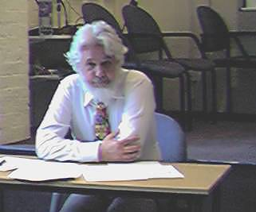

## 21 May 1999 at the RSS, beginning at 2 pm

### Minutes of the AGM

Apologies were received from Dr Alan Mayer and Dr Ian Clark.

The minutes of last year’s AGM (published in [Vector Vol.15 No.1](trad/v151/agm98.htm)) were taken as read.

The Chairman reported on the year (full report [below](#chairman)). He explained that as no post had more than one candidate there had been no need to hold a ballot, but the committee would be very glad to hear from anyone who wanted to help and such people could be co-opted to join the committee.

The Treasurer circulated the [accounts](acct99.htm) and asked for questions: there were none.

There were no questions to the committee.

John Sullivan was re-elected as auditor.

The meeting ended at about 2.15 pm.

### Chairman’s report on the BAA year 1998-1999

{ width="321" height="267" }  
**Anthony Camacho, BAA Chairman**

In short; we have held two meetings and Vector has (approximately) appeared on time.

Your committee as announced at the last AGM was:

<table width="60%">
<tr><td width="50%">Chairman</td><td width="50%">Anthony Camacho</td></tr>
<tr><td>Secretary</td><td>Ajay Askoolum</td></tr>
<tr><td>Treasurer</td><td>Nicholas Small</td></tr>
<tr><td>Editor</td><td>Vacancy</td></tr>
<tr><td>Projects and publicity</td><td>Dr Alan Mayer
</td></tr><tr><td>Activities</td><td>Jon Sandles</td></tr>
<tr><td>Webmaster</td><td>Ray Cannon</td></tr></table>

We had a vacancy for Editor. Stefano Lanzavecchia had been guest editor for the April 1998 Vector. You will be delighted to hear that he agreed to take on the task for another two years. As he lives in Denmark, goes home to Italy for some of his holidays and frequently visits the UK as he works for Adaytum, we bought a portable computer for him to use and keep in constant touch with the other members of the Vector working group and with the production office. This he has done and I hope you will agree with me that under his care Vector has maintained or improved the standard set by previous editors.

The two meetings were the vendor forum after last year’s AGM and the visit Eric Iverson made on his way back from APL 98. Both meetings have been documented in Vector so I will say no more now except to thank Jon Sandles for arranging them.

Next year’s committee will be:

<table width="60%">
<tr><td width="50%">Chairman</td><td width="50%">Anthony Camacho</td></tr>
<tr><td>Secretary</td><td>Ajay Askoolum</td></tr>
<tr><td>Treasurer</td><td>Nicholas Small</td></tr>
<tr><td>Editor</td><td>Stefano Lanzavecchia</td></tr>
<tr><td>Projects and publicity</td><td>Dr Alan Mayer
</td></tr><tr><td>Activities</td><td>Jon Sandles (co-opted)</td></tr>
<tr><td>Webmaster</td><td>Ray Cannon</td></tr></table>

Membership continues its slow decline; we now have 441 members. The circulation of Vector is 628 copies. Over the years the committee has tried many things to encourage people to join the Association and discourage people from leaving. We would like to hear from any members who think they can do something to reverse this trend. Our email addresses and telephone numbers are in Vector. It is in every member’s interest to recruit more members. A larger audience makes it possible to attract speakers for meetings and a larger readership motivates the Vector working group to keep the magazine going.

The Association is financially sound. Profits from conferences are still unspent and we have about £45,000 in the bank. I feel entirely happy that our expenditure exceeds our income by three or four thousand pounds a year and so we do not propose to change the subscription rates. At current expenditure our money will last longer than our members. I would be glad to increase our deficit if, by spending the money on some well-designed recruitment initiative, we could increase our membership.

I conclude by thanking your committee and the Vector working group for their efforts which have kept the Association going over the last year, in particular those who have done significant work and are not mentioned above - Nicholas Small, Ray Cannon and Ajay Askoolum. Lastly I thank the authors whose contributions to Vector are the main reason why new members join and why old members renew.

*Anthony Camacho, 20 May 1999*

***
