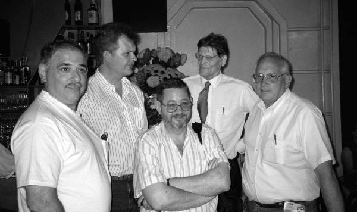
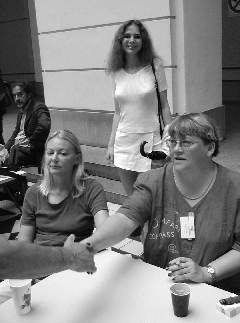
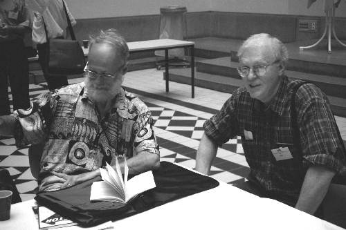

### Some More of the Personalities at APL Berlin 2000

OK, Vector Production can’t count .... we admit it .... so here are some more pictures from Ray’s CDs .....

{ width="500" height="333" }  
**How it was, not so very long ago ....**

{ width="600" height="356" }  
**... and how it is now. Three Americans, one South African, One Russian (who always obeys traffic rules),  
and not a weapon in sight!**

***

### Onward to Viking APL in November ...

{ width="240" height="323" } As APLBerlin 2000 progressed, it became increasingly clear that the north European contingent wanted a chance to get together again in a smaller group for one to two days of more focussed technical seminars.

This fitted well with Insight Systems desire to re-establish themselves in the APL world, so the idea of a Viking APL meeting was born, with Gitte (on the right) and Helene (on the left of picture) as the organising committee.

It will be interesting to see how this goes - at the time of writing there are over 35 delegates booked to come, and this is always the kind of gathering where real work gets done and APL as a whole moves a little way forward. Vector (as usual) will be there.

### And to Yale in 2001 ...

Although nothing was announced at the conference, it now looks like Yale, Ed Shaw, and possibly June rather than August. Look out for firm dates on the SigAPL site as soon as they fix the time, place and committee.

{ width="500" height="333" }  
**Eke Van Batenburg with Ed Shaw**

***
