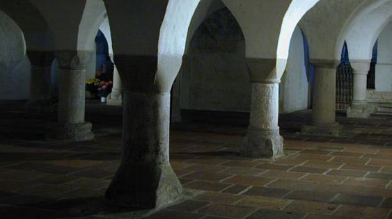
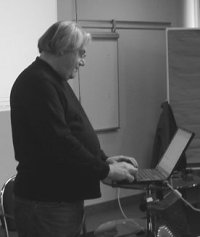
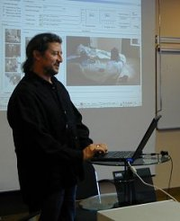
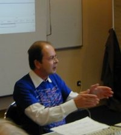
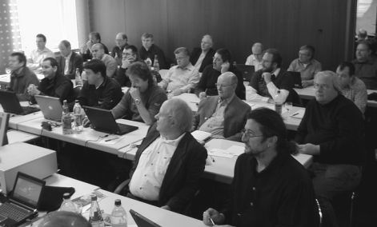

reported by Adrian Smith (adrian@apl385.com)
{ .byline }

## Around the City

Augsburg dates from Roman times, and where ancient buildings have survived (mostly by virtue of being below ground-level) it is very impressive. The cathedral had a quiet simplicity most unusual in a region generally associated with the extremes of baroque. As always, the centre of town is for pedestrians only (and the occasional tram) so it was a real pleasure to walk back from the restaurant in the gently falling snow after a typically warming Bavarian meal.

<figure markdown="1">

<figcaption markdown="span">The undercroft of the cathedral</figcaption>
</figure>

The joint meeting was really well attended, so much so that we slightly overflowed the seminar room on the second day. Thanks to Dittrich and partners for setting it all up in their home town, and for paying for the magnificent flagons of locally-brewed *dunkelbier* on the second evening. Much good work was done, and all of the talks had interesting material to keep us awake.

## The GSE requirements day

In the past, I have tried to come to these joint meetings for the second day only, as Day 1 is to some extent a private conversation between IBM and its most loyal customers. However there was a most interesting talk from Sandvik which I really wanted to hear, and the summary of “what’s new in APL2” is intended for public consumption, so I tagged along for the morning session.

### The Sandvik CAPP system, shown by Gunnar Jörtsö

This was the first time anyone from Sandvik has been allowed to talk about the system outside the company, so we were very privileged to see it. The 20-page handout would make an excellent paper in its own right, but I doubt we will get permission to publish more than some very brief notes here!

The system is implemented on the mainframe with GDDM drawing, and overlayed text. Engineers create the specifications for components in a visual flowchart, attaching ‘COBOL-like’ logic at each process stage. The specifications are (very carefully) checked, ‘compiled’ into APL2 functions which generate the CAD drawings to drive the machine tools directly. This can take the time from specification to manufacture down to a few hours, rather than the many days which would be involved in processing the drawings manually.

It is *big* in any terms, with around 1,500 users, who have built some 25,000 flowcharts which compile into over 2.5 million lines of APL2 code. The engineers still like the mainframe interface, but for the sales users (who configure new components while talking to customers) find a web front-end gives that modern look and feel. There are currently 10 servers running with a load-balancing master server handling the 20,000 daily browser requests from the web interface.

A few years back in Florida, we were shown a wonderful APL2000 system which simulated mineral processing, down to the level of detail that you need if you are thinking of opening a copper mine. Twice now, we have been given a walkthrough of the petroleum-chemistry simulator that Mobil research wrote in Dyalog APL to configure oil refineries in the most profitable way. Well, now there is a new companion for both these applications – the Sandvik system is at least as wide in scope, at least as business-critical, and rooted just as firmly in APL. Long may it stay that way!

### David Liebtag on new things in APL2

David has been quietly working away at making the APL2 session more comfortable for developers, to some extent in response to previous GSE days, and sometimes just because he likes a new idea, and it is easy to do. Some of the things that have been bugging his users are quite interesting:

- Commercial rounding has been speeded up by quite a large factor (×11 on integer data, ×3 on float) which could be beaten easily on Intel hardware by using the on-chip instructions if this were still not adequate.
- Reading LF-delimited files just got nearly 1000 times faster for big files. (A simple change of approach can work wonders).
- The toolbar with the APL symbols opens a stand-alone documentation window (rather than just showing a transient tooltip) from a right-click. I think I would like this better than the Dyalog tip – you can copy/paste the examples and maybe park the window somewhere for easy reading later!
- Hitting Ctl+Enter on an expression throws the output into a simple editor window, rather than into the session. This is a very nice feature, as you can easily stuff your session with a huge array you really didn’t want to see all of!
- You can set a trace or stop on all labels in one keystroke, and F7 in the editor throws out unused locals.
- You can quickly save a selected part of the session log to a named file, handy for sending off for debugging support.

We also got a very quick overview of the structured storage, which has been slightly enhanced to allow you to move any array (so untyped data) into the external storage, for reasons which would become obvious when David showed us the new *monitor* capability on Day 2

## Day 2 – User presentations at the APL Germany Day

### Adrian Smith shows ‘Dyalog for students’

This talk will get a full paper in a forthcoming *Vector*, so for now just a quick summary:

- Typing stuff is becoming *cool* again. The top 5% of students who may get to like APL are the rebels who relish the chance to get some real power over the machine. One of the coolest developer tools around is Microsoft PowerShell, which just makes the command prompt into a full-blown hackers toolkit. We need to get after these guys with APL!
- There was a time when APL *was* cool. It was the only place where it was easy to type in some numbers, `)SAVE` what you typed, make some simple analysis, and print out the results neatly (good old `⍕`) with the minimum of fuss. ‘Dyalog for students’ is an attempt to recapture some of that old simplicity.
- The biggest problem is Microsoft Excel, which makes it so easy to type in the numbers, then makes it almost impossible to do anything useful with them. Microsoft Access does let you do useful things with data, but is impossible for mortals to get it moving. Adrian proposes a step back to something that looks like a command prompt, lets you easily enter and save data (so it has a well-hidden but powerful database engine), positively encourages you to analyse it with real he-man statistical tools (thanks to Alan Sykes and Ellis Morgan), charts it (now this really is quite cool) and helps you make your report if you find Word too boring and LaTeX too geeky.

I think this made a hit with the meeting, although Morten qualified my estimate of 5% down to 1%. This is still enough to be worth chasing – there was a time when almost all the students from a German Technical University had met APL, and this makes the job of recruiting new blood into the industry that much easier. I think I will get some good support from several directions if I can make this stuff work seamlessly with Dyalog.

<figure class="left" markdown="1">

<figcaption markdown="span">David Leibtag on new features in APL2</figcaption>
</figure>

### David Liebtag on Monitor expressions with Processor 15

AP15 started as a way of enforcing typed arrays, mainly so APL2 can interface cleanly to external routines which expect strict data typing. However it has a few extra capabilities, which David showed us around.

- Once notified to P15, a variable has some attributes, for example you can find (or set) its *address* in memory, which gives you an easy way to define little Union structures by overlaying two arrays at the same address.
- New to this release is the Monitor attribute. This may be set to any executable expression (for example `⎕SI ⍳0` which will run whenever the variable is assigned. This has obvious debugging uses, but David did point out that there is quite an overhead in moving data to the external storage, so you should not think of using this in production code for large arrays.
- The monitor expression runs in the same way as code executed by `⎕EC` so it cannot change the variable which triggered it. Seems sensible enough!

I think this will be very popular – when you are trying to track an obscure bug in a big mainframe application (written 20 years ago by a team of programmers who left the company long ago) then having a handle on all the assignment points to some rogue variable can be an enormous help. The drumming on the tables was exceptionally enthusiastic for this one!

Actually, you could abuse this quite nicely by using little scalars (say a version number) to track updates, and having a monitor on this variable trigger updates elsewhere in the system. It is probably really easy to tell the programmer “when you are done, just increment `∆version`” rather than having to call some particular follow-on code. Just a small step in the direction of event-based programming.

       
      Bernd with the image album  
       
      Dr Reiner Nussbaum
    

### Emulating `⎕WI` in APL2 by Bernd Geißelhardt

This was a nice little gallery-maker, but the impressive thing for me was that it was converted from an APL2000 original using cover functions to mimic `⎕WI` in APL2. Bernd reckoned that with about 900 lines of (very tedious) code he can do a good percentage of the basic Windows toolkit. Obviously a full-blown generic conversion kit would be a lot, lot harder.

### Unix for grown-ups by Dr Reiner Nussbaum

The code behind this talk is all being shared on SourceForge, so search for `unix4aplers` if you want more details. Basically it is an attempt to transfer a bit of APL thinking to the tasks system programmers do on big Unix boxes. Jobs like load balancing can be handled very well by the APL `?` if all the tasks are roughly the same weight. Reports showing the disk space taken by files more than *x* days (or years or whatever) old can benefit from the typical APL calendar routines which convert from `⎕TS` form (as reported by the Unix system time) to decimal Julian days.

Remarkably, Reiner could not find any good (i.e. working) examples on the Net to do this job, so he carefully hand-translated an existing APL calendar library to Perl to do the work.

### Trying to manage huge arrays in a limited workspace by Holger Walliser

How do you program a recursive summation on a 5-dimensional matrix when the size gets above 250Mb? For the lucky few on 64-bit APL systems on workstations, the answer is obvious – just buy enough memory! On the mainframe the job is much harder, and Holger took us through a few approaches, none of which worked particularly well.

At the end, David Liebtag suggested a more radical approach, using simple sequential files (the data is a homogeneous floating-point matrix) where it should be possible to make a fairly simple cover function to ‘map’ the file in bite-size pieces back into the workspace very efficiently. Maybe at the next meeting, we will see if the problem can be solved this way!

### Themes for 2009 by Morten Kromberg

Dyalog left the Elsinore conference with the best of intentions (stop working on new stuff, get the reliability up, document what we have) with the 12.1 release expected quite early in 2009. It sounds as if the big customers have just come strongly back behind APL, are recruiting new APL staff, and (of course) have a list of new features which they really, really need. Oh bother, here we go again, said Morten, looking pleased, but slightly hassled. So look forward to 12.1 a little later than planned, but definitely with a much shorter list of outstanding bugs.

In the few spare hours available to him, Morten has been working on a simplified version of Stefano’s WildServer (known for now as the *MildServer*) which allows APLers to interact really easily with data coming in from web forms. This looks as if it is midway between Pete Donnelly’s original ‘demo’ server (which has been running Starmap and a few related Causeway sites like CUSP very quietly for a little over 10 years now) and the serious object madness offered by the WildServer technology. For simple-minded APL folk who just want to get on the Ajax bandwagon, it has a lot to offer, and it will be offered as an open-source project on the Dyalog website. Incidentally one of the good things about saving your APL code outside the workspace as Unicode text files is that such collaborative development becomes practical.

## Wrap up

This whole meeting had quite an optimistic feel to it. APL on the mainframe is alive and well in Germany, and seems likely to stay that way for many years yet. But the APLers of the old school are well aware of new ideas, and (see for example the Sandvik application) are able to skip a generation very easily by adding HTTP support to the big old iron kit and coming out smelling of browser.

<figure markdown="1">

<figcaption markdown="span">A well-attended session on the second day</figcaption>
</figure>

The APL2 language remains almost unchanged over the decades since its inception, but the interfaces and environment are moving steadily ahead, and as long as David is around and willing to work on it, steady and reliable progress will continue. These meetings are always worth the trip, and I hope to see the same old faces (and a few more new ones) again next year.
