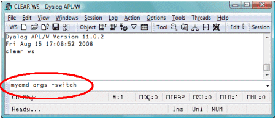
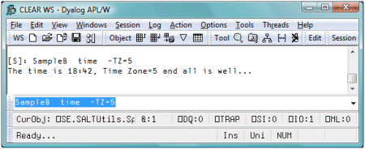

Dan Baronet (danb@dyalog.com)
{ .byline }

Spice is a Dyalog development tool introduced with V11 in 2006. It allows you to execute code independently of the current workspace status. It works in conjunction with SALT. For those of you familiar with APL+’s User Commands this will sound familiar: APL+[\[1\]](#n1) uses the right bracket to invoke a *user command* as in

```
      ]XYZ
```

to execute[\[2\]](#n2) user command `XYZ`. It brings in all the code necessary, localising it before running it.

Dyalog does something similar, using an input window above the status line instead of the `]` syntax of APL+.



Upon hitting Enter, the content of the window is sent to the Spice processor, which then identifies the selected command, gets and localises the code to run it, runs it, then cleans up. Just as APL+ does.

And just like APL+, entering `?` displays a list of available commands, and `?XYZ` displays help about command XYZ.

To write a Spice command, a few rules must be followed. You must:

- Write a class containing the code
- Put that class in a file in the Spice folder with a `.dyalog` extension
- Define at least the minimum three public shared functions: `List`, `Help` and `Run`

A Spice class may be host to several (related) commands. Or just one.

## Example 1: The TIME command

Here is a very simple example: let’s say we want to create a Spice command that will show us the current time.

We first create a class that will handle the group of time-related functions:

```
:Class timefns
    ⎕ML ⎕IO←1 ⍝ always set here to avoid inheriting external values

    ∇ r←List
      :Access Shared Public
      r←⎕NS¨1⍴⊂''
      r.(Group Parse Name)←⊂'TimeGrp' '' 'Time'
      r[1].Desc←'Time example Script'
    ∇

    ∇ r←Run(Cmd Args)
      :Access Shared Public
      r←⎕TS[4 5 6]   ⍝ show time
    ∇

    ∇ r←Help Cmd
      :Access Shared Public
      r←'Time (no arguments)'
    ∇
:EndClass
```

The `List` function is used to describe the command to Spice. Spice is thus able to display a minimum of information when you type `?` in the Spice command line. This information is stored in `Desc`. Three more variables must be set: the command Name, the Group it belongs to and the Parsing rules. We’ll get to those rules in a bit.

The `Help` function is used to report more detailed information when you type `?time` in the Spice command line. Since the class may harbour more than one command the function takes an argument. Here there is only one command and the argument will always be `time` so we ignore it and return some help for the command `time`.

The `Run` function is the one executing your code for the command. It is always called with two arguments. Here we ignore them as all we do is call `⎕TS`. Easy peasy. We can write this code in a `timefns.dyalog` file using Notepad and put it in the SALT\\Spice folder or write it in APL and use SALT’s Save command[\[3\]](#n3) to put it there.

Once in the Spice folder is it available for use. All we need to do is move the cursor to the Spice command line and type time. Et voila! The current time appears in the session as three numbers[\[4\]](#n4).

## Example 2: Another command in the same class: UTC

We may want to have another command to display the current UTC time instead of the current local time. Since this new command is related to our first `time` command, we could – and should – put the new code in the same class, adding a new function `Zulu`[\[5\]](#n5) and modifying `Run`, `List` and `Help` accordingly. Like this:

```
:Class timefns
    ⎕ML ⎕IO←1

    ∇ r←List
      :Access Shared Public
      r←⎕NS¨2⍴⊂''
      r.(Group Parse)←⊂'TimeGrp' ''
      r.Name←'Time' 'UTC'
      r.Desc←'Shown local time' 'Show UTC time'
    ∇

    ∇ r←Run(Cmd Args);dt
      :Access Shared Public
      ⎕USING←'System'
      dt←DateTime.Now
      :If 'utc'≡⎕SE.U.lcase Cmd ⋄ dt←Zulu dt ⋄ :EndIf
      r←(r⍳' ')↓r←⍕dt ⍝ remove date
    ∇

    ∇ r←Help Cmd;which
      :Access Shared Public
      which←'time' 'utc'⍳⊂⎕SE.U.lcase Cmd
      r←which⊃'Time (no arguments)' 'UTC (no arguments)'
    ∇

    ∇ r←Zulu date
     ⍝ Use .Net to retrieve UTC info
      r←TimeZone.CurrentTimeZone.ToUniversalTime date
    ∇
:EndClass
```

The `List` function now accounts for the `UTC` command and returns a list of two namespaces so `?` will now return info for both commands. Same for `Help` which makes use of a `lcase` utility in `⎕SE.U`, a namespace of short utilities for use by SALT, Spice or anyone.

The `Run` function now makes use of the Cmd argument and, if it is `utc`, calls the `Zulu` function. It then returns the data nicely formatted, an improvement over the previous code.

## Example 3: Time in cities around the world

We could then add a new function to tell the time in Paris, another one for Toronto, etc. Each time we would have to modify the three shared functions above *or* we could have a single function that takes an argument (the location) and computes the time accordingly.[\[6\]](#n6) Like this:

```
:Class timefns
    ⎕ML ⎕IO←1

    ∇ r←List
      :Access Shared Public
      r←⎕NS¨2⍴⊂''
      r.(Group Parse)←⊂'TimeGrp' ''
      r.Name←'Time' 'UTC'
      r.Desc←'Shown local time in a city' 'Show UTC time'
    ∇

    ∇ r←Run(Cmd Args);dt;offset;cities;diff
      :Access Shared Public
      ⎕USING←'System'
      dt←DateTime.Now ⋄ offset←0
      :If 'utc'≡⎕SE.U.lcase Cmd
          cities←'honolulu' 'montreal' 'copenhagen' 'sydney'
          offset←¯10 ¯5 2 10 0[cities⍳⊂⎕SE.U.lcase Args]
      :OrIf ' '∨.≠Args
          dt←Zulu dt
      :EndIf
      diff←⎕NEW TimeSpan(3↑offset)
      r←(r⍳' ')↓r←⍕dt+diff ⍝ remove date
    ∇

    ∇ r←Help Cmd;which
      :Access Shared Public
      which←'time' 'utc'⍳⊂⎕SE.U.lcase Cmd
      r←which⊃'Time [city]' 'UTC (no arguments)'
    ∇

    ∇ r←Zulu date
     ⍝ Use .Net to retrieve UTC info
      r←TimeZone.CurrentTimeZone.ToUniversalTime date
    ∇
:EndClass
```

Here `List` and `Help` have been updated to provide more accurate information but the main changes are in `Run` which now makes use of the `Args` argument. This one is used to determine if we should use the `Zulu` function and compute the offset from UTC by looking it up in the list of cities for which we know the time offset.

The first argument to `Run` is always the command name (here it is called `Cmd`) and the second argument is whatever you entered after the command (here it is called `Args`). When there are no special rules this argument will always be a string.

For example, if we enter in the Spice command line:

```
time Sydney
```

`Cmd` will contain `'time'` and `Args` will contain `'Sydney'`.

## Special rules

There are times when it is easier to make a command accept variations than to write an entirely new command. A command switch (also known as *modifier* or *flag* or *option*) is an indication that the command should change its default behaviour.

For example, in SALT, the command `list` is used to list files in a folder. The command accepts an argument to restrict the files to list (e.g. `a*` to list only the files starting with `a`) and accepts also some switches (e.g. `-versions` to list all the versions). Thus the command `list a* -ver` will only list the files starting with `a` with all their versions instead of listing everything without version, which is the default.

In Spice the same thing is possible but this time you decide which switches are acceptable. When no rules are given to Spice via the `Parse` variable (in the `List` function) `Arg` is a string and you can do whatever you wish with it. If your command is to accept switch `-x` then you can look for a `-x` in the string and make a decision about that. It can become quite tedious to have to deal with the handling of switches every time you write a new command. Without getting into too many details let’s say that Spice takes care of that for you.[\[7\]](#n7) It handles switches the same way SALT does.

Let’s have a look at a more complex example.

## Example 4: The sample command

Spice comes with a sample command to demonstrate the use of arguments and switches.

In file `aSample.dyalog` you will find a class with two commands: one which does not use the parser, and one that does.

The second command, named `sampleB`, uses the parser. It is similar to the `time/utc` command above: it accepts one and only one argument and one switch, called `TZ`, which *must* be given a value. For example you could write:

```
Sampleb   time  -TZ=-5
```

or, as seen in ‘real life’:



Spice is unable to validate the contents of the argument but it can determine that there is only one argument. It can also ensure that `TZ`, if supplied, is given a value and that no other unknown switch appears.

The way to tell Spice about this is to set the `Parse` variable for that command in `List` to `1 -TZ=`.

The `1`, here, means that one and only one argument must be present and `-TZ=` means:

> use `-` as the switch delimiter, accept `TZ` as valid switch for the command, and make sure a value is supplied (with `=`) whenever it is used.

Switch names are case-sensitive and must also obey the rules for APL names.

If you don’t specify the number of arguments, Spice won’t check, and you can have as many or as few arguments as you wish, including none.

When your command is used Spice will check those conditions and if anything breaks the parsing rules it will complain and abort execution. It all goes well Spice will package the argument and switch(es) into a namespace and pass it on to `Run` in Arg.

`Arg` will contain `Arguments`, a list of text vectors (here only one) containing each one of the arguments and `TZ`, which will be either the scalar number 0 (if it was not specified) or the string given as value if it was specified.

Let’s go over that again.

Here’s what the user enters in the Spice command line:

```
sampleb  xyz –TZ=123
```

Spice will validate this, find it is OK since there is only one argument, `xyz`, and that the switch `TZ` has been given a value, here `123`.

It will then call `Run` with `sampleB` and a namespace in which `Arguments` is `,⊂'xyz'` and `TZ` is `'123'`. It is then up to the program to determine if this all makes sense.

Here’s another example:

```
sampleB  x  y  z
```

Here three arguments have been supplied: `x`, `y` and `z` and Spice won’t allow it:

```
[S]: sampleb x y z
Command Execution Failed:
too many arguments
Spice[64] arg←(⎕NEW ⎕SE.Parser rules).Parse arg
         ∧
```

Another example:

```
SAMPLEB  'x  y  z'  -TZ
```

Here there is only *one* argument, as quotes have been used to delimit the argument of 5 characters: `'x y z'` *but* the switch `TZ` has not been given a value so:

```
[S]: sampleb 'x y z'  -TZ
Command Execution Failed:
value required for switch <TZ>
Spice[64] arg←(⎕NEW ⎕SE.Parser rules).Parse arg
         ∧
```

One more:

```
Sampleb  zyx  -TT=321
```

Here is one argument, which is OK, but TT is not a recognized switch and:

```
[S]: sampleb zyx -TT=321
Command Execution Failed:
unknown or ambiguous switch: <TT>
Spice[64] arg←(⎕NEW ⎕SE.Parser rules).Parse arg
         ∧
```

What if we don’t supply *any* argument?

```
Sampleb  -T=xx
```

```
[S]: sampleb  -T=xx
Command Execution Failed:
too few arguments
Spice[64] arg←(⎕NEW ⎕SE.Parser rules).Parse arg
         ∧
```

Here we supplied a proper `TZ` switch (Spice was able to determine that `T` stood for `TZ`) but 0 argument was not enough and therefore it complained.

As you can see Spice can be clever enough to figure out the number of arguments and which switches have been set and their values. The rules are fairly simple:

- All commands take 0 or more arguments and accept 0 or more switches
- Arguments come first, switches last
- Arguments are separated by spaces
- A special character (delimiter) identifies and precedes a switch
- Switches may be absent or present and may accept a value with the use of `=`
- Switches can be entered in any order
- Arguments and switch values may be surrounded by quotes (`'` or `"`) to include spaces and/or switch delimiters.

Spice, after verifying that the rules are being followed correctly, will put all the arguments (the space delimited tokens) into variable `Arguments` in a new namespace. It will also put in there variables of the same name as the switches. The namespace is then passed as the second argument to `Run`, which then runs.

There are a few more things the parser can do, but this should cover most cases. For a complete list, have a look at the documentation for Spice on the Dyalog site.

## Notes

1. <a id="n1"></a> *APL+* refers to the APL/PC, APL/II, APL+Win family
2. <a id="n2"></a> This is similar to the way the system recognizes its own commands, i.e. the use of a right parenthesis, e.g. `)CLEAR` is a system command whereas `]CLEAR` would be a user command.
3. <a id="n3"></a> `⎕SE.SALT.Save 'timefns Spice\timefns'` will do it
4. <a id="n4"></a> This requires SALT/Spice version 1.3 or more. To see which version you are using type `⎕SE.SALT.Version`
5. <a id="n5"></a> UTC is sometimes denoted as *Z time* – Zero-offset zone time – or *Zulu time* from the NATO phonetic alphabet.
6. <a id="n6"></a> The function does not deal with daylight savings time. An exercise for the reader?
7. <a id="n7"></a> If you wish to delve into this subject, have a look at *Vector* Vol 19.4: “Tools, Part 1. Basics.”
