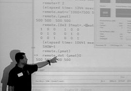
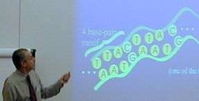
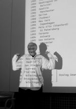
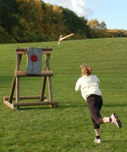
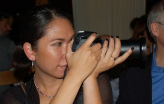
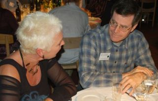
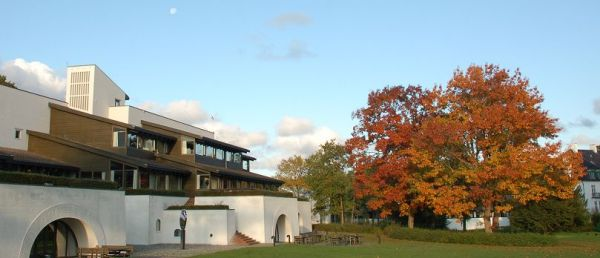

reported by Adrian Smith (adrian@apl385.com)
{ .byline }

## Setting the scene

<figure class="right" markdown="1">

<figcaption markdown="span">On target for the 12th century</figcaption>
</figure>

Back to Denmark, for what everyone seemed to agree was the best Dyalog gathering yet. The delegate list numbered over 100 for the first time, and the sun shone for the Viking challenge. The quality of the food was almost too good – I for one had to go for a very minimal lunch to keep my wits about me for the afternoon sessions.

The presentations covered a wide range of topics, and the feedback forms showed there had been something good for everyone there, from the talk by Charles Brenner (APL content zero) to the talk by Roger Hui (APL content close to 100%) – both were highly rated, and by very different groups of attendees. As always, the slack time was well used, and I walked past lots of small groups clustered around laptops in the various coffee areas.

The recreation opportunities were welcome, although I mourned the 9-pin bowling. But there were woods to walk in, a tough little par-3 golf circuit (50kr including hire of equipment), table-tennis, skittles/pool, table football and an easy walk down to the beach if you wanted to smell the sea air from a little closer. All told, it is hard to beat [Lo-skolen](http://www.loskolen.dk) as a venue for a group of this size.

## Major sessions

### Opening keynote

This was all about usability, consolidation and gradually expoiting the new multi-core hardware that is coming our way. Morten showed us how to use the new logging capability of the interpreter, and asked everyone to give it a run, and send in the logfiles for Dyalog to analyse. This looks like a great way to find the remaining bottlenecks in the interpreter, and will point Nicolas and Roger Hui at the most productive speedups.

<figure class="left" markdown="1">

<figcaption markdown="span">Morten Kromberg’s keynote address</figcaption>
</figure>

Here is Morten, illustrating a simple Conga server which gives the impression of APL running a genuine *parallel each* operator. The CPU buckets very satisfactorily both fill up and both empty at the same time. The ability to spread load across cores like this will become increasingly useful as we go from dual to quad cores and on upwards.

Morten briefly showed the Unicode chessboard again, and stressed the benefits of moving across to the new interpreter family as soon as possible. He also outlined a true ‘managed code’ project which will one day allow a new build of Dyalog to run anywhere a .Net process is allowed to run. It will be lean, mean, and will tick all the required boxes for implementation in highly secure environments. It will definitely not carry forward any baggage from the current Dyalog, so is unlikely ever to replace it completely as an application development tool.

Apart from these announcements, it will all be about getting the bug-list fully under control, and making it possible to work with really big classes in a productive way. Morten pointed us to John Daintree’s talk on the IDE as well as to Nicolas Delcros and Roger Hui who have both been working to improve the efficiency of the current interpreter, and at Richard Smith who has been helping John Scholes to make great strides in eliminating `FILE DAMAGED` by adding journalling to component files.

### Charles Brenner on “Forensic Mathematics”

<figure class="right" markdown="1">

<figcaption markdown="span">Charles Brenner on DNA-View™</figcaption>
</figure>

Dr Brenner has almost single-handedly established a whole new discipline of ‘Forensic Mathematics’ and (naturally) is a world-respected expert in the field. Having seen a prior run of this talk at Naples a few years back, I knew a fair bit of the background, but this was still a fascinating insight into the world of DNA matching, as well as Bayesian likelihood and all the other stuff you need to know to make a reasoned judgement based on DNA ‘evidence’.

I think the key element I had missed from his previous talk was that all DNA matches are made between rather few highly specific *loci* in the junk DNA. Obvious when you think about it – we are highly likely to match exactly in the DNA that actually does something useful, as anyone who didn’t would be unlikely to make it into the world at all! Look out for his paper in a forthcoming *Vector*.

### John Daintree on the IDE for Dyalog 12.1

This was also rated ‘most useful’ on many of the feedback sheets. Classes are a great new capability, but (as many of us have quickly noticed) they could use some help for serious development – the editing environment is nowhere near as comfortable as the traditional namespace full of functions. Typically (see flipdb, for example) you have a skeleton class and a companion namespace with all the code in it, which the class `⎕IMPORT`s whenever it gets instanced. Alternatively you go the whole hog and generate/fix/instance an entire script from a your namespace on the fly.

Both of these are *kludges* and should be wiped from the map, which is what John has set out to do by making the editor respect the content of a class in a much better way. He showed the ‘obvious’ things working again – you can just say `)ed myclass.foo` in the session and get straight to the function – and there may be some extras like the ability to roll up sections of code the way Visual Studio does. For now, it would be good just to have the basics – if I can go `)ed myclass.newfn` and have it show up in the script, add stuff, double-click on a new name within it, get another new function, and so on, then I’m a 95% happy bunny.

### Roger Hui, Nicolas Delcros and Richard Smith on APL internals

These three talks were closely related, and all promised simple incremental improvements in performance. John Scholes has a watching brief on all of these areas, but is was good to see the ‘new boys’ let loose in the core of the interpreter.

- **Roger** has been working on speedups to common boolean operations like `≠\boolmat` and has discovered that by playing with the byte alignments, he can quite easily write simple APL expressions that beat the raw primitives for speed. Read his script (on the key disk) or await the full paper to see a very neat use of the new LCM capability that came in with Dyalog 12.
- **Nic** has been investigating *matrix indexing* which was written in the days when the entire interpreter had to fit in a 64k segment, so takes very few optimisation choices indeed. In the case where one or more axes are elided, it builds the entire index set in memory, before iterating around it. Clearly it can do much better with high-rank arrays by taking the elided ranks ‘as read’ in an extra layer of iteration. Nicolas showed some good speed improvements, and even the pathological case with a 15-dimensional array was only a little slower.
- **Richard** (there were two Richard Smiths at the conference – this is the one who recently joined Dyalog) has been taking over existing work on component file reliability. By first writing a journal of a pending update, he allows the file to recover from nearly all the bad things that can happen when data is written. By adding an optional level of explicit cache flushing, he even overcomes the pathological cases where the operating system has actioned the file writes in a random order, so you never know what failed when the power was pulled.

This block of talks was concluded by Jonathan Manktelow with a quick demo of the latest .Net toys (called *Windows Presentation Foundation* or WPF for short) which implement screen-management in a much more web-oriented way. Interestingly the world is moving towards a *flow-layout* model where you arrange your fields and buttons using simple nested groups (\{*this* above <em>that</em>\} beside *these*) and the system is responsible for the detailed layout, depending on the space available, the fonts chosen, and so on. The convergence with Gary Bergquist’s `ZarkWin` framework is very close (it was good to see Gary at a Dyalog conference for the first time) and I am seriously wondering about a modern edition of CPro which merges Gary’s screen-layout tools with the ‘observer pattern’ engine that I think is the key ingredient of CausewayPro.

### 25 years of Dyalog with John Scholes

<figure class="left" markdown="1">
{ width="151" height="216" }
<figcaption markdown="span">John Scholes on display</figcaption>
</figure>

The usual mix of deadpan humour, interesting history, and jokes for programmers like the carefully timed demo of `⎕DL ¯5`, which he must have been practising. The *hammer sketch* was all his own work, and will stick in lots of memories, for the quality of the acting as well as the originality of the script.

25 years is actually a very long time in the software industry, and it was interesting to see how quickly the key moments get blurred into history. When did *namespaces* first appear? Which APLnn meeting saw a Windows GUI for the first time? John had left plenty of gaps in the chronology, and the audience found it hard to fill in all of them. The relationship between the known ‘hard’ dates (when people joined and left, when the company address changed) and the key moments in the life of the interpreter proved very hard to pin down. Even the special *Vector* supplement (a good read, by the way) leaves quite a lot of detail to be filled in by some enterprising local historian.

## Day 2 – User presentations, the Viking challenge and the Banquet

<figure class="right" markdown="1">
{ width="252" height="302" }
<figcaption markdown="span">Anne’s airborne axe</figcaption>
</figure>

Most of these talks are on the conference keydisk, and will very likely appear in future issues of *Vector*, so better not to attempt a summary here, I think. The feedback forms mentioned most of them as ‘useful’ so I think the programme must have worked well. I was rather sad that my RainPro session collided with Morten on Conga, as this was something I would have definitely attended, given the chance.

As you can see from the picture, axes were thrown again this year. There were some rather less physical challenges too, mostly to see how well the groups could function as a team. One task involved everyone holding a rope and pulling as hard as they could in opposite directions. Now *there* is a true metaphor for APL development!

And so to the banquet, with the usual great food and quality entertainment (this time from a champion accordion player). Here are a couple of shots from the rogues’ gallery to give you a flavour:

<figure markdown="1">
{ width="321" height="205" }
<figcaption markdown="span">Chala from the Carlisle Group, with a serious camera!</figcaption>
</figure>

<figure markdown="1">
{ width="321" height="205" }
<figcaption markdown="span">Vibeke chatting with Gary Bergquist</figcaption>
</figure>

The challenge is on to find a venue as good as this one anywhere else in the world, starting with the Eastern USA for next year. It will be tough, even in the more relaxed parts of Europe, and (apart from Minnowbrook) I don’t think I can pick out any stateside venue that comes close. If anyone can think of one, let Vibeke know!

## Day 3 – closing sessions and afternoon courses

### Tommy Johannessen and his lunch server

Tommy writes software the way he throws axes – see opportunity … *charge!!* … which may get a few people hurt along the way but sometimes comes up with something really great. This talk showed us how to order our school meal on the internet, along with over 25,000 regular users of his ASPX-based system. Along the way he has bounced off all the nasty hidden features of the interface between the web server and Dyalog, and he has bullied all of them into submission. Wonderful stuff.

### Gert Møller and his logic engine

This is another great use of APL, originally for prototyping but increasingly as an implementation tool for crashing straight through huge (and I mean *really* huge) constraint networks. This is based on some core work that was done many years back in APL, and Gert has been patiently waiting for some key patents to expire so that he can start over with a new company ready to exploit some very neat compression algorithms in APL. I get the feeling that Dyalog is beating C++ for speed on many of the crucial operations – it would be great to throw some of his code at our C# translator to see if there is a ‘best of both worlds’ solution out there.

### Romilly Cocking returns to APL

Romilly was one of the founders of the BAA and co-owned the most successful APL consultancy business in the UK for many years. Then he quit the APL world for Smalltalk and made a pretty good living out of that, too, before exploiting his experience in developing with dynamic languages to win a reputation as a coach for ‘agile’ Java teams. Now he’s back to APL and says it’s better than ever before.

His talk was a very clear and simple introduction to genetic algorithms (GAs for short) and to some of the uses they can be put to. The core code was about 25 DFns and fitted very nicely on one slide. So that made two talks in one conference on DNA, and they complemented each other beautifully.

### Wrap up

Morten closed with a slide of all the things they would love to shake out of the interpreter, like the underscored alphabet, `⎕SM`, and external variables. As you would expect, almost every oddball feature was used by at least one person in the audience, so this is going to be a tough call, but signalling the intention can’t be a bad thing. Then it was off to one last lunch, and some final training sessions for the true stalwarts.

<figure markdown="1">
{ width="550" }
<figcaption markdown="span">The morning light over Lo-skolen</figcaption>
</figure>

If you missed any of it, many of the sessions were fed through 1024×768 screen-capture and should come with high-quality audio, so you can watch them again on the [Dyalog web site](http://www.dyalog.com/).
