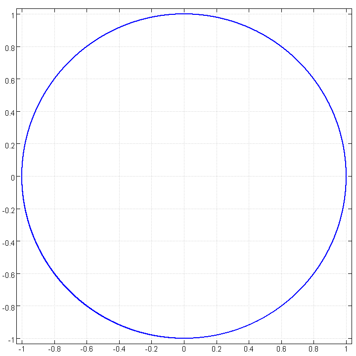
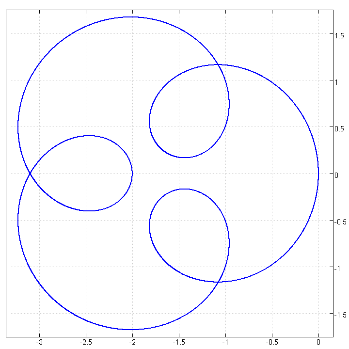
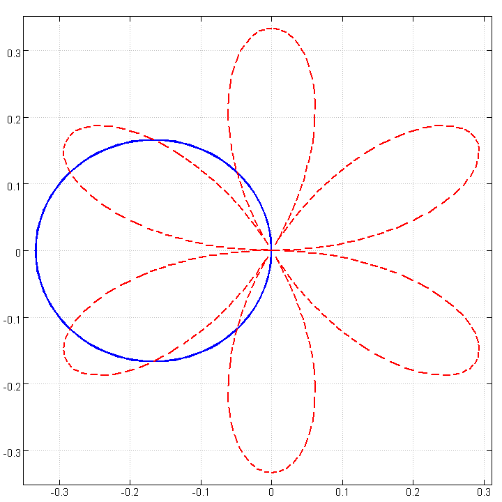
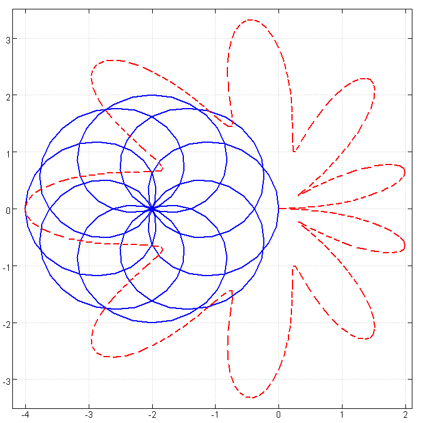
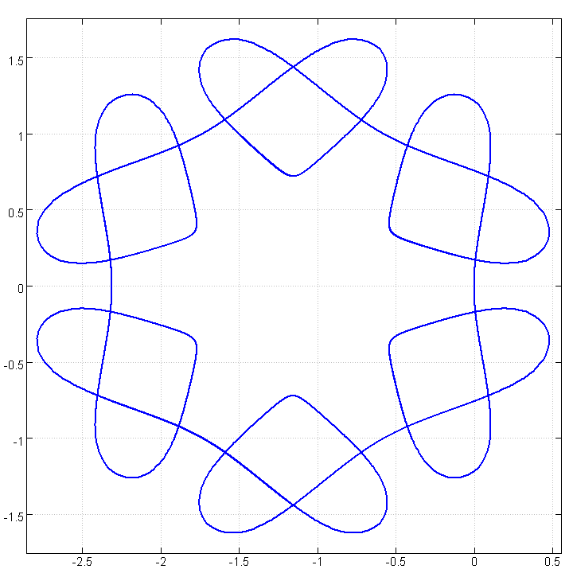
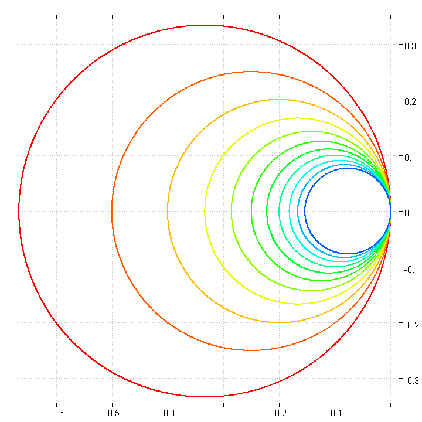
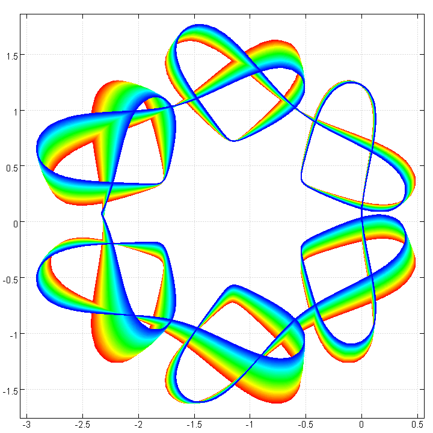
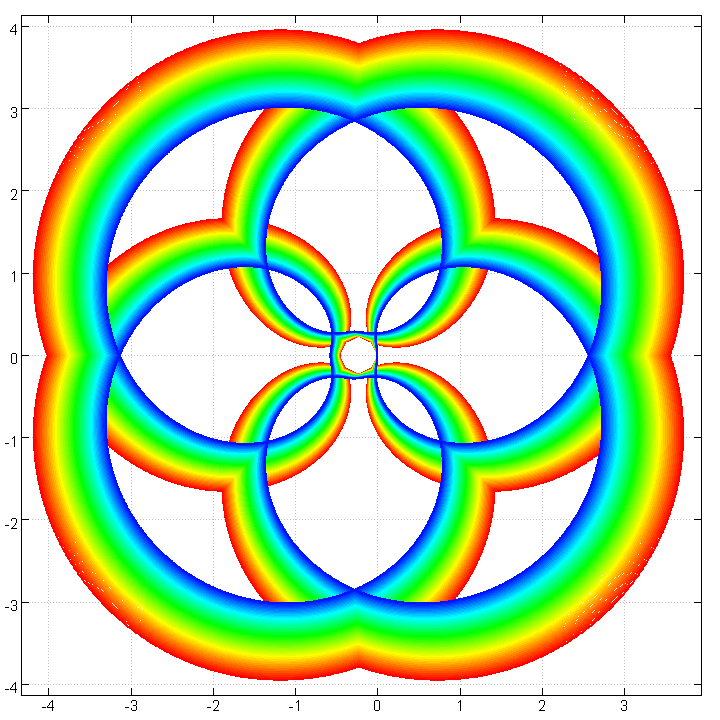
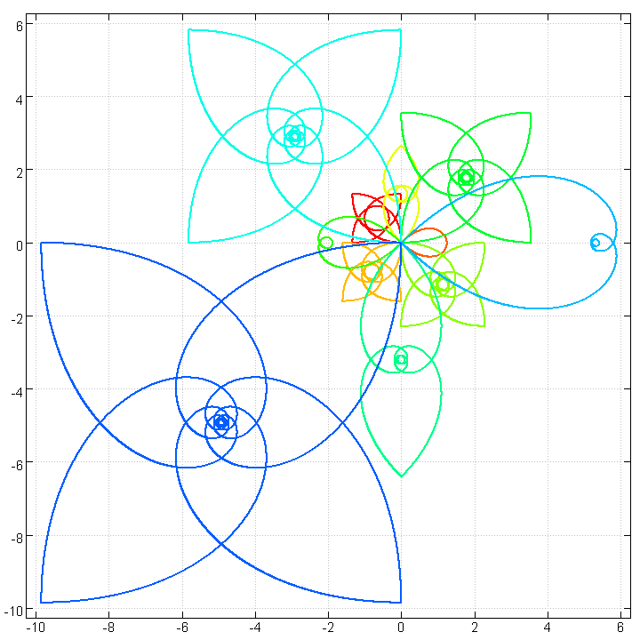
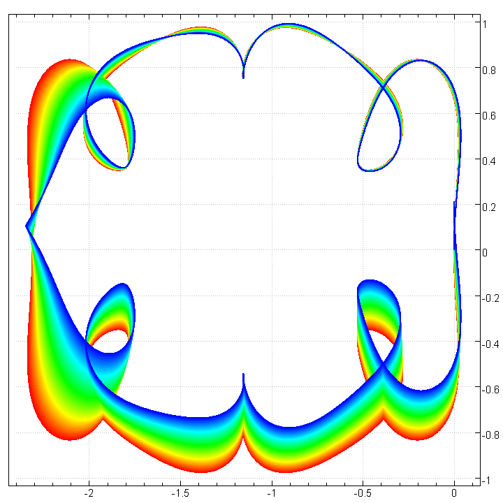

by William R. Jones & Cliff Reiter  
(jonesw@lafayette.edu and reiterc@lafayette.edu)
{ .byline }

**Abstract** Cauchy’s Integral theorem guarantees that certain complex integrals along closed paths are zero. This means that the intermediate values of ‘partial path integrals’ themselves form paths. We explore the marvelous variety of curves that arise this way using J’s excellent facilities for complex arithmetic and plotting.
{ .abstract }

## Introduction

A.L. Cauchy (1789-1857) was the founder of complex integration theory. He made hundreds of contributions to various branches of mathematics and mathematical physics. A brief biography of Cauchy may be found in \[[1](#ref1),[2](#ref2)\] and a detailed discussion of his mathematical work on complex functions appears in [\[9\]](#ref9). Some modern books on complex analysis include \[[3](#ref3),[7](#ref7)\]

His theorem called the Cauchy Integral Theorem tells us that the integral of a well-behaved complex function around a well-behaved closed path in the complex plane is zero. Such integrals are called ‘path integrals’ and we write the conclusion of the theorem as follows.


A closed path begins and ends at the same point. Here the closed path is well-behaved if it is a loop around some region in the complex plane and it should be ‘rectifiable’ (have a sense of length). Suffice it to say circles, ellipses, and squares are well-behaved, but a Koch snowflake [\[8\]](#ref8) is not (it has fractal dimension, not a finite length). Here well-behaved functions are analytic on and inside of the closed path. Suffice it to say that polynomials, the sine, cosine and the exponential are well-behaved (analytic everywhere). Even rational functions are well-behaved so long as the zeros of their denominators do not appear on or inside the closed path.

We consider in this note the set of values assumed by integrals over the course of the path of integration. In each example we approximate integrals of a given function over increasingly longer portions of a given path of integration. We plot the set of values of these ‘partial-path integrals’ and call the result a *Cauchy curve*. The Cauchy Integral Theorem assures that these Cauchy curves begin and end at zero (thus forming closed paths themselves); along the way, however, marvelous variety can occur.

We feel that the resulting curves are interesting for their complexities, novelties, and simple beauty. Moreover, these curves give a different way of looking at analytic functions. This note investigates Cauchy curves using J’s excellent facilities for complex arithmetic, plots, and adverbs. The inclusion of complex arithmetic can be seen in the original dictionary of J [\[4\]](#ref4). There is recent documentation of J’s complex number operations at [\[5\]](#ref5) and a recent *Vector* article includes [\[10\]](#ref10).

## First example

For our first example our closed path of integration is the unit circle in the complex plane. We use the fact that the complex function


runs once around the complex unit circle for 0 ≤<em>t</em> ≤ 2π. Here we look numerically at stepping around the circle in three steps and then graphically consider 10000 steps.

```
   require 'plot'

   r=: ^@j.

   r steps 0 2p1 3   NB. sin 2r3p1 is 0.866025
1 _0.5j0.866025 _0.5j_0.866025 1j_2.44929e_16

   $C=: r steps 0 2p1 10000
10001
```

Since we usually want circles to look round, we define a utility to make plots with aspect ratio one and we thicken the curves slightly.

```
   cplot=: 'Aspect 1;pensize 2'&plot

   cplot C
```

That plot is shown in Figure 1.

<figure markdown="1">
[{ width="360" height="360" }](fig01.png)
<figcaption markdown="span">Figure 1. The unit complex circle centered at `0j0`.</figcaption>
</figure>

For our first example of a Cauchy curve, we will let <em>f</em>(*z*) = 1+3<em>z</em><sup>3</sup> and use the `C` defined above for the closed path of integration. The 10001 complex numbers in `C` represent the ‘*z*’ values in the path integral that we are estimating.


We compute *dz* by taking differences with the verb `diff`, defined below. We use the function `midpt` to find the points between the `z` values and evaluate `f` at those points (the ‘midpoint rule’ for integration gives quite good numerical approximations). Thus, *dz* is `diff C` in J while <em>f</em>(*z*) is `f mdpt C`. The integral sign means ‘limit of sums’, so we approximate it by using a sum as follows in J.

```
   diff=: }. - }:

   mdpt=: [: -: }. + }:

   f=: 1 + 3 * ^&3

   +/(f mdpt C) * diff C
1.19488e_14j_3.08564e_15
```

The result should be zero by Cauchy’s theorem; it is near 0 to 13 decimal places. To get the Cauchy curve in the above situation we just replace the sum `+/` with a list of partial sums `+/\` and plot the result.

```
   cplot +/\(f mdpt C) * diff C
```

The result is shown in Figure 2. This is our first Cauchy curve.

<figure markdown="1">
[{ width="360" height="360" }](fig02.png)
<figcaption markdown="span">Figure 2. Cauchy curve for <em>f</em>(*z*) = 1+3<em>z</em><sup>3</sup>.</figcaption>
</figure>

We note that in our computational point of view the curve `C` is given as a numeric list of points and therefore we find the midpoints numerically as above. The integrals could be made more accurate by using midpoints from the parameterization or using higher order integration methods such as Simpson’s rule. Since our purpose is plotting curves, 13 decimal places of accuracy are sufficient.

Also, technically we think of paths as beginning and ending at the same point and the first term in the partial sum is typically not zero, thus we pre-append a 0 to the list of partial sums to make the result a closed path in our sense. It is convenient to introduce an adverb `chycu` to compute these Cauchy curves. Its adverb argument is the function being integrated, the right argument is the closed path given as a list of approximating points. The dyad case uses `x&u` as the integrand and this will later be used to compute several curves for one plot.

```
   chycu=: 1 : 0    NB. CAUchy cuRVE
0,+/\(u mdpt y) * diff y
:
x&u chycu y
)

   cplot f chycu C
```

The above line duplicates Figure 2.

## Cauchy curves and magnitude

If we plot the Cauchy curve for a monomial `^&n` the result is a circle. Here, and in all the examples until the last section, we again use the unit circle around the origin as our path of integration.

```
   cplot ^&5 chycu C    NB. Cauchy curve is a circle
```

However, the plot of the Cauchy curve as a circle is misleading since it wraps around several times. Any guess as to how many times it wraps? Here we define `cmplot` which shows the Cauchy curve along with the magnitudes of the points on the Cauchy curve plotted in the direction of the angle (`12 o.`) to the corresponding points on the closed path `C`.

```
   cmplot=: 1 : 0
z=. u chycu y
opts=. 'pensize 2;aspect 1;penstyle 0 1'
opts plot z,:(|z)r. 12 o.y
)
   ^&5 cmplot C

   ^&5 cmplot sC=: r steps 0 2p1 100
```

Figure 3 shows such a plot with the unit circle `sC` having a small number of points so that the magnitude curve can be seen in dashed form.

<figure markdown="1">
[{ width="360" height="360" }](fig03.png)
<figcaption markdown="span">Figure 3. Cauchy curve and magnitude for <em>f</em>(*z*) = <em>z</em><sup>5</sup>.</figcaption>
</figure>

In general, `^&n` gives a circle that wraps <em>n</em>+1 times. If multiple terms are used (as in Figure 2) in the polynomial, the results can be quite complicated. For example, consider the Cauchy path with magnitude for <em>f</em>(*z*) = 1+9<em>z</em><sup>8</sup>, shown in Figure 4.

```
   (1+9*^&8) cmplot sC
```

<figure markdown="1">
[{ width="360" height="360" }](fig04.png)
<figcaption markdown="span">Figure 4. Cauchy curve and magnitude for <em>f</em>(*z*) = 1+9<em>z</em><sup>8</sup>.</figcaption>
</figure>

## Rational functions

With rational functions we need to be careful. Here we consider the rational function given by the following.


Notice that the roots of the denominator in the complex plane will be slightly larger than one in magnitude (about 1.00083), so the unit circle gets near, but does not reach or encompass the bad points.

```
   f=:1 0 0 0 0 0 2&p.%1.01+^&12

   lC=:r steps 0 2p1 30000

   cplot f chycu lC
```

<figure markdown="1">
[{ width="360" height="360" }](fig05.png)
<figcaption markdown="span">Figure 5. Cauchy curve for a rational function.</figcaption>
</figure>

That path of integration is so near to bad points that we increased the number of steps on the unit circle to 30000 to avoid a rough appearance. This creates a curve with six heart shapes has a cute, simple appearance. This curve is very sensitive to parameters. What happens if you change the exponent 12 to 11 or 13? What happens if you vary the coefficient of the sixth power away from 2? These are worthwhile experiments for the reader to try. We offer a gallery of these variants and more at [\[6\]](#ref6).

## Families of Cauchy curves

Next we consider families of Cauchy curves. The adverb `cfplot` takes a dyad `u` as its verb argument and produces the Cauchy curves for the functions `a&u` for each item `a` of `x`. Figure 6 shows the Cauchy curves (all circles here) arising from *z<sup>n</sup>* for 2 ≤ *n* ≤12.

```
   require '~addons/media/image3/prevare.ijs'

   cfplot=: 1 : 0
:
opts=. 'pensize 2;aspect 1;itemcolor '
opts=. opts,":,Hue steps 0 2r3 ,#x
opts plot x u chycu"_1 _ y
)

   (2+i.11) (]^[) cfplot C
```

<figure markdown="1">
[{ width="360" height="360" }](fig06.png)
<figcaption markdown="span">Figure 6. Cauchy curves from <em>f</em>(*z*) = <em>z</em><sup>n</sup>.</figcaption>
</figure>

Next we consider plots of


for exponents *a* geometrically distributed near 12.

```
   fh6=: 1 0 0 0 0 0 2&p.@] % 1.01+]^[

   lC=: r steps 0 2p1 30000

   ({.,{:)a=: 12*1.07^ steps 0 0.36 100
12 12.2959

   a fh6 cfplot lC
```

<figure markdown="1">
[{ width="360" height="360" }](fig07.png)
<figcaption markdown="span">Figure 7. Cauchy curves from `fh6`.</figcaption>
</figure>

Next we look at the Cauchy curves from the family of functions <em>f</em>(*z*) = cos(<em>a z</em><sup>2</sup>). The result is shown in Figure 8.

```
   ({.,{:) a=: 4*0.9^steps 0 1 50
4 3.6

   a cos@:([**:@]) cfplot C
```

<figure markdown="1">
[{ width="360" height="360" }](fig08.png)
<figcaption markdown="span">Figure 8. Cauchy curves from <em>f</em>(*z*) = cos(<em>a z</em><sup>2</sup>).</figcaption>
</figure>

Several other plots of families of Cauchy curves may be found in the gallery [\[6\]](#ref6)

## Alternate closed paths of integration

In this last section we note that we need not restrict ourselves to using the unit circle `C` as our closed path for the integration. We consider below examples using a square and an ellipse. The square has vertices at `_1j_1`, `1j_1`, `1j1` and `_1j1`.

```
   pp=: 2 : '(m&*@-.+n&*)@(1&|)'

   ss=: _1j_1 pp  1j_1

   ee=: 1j_1 pp  1j1

   nn=: 1j1  pp _1j1

   ww=: _1j1  pp _1j_1

   rsq=: ss`ee`nn`ww@.(4|<.)"0

   sq=: rsq steps 0 4 50000

   (2+i.11) (]^[) cfplot sq
```

Figure 9 gives the Cauchy curves of <em>f</em>(*z*) = *z<sup>n</sup>* with a square as the closed path of integration. Compare to Figure 6.

<figure markdown="1">
[{ width="360" height="360" }](fig09.png)
<figcaption markdown="span">Figure 9. Cauchy curves from <em>f</em>(*z*) = *z<sup>n</sup>* on a square.</figcaption>
</figure>

In Figure 10 we show the result of using a very mild ellipse (the ratio of the axes is 0.9) as the path of integration for the function `fh6`. Compare to Figure 7. Notice the hearts are gone. Cauchy curves are very sensitive to the path of integration.

```
   $ell=: (cos j. 0.9 * sin) steps 0 2p1 30000
30001

   (12*1.07^ steps 0 0.5 100) fh6 cfplot ell
```

<figure markdown="1">
[{ width="360" height="360" }](fig10.png)
<figcaption markdown="span">Figure 10. Cauchy curves from `fh6` on an ellipse..</figcaption>
</figure>

<a id="references"></a>

## References

1. <a id="ref1"></a> E. T. Bell, *Men of Mathematics*, Simon and Schuster, 1965.
2. <a id="ref2"></a> David M Burton, *The History of Mathematics*, 6th ed., McGraw Hill, 2007.
3. <a id="ref3"></a> John B. Conway, *Functions of one complex variable*, 2nd ed. Springer-Verlag, c1978 (1995 printing).
4. <a id="ref4"></a> Ken Iverson, “A Dictionary of J”, *Vector* 7.2 (1990) 99-117.
5. <a id="ref5"></a> “Complex Operations”,  
    [www.jsoftware.com/jwiki/Essays/Complex\_Operations](http://www.jsoftware.com/jwiki/Essays/Complex_Operations)
6. <a id="ref6"></a> William R. Jones and Cliff Reiter, *Cauchy Curves* Auxiliary Gallery,  
    [www.lafayette.edu/~reiterc/mvq/cc/index.html](http://www.lafayette.edu/~reiterc/mvq/cc/index.html)
7. <a id="ref7"></a> Tristan Needham, *Visual complex analysis*, Oxford University Press, 1997
8. <a id="ref8"></a> Cliff Reiter, *Fractals, Visualization and J*, 3rd ed., Lulu.com, 2007
9. <a id="ref9"></a> Frank Smithies, *Cauchy and the creation of complex function theory*, Cambridge University Press, 1997
10. <a id="ref10"></a> Norman Thomson, “J-ottings 50: If you think J is complex try j”, *Vector* 23.4 (2008) 106-118,  
    [www.vector.org.uk/archive/v234/jot50.htm](../art10012070/)
