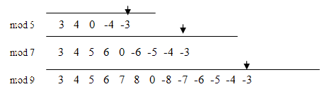
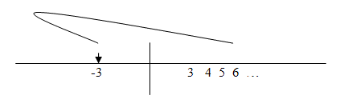

to Norman Thomson
{ .byline }

Early articles on APL sometimes speculated on how to do a work-around if one of the APL function keys was broken. Analogously one of the properties of ‘clock arithmetic’ as taught in the early stages of primary schools is that division is a disallowed (broken key!) operation. This reflects the historical fact that the concepts of division and fractions came relatively late in mankind’s mathematical development. Despite their arithmetical skills and geometrical sophistication, the early Greek and Roman mathematicians had only crude notions of division into parts, and it was not until the invention of place value in the 11th century that fractions in the sense we know them today became part of the earliest stages of elementary arithmetic.
{ .abstract }

J adverbs provide a natural means for realising the concepts of finite arithmetic, for example the derived verb `+mod` is addition in modulo arithmetic:

```
   mod=.1 :'n&|@x.'     NB. ‘define modulus’ adverb
   n=.7                 NB. set modulus to n
   3+mod 6              NB. add 3 and 6 (mod 7)
2
   3*mod 6              NB. multiply 3 and 6 (mod 7)
4
```

Graduating from clock arithmetic to ‘clock algebra’ is where some at least of the little children might begin to suffer, since division in the conventional sense is no longer an option for solving e.g. 2x=3. This is known in clock arithmetic as a congruence rather an equation. In modulo 5 arithmetic, it is not too difficult to spot that x=4 as a solution. However solving 17x=5 in modulo 23 arithmetic is a little more difficult. If the inverse of 17 were known (that is the solution of 17x=1) then the solution of 17x=5 is simply 5 times 17<sup>-1</sup>:

```
   n=.23                NB. set modulus
   (17*mod i.n)i.1      NB. locate 1 in multiples of 17
19
   5*mod 19             NB. solve 17x=5
3
```

This is readily confirmed by multiplying 17 times 3 = 51 = 5 in modulo 23 arithmetic. The second line in the above J sequence suggests a general technique for solving linear equations (congruences) of the form ax + b = 0 by first defining inverse as

```
   inv=.4 : '(x.|y.*i.x.)i.1'
   23 inv 17
19
```

(tacit definition enthusiasts may want to write this as `inv=.i.&1@([|]*i.@[)`, although arguably the above version is more expressive.) It is easy to confirm that in modulo p arithmetic (p prime), all integers in 1, … p-1 have an inverse, for example:

```
   iota=.>:@i.          NB. integers from 1 to y.
   13|t*13 inv&>t=.iota 12
1 1 1 1 1 1 1 1 1 1 1 1
```

A first try at a solution of the linear equation ax + b = 0 is then

```
   lsol=.4 : 'x.|(x. inv {.y.)*(-{:y.)'
   23 lsol 17 _5
3
```

However, inverses exist only for numbers which are relatively prime to the modulus. In clock arithmetic terms 17x=5 is an invitation to find how many chunks of 17 steps are needed to arrive at 5, to which the answer is 3. But for 2x=5 in modulo 6 arithmetic no solution exists because 2 and 6 have a common factor, which means that only some of the clock points are reachable. On the other hand 2x=4 has two solutions, x=2, the ‘obvious’ one, and also x=2+3=5. To generalise this, the number of solutions of ax=b in modulo n arithmetic is either none if b is not a multiple of GCD(a,n), otherwise it is GCD(a,n), in which case these solutions are found by adding \{n/GCD(a,n)\} successively GCD(a,n) times to the solution of ax=b after a, b and the modulus n have all been divided by GCD(a,n) :

```
linsol=.4 : 0                           NB. linear equation solver
if.1=gcd=.x.+.{.y.                      NB. if a and n are co-prime ..
   do.x.lsol y.
elseif.0=gcd|{:y.                       NB. if gcd(a,n) divides b ..
   do.(m lsol y.%gcd)+(m=.x.%gcd)*i.gcd
end.                                    NB. otherwise null result
)
   21 linsol 6 _15                      NB. solns of 6x=15 in mod 21 arith
6 13 20
```

The divide symbol `%` appearing in the long line of `linsol` reflects the ‘cancellation’ of ax=b to its prime form, and does not conflict with the disallowance of divide in clock algebra.

ax=b has now been solved with complete generality.

## Simultaneous linear congruences

Unlike ordinary simultaneous equations where, barring degeneracies, the number of equations must exactly equal the number of variables for there to be a unique solution, there is no limit to the number of simultaneous congruences for which a solution can be sought. Further, a theorem called the Chinese Remainder Theorem (so called because such results were known in China from about 100 A.D.) guarantees that *provided the various moduli are coprime*, then a set of simultaneous equations such as

```
   x=0 (mod 2), x=1 (mod 5), x=2 (mod 7)
```

has a solution which is unique modulo the product of moduli.

The algorithm for obtaining such a solution consist of multiplying three lists:

1. a list of the b’s as in ax=b;
2. a list of products of the a’s omitting one at a time; and
3. the inverses of the products in (2) relative to their matching moduli,

and then multiplying the items of the resulting list modulo the product of moduli. This is described as readily, and certainly more unambiguously, in J with as input

<table>
        <tr>
        	<td class="left">Left arg (x.)</td>
        	<td class="left">a list of moduli – these must be coprime;</td>
        </tr>
        <tr>
        	<td class="left">Right arg (y.)</td>
        	<td class="left">a matching list of pairs of coefficients as for <code>linsol</code>.</td>
        </tr>
      </table>

```
each=.&.>

simlsol=.4 : 0    NB. simultaneous congruences
r1=.>-@{:each y.
r2=.(%~*/)x.
r3=.>x. linsol each <"1 r2,._1
r=.(*/x.)|+/r1*r2*r3
)
```

The solution of the above set of congruences is:

```
   2 5 7 simlsol 1 0;1 _1;1 _2
16
```

For those who like puzzles `simlsol` lends itself to solutions of problems such as

<ol class="alpha">
        <li>
          what is the smallest integer divisible by 7 whose remainders on
          division by 2,3,4,5 and 6 are 1,2,3,4 and 5?
        </li>
        <li>
          what is the smallest integer divisible by 7 whose remainders on
          division by 2,3,4,5 and 6 are all 1?
        </li>
      </ol>

```
   4 3 5 7 simlsol 1 _3;1 _2;1 _4;1 0
119
   4 3 5 7 simlsol 1 _1;1 _1;1 _1;1 0
301
```

## Quadratic congruences

Here the simplest case is x<sup>2</sup>=a. In ordinary arithmetic the solution is simply ± the square root of a, and it is useful to picture how finite arithmetics converge towards normal arithmetic as the modulus increases towards infinity. Represent say -3 by points on number lines corresponding to arithmetics with successively larger moduli:



Eventually the arrow ‘goes off to infinity’ and returns ‘on the other side of zero’ as -3 in the conventional sense:



Returning to the problem of solving x<sup>2</sup>=a in modulo n arithmetic, Since only integers are admissible, there can only be solutions if a is one of those integers in 1…n-1 which are squares in modulo n, and since k<sup>2</sup> = (-k)<sup>2</sup> it is only necessary to consider the range 1…½(n-1) in order to establish all such squares. These are called ‘quadratic residues’ in finite arithmetics, and are obtained as:

```
   qres=.|*:@:(iota@(-:@<:))        NB. quadratic residues

   qres 13                          NB. squares modulo 13
1 4 9 3 12 10
   qres 17                          NB. squares modulo 17
1 4 9 16 8 2 15 13
   qres 29                          NB. squares modulo 29
1 4 9 16 25 7 20 6 23 13 5 28 24 22
```

so, for example, in modulo 13 arithmetic, the square root pairs of 3, 12 and 10 are (4,13-4), (5,13-5) and (6,13-6), i.e. (4,9), (5,8) and (6,7) respectively, and a must be one of the six values `qres 13` if the equation x<sup>2</sup>=a is to have a solution. One such solution is then `1+(qres n)i.a` so, for example one solution of x<sup>2</sup>=5 in modulo 29 arithmetic is

```
   1+(qres 29)i.5
11
```

and the other is 18, which is confirmed by observing that both 121 and 324 = 5 in modulo 29 arithmetic. This leads to the following definition of a verb which delivers a ‘single square root’ verb in finite arithmetic:

```
   sqrt=.>:@(qres@[i.])             NB. sqrt of y. in modulo x.
   13 sqrt 12
5
```

This can readily be generalised to find any root:

```
   res=.[ | iota@(<:@[) ^ ]         NB.generalised residue
   13 res 3                         NB.cubes in modulo 13
1 8 1 12 8 8 5 5 1 12 5 12

   iall=.>:@(= # i.@#@[)            NB.iota all (origin 1)

   root=.(({.res{:)@[)iall]         NB.all kth. roots, e.g. …
   13 3 root 12                     NB.cube roots of 12 mod 13
4 10 12
```

Read the above lines as ‘in modulo 13 arithmetic, the 3-roots (i.e. cube roots) of 12 are 4, 10 and 12’.

The suite of verbs `res`, `iota`, `iall` and `root` makes `qres` and `sqrt` redundant, and allows the solution of any equation x<sup>n</sup>=a. Where no solution exists a null result is returned.

Now turn to the solution of the more general quadratic ax<sup>2</sup> + bx + c = 0. In ordinary arithmetic, the solution is found by the technique of completing the square to give the standard formula with 2a as the denominator. With division disallowed, the trick is to multiply the left hand side by 4a to obtain a leading term (2a)<sup>2</sup>x<sup>2</sup> and factorise 4a(ax<sup>2</sup> + bx + c) as (2ax + b)<sup>2</sup> – (b<sup>2</sup> – 4ac). Then write d = b<sup>2</sup> – 4ac and y = 2ax + b, so that ax<sup>2</sup> + bx + c = 0 becomes y<sup>2</sup>=d which has already been solved provided that d is one of the quadratic residues. If not, there are no solutions. So define the verb `disc` standing for ‘discriminant’ to compute b<sup>2</sup> - 4ac in the ordinary way, so that the discriminant of e.g. 5x<sup>2</sup> – 6x + 2 is –4:

```
   disc =.(*:@(1&{))-4&*@{.*{:
   disc 5 _6 2
_4
```

`disc`, like other verbs, can be modified with the adverb mod using the current modulus n:

```
   disc mod 5 _6 2                  NB. n is currently 13
9
```

so that the first step in the solution is

```
   13 2 root disc mod 5 _6 2        NB. sq roots of 9 mod 13
3 10
```

All that remains is to transform these two solutions in <em>y</em>s back to <em>x</em>s, specifically to solve 10x – 6 = 3 and 10x – 6 = 10 (the latter being equivalent to 10x – 6 = –3), that is the two linear equations 10x – 9 = 0 and 10x – 16 = 0, for which a technique is already available:

```
   13 linsol&>10 _9;10 _16
10 12
```

solutions which are confirmed by

```
   10 12 #.mod&>< 5 _6 2
0 0
```

The technique is consolidated in the verb

```
qsol=.4 : 0                         NB. quadratic solver
t=.(n,2)root disc mod y. [ n=:{.x.
n linsol&><"1(2 1*}:y.)+"1(0,&>t)
)
   13 qsol 5 _6 2
12 10
```

and confirmation is obtained by

```
   (13 qsol 5 _6 2)#.mod&>< 5 _6 2
0 0
```

Not all quadratics have genuine solutions, and the simplest way to proceed is to execute `qsol` regardless but disregard any solutions which fail the confirmation test above. This leads to a completely general quadratic solver:

```
quadsol=.4 : 0                      NB. general quadratic solver
t=.(n=:x.)qsol y.
if.0 0-:t#.mod&><y.do.t
else. i.0 end.
)
   13 quadsol 5 _6 2
12 10
   13 quadsol 5 6 _2                NB. change of coefficients
```

(null result)

the results of which can be checked by

```
   (13 quadsol 5 _6 2)#.mod&>< 5 _6 2
0 0
   (13 quadsol 5 6 _2)#.mod&>< 5 6 _2
```

(null result)

Thus a single session of algebra has provided solutions for all linear and quadratic equations in countless algebras, and all with a quite modest amount of suffering!
