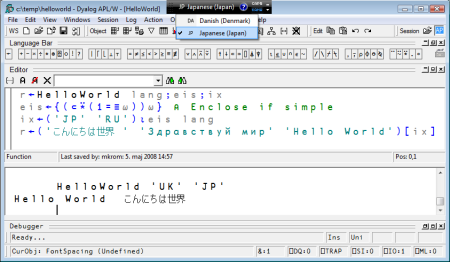
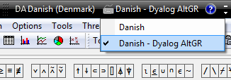
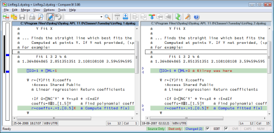
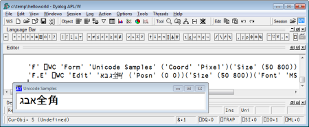
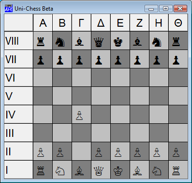

by Morten Kromberg (mkrom@dyalog.com)
{ .byline }

An earlier version of this article was presented as a paper at APL07 and published in *APL Quote Quad* as part of the Proceedings. *Ed*.
{ .ednote }

See the chessboard demonstration on YouTube.  
[Video: http://www.youtube.com/v/GdG04m1IQ0A&hl=en&fs=1](http://www.youtube.com/v/GdG04m1IQ0A&hl=en&fs=1)
{ .right }

Unicode offers users of APL the same benefits as users of other programming languages, namely the ability to consistently represent and manipulate text expressed in any of the world’s writing systems. For APL users, there is a significant bonus, which is that Unicode includes the APL character set, and therefore allows APL programs to be represented and manipulated using industry standards which are finally becoming widely supported (‘only’ 17 years after the first version of the Unicode standard). The paper presents the design of Unicode support for an APL interpreter which fully supports Unicode in all phases of system development and deployment. The paper discusses the internal representations used for Unicode characters in Dyalog version 12.0, and how the design is intended to provide a smooth upgrade path of users of earlier versions of the system.

## Introduction to Unicode

Unicode is an [industry standard](http://en.wikipedia.org/wiki/Industry_standard) allowing [computers](http://en.wikipedia.org/wiki/Computer) to consistently represent and manipulate [text](http://en.wikipedia.org/wiki/Character_%28computing%29) expressed in any of the world’s writing systems. It assigns a number, or *code point*, to each of approximately 100,000 characters, including the APL character set. The first version of the standard appeared in 1991, but it is only in the last few years that support for Unicode has become common in operating systems and ‘mainstream’ applications.

The adoption of Unicode provides APL users with three important benefits:

- It becomes possible to write applications that fully support not just North American and Western European character sets, but all of the world’s languages and writing systems – including the APL character set itself.
- Character data no longer needs to be translated as it enters or leaves the APL system during interoperation with other components like database systems or code libraries written in other languages.
- APL source code can now be handled by the off-the-shelf source code and project management tools.

Adding support for Unicode requires changes to the way character data is entered, displayed and stored in an application. Much of the work involved consists of ripping out special APL mechanisms for handling keyboards and translating data, in favour of using standard tools provided by the operating system. Although work is required to change the way the interpreter and session manager works, the resulting system is easier both to maintain and to explain to future generations of APL users.

## Character encodings

Although the Unicode standard assigns a unique number to each character, these *Code Point Numbers* can be stored using a number of different encodings. There is a set of fixed-width encodings named UCS-<em>n</em>, where UCS stands for Universal Character Set and *n* is the number of bytes used to represent each character, and another set of variable-length encodings named UTF-<em>n</em>, where UTF stands for Unicode Transformation Format and *n* is the smallest number of bits (not bytes) used per character.

The four most commonly occurring representations are probably UCS-4, UCS-2 (which has become obsolete since Unicode broke the 2-byte boundary), UTF-8 and UTF-16:

UCS-4
:   (also known as **UTF-32**) is a fixed-width encoding which uses 4 bytes per Unicode character, and is able to represent all characters that will ever be defined by the standard. The Unicode standard guarantees that the highest code point which will ever be allocated is x10FFFF, a number which requires 21 bits to represent, so 4 bytes (32 bits) is ample to represent all of Unicode. This format is common in some Unix environments.

UCS-2
:   is an obsolete representation which was popular in the early days, when the standard only defined characters in what is now known as the Basic Multilingual Plane. Until Windows 2000, it was the default encoding on the Windows platform. It can only represent Unicode code points up to xFFFF (65,535 - which does still cover most of the commonly-used characters).

UTF-8
:   is the most commonly used encoding for data in files (especially web pages), under both Unix and Windows. The reason for the popularity of UTF-8 is that it is backwards compatible with 7-bit ASCII (using one byte to store each character in the range 0-127), and also that – unlike the other encodings - it is not affected by the endianness of the platform (see the following discussion of the Byte Order Mark). Two bytes are required to represent code points from 128 to 2,047 (x7FF), three bytes per character from 2,048 to 65,535 (xFFFF), and 4 bytes per UTF-8 encoded character outside the Basic Multilingual Plane.

UTF-16
:   is an encoding which is identical to UCS-2 for all characters in the range 0-xFFFF<strong>,</strong> except for 2,048 so-called surrogate code points (D800-DFFF). Some bit patterns in that range are used in UTF-16 to indicate that second 16-bit word is required. UTF-16 is the default encoding on the Windows platform, from Windows 2000 onwards.

## The Byte Order Mark

The final thing that should be mentioned in a five-minute introduction to Unicode is the ‘BOM’. Because microprocessors differ in whether the most or least significant byte is written to storage first, it is necessary to know which type of system wrote a text file in order to properly decode it. Unicode defines two code points, xFEFF and xFFFE, as the big- and little-endian Byte Order Marks, respectively. Some (but not all) applications will write byte order marks, usually at the beginning of a text file, to make it possible to detect the encoding used:

| File starts with… | Encoding is |
| --- | --- |
| EF BB BF | UTF-8 (these 3 bytes are the UTF-8 encoding of FEFF) |
| FF FE | UTF-16 (or UCS-2), little endian |
| FE FF | UTF-16 (or UCS-2), big endian |
| FF FE 00 00 | UTF-32 / UCS-4, little endian |

When writing text files, especially in a Windows environment, it *can* be a good idea to prefix the file with the above byte sequences (but some applications still ignore or get confused by BOM sequences).

Wikipedia is a good source of information about encodings: take a look at [Comparison of Unicode encodings](http://en.wikipedia.org/wiki/Comparison_of_Unicode_encodings).

## Using a Unicode APL system

The APL system with Unicode support is designed to look, feel – and work – just like the non-Unicode systems that preceded it. With a very small number of exceptions, APL code that does not either exchange data with external components, or use the system function `⎕DR` to explicitly work with the internal representation of character data, should run unchanged.

The obvious difference (which is hard to detect if your main language is English), is that you can enter and display all the characters on your keyboard – and use ‘Input Mode Editors’ for eastern languages – not only to enter data into applications, but also into the APL development environment itself.

The following example shows the definition and execution of a simple multi-lingual application:



The black rectangle at the top of the screen, which has dropped down a menu, is not part of the APL session – it is the *Windows Language Bar*. The language bar allows multi-lingual users to switch keyboard layouts – in the above example Danish and Japanese are available. For entry of APL characters, an alternative layout for the main language is typically used:



*Danish – Dyalog AltGR* (selected above) is an APL keyboard based on the standard Danish keyboard, with the addition of AltGR (which can also be keyed as Ctrl+Alt) key combinations to enter APL symbols. For example, `⎕` is entered using AltGr-L. ‘Classic’ Dyalog Keyboards based on Ctrl key combinations are also provided, but these are harder to use in most Windows applications, which tend to define a number of Ctrl combinations as ‘hotkeys’. The bad news is that more and more applications are starting to use AltGR key combinations as keyboard accelerators, which means that some APL characters remain hard to enter in those applications (some applications allow you to disable these hotkeys).

The APL keyboards are not part of the standard operating system language support, but they have been created using standard tools (in the case of Microsoft Windows, we use a tool called the Microsoft Keyboard Layout Creator). One immediate advantage of using standard tools is that we have been able to involve more people in keyboard creation, so version 12.0 is shipped with significantly more national APL keyboards than earlier versions.

Hotkeys (typically Ctrl+Left Shift) can be set up for quick switching between input modes without using the mouse to click on the Language Bar.

Most of the behavioural differences apparent in the Unicode edition consist of strange behaviour having disappeared, for example:

- You can copy and paste between the APL development environment and other applications, and all that is required for APL symbols to appear correctly in a word processor is that a Unicode font containing APL glyphs is selected. Both Windows and Unix systems come with at least one standard Unicode font which can be used to display APL.
- The same is generally true when you write data to files or database systems: No translation of the data is required (although you *might* be required to encode the data, depending on the interface used).

The code changes that are required are natural consequences of the new internal representation of characters in the Unicode edition of Dyalog APL.

## Internal representation

Historically, APL systems have used a single byte (8 bits) to represent each character in an array. The list of all the 256 possible characters [\[1\]](#ref1) is known to APL users as the Atomic Vector, a system variable named `⎕AV`. Atomic vectors differ from one vendor to the next, sometimes even between products from the same vendor, and some vendors (including Dyalog) allow the user to redefine sections of this system constant, in order to support different national languages.

The highest currently assigned Unicode code point is currently around 175,000, and the standard specifies a maximum value of x10FFFF (a number slightly larger than one million – an order of magnitude higher than the total number of characters currently defined). Three bytes (24 bits) would be sufficient to represent any Unicode character. In practice, it is more common to use four bytes (UCS-4/UTF-32) for a ‘complete’ fixed-width representation, simply because three bytes is an impractical group size for most computer hardware.

Obviously, a single byte per character is no longer sufficient to represent character arrays in a Unicode APL system.

## Unicode representations in other array languages

At least two array language vendors (IBM and Jsoftware) had implemented Unicode support before Dyalog, so we had the benefit of examining the solutions that our colleagues had chosen before deciding what to do. I am grateful to David Liebtag at IBM and Chris Burke of Jsoftware for helping me to understand the details of – and the reasoning behind – the choices that were made:

<div class="panel right" markdown="1">

### Strange characters on the Basic Multilingual Plane

- Chris Ball’s  [Favourite Unicode Codepoints](http://www.inference.phy.cam.ac.uk/cjb/codepoints.html)
- Taw’s Blog:  [Funny Characters in Unicode](http://t-a-w.blogspot.com/2008/12/funny-characters-in-unicode.html)

</div>

IBM added multi-byte character support to APL2 *before* the first version of the Unicode standard saw the light of day. From Version 1 Release 3 (dated 1987), APL2 uses 1 and 4 byte representations for character data. The 1-byte representation is used for arrays containing characters that are all elements of the APL2 atomic vector. The 4-byte representation is used for other character arrays. In the 4 byte representation, 2 bytes contain the data’s codepage and 2 bytes contain the data’s code point. Support for Unicode was added in Version 2 Release 2 (dated 1994), where APL2 supports codepage values of zero and 1200 which both indicate the data uses the UCS-2 representation. These APL2 representations have the advantages that existing applications can run without change and applications which only use characters in the APL2 atomic vector have minimal storage requirements.

J introduced a double-byte character type containing UCS-2 encoded characters in Version 4.06, which was released in 2001. From Version 6.01 (September 2006), J switched from using ANSI to UTF-8 as the default encoding of (single-byte) character constants entering the J system from the keyboard and through the execution of J script files. This change was made in order to make it easy to work with text files, and in particular to support J scripts containing Unicode characters, as UTF-8 had emerged as the de facto standard for such files. If J applications wish to view Unicode strings as arrays where each element of the array is exactly one Unicode character, conversion to the double-byte (UCS-2) representation is required.

Initially, we considered following the APL2 model and having two encodings – one based on our atomic vector and a ‘wide character’ type containing Unicode characters not in `⎕AV`. Upwards compatibility is important to our users, and this solution would allow existing applications to run completely unchanged, without changing the storage requirements. Eventually, we decided against doing this for two reasons:

- Simplicity: the number of people who will learn to use APL in the future vastly exceeds the number of people using it today. Maintaining two representations, and trying to continue to explain to future of generations of APL programmers how the single-byte representation came about, was not felt to be in the long-term interests of our users.
- The above was compounded by the fact that users of Dyalog APL have been able to customize their atomic vectors for different languages (in Eastern Europe in particular), so not all atomic vectors are the same.

Exposing the variable-length encoding to the end user in the way that J has done did not feel like an attractive solution. This gives a system in which character arrays containing about 50 European characters in the ANSI set (but outside ASCII) cannot easily be compared – or easily extracted from an array – without first being converted to a double-byte representation, where they consume twice as much space. For example, the following expression gives a length error in J:

```
      'ä'='Seppälä'
```

This is because the array on the right has 9 elements, and the one on the left has 2. It is very easy to work around this in J, all you have to do is convert the strings to double-byte characters first using the public utility function `ucp` – but this just didn’t ‘feel right’ to us.

Finally, Unicode had broken the 2-byte barrier in the years following the APL2 and J implementations, and we did not feel that we should restrict our users to the Basic Multilingual Plane.

## One code point, one character

After much debate, we decided that the new Unicode product should only have a single type of character as seen from the user’s point of view. Therefore, all character arrays contain one Unicode code point number for each character in the array. The system picks the smallest possible internal representation (1, 2 or 4-bytes), depending on the range of elements in the array – in the same way that Dyalog APL has always stored integers. This means that most existing customer data will continue to be represented using one byte per character. Arrays which contain APL symbols require two bytes per element, and a very small number of characters require four bytes (but no pre-existing data created by an earlier version of the system will require more than two). The character array `'Seppälä'` requires 7 bytes to store the contents of the array, and the system behaves as any Finnish or Japanese [\[2\]](#ref2) person would expect:

```
      'ä' = 'Seppälä says: "こんにちは世界"'
0 0 0 0 1 0 1 0 0 0 0 0 0 0 0 0 0 0 0 0 0 0 0
```

In the above example, the array on the right is stored using two bytes per character, because of the Japanese characters, which have code point numbers above 255:

```
      ⎕UCS'こんにちは世界'
12371 12435 12395 12385 12399 19990 30028
```

`⎕UCS` is a new system function for converting to and from integer code point numbers to the corresponding characters. The monadic function is self-inverse, and has the same definition as in APL2 implementation: a right argument of code points gives you a character array of the same shape:

```
      ⎕UCS 123 9077 91 9035 9077 93 125
{⍵[⍋⍵]}
```

In Dyalog APL, `⎕UCS` also accepts a left argument which must be the name of a UTF encoding. In this case, if the right argument is a character array, the numeric result contains the encoded data stream, and vice versa:

```
      'UTF-8' ⎕UCS '界'
231 149 140
      'UTF-8' ⎕UCS 65 195 132
AÄ
```

The dyadic extension makes it straightforward to work with variable-length encodings. Writing any character string to a UTF-8 encoded text file requires a slightly more complex expression, along the lines of:

```
      (⎕UCS 'UTF-8' ⎕UCS text) ⎕NAPPEND tn
```

The leftmost `⎕UCS` converts the integers returned by dyadic `⎕UCS` back into characters before writing them to file. This is necessary because numbers in the range 128-255 would cause data to be written using two bytes per element. In effect, the last `⎕UCS` is used to turn the numbers into 8-bit unsigned integers. We debated adding an ‘unsigned’ type number to native file functions, or even a type number to select UTF-8 encoding as part of the native file interface, but decided to be conservative in the first Unicode release, as the above expression is quite straightforward and easily embedded in utilities for manipulating files.

If your application inhabits the Microsoft.Net framework, you can leave the encoding to the framework, and simply write:

```
      System.IO.File.WriteAllText filename text
```

The default encoding used is UTF-8, but this can also be selected using an optional third argument, for example:

```
      System.Text.Encoding.UTF16
```

## The Classic Edition

Most applications written in Dyalog should load and run in the Unicode version without any changes – if they only use APL’s own storage mechanisms (workspaces and component files) [\[3\]](#ref3). Applications which use Microsoft.Net, OLE/COM and the ODBC interface, will generally also only require minor changes, if any. Data moving through these interfaces was already being translated to UTF-16 for the first two and ANSI for ODBC.

However, many of our users have applications which share data with the outside world using other mechanisms. These applications will almost certainly contain some code which is dependent on the internal representation of character arrays. Even if an application is not actually going to use any new characters, modified code will need to be verified and tested in the new environment.

Even in the case where an application loads and runs without changes, components which the APL code connects to may not be able to deal with data outside of the ASCII or ANSI range. The application may need new validation code to be inserted in order to avoid breaking partner code. *If* it is the intention to extend the domain of data that can be handled to include new Unicode characters, the format of any external storage and encodings used in all connections with the outside world also need to be reviewed and possibly changed.

In recognition of the fact that many applications are going to have to go through a conversion cycle which *might* take some time to plan and execute, a ‘Classic Edition’ will be available for several future releases of the product. Dyalog Classic Version 12.0 will continue to use the single-byte atomic-vector-based representation of characters and all of the old translation mechanisms for data entering or leaving the system, and is intended to be 100% upwards compatible with earlier versions.

Although it is 100% compatible with old versions, the Classic edition is able to read the new data formats that the Unicode system uses in component files and TCP sockets. The intention is that users will safely be able to experiment with building Unicode-capable versions of their applications without having to have two sets of source code. Classic and Unicode variants of the Dyalog product itself are built from the same source code, differing only in whether character data is translated and limited to one byte per character – so the burden of supporting them both is mostly a QA and packaging issue.

We could have decided to carry the ‘old style’ character type forward into a single new system (as APL2 and J have done), but although this would possibly have made the transition smoother in the short term, it would quickly become a burden both for us and for our users. We felt that having two character types which required translation when moving between the two would be an endless source of confusion, particularly for new users.

Instead of complicating the product indefinitely, we decided to have two separate editions of product for a period of time, and design these in such a way that they inter-operated easily, in order to provide an environment which encouraged people to move to Unicode. This required a significant amount of additional work for us, and perhaps a little extra work for our users in the short term, but should result in a simpler system going forward.

## Inter-operability between Classic and Unicode

A large part of the work involved in producing the Unicode implementation has been aimed at minimizing the effort required to move an existing application to the Unicode system – and in particular doing everything reasonable to avoid ‘big bang’ data conversion events, which can be daunting in large systems with many components – and tend to discourage conversions.

The Unicode edition is able to load workspaces and share component files with Classic editions (versions of Dyalog APL before 12.0 are also considered to be Classic). Component files created by Classic editions are considered to be ‘non-Unicode’, and new files created by Unicode editions can optionally be created with the Unicode flag switched off. TCP Socket objects have an equivalent flag. Any character data written to non-Unicode files or sockets is translated to the old format as it is written. This makes it possible to move part of an application to Unicode, allowing unconverted parts of the application to continue to work in Classic mode, in a controlled fashion.

In order to share data with Classic systems, a Unicode interpreter needs to know what the atomic vector ‘used to look like’. A new system variable `⎕AVU` (Atomic Vector-to-Unicode) defines the Unicode code points of the Atomic Vector [\[4\]](#ref4). In the Classic edition of version 12.0, which still uses single-byte characters based on an atomic vector, `⎕AVU` defines how to map characters to Unicode (for example, when writing data to a component file with the Unicode flag enabled). The Unicode edition uses the variable to map data received from old APL systems, and to translate back to the old format when writing to non-Unicode component files and TCP sockets. Users who have defined translate tables and fonts to provide regional atomic vectors can set `⎕AVU` to ensure that old data is correctly converted to Unicode. `⎕AVU` can be localized and has namespace scope, making it straightforward to integrate data from different regions, or old applications using different conventions. `⎕AVU` is intended as a migration tool. It should be used as a temporary measure to access data which absolutely has to remain in the old format (which might take a decade or two, but hopefully not longer than this).

Interoperability between the Unicode edition and versions before 12.0 is limited to the ability of the Unicode system to write to component files in the old format, and the ability of the Unicode system to )LOAD old workspaces. However, from Version 12.0, both editions can read each other’s data formats (workspaces, sockets and files) – so long as a Classic edition is not required to receive or read characters which cannot be represented in its atomic vector. In this situation, a TRANSLATION ERROR is signalled.

## Name Association

The Microsoft Win32 API is still used by many applications to access services provided by the Windows platform. As part of the migration to Unicode that is still ongoing in the platform itself, Windows generally provides two versions of every Win32 API function: a version which expects string arguments to contain single-byte ANSI data (with a name ending with the letter A), and a version which expects Unicode data encoded as UTF-16 (with a name ending with W for Wide).

The system function `⎕NA` has been extended to make it simple to write code which can run on both versions of the API. If an API function is named with a trailing `*`, `⎕NA` will link to the A function from the Classic edition, and the W function from the Unicode edition.

Likewise, the argument type `T` without a width specification is interpreted to mean a wide character according to the convention of the host operating system. This translates to `T1` in the Classic edition, `T2` under Windows Unicode, and `T4` under Unix or Linux.

For example, the following function will display a Message Box with OK and Cancel buttons in both editions (under Windows):

```
    ∇ok←title MsgBoxmsg;MessageBox
[1]  ⎕NA'I user32∣MessageBox* I <0T <0T I'
[2]  ok←1=MessageBox 0 msg title 1 ⍝ 1=OK, 2=Cancel.
    ∇
```

## Underscores

Somewhat surprisingly, Unicode seems to spell the death of the use of the underscored alphabet in APL identifiers. The APL Standards committee deserves huge credit (Praise them with Great Praise, except for the unfortunate episode regarding the naming of tacks [\[5\]](#ref5)) for getting all other APL symbols that have ever been used or proposed in an APL system into the standard. However, the underscoring of letters of the English alphabet is seen as a form of emphasis, and underscored characters have not been assigned code points.

In most Dyalog installations, it is a long time since the 26 characters that used to be the underscored alphabet have been ‘recycled’ to provide a selection of western European accented letters:

```
      ⎕AV[97+⍳26]
ÁÂÃÇÈÊËÌÍÎÏÐÒÓÔÕÙÚÛÝþãìðòõ
```

However, some users of Dyalog APL still have significant quantities of code using underscored identifiers. To allow these users (even more) time to migrate, underscores have been mapped to a circled alphabet – which somehow *did* manage to get included. Adrian Smith’s font APL385 Unicode, which has become the standard font for most Unicode APL systems, displays these characters (‘incorrectly’) as underscores:

```
      ⎕AVU[97+⍳26]←⎕UCS 9397+⍳26
      ⎕AV[97+⍳26]
ⒶⒷⒸⒹⒺⒻⒼⒽⒾⒿⓀⓁⓂⓃⓄⓅⓆⓇⓈⓉⓊⓋⓌⓍⓎⓏ
```

The first statement above specifies that the relevant part of the atomic vector should be mapped to the circled alphabet in Unicode, the second displays the ‘third alphabet’. In any other Unicode font, these would display as the circled alphabet, Ⓐ to Ⓩ. We strongly recommend that anyone still using underscored letters makes plans to give them up. The underscored alphabet now constitutes the sole remaining incompatibility between the APL character set and Unicode.

## Future challenges

We believe that Version 12.0 of Dyalog has achieved a number of important objectives:

- Dyalog applications can make full use of Unicode data in applications.
- A reasonably smooth migration path exists from the Classic to Unicode editions of the product.
- The use of Unicode script files for APL source code makes it easy to tap into a large collection of software development tools that we can now share with users of other programming languages.

There is not space here to discuss the latter point, but the following screenshot shows an inexpensive file comparison tool called *Compare It!*, which the author spent about an hour finding and downloading from the internet. It was able to compare and merge APL source files without any other work than selecting the APL font for display:



A number of challenges remain to be resolved in future releases:

## Allowing new characters in names

Unicode supports just about all human alphabets, which raises questions about whether letters from other languages should be allowed in identifiers named by APL users. In the first Unicode version, we have not taken any steps in this direction, except to allow letters from the circled alphabet *and* the alternative European letters shown in the discussion of underscores (these were previously mutually exclusive, as pre-Unicode users had to pick one or the other of these sets).

The main reason that we have hesitated is that there is significant potential for confusion between similar characters. In particular, the APL language uses a number of Greek letters as primitives. There is a body of opinion which holds that the clearly visibly distinction between primitive symbols and user-defined names is an important aspect of the readability of APL language statements. Greek APL users are undoubtedly justified in wanting to write `αρίθ←{⍴⍵}` in place of `count←{⍴⍵}`, but (depending on the font), readability may suffer.

Other languages can cause confusion due to similarity with English letters. For example:

```
      ⎕UCS 65 913 1040
AΑА
```

The above statement returns the first letter of the Latin, Greek and Cyrillic alphabets. I’m not sure I would like to debug code in which `A`, `Α` and `А` were three different variables – or go looking for a font in which I could tell the difference between all the capital As in Unicode.

The issues above were enough to convince us to chicken out of extending the set of characters allowable in user-defined names, until we have had a bit more time to think about the consequences. In an age where writing components for use by other languages is getting more and more important, a conservative approach to naming seems like a good idea.

## Improved display

While the use of fixed-pitch fonts for APL sessions and code editors has clearly been the best choice to date, Unicode poses new challenges. Some scripts use symbols which should occupy twice as much space as Latin letters. In addition, some languages are expected to be displayed from right to left. The following screen shot illustrates both issues. The code sample creates a form containing an edit field, and inserts into it:

- The three first letters of the Hebrew alphabet
- Two double width Japanese “Zenkaku” characters.



Windows controls have the knowledge required to correctly render this text: The three Hebrew letters are displayed from right to left, and the Japanese characters are given more space. The extent to which it would help developers if the session did the same, is not clear. It is probably a good thing if we could avoid having the Japanese characters overlapping in the session, as they do above. As an interim measure, Version 12.0 has a property on the session which can be used to increase the spacing between characters if you are using characters which are wider than normal.

On the other hand, it seems that one would want it to be easy to predict the result of a statement like:

```
      3⊃'גבא全角'
ג
```

In this case, it seems to make sense that the session manager of an array oriented language should stick to the view of each character as separate element of the array, and always display arrays in the same way – first element on the left.

## Fun and Games with Unicode

Unicode can be fun, too:

```
     ChessPieces←⊃'♔♕♖♗♘♙' '♚♛♜♝♞♟'
     Officers←3 5 4 2 1 4 5 3 ⋄ Pawns←6
     White Black←1 2
     ix←Black White∘.,Officers,8⍴Pawns
     Pieces←4 8⍴ChessPieces[0 ¯8⌽ix]
     Board←(2⌽4/1 0)⍀Pieces
     'Chess' ⎕WC 'Form' 'Uni-Chess Beta'(40 20)(341 381)'Pixel'
     'Chess' ⎕WS 'Font' 'Arial Unicode MS' 30
     'Chess.Board' ⎕WC 'Grid' Board (0 0) Chess.Size
     Chess.Board.(TitleWidth CellWidths←60 40)
     Chess.Board.ColTitles←,¨'ΑΒΓΔΕΖΗΘ'
     Chess.Board.BCol←(192 192 192)(127 127 127)
     Chess.Board.CellTypes←(⍳8)⌽8 8⍴2 1
     Chess.Board.RowTitles←,¨⎕UCS 8543+⌽⍳8
```

Pawn to Queens Bishop 4?

```
     Chess.Board.(Values[5 7;3]←Values[7 5;3])
```



The hard part is now done; the rest is left as an exercise for the reader.

## Acknowledgements

I would like to thank:

- David Liebtag and Chris Burke for helping me get the story a bit straighter on the details of the APL2 and J Unicode implementations.
- Anssi Seppälä for the use of his name in an example, and Alexey Miroshnikov for “Здравствуй мир”
- John Daintree, John Scholes, Geoff Streeter, Nicolas Delcros and Vincent Chan – and many others at Dyalog.

For more on Dyalog Version 12.0, see [www.dyalog.com/help](http://www.dyalog.com/help)

## Notes { #references }

1. <a id="ref1"></a> Or in the case of APL systems on 9-bit DEC architectures, 512.
2. <a id="ref2"></a> If the Japanese example doesn’t actually mean “Hello World”, it is the Internet’s fault!
3. <a id="ref3"></a> The only language APL primitive affected is monadic *grade up*, which now sorts according to Unicode rather than Atomic Vector indices. For more information on coding changes, see http://www.dyalog.com/help/html/relnotes/converting%20to%20unicode.htm
4. <a id="ref4"></a> The system variable `⎕AV` still exists in the Unicode edition, in order to allow old code to continue to run. It is still a 256-element character vector, which is now ‘defined’ by `⎕AVU`, in that `⎕AV≡⎕UCS ⎕AVU`.
5. <a id="ref5"></a> It is unfortunate that Unicode names `⍕` “APL functional symbol up tack jot” and `⊤` “Down Tack”.
