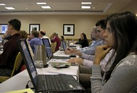
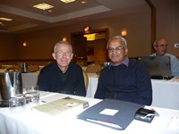
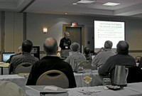
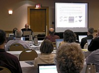
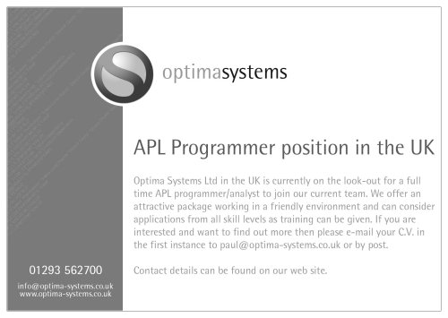

from Sustaining Members
{ .byline }

from:  
[APL2000](#apl2000)  
[Dyalog](#dyalog)  
[Kx Systems](#kx)  
[MicroAPL](#microapl)  
[Optima Systems](#optima)

## APL2000

### 2008 conference round-up

On November 10-11, 2008 APL enthusiasts from across the United States and seven other countries gathered at the Hyatt Regency Hotel in Bethesda, Maryland for the 2008 APL2000 User Conference.

The conference hotel was conveniently located with easy Metro access from the airport and to downtown Washington D.C. The nation’s capital offered many opportunities for sightseeing, viewing exhibits at the Smithsonian Institution’s museums, fine dining and shopping. Many attendees took advantage of special weekend rates and arrived early to spend a few extra days in the area.

Attendees represented industry leaders from a broad spectrum of business, engineering and science. APL2000 has a significant presence in the fields of finance, insurance, healthcare, aerospace, engineering, employee benefits, airline and automotive industries among many others.

Each conference attendee received a conference bag including an APL2000 conference shirt, flash drive with the conference proceedings and a copy of Ajay Askoolum’s book, *System Building with APL+Win*.

For two exciting days the attendees immersed themselves in informative sessions and participated in stimulating discussions surrounding new developments in APL2000 products, particulary APL+Win, VisualAPL and APL WebServices.

#### APL education

<figure class="right" markdown="1">

<figcaption markdown="span">APL education</figcaption>
</figure>

John Estep presented his *pro-bono* APL Workshop program, which trains high school students interested in programming using the APL language. Mathematics, software design and engineering are also emphasised. APL2000 and other APL programming-language vendors have provided John with books and software for his students. John encouraged other APL programmers to use his course as a model for regional APL programmer training and development.

#### APL+Win sessions

John Walker’s presentation, “What’s New in APL+Win” highlighted the developments in the APL+Win product including:

- Enhanced Unicode support in APL+Win, for instance, the ability to convert between Unicode code points and various representations, such as UTF-8 and APL+Win `⎕AV`.
- Localisation level specific referencing, the ability to reference functions and variables at specified localization levels.
- Enhanced printing and print preview in the APL Grid.
- Major overhaul and refactoring of the behaviour of tooltips in APL GUI objects.

There have been 10 releases from Version 6 in 2006 to Version 8.3 in 2008.

Ajay Askoolum’s presentation, “C# As the GUI and APL+Win Supporting the Business Rules” illustrated how to interface APL+Win with mainstream technologies including:

- Creating a C# web service which relies on APL+Win to support multiple clients needing access to application-specific business rules.
- Exposing a .Net assembly as a COM for use with APL+Win.
- An introduction to the many examples of APL+Win interfaces in Ajay’s book, which was distributed to conference attendees
- An HTA (HTML Application) using APL+Win as a COM Server.
- An additional, detailed example was provided by Ajay as part of the conference materials – a C# Windows Service using APL+Win as a COM Server – with SQL Server Express as the data tier, accessed by C# using ADO.NET and by ADO from APL+Win.

<figure class="right" markdown="1">

<figcaption markdown="span">Eric Lescasse & Ajay Askoolum</figcaption>
</figure>

Eric Lescasse’s presentation, “Interface APL+Win and .NET (C#)”, also illustrated how to interface APL+Win with mainstream technologies including:

- Consuming C# DLLs from APL+Win using the NetAccess product. It was announced at this conference that current APL+Win Subscribers will receive a licence for the NetAccess software, installer and documentation. NetAcess is a convenient tool to prepare C# DLLs that expose Microsoft .Net features for access by APL+Win. NetAccess opens the power of the .Net framework to APL+Win users, including the Microsoft .Net visual objects which can now be embedded in APL+Win forms.
- Porting your existing APL+Win application to the .Net environment with a C# WPF or Ajax GUI, an APL+Win calculation engine on the server and the project deployed over the Internet as a client-server .Net (C#) ClickOnce application.

Joe Blaze’s presentation, “Improved Efficiency of Execution of APL Primitives”, illustrated the new APL+Win interpreter enhancement, which a programmer can activate to utilise an alternate order of execution for APL+Win expressions involving multiple primitive operators. For large size, double data type arguments, significant performance increases can be achieved. The alternative order-of-execution option can data-fetch and store overhead.

<figure class="right" markdown="1">

<figcaption markdown="span">Jeremy Main</figcaption>
</figure>

Jeremy Main presented “Reverse Geocoding with APL”. APL functions are used to access GPS position data and various public databases to establish the relative location of geographical elements, enterprises, parks, public places and other points of interest.

#### APL WebServices sessions

Joe Blaze presented the APL WebServices sessions:

<figure class="left" markdown="1">

<figcaption markdown="span">Joe Blaze</figcaption>
</figure>

- Overview of the APL WebServices product from inception in 2002 to 2008 as a high performance, high-reliability tool to interface APL+Win functions and workspaces with web-based clients.
- Exposure to APL WebServices features for scalability, load balancing, request queueing, multi-threading and stateless/statefull client-server interaction were illustrated.
- Health, underwriting and financial examples were provided, illustrating APL WebServices on the client side supporting business rules and creating client-ready output. These examples also illustrated client-side GUI creation using HTML, PDF or C# WPF forms.
- An additional example was provided which uses APL WebServices to efficiently organize a grid of computers to perform stochastic analysis for a health-related application system. Extensions of this model to other monte carlo simulations is easily done.

#### VisualAPL session

Jairo Lopez presented the VisualAPL session:

- The VisualAPL version now available for Microsoft Visual Studio 2008 was demonstrated. VisualAPL also remains available for Microsoft Visual Studio 2005. VisualAPL remains the only APL implementation which is fully integrated with Visual Studio and produces fully-managed CLR output. The performance of VisualAPL is outstanding. VisualAPL programmers can take advantage of extreme memory (including 64-bit addressing), multi-threading and all .Net data types.
- The Cielo Explorer interactive session and scripting engine included with VisualAPL was demonstrated as unique among Visual Studio add-ins because it enables easy exploration of all of Microsoft .Net without the overhead of building and compiling an entire project. Line-by-line entry of APL or C# code in the Cielo Explorer is immediately processed and the results displayed within the Cielo Explorer window. In addition Cielo Explorer scripts can be incorporated into a .Net namespace and compiled into a .Net assembly, if desired by the programmer.
- A health and underwriting example was provided using a C# WPF GUI form and a VisualAPL .Net assembly to perform the analysis and prepare the output.

#### Overview of APL2000 mission and licensing options

Sonia Beekman made this presentation.

##### APL2000’s mission

APL2000 is a full-service software company that develops and markets APL products for the Win32, .Net, Unix and Linux operating system environments. APL2000 also provides consulting services to assist in the design, development, implementation, conversion, update, enhancement and deployment of APL-based application software systems.

APL+Win is the product for customers with an investment in Win-32 based programming. The APL+Win Subscription Program has been very well received by APL2000 customers, and APL2000 remains dedicated to the development and maintenance of this product.

VisualAPL is the product for customers interested in an APL implementation which can fully exploit the features of the Microsoft .Net framework and is integrated with the mainstream Microsoft Visual Studio 2005/2008 interactive development environment.

APL WebServices is the product which provides an easy and effective way to use APL+Win code to support the calculations and business rules for a web-based or .Net graphical user interface. APL WebServices is the high-performance, high reliability, .Net-based Web Services application to expose an APL+Win based software application to any Web-connected user.

##### APL2000 product licensing options

APL+Win subscriptions will now include Lescasse Consulting’s NetAccess.

APL+Win subscriptions will continue to provide unlimited ‘runtime’ use. Seven subscription levels are available to best meet the APL+Win needs of the customer.

A no-cost education version of APL+Win is available for classroom use by instructors and students.

The Professional and Enterprise versions of VisualAPL will now include unlimited production use as part of the licence. ‘Production’ use in the Visual Studio environment means distribution of the compiled output of a VisualAPL product. This ‘production’ use is analogous to ‘runtime’ use in the Win32 environment. A lower-cost desktop version of VisualAPL remains available for those programmers not requiring distribution of their output beyond their desktop.

No-cost, full-featured, limited-time-period, demonstration and evaluation versions of VisualAPL and APL WebServices are available.

Further information on APL+Win, VisualAPL, APL WebServices and other APL2000 products can be obtained on the APL2000 web site, www.apl2000.com or by contacting sales@apl2000.com.

#### Monday evening dinner cruise

<figure class="right" markdown="1">

<figcaption markdown="span">Cruising on the Potomac</figcaption>
</figure>

Monday evening, conference attendees were given a bus tour of the Washington D.C. monuments on their way to the waterfront. There they boarded the “Capital Elite”, a 70-foot yacht chartered by APL2000 for a private 3-hour dinner cruise down the Potomac River. The boat provided a cozy atmosphere to wine, dine, network and chat with friends. The main deck was set for dinner and offered hors d’oeuvres followed by a delicious buffet. The upper deck had a bar and lounge area with comfortable sofas and cocktail tables. Although the weather was a bit nippy, a few brave souls ventured onto the outer decks to take in the fresh air and enjoy the view. A great time was had by all.

#### APL Memory Lane

The closing session provided a trip down memory lane with an APL Jeopardy Game prepared by Kevin Weaver.

### NetAccess from Lescasse Consulting now included with all APL+Win subscriptions

NetAccess opens the power of the .Net Framework to APL+Win. All APL+Win Subscription licensees will receive NetAccess software, the installer and documentation, as part of their subscription benefits.

NetAccess, developed by Lescasse Consulting, is a convenient tool to prepare C# DLLs that expose Microsoft .Net features for access by APL+Win. NetAccess uses APL+Win's ActiveX interface to great advantage by exposing the user-selected methods, properties and events of the C# DLL as ActiveX elements.

With NetAccess, you can write Microsoft .Net C# DLLs to be used with `⎕wi` from APL+Win. This enables you to tap the power of .Net. For example the Microsoft .Net visual objects can now be embeded in APL+Win forms.

This exciting new feature is provided to our APL+Win subscribers at no additional cost, and reflects APL2000's commitment to APL+Win and to our customers. To further support NetAccess users, a separate section on the APL Developer Network Forum has been established for NetAccess related discussions.

For further information, or to purchase APL2000 products, contact [sales@apl2000.com](mailto:sales@apl2000.com) or call Sonia Beekman at +1 (301) 208-7150.

## Dyalog

### Dyalog 2008 at a glance

As we’re rapidly approaching the end of a *very* eventful year it seems there has been something new almost monthly. Let us take the opportunity to re-cap some of the highlights.

### October 2008 – Dyalog ’08 User Group Conference

This year Dyalog hosted its most successful user conference ever in Elsinore in Denmark. More than 100 delegates (plus guests) attended the 2½-day conference and many also took part in the 1½ days of training and workshops on offer. Dyalog is already in the process of planning the Dyalog ’09 conference – currently scheduled to take place near New York in the US in the early autumn of 2009. If you were unable to attend, would like to refresh your memory, or perhaps see one of the sessions you were unable to catch, take a look at:

- Adrian Smith’s [conference review](../art10500030/) in this issue
- This year Dyalog taped most of the conference sessions and you can access the slideshows with full audio from [www.dyalog.com](http://www.dyalog.com/).
- Andrea ‘Tony’ Grignani and Stefano ‘Wildheart’ Lanzavecchia have put together a photo Gallery show from the Conference featuring Tony’s beautiful pictures supported by original music composed by Wildheart. You can find their YouTube show at [uk.youtube.com/watch?v=lW552GGVQxk](http://uk.youtube.com/watch?v=lW552GGVQxk).
- Do not miss the wonderful presentation John Scholes made at Dyalog ’08 where he took a look at Dyalog through 25 years and made a plea for simplicity. You can find John’s presentation at [uk.youtube.com/watch?v=qSVR4Z3DA24](http://uk.youtube.com/watch?v=qSVR4Z3DA24).

### September 2008 – LearnAPL

In the previous issue of *Vector* we featured the joint apprenticeship scheme launched by Dyalog Ltd and Optima Systems Ltd. This initiative is aimed at an individual looking to expand their knowledge into the exciting world of APL. The apprenticeship scheme will hopefully attract interesting candidates over the next couple of months and since this is part of Dyalog’s ongoing activities with regards to attracting new programmers, we would like to highlight the initiative again. See more at [www.dyalog.com/pdf/LearnAPL.pdf](http://www.dyalog.com/pdf/LearnAPL.pdf).

### August 2008 – Version 12.0.3

Dyalog announced the commercial availability of Dyalog Version 12.0.3, including support for secure sockets. Version 12.0.3 is available ‘off the shelf’ for Windows 32 & 64, AIX and Linux. Solaris and other Unix versions are available on request.

Version 12 Manuals are available as free-of-charge PDF downloads or as print-on-demand from [stores.lulu.com/dyalog](http://stores.lulu.com/dyalog).

Two new public workspaces (APL2IN and APL2PCIN) were also made available for download. You can get them from [www.dyalog.com/version12.html](http://www.dyalog.com/version12.html).

### June 2008 – New Dyalog team member – Richard Smith

In June the Dyalog Development Team welcomed Richard Smith. Richard landed firmly on his feet in Dyalog and he quickly started excellent – and independent! – work on Journalling Component Files. The first result of Richard’s work was a presentation held at Dyalog ’08. Hear and see it at [winweb.dyalog.com/Dyalog08/RichardSmith\_JournalingFiles.html](http://winweb.dyalog.com/Dyalog08/RichardSmith_JournalingFiles.html).

### May 2008 – New Board member, Michael Holmberg Andersen

Michael joined the Dyalog Board of Directors in May. He has worked in SimCorp A/S since 1991 and currently holds the position of Senior Vice President for the IMS Development Department, where he is responsible for SimCorp’s software-development activities.

### April 2008 – Dyalog@25

The Dyalog APL language celebrated its 25th anniversary in April, where Dyalog Ltd hosted an open-house day in the office in Bramley on Friday the 11th, followed by a more formal event on the 12th. The Dyalog story has further been published as a booklet which was distributed with the previous issue of *Vector* to BAA members, and to delegates at the Dyalog ’08 Conference. You can get a PDF version from [www.vector.org.uk/archive/v234b/d25.pdf](trad/v234b/d25.pdf).

### February 2008 – Dyalog Version 12.0.1

At the end of February Dyalog announced the commercial availability of Dyalog Version 12.0 for 32-bit Windows, with Unicode Support. At the same time the company launched two new online libraries for Help and Documentation. You can peruse the new libraries at [www.dyalog.com/documentation](http://www.dyalog.com/documentation/) and [www.dyalog.com/help](http://www.dyalog.com/help/). (Both these sites include the full version 12.0 and 11.0 Release Notes.)

Dyalog is in the process of finalising some interesting announcements for the beginning of 2009 – so make sure you check the Industry News in the first 2009 issue of *Vector*.

## Kx Systems

Kx Systems and Nagler & Company have announced a strategic partnership agreement covering the German-speaking areas of Europe, primarily Germany, Austria and Switzerland as well as Benelux and Poland. Nagler has formed a new company, Symagon, specifically to work with Kx and to provide market data solutions to European financial institutions. Symagon is a wholly owned, Germany-based subsidiary of Nagler & Company.

The main drivers for forming the partnership were the deep market knowledge of Nagler’s consultants and their successful track record of working with Kx and implementing kdb+ at financial institutions, most notably in Germany. The partnership will see Symagon provide sales, consultancy and support services to firms in Benelux, Germany, Austria, Switzerland and Poland.

Says Jens Rick, managing director of Symagon: ”Having worked with Kx on a number of market data projects for the last three years we decided that we wanted to formalise what has become a very productive working relationship. We found kdb+ to be far superior to other systems on the market in terms of the speed of implementation, performance and cost of ownership. We are very impressed with Kx’s dedication to its customers, its excellent standard of client support and the continuing enhancement of kdb+.”

Nagler & Company first started working with Kx in 2005; from the first joint project it was clear to both firms that together they offered a winning combination of talent, experience and location. Symagon specialises in market data, providing consultancy that spans all phases of planning, development and implementation and covers quantitative analysis, structuring, algorithmic trading, market making and risk management.

Janet Lustgarten, CEO of Kx Systems, says: “Symagon consultants have a thorough understanding of our philosophy and of our products, kdb+ and q. They have many years’ experience in our core markets and have worked on numerous projects with Kx. Symagon will help us to extend our presence in Europe and provide a high level of expertise to financial institutions in the region.”

## MicroAPL

At MicroAPL we have always worked hard on making new versions of APLX backwards-compatible, believing that new versions of the interpreter should not break existing APL applications if at all possible.

As an example, consider APL programs written the Apple Macintosh. Our original APL product, then called APL.68000, was released in 1986 and included a number of then-innovative workspaces for GUI programming. At that time, a typical Macintosh had an 8MHz 68000 processor and 512K of memory.

Over the years, Apple made the transition from 68000 to PowerPC processors, then changed the operating system to the modern OS X, and finally changed processors again to use the Intel x86 architecture.

Despite this – and despite the fact that the APL.68000 interpreter was originally written in 68000 assembler – you can still load an original APL.68000 workspace into APLX. All the original APL code will run, and even most of the original GUI functions still work (although we would not recommend them for new programs).

One of our APLX users recently demonstrated the importance of this approach in a very exciting way. Dr Glenn Schneider from the University of Arizona’s Steward Observatory is an umbraphile – literally a ‘Shadow Lover’ – who travels all round the world taking spectacular photographs of solar eclipses.

The August 2008 solar eclipse was visible from the Arctic Ocean, with the path of totality close to the North Pole. Dr Schneider viewed the eclipse from an Airbus A330-200 flying high above Svalbard, with his cameras pointing out of the aircraft windows. The software he used to control the cameras and help navigate the aircraft is written in APLX running on a Macintosh. It was originally implemented in APL.68000 and still makes use of GUI features we introduced back in 1986.

As a testament to the enduring strength of APL as a language, readers might like to note that some of the core algorithms were originally implemented in 1974 in APL on a Xerox Sigma 9 computer under the UTS (and later CP-V) operating system.

To see some pictures of the eclipse and scenes from inside the Airbus, visit [nicmosis.as.arizona.edu:8000/ECLIPSE\_WEB/ECLIPSE\_08/TSE2008\_FLIGHT\_FD/TSE2008\_FLIGHT\_DECK\_SETUP.html](http://nicmosis.as.arizona.edu:8000/ECLIPSE_WEB/ECLIPSE_08/TSE2008_FLIGHT_FD/TSE2008_FLIGHT_DECK_SETUP.html)

Looking to the future, the development team at MicroAPL is currently working hard on APLX Version 5 which will be released in 2009. Although we already have a long list of new features, it’s not too late to suggest anything you would like to see added to APLX.

Please send your ideas to [aplxv5@microapl.co.uk](mailto:aplxv5@microapl.co.uk). We can’t promise to implement everything in this release but we’re always interested to hear your ideas.

## Optima Systems

