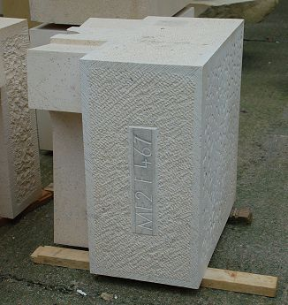

A database engine for simple folk
{ .subtitle }

Adrian Smith (adrian@apl385.com)
{ .byline }

These notes are lightly adapted from the script I wrote for the Sunday night light-entertainment at Dyalog 08. Yes, the apparent integration of q-sql with the APL session was a gross deception using `⎕TRAP` but the basic idea of running a low-tech relational database inside your workspace is a perfectly good one. I pretty well depended on it for the 10 years I led a team who wrote applications in APL, and who knew no other way. Morten also made very good use of the query tools in his examples of monitoring APL primitives, which was nice to see. Sometimes the best ideas are the ones you come up with under so much time pressure that you have no time to look ahead. We shall see. Anyway, here is the script that I spoke to, and which was included on all the memory sticks, along with the workspace.
{ .abstract }

## Motivation

There was a time, long ago and far away, when I used to write proper business applications in APL. I am thinking back to 1983 and my Loughborough paper on databases, which reminded me of just how heavily I depended on a simple, reliable DBM working entirely within the confines of the APL workspace. Subsequently, I had evolved into something of a tool-builder rather than a tool user, and this state persisted until a few weeks ago.

When I had a phone call from a old Rowntree friend (he used to run Assortments in York) for whom I wrote a lot of planning and scheduling applications. He is kinda retired now, and has ended up managing the rebuild of the east end of York Minster ‘in his spare time’. This is a big project (around £21M of lottery funding over 5 years) and has put huge pressure on the Minster Stoneyard to turn out carved blocks to a predictable schedule. Herding cats comes to mind.

<figure markdown="1">

<figcaption markdown="span">Carver at work</figcaption>
</figure>

So Peter called me, and wondered if I would be interested in reviving some 20-year old skills and cranking out a little scheduler for them, so at least they might know a little way ahead who will be carving which blocks when, and consequently when various bits of the overall project might get completed. Was I interested – of course I was!

Panic then set in fairly quickly, as I realised that an essential chunk of the software I needed was last seen on a VS APL system that was turned off in late 1999. So I looked around my collection of heaps of things and found a flipdb user guide and (of course) a copy of *q for Mortals*, which I recently reviewed. Towards the end of this review, I caught myself musing around the possibility of implementing something comparable in APL. After all, kdb was originally just a bunch of q and Paul Mansour had gone down a very parallel road with flipdb. Time to give it a go, thought Adrian.

## A database architecture for APL

Firstly, this has to be designed to make the raw data available to your application in the simplest way imaginable. You must *not have to* run a query (or call a server) just to get some numbers back. In the old days I just used variables in the workspace, with a ‘master variable’ called (say) `⍙emp` which was just a namelist of other variables like `∆name`, `∆sal` and so on. A few simple utilities implemented operations like take and compress on the table as a whole. The description variable developed a few whistles and bells, the main one being support for foreign keys (when the emp table has a pointer to a dept table) which were implemented as simple (zero-tolerant) 1-origin indexer variables. So when you deleted a department, it knew to fix up the indices in any other tables which referenced it (or yell at you if the deletion was not acceptable).

Let’s slide forward from the VS APL timeframe where this was all written, to the 21st century and Dyalog APL. Namespaces could be very handy here, and maybe those foreign keys could just be refs? If we start with the basic notion that a table maps to a namespace with some variables in it, then we pass the first hurdle of data accessibility. What could be easier than:

```
      emp.sal
12340 2345 2345 1200 1234 0 1234
      +/emp.sal
20698
```

Rather than using prefixed names in the old-fashioned way, we just prefix with the namespace. This makes it pretty trivial to code up (for example)

```
      8 db.take emp
      emp.sal
12340 2345 2345 1200 1234 0 1234 0

     ∇ {tbl}←len take tbl;nl2
[1]   ⍝ Normal APL take/overtake for all vars in namespace <tbl>
[2]    nl2←tbl.⎕NL ¯2
[3]    :With tbl
[4]      ⍎¯2↓∊(⊂'↑⍨←len ⋄ '),⍨¨nl2
[5]    :End
     ∇
```

Of course you need to be sure that the only variables you leave lying around are valid to be taken/compressed by the same expression. Anything else we want to store about the data is going to be tucked away in a sub-namespace. Alert readers should have spotted the flaw in the above function. I should really have formatted the length and used dyadic execute rather than `:with` here. One day I’ll have a variable called `len` in a table, and it will all go horribly wrong.

Anyway, moving quickly on, if we could throw some descriptive stuff into a sub-namespace, that would help with the formatting of the output, and also give me somewhere to record those pesky relationships.

```
      db.Columns emp
 Varname        Key  Type  Format      References  Shape
 -------        ---  ----  ------      ----------  -----
 #.emp.id    ⍝  *    num                               8
 #.emp.name  ⍝       text                              8
 #.emp.dept  ⍝       ptr               #.dept          8
 #.emp.sal   ⍝       num   £##,##0.00                  8
 #.emp.bonus ⍝       num                               8
 #.emp.band  ⍝       num   00                          8
 #.emp.sex   ⍝       ptr               #.sex           8
```

The references really are refs here, everything else in the description namespace is just text, so is pretty trivial to edit. There are a few handy utilities called `db.CreateTable` and `db.CreateColumn` which help you to get things in the right order. So far so good. If I re-order the dept table it can check for any refs to itself and go fix up the corresponding pointers (fortunately most primitives like iota and membership work fine on refs now) so we are still quite low on rocket science. Just formatting the content and throwing it into the session is very easy now:

```
      db.Show emp
   id    name         dept*         sal  bonus  band  sex*
 ----    ----         ----   ----------  -----  ----  ---
 5728 │  William       451   £12,340.00    100    01  Male
 1234 │  Gill          777    £2,345.00    100    03  Female
 1238 │  Richard       451    £2,345.00    400    02  Male
 1240 │  Tim           822    £1,200.00    100    02  Male
 1241 │  Beryl         451    £1,234.00      0    01  Female
 1242 │  Hello there   822        £0.00      0    01  Male
 1243 │  Farewell      451    £1,234.00    321    02  Never
    0 │                  0        £0.00      0    00
```

Better get rid of that dodgy extra row (the overtake a few lines back) but at least you can see what it did.

## How hard can it be

to write a `db.Select` utility that takes a table and some expressions, and throws you back what is effectively another table?

```
      db.Select emp ('' 'sal>1000')
#.db.sel
```

Well, it returned a ref all right, can we see the content with the same kit we used to see the original table?

```
     db.Show qq←db.Select emp ('' 'sal>1000')
   id    name      dept*         sal  bonus  band  sex*
 ----    ----      ----   ----------  -----  ----  ---
 5728 │  William    451   £12,340.00    100    01  Male
 1234 │  Gill       777    £2,345.00    100    03  Female
 1238 │  Richard    451    £2,345.00    400    02  Male
 1240 │  Tim        822    £1,200.00    100    02  Male
 1241 │  Beryl      451    £1,234.00      0    01  Female
 1243 │  Farewell   451    £1,234.00    321    02  Never
```

More to the point, can we run a further query on the result of this one?

```
     qqq←db.Select qq ('name,sal,bonus,both←sal+bonus' 'bonus>100')
     db.Show qqq
 name            sal  bonus  both
 ----      ---------  -----  ----
 Richard   £2,345.00    400  2745
 Farewell  £1,234.00    321  1555
```

This is the property of *closure* that the database gurus insist is so important. It allows you to write a proper relational algebra, with functions like set-union and set-difference that act on tables and return tables. It is one of the great strengths of q and is something we should constantly keep in mind. Of course we can still get at the raw data very easily:

```
      qqq.(name both)
  Richard  Farewell   2745 1555
```

The only magic here is the magic that comes with your interpreter. Honest!

## More interesting queries

Hands up everyone who hates writing joins in SQL. Both Arthur and Paul (independently, I think) had the brilliant idea of using the dot-notation to allow a query to ‘look down the link’ in a very intuitive way. An example will make this clear:

```
     sel←db.Show∘db.Select
     sel emp ('name,dname←dept.name,mgr←dept.mgr.name' 'bonus<100')
 name         dname        mgr
 ----         -----        ---
 Beryl        Main office
 Hello there  Dogsbodies   Gill
```

The dot is appropriate for many-to-one relationships, and of course you can chain them to follow the links to the end of the earth (and back again, as in the example above). Just try asking Oracle to list all employees who earn more than their manager, and you will rapidly appreciate the power of this simple extension. Incidentally variables get ‘sensible’ new names if you leave them to default, but giving them names explicitly generally makes sense.

Paul takes this a step further by allowing us to look through the wrong end of the telescope and see the many from the one, like this:

```
      sel dept 'id,name,emp[dept].bonus'
  id    name                         bonus
 ---    ----                         -----
 451 │  Main office                  [100 400 0 321]
 977 │  Real workers are here again  []
 822 │  Dogsbodies                   [100 0]
 777 │  The End                      [100]
```

Which illustrates another great thing about q (and flipdb, of course) which is that you are allowed to group things without applying a reduction. Of course you can reduce the groups if you want to:

```
      sel dept 'id,name,max emp[dept].sal'
  id    name                                         sal
 ---    ----                         -------------------
 451 │  Main office                  12340
 977 │  Real workers are here again     ¯1.797693135E308
 822 │  Dogsbodies                    1200
 777 │  The End                       2345
```

… but be aware that this is APL and that reductions on empty arrays don’t always do what you expect! I need to have a proper think about missing-value support before I fix this one.

Grouping is something we need to do all the time, so it makes sense to accommodate it in the normal query syntax. Along comes another optional argument (sorry Arthur, I put these in a different order) to the selection to give us the new keys for the output table:

```
      sel emp ('count,sum sal,avg sal+bonus' '' 'dept.name')
 name           count  sum sal  avg col4
 ----           -----  -------  --------
 Main office │      4    17153    4493.5
 The End     │      1     2345    2445
 Dogsbodies  │      2     1200     650
```

Note that the grouper(s) are marked as keys (as they are always unique combinations) and the output is once again a table that we can do further processing with, or just treat as a handy repository for some working data. If we group on two columns:

```
      sel emp ('count,sum sal,avg sal+bonus' '' 'dept.name,band')
 name         band    count  sum sal  avg col5
 ----         ----    -----  -------  --------
 Main office    01 │      2    13574      6837
 The End        03 │      1     2345      2445
 Main office    02 │      2     3579      2150
 Dogsbodies     02 │      1     1200      1300
 Dogsbodies     01 │      1        0         0
```

Then we get two keys (duh!) and something stirs deep in Adrian’s subconscious. Maybe we could use these as the row/column indices into a crosstab, like this:

```
   xtab←db.XTab∘db.Select
   xtab emp ('sum sal' '' 'dept.name,band')
 name                01       03       02
 ----           -------  -------  -------
 Main office │    13574              3579
 The End     │              2345
 Dogsbodies  │        0              1200
```

As of today, this is just a fancy way of displaying a table with two keys, but a sense that it should become another first-class object, related to a table, but not quite the same. Perhaps *brick* or *box* would be good names for it. *Cube* has already been done to death, I think! The bit in the middle looks awfully like a matrix.

## A quick look beneath the surface

There is really only one important idea behind this. Having checked out the tokens in each expression, the `Select` function runs the expressions in the table (so they can see all the variables) but with the path set to look for the utility namespace which lives inside `#.db`. This allows you to write any APL you like in the query, or make use of some simple canned functions if you can’t be bothered to re-invent `average` every time you want it. Here are the 6 wettest days we have had, in date order:

```
      sel rain ('' '{⍵>¯6+⌈/⍵}⍋⍋rain')
 date        rain  mintemp  maxtemp
 ----        ----  -------  -------
 25/10/92 │  38.9       ¯2        6
 08/06/99 │  38.1        6       11
 02/08/02 │  49.3       15       20
 10/08/04 │  55.4       18       21
 15/06/07 │  53.4       10       12
 25/06/07 │  38.1       12       18
```

… and here is what our `avg` function does:

```
 avg←{1{(+/⍵)÷↑⍴,⍵}godeep ⍵}
 godeep←{
   (1+⍺)>|≡⍵:⍺⍺ ⍵
   ⍺ ∇¨⍵
 }
```

… with much the same stuff for all the standard summary functions. I am sure 10 mins of Alan Sykes’ time will add lots more, like variance, median and all those other ones that standard databases never have when you want them.

## With one mighty bound

We have a functional query engine, we have an APL session. Perhaps we should put them together to make one of those little languages that we all remember from the 1970s. Remember where we came in? Well, *Stones* have *Types* and *Types* have *estimated days*, so wouldn’t it be great if we could type:

```
   xtab count,ManDays←sum Type.Mason+Type.Carve
   from ym.Stone
   by Type.Id,Level.Name
   where Level.Id in 'B,C'
   asc Type.Id

 Id                          Level B           Level C
 --                      count  ManDays    count  ManDays
 Arcading            │       1       25
 Arcading/string     │       3       45
 Ashlar              │       4        4        3        3
 Grotesque           │       2       80        2       80
 Niche head          │                         4      180
 Niche head course 2 │       2       48        5      120
 Shaft moulding      │      31      248       44      352
 Shaft stooling      │       2       20
 String/pedestal     │                         3       60
```

… to get an overview of how much work is left. Perhaps some of you are old enough to remember those special daisy-wheels that allowed you to plot to some small fraction of a character? Well, with Unicode we have some 1/8th blocks, so it’s back to the future again:

```
 select ManDays←sum Type.Mason+Type.Carve '⎕24 ###9'
 from ym.Stone by Type.Id asc Type.Id where Type>0

 Id                                             ManDays
 --                       -----------------------------
 Arcading              │  ▌ 25
 Arcading/string       │  █ 45
 Ashlar                │  ▎ 12
 Ashlar return         │  ▎ 12
 Carved pedestal       │  █▎ 60
 Grotesque             │  ███▍ 160
 Niche head            │  ██████▋ 315
 Niche head course 2   │  ████▌ 216
 Shaft moulding        │  ████████████████████████ 1144
 Shaft stooling        │  ▍ 20
 String                │  ▍ 20
 String/grotesque      │  █▋ 80
 String/pedestal       │  █▎ 60
 String/shaft stooling │  ▌ 25
```

There is a font update on your keydrive if you don’t see all the blocks correctly! The workspace is called `iqx`, it is definitely work in progress, and there are plenty more examples. You won’t see the stone data (for obvious privacy reasons) but there is 15 years of rainfall to play with, as well as the infamous “Suppliers and Parts” data that everyone uses these days. Of course what would be really nice would be:

```
select photo from ym.Stone where Id=467
```

<figure markdown="1">

<figcaption markdown="span">Stone with id</figcaption>
</figure>

… but that one will have to await the next update to the Dyalog session!

## Roundup

This is first and foremost a programmer’s toolkit, and I would expect to use the functional form of `db.Select` nearly all the time. The stuff with queries and the session I see mostly as a handy debugging tool, but you never know. That is really how q got started, and look what happened to it. The session is a much under-appreciated resource, so exploiting it in this simple way was good fun, and may develop into something useful. Let me know.

## Postscript

As always in live talks, I overstated my case in a few places. In particular I annoyed several people by slagging off Oracle (and its friends) rather too enthusiatically. My SQL primer is dated 1985 and was written by one Lawrence Ellison (now whatever happened to him?) so I am definitely a touch behind the pace. However it would be good if some of you SQL buffs out there could pick up the challenge and show me how to code up:

```
t2:select sum qty by p.color from sp
/s)select p.color,sum(sp.qty) from sp,p where sp.p=p.p group by p.color order by color
```

This is a simple example from the scripts shipped with personal kdb+ where the standard sql is shown alongside the q dot-notation. I agree that you *can* do this in standard sql, but the dot-notation is so much cleaner, that the ‘tool of thought’ argument comes into play even here. Now for a couple of flipdb examples which look like more of a challenge!

```
⍝ Suppliers with at least 700 in shipments
 select sno,sname,city from s where 700≤sum sp[sno].qty
⍝ Who supplies ALL parts
 select sno,sname,city from s where sp[sno].pno seteq p[].pno
```

Or even just my rather trivial home-oriented database:

```
   usage←(delta meter)÷delta date '##0',notes from lecky
   select date,date.weekday,meter,usage
 date        weekday  meter  usage  notes
 ----        -------  -----  -----  -----
 23/09/08 │  Tue      11908     12  Kitchen fridge off
 24/09/08 │  Wed      11919     11
 25/09/08 │  Thu      11929     10  Outside fridge off
 26/09/08 │  Fri      11940     11
 27/09/08 │  Sat      11949      9
...
```

This clearly needs more thought and probably a bit more work, but if Arthur can take the ultimate pragmatist approach of switching parser on seeing `select` then maybe APL could too. Keep watching this space.
