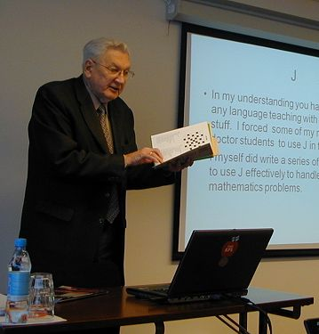
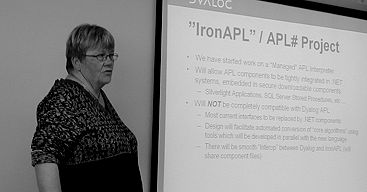
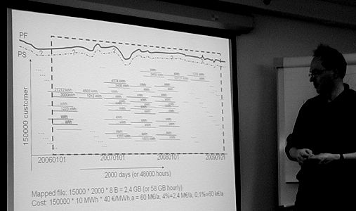
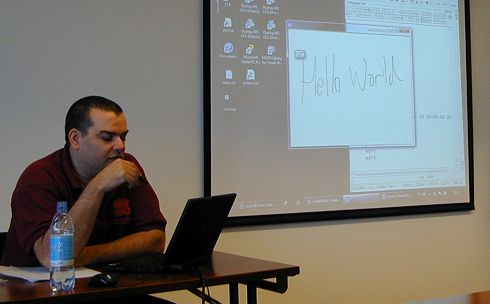

reported by Adrian Smith (adrian@apl385.com)
{ .byline }

## Location and other social stuff

Tallinn is a bit like York (you can walk everywhere) only the walls are bigger, the sun seems to shine most days, and it can still be seriously cold. The Finns (and Jim Brown) came in by ferry, the rest of us by the cheapest airline we could find. We all enjoyed an excellent guided tour of the old town (pictured below with Jim on the left) followed by a most friendly banquet at a mediaeval-ish restaurant on the evening of the first day.

<figure markdown="1">

<figcaption markdown="span">Our tour group in the centre of Tallinn</figcaption>
</figure>

The general balance of the seminar was excellent, the real bonus being the presentations in J from two doctoral students at the local technical university. There is a serious hotbed of array programming expertise (and internationally renowned ability to win on internet gambling sites) in Tallinn – maybe the two things go together? One final thing to mention was the collection of *very annoying* puzzles emblazoned with the FinnAPL logo and handed around at the start. I was treated (along with JD) to a level-5 challenge, which I have so far failed to make progress with. Gill has now mastered hers, which will be a great relief to the family when we get home.

## Day 1 – mostly applications

### Does APL interest people? *Veli-Matti Jantunen*

I think this was just a good excuse to give out the puzzles! Veli-Matti introduced the meeting with the idea that one of the best ways to get people interested in APL was to have solutions to puzzles and brain teasers ready to hand. Programmers are always willing to fill in the quiet times with a bit of puzzle-solving, and students are regularly set data-analysis challenges as part of their training or project work.

So we should be ready with out grab-bag of solutions, whether Sudoku solver, RainPro charting, or just a bit of trivial arithmetic to turn a big pile of numbers into information. He showed some nice examples, for example how easy is is to make a grid with all the negative values coloured red. Even basics like `+/?1000000⍴6` – to check the average of a million dice throws – are impressive to someone new to an array language.

### Graph cliques in J *Leo Võhandu, Professor Emeritus in Informatics, Tallinn Technical University*

<figure class="left" markdown="1">
{ style="width: 200px" }
<figcaption markdown="span">Professor Võhandu on winning at Poker</figcaption>
</figure>

For me, this was the highlight of the meeting – Leo was a keen follower of Langlet and Michael Zaus back in the 1990s, and has published extensively on experimental mathematics in Russian journals that very few of us in the West ever saw, let alone attempted to read. He is a renowned expert on gaming and lotteries, and also writes regular columns in the popular Estonian press on good algorithms for winning in casinos. Nearly all this work is founded in J, and of the 15 languages he has used:

> “I like J the best – why? Because I am old, fat and lazy!”

So he encouraged many of his masters students to use J in their doctorates, and we saw the result in two excellent talks at this seminar. He thinks there are around 10 active J programmers in Estonia as a result, and I have high hopes we may now see much more of them in *Vector* in the future!

The bulk of the talk was about “how not to look dumb in other fields, from childbirth to space. In space you *always* have enough money!” – a really general approach when faced with a mountain of data is required here, and Leo uses graph theory to search for patterns by progressive clustering of groups and elimination of variables. J proves ideal for handling large boolean matrices, and operations like closure express very nicely and run quite quickly even on huge graphs, although when you get up to 35m vertices, you really need to look towards parallel computing. Sometimes he turns up recording errors in the data, for example in a study of around 5,000 Baltic Herring over 10 generations, the experimenters were expecting 10 groups and the analysis showed 11. It turned out that on one survey trip the trawl was broken and they sampled the wrong shoal!

> “Because I am the main gambling expert in Estonia, they read my stuff!”

Which sums up his message – getting published in the popular press is what more of us need to do to keep the language alive. Oh, and it help if you can turn 250€ into 750€ since New Year, with no more that 30min per day on the internet.

### Objects and XML files *Kimmo Linna, FinnAir*

Kimmo must have one of the best jobs in the world – flying commercial airliners 2 days a week and maintaining Dyalog APL software the rest of the time. He has been experimenting with trees of namespaces as a way of mapping XML structures into objects, and then in using Twitter as a support infrastructure for an easily accessed and queried logging tool.

The interface to Twitter made good use of Dyalog’s Conga libraries and also Conrad’s MD5 hashing code from the APL Wiki (which you need to encrypt passwords for the login). The result is a stream of XML which can be broken out into a tree of nested namespaces. Every time the application starts, or encounters a problem, it *tweets* a short message with some well-coded supporting data. The restructured XML is easily explored and summarized to provide an efficient support mechanism.

Incidentally, the work in Dyalog 12.1 to provide `⎕XML` complements this nicely, as it takes away much of the pain of parsing the incoming text, reformatting it into a nice matrix layout which Kimmo can easily transform into his preferred object structure. See later!

### Dyalog news from *Gitte Christensen*

<figure class="left" markdown="1">
{ style="width: 200px" }
<figcaption markdown="span">Gitte outlines the Iron APL project</figcaption>
</figure>

I think you can read all of this on Dyalog’s new pages, apart from the new material on the Iron APL project which caused a lot of interest. This builds on Dyalog’s experience with the core library used to support the APL-C# translator to propose a fully managed .Net APL interpreter which could be run as part of a SQL-server stored procedure, called from Microsoft SSRS (their attempt to kill off Crystal Reports with an embedded reporting tool), run as a SilverLight component in a browser, and so on.

This requires it to be very lightweight, and to support the .Net array types very directly so that there is minimal conversion overhead in accessing large arrays of .Net objects. A consequence will be that it can never quite be a direct migration from Dyalog APL, or that there will be some places where arrays are handled a little differently, for example the action of *enclose* does not map exactly, as .Net has no way to represent an enclosed array as a scalar. It will also take multi-argument function calls (probably with optional arguments) as a requirement of the design, so that it will be very easy to work with the .Net libraries. We should see a fleshed-out specification at Princeton in September, which will be extremely interesting.

### Analysing text with J *Kairit Sirto, masters student in Linguistics*

This talk was a nice example of some relatively straightforward J used in support of a master's thesis in Linguistics. Essentially the task involved a basic text cleanup on a ‘cuttings file’ of Estonian newspapers, cutting the text into syllables (calling out to a standard DLL) and analysing the n×n matrix of syllable pairs (sparse array handling helps a lot here as the matrix can get rather large).

It was interesting to compare the rather exotic regular expression that could have been used as the first step of the cleanup process with the very simple use of the J *cut* primitive which has a certain amount of hidden power when you dig into it. There were a couple of places where ‘old hands’ pointed out library functions that could have saved here a bit of time, but (as always) it turned out that Kairit’s re-invented wheels did exactly the same job and it probably took her less time to re-invent them that it would have to find the library copies!

### Iqx – a database colouring guide *Adrian Smith, Causeway*

This was the second iteration of the talk I gave in Denmark last autumn, so I tried to show much more of the nuts and bolts of the system, by simply starting with a clear workspace and making a database from scratch. I see the future of this as providing APL newbies with a simple data-editing tool, APL professionals with a rather handy access tool for reasonable size tables, and possibly as a first-cut delivery platform for a completed application (currently being pushed along by the Minster Stoneyard project).

I think a crucial difference from standard SQL-based tools is that it understands nested arrays and matrices (I leaned quite hard on the idea that a matrix can simply sit at the intersection of 2 tables), and that a selection is really just a table in disguise. Yes, it is single-user, it resides entirely in the workspace, and it has no fancy transaction stuff or rollback. Then again, so is kdb and no-one seems to be too bothered now you can have terabytes of main memory and run the engine behind a simple socket library. I will keep chipping away at this as I need it, so expect updates from time to time. Thanks again to Arthur Whitney and Paul Mansour for most of the ideas.

<figure markdown="1">

</figure>

## Day 2 – mostly technical

### Where did that 4% go – a short challenge from *Anssi Seppälä*

This was a 10-second filler to challenge us to code up the search strategy to find the 4% of the total Finnish electricity consumption that no-one gets charged for.

<figure markdown="1">

<figcaption markdown="span">Anssi Seppälä looking for the missing 4% of Finnish electricity</figcaption>
</figure>

The dataset is very large – hourly data is available by consumer for several years. The problem is that when you add it up, the sum is around 4% less than the amount you know went through the grid (allowing for known losses). For anyone who can find it, there are several million Euros on offer.

### New features in Dyalog 12.1 *John Daintree, Dyalog Ltd*

John covered a lot of stuff in a short time, with several rather natty demos along the way, so this will inevitably be a rather patchy summary. Version 12.1 is rapidly nearing code-freeze, so we may get our hands on a test copy quite soon.

<figure markdown="1">

<figcaption markdown="span">John Daintree demonstrating handwriting recognition in Dyalog 12.1</figcaption>
</figure>

Dyalog have been working with MicroAPL to make a standard implementation of `⎕XML` to do all the heavy lifting and parse up a stream of incoming XML-coded data into an easy-to-access format. This looks like a nice old-style matrix, with tags classified by depth, and columns for the attributes and values – you can display a big chunk of XML (such as Kimmo’s Twitter logs) in a tree-control almost trivially. Of course the process is reversible, so to save (for example) an IQX database as a stream of XML would become a much less tedious programming task, and re-constituting it would be almost as easy. I will definitely need this to augment my current approach of simply dumping the `⎕OR` of the namespace on a component file, so this little addition definitely gets a hug or two from me!

Next up were a bunch of editor enhancements that make working with ‘real’ (as opposed to ‘toy’) classes a practical proposition. Both line-numbering and syntax-colouring currently die if you have more than 10,000 lines in the object being edited (this editor was designed for functions after all, and we all start to feel uneasy if we have more that 100 lines). Now we have a rewritten syntax-colouring engine, a proper navigation tree on the left, tagged sections with an outliner, double-click can start a new function (or jump to an existing one) and stops can be set in the traditional way. Even the tracer has got a bit colourful.

The class remembers how it was when you left it, so you can run with nearly all your code collapsed, and you can dive straight to the function you want with the traditional `)ed myclass.foo` from the session. I’m sure there are a few bugs left to shake out, but I can think of enough places where this will help that I am willing to give it a run out and tolerate the inevitable annoyances!

Next up – the *really cool* stuff!

You used to have a choice between old-style forms made with `⎕WC` and the new Windows Forms library you get from Microsoft. Now you can just add one of the standard .Net controls (or any number of controls that you can download for free) to your form using the new `NetControl` type which mirrors `OCXClass` in putting a lightweight wrapper around any control you like. John showed some of the 60 free controls from DevExpress – hence that natty handwriting control working on his tablet PC – and illustrated a grid with a handy drop-down calculator implemented with a .Net control as its `input` property. This opens a lot of doors to the application designer, and frees up Dyalog from trying to keep up with all the rest of the GUI world. Applause please!

Finally (but worth the wait) we can now package up the workspace, runtime interpreter, and an icon into a single executable which just makes the installation game that much simpler. I still have a bad habit of updating my DSS copy, resaving the workspace, recreating the .exe, mailing it to the user, and then getting a puzzled message back about incompatible versions as soon as she tries to start it. Not any more – thanks John!

## Roundup

All in all, a most satisfactory outing. The post-conference feedback was all positive, and the attendance was a little up on last year (30+ people at most of the talks). There is definitely a little J bushfire going in Estonia – we need to do all we can to fan the flames and get this message spread more widely before the enthusiasm fades. *Vector* can offer its pages for the masters students to publish in a ‘well-respected’ English-language journal, which can only help to encourage a community which still feels the residue of Soviet occupation, and where getting your message heard has been very tough in the quite recent past.
