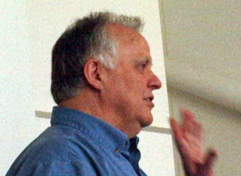

by Catherine Lathwell
{ .byline }

Catherine Lathwell’s talk to the APL Bay Area Users’ Group on 11 May 2009, reported by Curtis A. Jones
{ .ednote }

In March Catherine Lathwell’s [blog](http://aprogramminglanguage.com) [\[1\]](#ref1) on making a movie about the history of APL mentioned a trip to the San Francisco Bay area. She quickly accepted an invitation to speak to the APL Bay Area Users’ Group (APL BUG or The Northern California SIGAPL of the ACM) on the trip. Thirteen people assembled at a pizzeria before the meeting on the 11th of May. Gene McDonnell showed a proof copy of *At Play With J* [\[2\]](#ref2). Ed Cherlin showed a computer for the [One Laptop per Child](http://laptop.org/) [\[3\]](#ref3) project and said two people are working on two APLs for it. Catherine may have gotten something to eat, but mostly she took advantage of the chance to introduce herself to everyone who came.

<figure class="left" markdown="1">
{ style="width: 150px" }
<figcaption markdown="span">Joey Tuttle</figcaption>
</figure>

The meeting itself was at the [Computer History Museum](http://www.computerhistory.org/) [\[4\]](#ref4) in Mountain View, California. After the more or less annual election of officers under Chuck Kennedy’s chairmanship, Joey Tuttle introduced Catherine. He recalled walking up to Catherine Lathwell’s desk at Reuters in Toronto and addressing her as “Cathy”. Her coworkers asked how Joey could get away with “Cathy” when they’d get an earful if they attempted such familiarity. Her answer: “Grandfather rights.” Catherine was born when her father, Richard Lathwell, worked with Larry Breed and Roger Moore to take Iverson notation from an elegant way of writing algorithms to APL\\360 that could actually be run on a computer. Joey, Larry Breed, Eugene McDonnell, David Allen and Charles Brenner were the people in attendance who might claim grandfather rights.

Catherine saw first hand the rapid growth of APL from the late 1960s through the 1970s, and even worked herself as an APL programmer at I.P. Sharp Associates and Reuters. Her academic area has been fine arts and English literature. Now she’s reflecting on her experience of APL and, as an independent producer, starting to organise a documentary film on the history of APL.

A first step is her blog to scope out interest in the project. The Toronto APL SIG has provided seed money, and she is out looking for more support. She encouraged us to check the blog frequently since readership indicates interest in the project to potential funders.

Getting the history of APL into a finite-length documentary requires serious attention to the scope of the topic! The working question around which Catherine started organizing the movie is *What is APL’s contribution to science?* and it is creeping to *What is APL’s contribution to computer science?* and *What is APL’s contribution to international finance?*.

Movie? She made one for the APL BUG with greetings from Dick Lathwell. This video, with some additional editing, is on YouTube, and may be found through Catherine’s blog. The title *Dad & My APL Box* describes the beginning in which Dick shows some memorabilia. There’s the issue of the *IBM Systems Journal* celebrating the 25th Anniversary of APL [\[5\]](#ref5), a record of “APL Blossom Time” composed by J.C.L. Guest (Mike Montalbano – “A wonderful person”), some I.P. Sharp Associates’ newsletters and a picture of the ‘original six’. These are Dick Lathwell, Ken Iverson, Roger Moore, Adin Falkoff, Phil Abrams and Larry Breed. [\[6\]](#ref6) Dick noted that not everyone in the picture worked on the same program at the same time. Phil Abrams, in fact, never worked directly for IBM. Phil worked for SRI with Larry Breed to write IVSYS which computed with input in Iverson notation. Later Dick Lathwell converted IVSYS to run on the IBM 7040 computer at the University of Alberta.

Here are some exchanges in the video (with some editing).

> Catherine Lathwell: *Tell me about the first time you met Ken \[Iverson\].*
>
> Richard Lathwell: Ken had come to the University of Alberta around 1964 to lecture on describing hardware architecture using his notation. I didn’t meet Ken personally until I worked on converting IVSYS to run on the 7040.
>
> Dick’s thesis advisor left the University of Alberta and suggested that better research was being done in industry. Dick went to Toronto to interview Honeywell. On the day he was to accept Honeywell’s job offer a call came from Ken Iverson: “I hear you’re leaving. Come and talk to us.” Dick’s advisor must have called Ken.
>
> CL: *Do you remember the first time you met Adin?*
>
> RL: No. Probably when I went to be interviewed. I felt overawed. New York and its suburbs were overwhelming.
>
> CL: *I always remember being a little bit afraid of Ken but I remember Adin as being kind of gentle.*
>
> RL: Yes. Our first two cars came from Adin. The first was a 1956 Cadillac. Adin’s view was that a ten-year-old luxury car, because it was built so well, gave a better deal than a cheap new car. He sold his 1956 Cadillac to us for $50 in 1966. Then later he sold a 1957 Cadillac for about $100. We later sold it to Mike Jenkins who ended up taking it to Queens University and spending a fortune to have it certified in Canada.
>
> CL: *Do you have any comments to the people who will be watching at the museum?*
>
> RL: I think the thing that’s important – what I always come back to – I have downstairs somewhere Roger’s yellow pad with his design of the APL\\360 supervisor – but the thing that we did always was to do our design in APL and so we would write whatever it was we were going to do first in APL and use that to prove it out and check it and then transcribe that into assembler language which is what we programmed in in those days. By doing that – by using that tool – we were able to produce really good code significantly faster than any other way and pretty much faster and more accurately than what anybody else was doing at the time.
>
> And IBM never got it. In fact at one point I remember a vice president trying to convince me to do something in a different way and I kept trying to convince him that the reason we were successful was because we used our own tool and the IBM vice president said no, it was because I was smart. I remember mentioning that to Ken later, and Ken said “You should have asked him ‘If you think I’m so smart, why don’t you take my advice?’”
>
> CL: *That sounds so much like Ken. Did I tell you what Ken said when I told him about doing this?*
>
> RL: No.
>
> CL: *“OK. Maybe all that art school is good for something after all.”*

Here are a few highlights of the question-and-answer session after the video.

> Larry M. Breed: Mentioned Phil Abrams and Dick Lathwell working with FORTRAN on IVSYS before APL\\360. [\[7\]](#ref7)
>
> Curtis A. Jones: Would Ken Iverson have wanted APL’s contribution to science to be through education?
>
> LMB: Ken’s dream was to improve communication of mathematical ideas. [\[8\]](#ref8) Howard Aiken’s advice to Ken: “Don’t worry about people stealing your ideas. If they’re any good you’ll have to stuff them down their throats.”
>
> LMB: Lack of declarations may have limited APL.
>
> Joey K. Tuttle: Recalled meeting with Frito Lay in 1970s – their most important application was modelling a potato in APL.
>
> CAJ: How Important was language to APLers?
>
> LMB: Everyone had strong view on correct dictionary. Ken favored the American Heritage Dictionary.
>
> JKT: The last book from Ken was *Eats, Shoots and Leaves*.

Catherine played a video montage created from “APL Blossom Time” [\[9\]](#ref9) and Peter McDonnell’s much-loved caricatures of the APL veterans that is also the closing sequence of her video of Ken Iverson’s Toronto Memorial, which can be found in [Myspace](http://vids.myspace.com/index.cfm?fuseaction=vids.individual&videoid=49489049) [\[10\]](#ref10).

Thanks to the Lathwells for the talk. Thanks to The Computer History Museum and the head of its board of trustees, Len Shustek, who once worked with Dick Lathwell, for hosting the event.

## Notes

1.  [http://aprogramminglanguage.com](http://aprogramminglanguage.com)
2.  *At Play With J*, Eugene E. McDonnell, Vector Books, UK 2009, ISBN 978-1-898728-16-0
3.  One Laptop per Child (OLPC) [http://laptop.org/](http://laptop.org/)
4.  Computer History Museum [http://www.computerhistory.org/](http://www.computerhistory.org/)
5.  *IBM Systems Journal*, Volume 30, Number 4, 1991
6.  The Computer History Museum has a large print of this picture donated by Eugene McDonnell, who received it from Don McIntyre. CAJ
7.  See Mike Montalbano’s “A Personal History of APL”. [http://www.ed-thelen.org/comp-hist/APL-hist.html](http://www.ed-thelen.org/comp-hist/APL-hist.html)
8.  “Programming may be our middle name but language is our end.” CAJ
9.  The audio recording of “APL Blossom Time” may be found at [http://smartarrays.com/downloads/aplblossomtime/aplblossomtime.html](http://smartarrays.com/downloads/aplblossomtime/aplblossomtime.html) “Even today it is sold out in most record stores.” or [http://cosy.com/language/APLBlos/APLBlos.htm](http://cosy.com/language/APLBlos/APLBlos.htm)  
    “APL Blossom Time” is annotated in Mike Montalbano’s “A Personal History of APL” at [http://www.ed-thelen.org/comp-hist/APL-hist.html](http://www.ed-thelen.org/comp-hist/APL-hist.html)
10.  [http://vids.myspace.com/index.cfm?fuseaction=vids.individual&videoid=49489049](http://vids.myspace.com/index.cfm?fuseaction=vids.individual&videoid=49489049)
