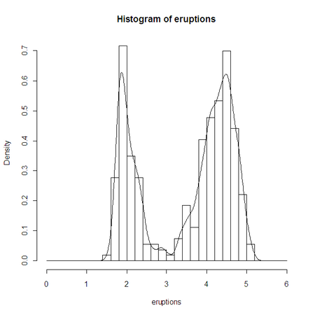
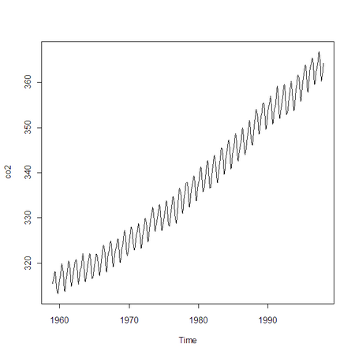
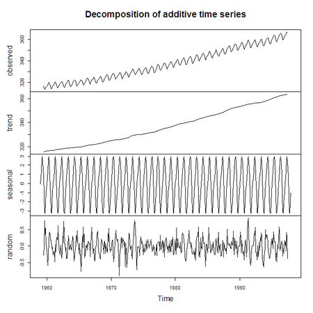
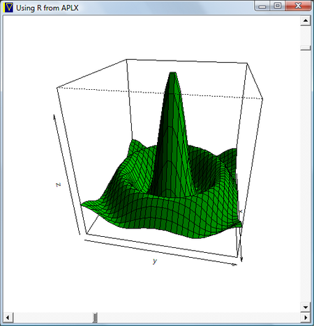
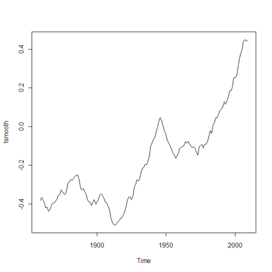
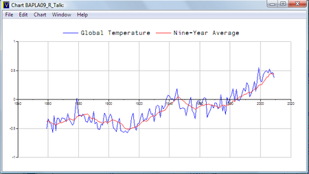

by Simon Marsden, MicroAPL Ltd
{ .byline }

This article is based upon a talk originally presented at the BAPLA09 Conference in June 2009.
{ .ednote }

APLX Version 5 includes a new interface to the R statistics package.

R is a computer language in its own right, but it also comes with a large collection of library functions. Most are concerned with statistics but there are many others, including excellent support for producing graphs.

There have been attempts at implementing a statistics library in APL, but it’s difficult to approach the comprehensive coverage that R brings. There are functions for linear and non-linear modelling, classical statistical tests, time-series analysis, classification, clustering, and many others.

I’m no statistician – I’m not even qualified to pronounce the names of some of the statistical tests that R offers, let alone explain them – but the whole of the huge, well-tested R library can be called easily from APL.

R is a GNU project, based on the S language and environment developed at Bell Labs. It’s open-source, and free under the GNU General Public Licence. It’s available on many major platforms, including Windows, Macintosh and Linux.

## A quick introduction to the APLX-to-R interface

Let’s look at a quick example to get a feel for what’s possible when APL is combined with R. (This is in part based on material in the *Introduction to R* manual[\[1\]](#ref1). Don’t worry too much about the details yet: we’ll come to those later.

We need to start by telling APLX to load the R plug-in. We’ll assign a reference to a variable, also called `r`

```
      r←'r' ⎕NEW 'r'
      r
[r:R]
      r.⎕DS
R version 2.9.0 (2009-04-17)
```

I mentioned that R has rather a lot of functions. We can get a listing of them from APLX:

<pre>
      ⍴r.⎕DESC 3
2051 117
      r.⎕DESC 3
AIC (object, …, k = 2)
ARMAacf (ar = numeric(0), ma = numeric(0), lag.max = r, pacf = FALSE)
ARMAtoMA (ar = numeric(0), ma = numeric(0), lag.max)
Arg
Arith
Axis (x = NULL, at = NULL, …, side, labels = NULL)
Box.test (x, lag = 1, type = c("Box-Pierce", "Ljung-Box"), fitdf = 0)
C (object, contr, how.many, …)
CIDFont (family, cmap, cmapEncoding, pdfresource = "")
<em class="plain">…etc</em>
</pre>

As you can see, there are well over 2,000 functions in the base package alone, and that’s before we start loading additional libraries.

R comes with a number of sample data sets for use in teaching statistics. For example there is a data set giving eruption details for the Old Faithful geyser in the Yellowstone National Park, famous for the regularity of its eruptions. The data is stored in an R data type called a `data.frame`:

```
      r.faithful
[r:frame]

      180↑r.faithful.⎕DS
    eruptions waiting
1       3.600      79
2       1.800      54
3       3.333      74
4       2.283      62
5       4.533      85
6       2.883      55
7       4.700      88
```

Let’s get the data for the eruptions column (durations of eruptions in minutes) into an APL variable:

```
      eruptions←(r.faithful).$$ 'eruptions'
      10↑eruptions
3.6 1.8 3.333 2.283 4.533 2.883 4.7 3.6 1.95 4.35
```

We can perform some simple statistical tests using R methods like `mean` and `summary`:

```
      r.mean (⊂eruptions)
3.487783088
      r.summary (⊂eruptions)
1.6 2.163 4 3.488 4.454 5.1
```

The summary is clearer when presented in text form like this:

```
      (r.summary.⎕REF (⊂eruptions)).⎕DS
   Min. 1st Qu.  Median    Mean 3rd Qu.    Max.
  1.600   2.163   4.000   3.488   4.454   5.100
```

Let’s get R to plot the APL data as a histogram:

```
      r.eruptions←eruptions
      r.⎕EVAL 'hist(eruptions,seq(0,6,0.2),prob=TRUE)'
      r.⎕EVAL 'lines(density(eruptions,bw=0.1))'
```

<figure markdown="1">
[](fig01.png)
</figure>

Looking at the histogram, we can see that Old Faithful sometimes stops after 3 minutes. If it keeps going beyond 3 minutes, the eruption length data appears to conform roughly to a Normal distribution. How can we test this?

The Kolmogorov-Smirnov test allows us to test the null hypothesis that the observed data fits a given theoretical distribution:

```
      r.long←(eruptions > 3)/eruptions
      ks←r.⎕EVAL 'ks.test (long, "pnorm", mean=mean(long), sd=sd(long))'
      ks
[r:htest]
      ks.⎕DS

 One-sample Kolmogorov-Smirnov test

data:  long
D = 0.0661, p-value = 0.4284
alternative hypothesis: two-sided

      ks.⎕VAL
 0.06613335935  0.4283591902  two-sided One-sample Kolmogorov-Smirnov test
```

This brief example gives a flavour of what’s possible when using R from APL : easy access to a huge library of statistical and other functions, and rich graphics.

## A practical introduction to R

Let’s leave APL out of the picture for a while, and take a look at some of the features of R by typing expressions at the R console window’s `>` prompt.

First of all, you’ll notice that R is an interpreted language:

```
> 2+2
[1] 4
```

It’s also an array language. Here’s the equivalent of `⍳10`:

```
> 1:10
 [1]  1  2  3  4  5  6  7  8  9 10
```

You can assign a value to a variable. Notice that the assignment arrow is similar to APL, but of course we don’t have APL’s beautiful symbols:

```
> x<-1:10
> x+x
 [1]  2  4  6  8 10 12 14 16 18 20
```

There are a limited number of symbols like `+` and `*`. For everything else we must use a function:

```
> sum(1:10)
[1] 55
> length(1:10)
[1] 10
```

R is similar to APL in that it has the concept of a workspace. If we try quitting, we get prompted whether to save the session. If we say ‘yes’ and then quit, all the variables will be there next time we launch R.

Like APL, higher order arrays are possible in R:

```
> x<-matrix (1:20, nrow=4)
> x
     [,1] [,2] [,3] [,4] [,5]
[1,]    1    5    9   13   17
[2,]    2    6   10   14   18
[3,]    3    7   11   15   19
[4,]    4    8   12   16   20
```

Notice that R uses column-major order, something that the APL interface must take care of transparently.

Entering a vector is a bit clumsy. You might expect that you can type:

```
> x<-1 2 3 4 5
Error: unexpected numeric constant in "x<-1 2"
```

…but you need to use a function called `c` and make each item an argument:

```
> x<-c(1,2,3,4,5)
```

Rather strangely, R has no concept of scalars

```
> length(1:10)
[1] 10
> length(123)
[1] 1
```

123 is a single-element vector!

You can also have mixed arrays:

```
> x<-list(1,2,'hello',4,5)
```

R also includes complex number support:

```
> 2*(3+4i)
[1] 6+8i
```

…but it’s not very consistently done:

```
> sqrt(-1)
[1] NaN
Warning message:
In sqrt(-1) : NaNs produced
```

To compute the square root of `-1` you must specify it as `-1+0i`:

```
> sqrt(-1+0i)
[1] 0+1i
```

Interestingly, R does include support for NaNs, or <em>Not-a-Number</em>s, as well as infinity. It also has the concept of a data item whose value is *Not Available*, using the special `NA` symbol:

```
> NA
[1] NA
> 10*NA
[1] NA
> x<-c(1,2,NA,4,5)
> x
[1]  1  2 NA  4  5
> sum(x)
[1] NA
```

Another important concept is that R supports optional parameters to functions, specified by keyword. In this example we supply a parameter `na.rm` with a value `TRUE` specifying that we want to remove the `NA` values before calculating the sum:

```
> sum(x,na.rm=TRUE)
[1] 12
```

So far, we’ve only seen simple arrays. R data items can also be arrays with attributes. Let’s create an array called a *data frame*:

```
> x<-1:5
> y<-sin(x)
> frame<-data.frame(x,y)
> frame
  x          y
1 1  0.8414710
2 2  0.9092974
3 3  0.1411200
4 4 -0.7568025
5 5 -0.9589243
```

Notice how the rows and columns are labelled. If we look at the attributes of the data frame, we can see how this is done:

```
> attributes(frame)
$names
[1] "x" "y"

$row.names
[1] 1 2 3 4 5

$class
[1] "data.frame"
```

There’s nothing magic about attributes. They are just extra bits of data associated with the main array.

Notice in particular the attribute `class` in the frame. It’s not a class in a normal object-oriented programming sense, just a character vector. However, many generic R functions use the `class` attribute to decide how to handle the data.

R comes with a number of built-in sample data sets for use in the teaching of statistics. If you want the results of the classic Michaelson-Morley experiment to measure the speed of light, or the survival rates of passengers on the Titanic, it’s all here.

Here is some data for monthly atmospheric CO<sub>2</sub> concentrations between 1959 and 1997:

<pre>
&gt; co2
        Jan    Feb    Mar    Apr    May    Jun    Jul    Aug  …
1959 315.42 316.31 316.50 317.56 318.13 318.00 316.39 314.65  …
1960 316.27 316.81 317.42 318.87 319.87 319.43 318.01 315.74  …
<em class="plain">…etc</em>

&gt; summary(co2)
   Min. 1st Qu.  Median    Mean 3rd Qu.    Max.
  313.2   323.5   335.2   337.1   350.3   366.8

&gt; plot (co2)
</pre>

<figure markdown="1">
[](fig02.png)
</figure>

```
> plot (decompose(co2))
```

<figure markdown="1">
[](fig03.png)
</figure>

Notice that the two plots we just did produced very different results (the second one is a seasonal decomposition of the `co2` data). It’s because the `plot` function behaves differently based on the class attribute:

```
> class(co2)
[1] "ts"
> class(decompose(co2))
[1] "decomposed.ts"
```

## Earlier work on an R to APL interface

Many of you will have read articles by Professor Alexander Skomorokhov (better known as ‘Sasha’) describing an earlier interface between R and APL running on Windows, achieved via the COM interface. The method works for Dyalog APL and APLX, and I’ll quickly show it here.

What Sasha’s work does is to make a bridge between APL and R by using four functions. Here’s a short example (we’re back in APL now):

```
      RINIT
      'x' RPUT 10?10
      RGET 'x'
7 1 8 3 9 2 6 10 4 5
      1 REXEC 'mean(x)'
5.5
      0 REXEC 'plot(x)'
```

What we’ve tried to do in APLX version 5 is to build on this work, but make the interface more elegant.

## Using R from APLX Version 5

APLX includes the ability to interface to a number of other languages, including .NET, Java, Ruby and now R. This is achieved through a plug-in architecture.

Most of the interface between APLX and R is done using a single external class, named `r`, which represents the R session that you are running. (Note that this is different from most of the other external class interfaces, where objects of many different classes can be created separately from APLX). You create a single instance of this class using `⎕NEW`. R functions (either built-in or loaded from packages) then appear as methods of this object, and R variables as properties of the object.

```
      r←'r' ⎕NEW 'r'
```

We can assign to a variable in the R world, roughly equivalent to Sasha’s `RPUT` and `RGET` functions:

```
      r.x←10?10
      r.x
7 1 8 3 9 2 6 10 4 5
```

Next, we also have `⎕EVAL`, similar to Sasha’s `REXEC`:

```
      r.⎕EVAL 'mean(x)'
5.5
      r.⎕EVAL 'plot(x)'
[NULL OBJECT]
```

But it’s not necessary to keep using an assignment to copy the data across to the R side before we can use it:

```
      r.mean (⊂10?10)
5.5
      r.plot (⊂10?10)
```

Notice that we need to enclose the data to tell R that it’s a single argument. We can also do something like:

```
      r.outer (⍳3) (⍳4) '-'
0 ¯1 ¯2 ¯3
1  0 ¯1 ¯2
2  1  0 ¯1
```

…where we’re supplying the `outer` function with three separate arguments.

## Boxing and un-boxing data

For simple data types like vectors and arrays returned to APL, the data is automatically ‘un-boxed’. In other words it’s converted to an APL array with the same values.

For more complex cases, the un-boxing is not automatic. Here’s the CO<sub>2</sub> data again:

```
      r.co2
[r:ts]
```

What we have here is a *reference* to an item of class `ts`: an R Time-Series.

We can force the reference to be un-boxed:

```
r.co2.⎕VAL
```

…but it’s often more useful to keep it boxed up.

```
      co2←r.co2
      co2.summary.⎕DS
   Min. 1st Qu.  Median    Mean 3rd Qu.    Max.
  313.2   323.5   335.2   337.1   350.3   366.8
```

This last example works because the APLX-R interface treats an expression like

```
        obj.function args
```

…as a synonym for

```
        r.function obj, args
```

…so `co2.summary` is the same as `r.summary co2`. It’s just a bit of syntactic sugar that makes things more readable.

Similarly, we can tell APL not to un-box a value even when it would normally do so:

```
      r.x←⍳10
      r.x
1 2 3 4 5 6 7 8 9 10
      r.x.⎕REF
[r:integer]
      x←r.x.⎕REF
      x.mean
5.5
```

## Graphical example

Now for something a little more interesting. Here’s a little interactive APL program which calls R to plot a 3-D surface and displays the result.

<figure markdown="1">
[](fig04.png)
</figure>

What we’re doing here is using APLX to create the window and manage the scroll bars. It’s calling R to do the 3-D plot and store the result in a bitmap, which APL then displays. As the user drags the scroll bars to change the viewing angle, the graph is rotated.

```
∇ Demo3D;w
⍝ Interactive 3-D charting using R from APLX

⍝ Create the 3D data to plot
r.x←r.⎕EVAL 'seq(-10,10,length=30)'
r.y←r.x
r.z←r.y ∘.Sinc r.x

⍝ Create a window
'⎕' ⎕WI 'scale' 5
w←'⎕' ⎕NEW 'window'
w.title←'Using R from APLX'
w.size←500 500

⍝ Create vertical scroll bar
w.phi.New 'scroll'
w.phi.style←0
w.phi.align←4
w.phi.value←0 360
w.phi.onChange←'Plot3D'

⍝ Create horizontal scroll bar
w.theta.New 'scroll'
w.theta.style←1
w.theta.align←3
w.theta.value←0 360
w.theta.onChange←'Plot3D'

⍝ Create the picture object
w.pic.New 'picture'
w.pic.align←¯1

⍝ Draw the initial plot
Plot3D

⍝ Handle events until user closes window
:Try
  0 0⍴⎕WE w
:CatchAll
:EndTry
∇
```

```
∇ Plot3D;sink
⍝ Helper function for Demo3D

⍝ Read the scroll bar values to get the rotation theta/phi
r.theta←1↑w.theta.value
r.phi←1↑w.phi.value
⍝
⍝ Tell R to do its plotting to a bitmap, not a graphics window
sink←r.bmp 'C:\\Users\\simon\\Desktop\\persp.bmp'
⍝
⍝ Plot the data
sink←r.⎕EVAL 'persp(x,y,z,theta=theta,phi=phi,shade=0.5,col="green3")'

⍝ Close the bitmap file and display in APL window
sink←r.dev.off
w.pic.bitmap←'C:\Users\simon\Desktop\persp.bmp'
∇
```

```
∇ R←X Sinc Y
⍝ Helper function for Demo3D
⍝
⍝ Compute Sinc function
R←(+/(X Y)*2)*0.5
R←(10×1○R)÷R
∇
```

## More details of the R interface in APLX

We can now use R to support complex numbers – something which APLX currently lacks:

```
      comp←r.⎕EVAL '3+4i'
      comp
[r:complex]
      comp.⎕DS
[1] 3+4i

      comp.real
3
      comp.imag
4
```

We can also create new complex numbers with the following syntax…

```
      x←'r' ⎕NEW 'complex' 3 4
      x.⎕DS
[1] 3+4i
```

…and even create arrays of complex numbers:

```
      x← 'r' ⎕NEW 'complex' (2 2⍴(2 3)(6 8)(1 7)(¯1 9))
      x.⎕DS
     [,1]  [,2]
[1,] 2+3i  6+8i
[2,] 1+7i -1+9i
```

```
      x.real
2  6
1 ¯1
      x.imag
3 8
7 9
      x.sqrt.⎕DS
                   [,1]               [,2]
[1,] 1.674149+0.895977i 2.828427+1.414214i
[2,] 2.008864+1.742278i 2.006911+2.242252i
```

You will remember that R also supports a ‘Not Available’ value. We can also specify this from APL:

```
      NA←'r' ⎕NEW 'NA'
      NA
[r:NA]
      r.sum (⊂1 2 3 NA 5 6)
[r:NA]
```

Sometimes it is necessary to explicitly assign APL data to an R variable so that we can get at it using `⎕EVAL` – something which is necessary if we want to call functions which take keyword parameters:

```
      r.x←1 2 3 NA 5 6
      r.⎕EVAL 'sum(x,na.rm=TRUE)'
17
```

## Attributes

The APLX interface also includes support for R attributes. Any use of `∆XXX` is interpreted as an attribute access.

Here we create a time series and change the `tsp` attribute to say that the values run monthly from January 2005 to May 2009:

```
      series←r.ts (⊂(5+4×12)?1000)
      series.attributes.⎕DS
$tsp
[1]  1 53  1

$class
[1] "ts"
```

```
      series.∆tsp←2005 (2009+4÷12) 12
      series.⎕ds
     Jan Feb Mar Apr May Jun Jul Aug Sep Oct Nov Dec
2005 826 835 727 332 803 634  52  49 161 770  72 525
2006 930 231 216 103 705 712 504 276 718 392 219 251
2007 450 483 865 978 461  63 539  62 762 606 829 354
2008 260 554 453 427 988 969 857 874 342 187 998 657
2009 494 936 707 825 566
```

## Climate example

Let me repeat my opening remarks that I’m no statistician, and neither am I a climatologist. However, today is World Ocean Day (*the talk was given on 8 June 2009*), so I thought just for fun we could conclude by looking at some statistics involving sea temperatures.

Let’s use some data from the University of East Anglia’s Climate Research Unit, quite widely used in the literature. It’s available from their web site[\[2\]](#ref2).

As a demonstration of the APLX-R interface, we’ll try to reproduce (approximately) the graph of global temperature change.

In particular we’ll use a file called `HadCRUT3`, which contains monthly land and sea-surface temperature records since 1850. The surface of the earth is divided into 5-degree-latitude by 5-degree-longitude squares, so the underlying data is a three-dimensional array.

The data is in NetCDF format, a text format for representing scientific data. We could parse it by writing some APL code, but we can get R to do it for us. We load the `ncdf` package and then read the file:

```
        r.library 'ncdf'
 ncdf stats graphics grDevices utils datasets methods base

      nc←r.open.ncdf 'C:\Users\simon\Downloads\HadCRUT3.nc'
      tempdata←nc.get.var.ncdf.⎕REF
      nc.close.ncdf
      tempdata
[r:array]
```

The data contains a lot of Not Available values, particularly for the earlier years, so we’ll get R to find the mean temperature for each month by averaging over all the 5×5-degree squares before getting the data into APL. (Note that this might be statistically a bit dubious!)

```
      r.tempdata←tempdata
      averageTemp←r.⎕EVAL 'colMeans(tempdata,na.rm=TRUE,dim=2)'
      ⍴averageTemp
1912
```

We’ll create an R Time Series, specifying that the data ranges from January 1850 to March 2009:

```
      tmonth←r.ts (⊂averageTemp)
      tmonth.tsp←1850 (2009+3÷12) 12
```

How many complete years of data do we have?

```
      ⌊tmonth.length÷12
159
```

Let’s get APL to find the mean temperature in each year:

```
      years←159 12⍴ tmonth.⎕VAL
      averagesForYears←(+/years)÷12
```

What was the hottest year?

```
     (1849+⍳159)[⍒averagesForYears]
1998 2005 2003 2002 2007 2004 2006 2001 2008 1997 1999 1995 2000 1990 1991
1988 1981 1944 1994 1983 1996 1989 1987 1993 1980 1973 1943 1938 1939 1992
1953 1977 1979 1962 1986 1878 1963 1941 1940 1937 1961 1958 1984 1945 1985
1982 1942 1957 1959 1969 1978 1970 1952 1967 1960 1934 1931 1975 1972 1932
1936 1930 1951 1877 1948 1968 1947 1926 1946 1971 1935 1949 1966 1954 1974
1889 1965…
```

We can create an R time series of yearly temperatures:

```
      tyear←r.ts (⊂averagesForYears)
      tyear.tsp←1850 2008 1
      tyear.summary
¯0.5757 ¯0.3768 ¯0.2342 ¯0.1655 0.004088 0.5483
      tyear.summary.⎕DS
     Min.   1st Qu.    Median      Mean   3rd Qu.      Max.
-0.575700 -0.376800 -0.234200 -0.165500  0.004088  0.548300
```

Now let’s use APL to compute a 9-year moving average of the data:

```
      tsmooth←r.ts (⊂9+/tyear.⎕VAL÷9)
      tsmooth.‘tsp←1859 2009 1
      r.tsmooth←tsmooth
      r.⎕EVAL 'plot(tsmooth)'
```

<figure markdown="1">
[](fig05.png)
</figure>

Of course we shouldn’t forget that APLX can do charting too:

```
      titles←'seriesname=Global Temperature' 'seriesname=Nine-Year Average'
      vals←(8↓tyear.⎕val) (tsmooth.⎕VAL) (1858+⍳tsmooth.length)
      titles ⎕CHART ⊃vals
```

<figure markdown="1">
[](fig06.png)
</figure>

## Conclusion

There is a huge amount of high-quality software, much of it open-source, much of it free, written in languages like .NET, Java, Ruby and R.

Much of the recent work MicroAPL has done with APLX makes it easy to call code written in these other languages, so all of that software becomes available to the APL programmer.

## References

1. <a id="ref1"></a> <cite>Introduction to R</cite>  
    [http://cran.r-project.org/doc/manuals/R-intro.pdf](http://cran.r-project.org/doc/manuals/R-intro.pdf)
2. <a id="ref2"></a> University of East Anglia’s Climate Research Unit  
    [http://www.cru.uea.ac.uk/cru/data/temperature/](http://www.cru.uea.ac.uk/cru/data/temperature/)
