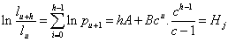
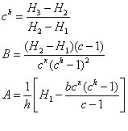
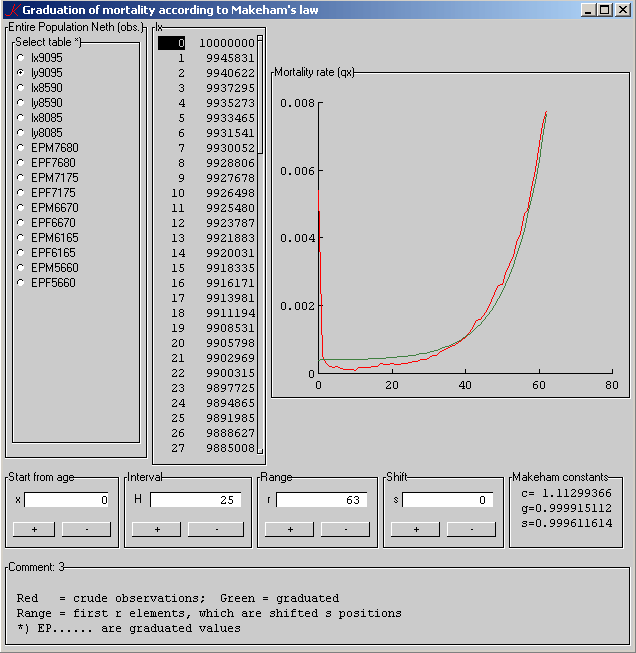

by Jan Karman (jkarman@planet.nl)
{ .byline }

When I first read about the release of q (kdb+) I was reminded of an article in the Dutch insurance press (1979) by Dr J.A. van der Pool, Actuary A.G., then with IBM, called <span lang="nl">“Een belegen notitie in een nieuw
      licht”</span> (A stale note in a new light). He discussed a new approach to the technique in life-insurance companies for changing their base interest rate used for premiums and valuation: APL. And I saw the Light! (Changing the base interest rate for valuation was not a sinecure in those days – the doors were closed for a fortnight, so to speak.)

Over the years around the millenium change I composed a couple of applications in k on the financial and actuarial territory. Reading recently about the free release of q, I thought it an opportunity to revisit my code and write it up for publication.

K4, the underlying code of q, differs from k3, the language I had been using. The principles are similar but the languages are not compatible. And q is designed for large databases – i.e. kdb+. [\*](#star)

Attila Vrabecz helped translate the k3 version into q. I have shown the k3 code here because k3 has GUI features which neatly display the execution of the code.

## Introduction

Graduation of mortality is a complex activity, which has had and still has the interest of many demographers and actuaries. Its importance for insurance offices and pension funds is obvious, and may be even greater for scientific research as well. Several methods of graduation have been developed. Here, we focus on graduation by a mathematical formula, i.e. Makeham’s Law (1879).

In all ages people have sought for system in human mortality. Even from the Romans a primitive form of annuity is known. The Dutch Raadspensionaris (Prime Minister and Minister of Finance) Johan de Witt (1625-1672) may be considered the first actuary, writing out life-annuity sheets, based on mathematics. He ‘convinced’ the States General by presenting loudly his “Waerdye van Lyfrenten” (Valuation of Life Annuities) – a famous but unreadable mathematical document – when financing his war against Britain. Benjamin Gompertz found a “law of mortality” (1825), which served for at least five decades:

μ<sub>x</sub> = Bc<sup>x</sup>

Gompertz’ formula had only to do with the deterioration of life, or rather the resistance to that. Then, in 1879, Makeham added a term reflecting bad chances in life. He found for the force of mortality

μ<sub>x</sub> = A + Bc<sup>x</sup>
{ .math }

From this by integration we get Makeham’s graduation formula:

l<sub>x</sub> = k.s<sup>x</sup>.g<sup>c<sup>x</sup></sup>
{ .math }

(in all these formulas x is age and l represents the number of lives exposed to risk at age x).

The objective is to get a smooth series of values. They should be strictly increasing, because it is undesirable for a one-year term insurance to be cheeper for an older person. (But believe me – there’s more to it).

Our task is to find the values of s, g and c from the crude material of the life table, that is right from the observed values. (k is a normalisation factor used to get an initial number in the graduated table of, say, 10,000,000.)

## Solution of parameters

Since we have three parameters to solve we take three distinct points in the ‘vector’ of the observed values, at distance h from each other. King-Hardy’s system of equations is a transformation of Makeham’s law for the force of mortality, and reads:


{ .math }

for u = x, x+h, x+2h and j = 1, 2, 3. After some reduction we find:


{ .math }

It may be clear that we prefer h as large as possible, in order to get the last part of the table valid. Also, we cannot start at age zero, because child mortality follows a different pattern; but we might try to take this segment as small as possible. Finally it will turn out that these days old-old-age mortality deviates more and more from Makeham’s law. It is in fact considerably lower.

This means that we need to provide controls for new factors. Makeham’s Law is not timeless, but it served well until about 1965. Then, because of new diseases (e.g cardiovascular) major deviations began in the mid 1960s. These could be repaired by minor adjustments. (See “blending” below.)

## Solution in k3, k4 and q

I shall start immediately with the function I designed for it, because it will be clear then, that you can usually type the formulas into the code, whether APL or K, almost literally from the text:

```
f:{[H;x;qx]
   h:+/' _log 1-qx[x+(0 1 2*H)+\:!H]
   c::((h[2]-h[1])%h[1]-h[0])^%H
   A:(-1 _ h) _lsq +(1.0*H),'(c^x,x+H)*((c^H)-1)%c-1
   s::_exp A[0]
   g::_exp A[1]%c-1
   1-s*g^(c^!#qx)*c-1}  / finding parameters i.e. points in curve
                        / by means of King-Hardy's equation system
                        / and calculating qx from s, g, c
```

We need to save c, s and g for later use – the display – so, they have double assignments, in order to make them global. (If one prefers, one can use the parameters even on the Casio).

Attila Vrabecz has been so kind to translate the k3 code into k4, with some comments:

```
f:{[H;x;qx]
    h:+/' log 1-qx[x+(0 1 2*H)+\:!H]
                        /log instead of _log
    c::((h[2]-h[1])%h[1]-h[0])xexp%H
                        /xexp instead of ^, ^ is fill in k4
    A:(-1 _ h) ! +(1.0*H),'(c xexp x,x+H)*((c xexp H)-1)%c-1
                        /! is _lsq, but it only accepts float matrices
    s::exp A[0]
                        /exp instead of _exp
    g::exp A[1]%c-1
    1-s*g xexp(c xexp!#qx)*c-1}
```

and after that also into q. (Q translation: monadic verbs are exchanged for words, `lsq` instead of `!` – though `!` would still work, as it is a dyad. Also, semicolons at line ends.)

```
f:{[H;x;qx]
    h:sum each log 1-qx[x+(0 1 2*H)+\:til H];
    c::((h[2]-h[1])%h[1]-h[0])xexp reciprocal H;
    A:(-1 _ h) lsq flip(1.0*H),'(c xexp x,x+H)*((c xexp H)-1)%c-1;
    s::exp A[0];
    g::exp A[1]%c-1;
    1-s*g xexp(c xexp til count qx)*c-1}
```

## Controls

There are four controls: starting age, interval (h), range of the observed data and a shift. The shift is nice in the graphical representation, because it helps you to look at differences in behaviour of the mortality in different segments of the entire table. The coding of the formulas is the easiest part. The GUI controls are quite different and they need to determine starting points and steps. For an example we take the interval h.

```
\d .k.I
H:25                                      /_ (#.k.qx)%4
                                          / interval in mortality table
incH:"H:(H+1)&_((#.k.qx)-0|.k.A.x)%4"
decH:"H:7|H-1"                            / decrement interval
incH..c:`button; decH..c:`button          / display class
incH..l:"+";decH..l:"-"
H..d:"_((#.k.qx)-0|.k.A.x)%4"
.k.I..l:"Interval"
```

## Picture

<figure markdown="1">

<figcaption markdown="span">Fig. 1. Left-most, the names of the table files with the observed values, the lx-column with the graduated values and the graph. Next line, the four controls, and right-most, the parameters. (No, we have no spinboxes.) In the bottom line some comments.</figcaption>
</figure>

## Final remarks and question

Makeham’s Law is under fire these days because of the deviations, particularly in the upper part of the life-table, but is still in wide use. In practice, you could use different formulas for different segments and glue the parts together afterwards. That’s what is called “blending”.

Q: “Why so complicated? Can’t you just look up those figures in a table?”  
A: “This is exactly how those tables are made.”

The complete application is available online and can be downloaded freely from [www.ganuenta.com/mortality.exe](http://www.ganuenta.com/mortality.exe).

## Acknowledgments

Repeatedly, I doubted whether I would finish this. But the encouragement of Stephen Taylor and Attila Vrabecz kept me at it. More, Attila generously offered to translate some essential parts of the code into q/k4. (The sociable atmosphere of the k community has not changed – hooray!). Many thanks too to Stevan Apter for referring me to the k4 listbox, where I met Attila.

## Bibliography

1. Benjamin, B. & Pollard J.H., *The Analysis of Mortality and other Actuarial Statistics*, 1980, Heinemann, London
2. Zwinggi, E., *Versicherungsmathematik*, 1952, Birkhäuser Verlag, Basel

## <a id="star"></a> \* Note by Stevan Apter

I think this is wrong.

Let’s separate a few things here:

1. k4 - the language
2. Kx System’s market objectives

I have nothing to say about (2).

K4 is a general programming language, no less than k3. It adds support for ‘database applications’ by rationalising the table and keytable datatype, adding two primitives which generalize SQL queries (`?` and `!`), and extending the atomic and list primitives (e.g. `+` and `#:`) to operate on these new types.

I think the evolution of k from k3 to k4 is consistent with Arthur \[Whitney\]’s lifelong intellectual committments: identify some important computational concept, reduce it to its fundamentals, stripped of accidental and historical anomalies, figure out how it fits in with the current generation of k, then model the concept (kdb, the set of k3 functions to ‘do database’), and finally, implement the next k, which incorporates the new concept.

‘K’ is k4. Q is a thin syntax layer on k, implemented in the primitive parsing and interpretation machinery of k. The ‘q language’ is nothing more than this: replace monadic primtiives with keywords. That is, q has no ambivalence. The phrase `#a--b` becomes `count a-neg b`. K and q are semantically identical. K and q have the same performance characteristics.

Kdb+ is k/q plus all the other stuff database people expect – ODBC, admin tools, etc. At least, that’s how I use the term, and to my knowledge, Kx has never offered a more precise definition.

I continue to use ‘k’ to refer to everything Kx offers, most generally to denote the whole research programme stretching from k1 to k4 and on into the future. K is just Arthur’s brain, past, present, and future.
