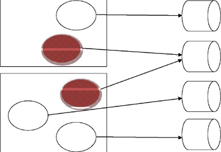

by Daniel Baronet  
(danb@dyalog.com)
{ .byline }

**Abstract** In [‘SALT: Simple APL Library Toolkit’](archive/v233/baronet.htm) and [‘SALT II’](archive/v234/baronet.pdf) the author introduced Dyalog’s toolkit for loading and saving APL scripts. Snap extends SALT by saving unscripted functions, operators, variables and namespaces as SALT scripts.
{ .abstract }

## Syntax for the SALT command line

```
Snap [path]  –class=   –convert   –fileprefix=   –loadfn[=]  –makedir
             –noprompt  –pattern= –show[=]  –vars[=]   –version
```

In the following, *object* refers to any APL object, either code (function, or operator) or data (including all namespaces).

Snap by default saves all new objects in the current namespace to the path specified as argument and saves modified objects to their proper location. It returns the list of the names of the objects that have been saved, if any. If the path is not specified then the current working directory is used.

Snap, in its present state, cannot save everything, and variables in the workspace root (`#`), function references, idioms and instances cannot be saved.

Snap uses `Save` to store objects.

## Procedure

Snap first finds the list of all objects and from those the ones that can be saved. It then determines which ones have been modified or are new. If any of them needs saving or if it cannot determine if they need to be saved (e.g. unscripted namespaces) then each one of these object is saved using `Save`.

To find out which object needs to be saved SALT marks objects (functions and namespaces) with special tags when it loads them or when they are first saved. Because `#` variables cannot be tagged they cannot be saved in canonical form on file. Variables in namespaces, on the other hand, can be saved as part of the namespace without any problem as long as they don’t contain anything ‘illegal’ like forms, `⎕OR`s, etc.

Unscripted namespaces can be saved by making them into a script, but tagging information cannot be retained and Snap will always overwrite (given permission) the existing file where they reside. Snap is non-destructive in that respect, and unless told otherwise (see below) it will keep the original unscripted form even though it writes a source for them.

## Alternate behaviour

Snap accepts a series of modifiers to alter its operation.

### Selecting the objects to save

It may be desirable to save only a subset of the workspace, for example only the functions or names starting with a specific pattern.

To select specific name classes (e.g. functions or D-ops) you use the `-class=` modifier. It takes a value of one or more classes. Acceptable classes are 3 (all functions), 4 (all ops) and 9 (all namespaces). Rational numbers are more specific, e.g. 4.1 for trad ops or 9.5 for interfaces.

To select objects following a specific pattern you use the `–pattern=` modifier. It takes a string where `*` means *any number of chars*. At the moment, the pattern matching is restricted to strings ending in `*` and stars are ignored, effectively meaning *only names starting with the string given before the star* as in `util*`[\[1\]](#ref1).

Both can be combined and the following will save all namespaces starting with `GUI`:

```
⎕SE.SALT.Snap '/ws/utils -class=9.1 -pattern=GUI*'
```

Both also accept the character `~` in the first position to exclude specified class or pattern, e.g.

```
⎕SE.SALT.Snap '/ws/utils -pattern=~GUI*'
```

will save all objects *not* starting with `GUI`.

These modifiers allow you to save various subsets of functions and namespaces to different locations. Two or more different workspaces can use the same subset, which can be updated independently of the workspaces.

## How two workspaces can share code

<figure markdown="1">

</figure>

### Verifying what will happen

If you are not sure what will happen when you use Snap you can ask it to show you which objects would be saved only. For example,

```
⎕SE.SALT.Snap '/ws/utils -class=~9 –show'
```

will show you only the names that would be saved without actually saving them.

### Changing the filenames

By default the filenames used are the same as each object’s name followed by `.dyalog`. If you wish to prefix these names by a special string you can use the `–fileprefix` modifiers. For example,

```
⎕SE.SALT.Snap '/ws/utils -pattern=GUI* -fileprefix=Win'
```

will save all new objects starting with `GUI` to files starting with `Win`, thus function `GUImenu` will be saved in file `/ws/utils/WinGUImenu.dyalog`.

### Skipping prompts

Unless your general prompting settings are set to `NO`, Snap will prompt you for replacement each time it finds a file that already exist. You will then have a choice of `Yes` to replace the file, `No` to skip that file or `Cancel` to skip the rest of the files. Snap will return only the names of the objects that have been effectively saved. If you wish to skip the prompting you can add the modifier `-noprompt`.

### Using version numbers

SALT can keep version numbers for each file. If you wish to enable that feature for the objects Snap is about to save, use the modifier `-version`. You can also specify the version number to use in which case *all* objects will be saved with the same version number.

### Creating intermediate directories

When Snap saves an object it assumes the directories in the path given as argument already exist and won’t attempt to create them. If you know they don’t exist (typically the first time you save objects) you must ask Snap to create the directories for you by using the `-makedir` modifier otherwise the command will fail.

### Converting namespaces to scripted form

When Snap saves namespaces in unscripted form it has to convert them first into scripted form in order to perform the save. It then gets rid of the converted format and keeps the original one. If you subsequently Snap the workspace it will redo the work even is no change occurred to these namespaces because they cannot be tagged to let know Snap of the changes. If you wish to retain that form use the `-convert` modifier.

### Recreating the workspace

You may be interested in recreating the workspace at a later moment in time. To do so you must remember which objects made up the workspace and bring them back one by one. Doing this by hand would be too tedious and prone to errors so Snap provides a way to do that for you.

If you use the `-loadfn` modifier Snap will create a function named `load_ws` in the same path given as argument. That function, when executed, will bring every object needed in the current workspace[\[2\]](#ref1) and run the `⎕LX`. If you want the function to exist elsewhere use `-loadfn=/new/path` instead. If the name `load_ws` does not suit you then you can change it by adding an extension.

There are two possible extensions: `.dyalog` (or more simply `.`), which will create a function, or `.dyapp`, which will create a script. Both are suitable for use by `Boot` and have the same effect. For example, to create a function named `loadit` do

```
⎕SE.SALT.Snap '/ws/myapp -loadfn=/ws/myapp/loadit.dyalog'
```

### Trick

If you have several workspaces to snap whose directory name is the same as the workspace’s name you can use `=` instead of the workspace name when specifying the target folder. For example, let’s say you want to store the workspaces in your personal library under /apl/wslib so that workspace W is stored under `/apl/wslib/W` you can use

```
)Xload W
SE.SALT.Snap '/apl/wslib/= -loadfn -makedir'
```

for each workspace without having to retype the Snap line for each workspace; simply grab the line from the session log to re-execute it after each `)XLOAD`.

## Restrictions

In its present form Snap cannot store some objects such as instances of GUI controls, or variables in #. This restriction is unlikely to be lifted soon. Idioms and function refs are another kind of object impossible to store in this version.

### Workarounds

Recreating the variables or instances upon loading the workspace (i.e. thru `⎕LX`) will always work but may not always be practical because sometimes the work involved in recreating them will be substantial. For variables another way to do this would be to store them in a separate (scripted) namespace. When the workspace is reloaded the variables are moved to the root space. There is a modifier to do just that.

This modifier, `vars`, will create a namespace with the definitions of all legal root variables and save it under the name `vars_ns`. When used in conjunction with the `loadfn` modifier the load function created will contain a statement to load the contents of the file and disperse its contents into root, effectively recreating all globals. If you prefer another name for the file you can use –vars=newname

## Epilogue

For all its elaborate definition, Snap is deceptively simple. It merely saves all new objects where specified, and modified ones where they belong. All the modifiers simply allow you to fine-tune the process.

<a id="references"></a>

## Notes

1. <a id="ref1"></a> Without the star, the pattern would be an exact match for the name specified in which case the `Save` command might as well be used.
2. <a id="ref2"></a> It will merge the objects with the existing ones in the workspace, replacing them if necessary.
