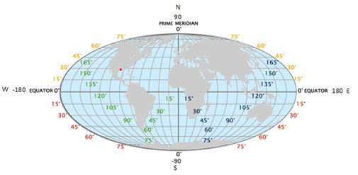

suggested by A Reader
{ .byline }

**Abstract** Writing for the DotNet world means accommodating multiple metric systems. An anonymous reader challenges you to manipulate GPS coordinates in APL.
{ .abstract }

## Introduction

DotNet languages compile to intermediate code which is run by the Common Language Runtime (CLR) [\[1\]](#ref1). This opens the field to many languages and raises the question: what advantage does one language have over another?

> Different programming languages allow you to develop using different syntax. Don’t underestimate the value of this choice. For mathematical or financial applications expressing your intentions by using APL syntax can save many days of development time when compared to expressing the same intention by using \[other languages\] [\[1\]](#ref1)

APL’s mathematical primitives and array-handling make it a powerful tool for addressing problems involving GPS (Global Positioning Systems). These days you could choose to use an APL interpreter to produce a DotNet assembly as all or part of your commercial solution.

DotNet assemblies commonly accept data in all or most of the units in common use. Programmers expect such assemblies to handle unit conversions for them, rather than requiing them to convert their data to a single metric, or match assembly to metric. APL programmers will not want to do less.

C# syntax supports a technique that can be imitated profitably in APL, namely, method- (for APL, read *function-*) *signatures*.

> The *signature* of a C# method consists of the name of the method and the number, modifiers, and types of its formal parameters. [\[2\]](#ref2)

## Signatures and valence

The APL concept of *valence* is similar: a *niladic* function takes no arguments, a monadic function takes a right–hand argument, a *dyadic* function takes two arguments, left–hand and right–hand arguments, and an *ambivalent* function that is essentially dyadic but with the left–hand argument being optional.

We can use dyadic or ambivalent functions to produce the equivalent of C# signatures: we use the left argument to specify how the right is to be understood. But functions that are to be exported as DotNet assemblies might have to be monadic, in which case we need, like a C# function, to respond to the structure of the right argument.

In C#, when a function has multiple signatures, each version is coded separately under the same name. Consider this example:

```
public static int First(int abc, int def)
{
  return (abc + def);
}
public static int First(int def)
{
  int abc = 90;
  return (abc + def);
}
```

The function `First` is coded twice; the first signature requires two arguments and the second requires only one. The function can be called either as `First(n)` or as `First(n,m)`, where `n` and `m` take any integer value.

In APL a function has but one definition, but, unlike C#, there is no constraint on the type or shape of the arguments. So APL can take a right-hand argument as a scalar, or a vector of two elements, or a vector of three elements. Effectively, this makes it possible to code with different signatures: a scalar represents an argument of one type, a vector of two elements another, and a vector of three elements yet another.

## The problem with the world

<figure markdown="1">
[](http://www.worldatlas.com/aatlas/imageg.htm)
<figcaption markdown="span">© worldatlas.com</figcaption>
</figure>

GPS is a rectangular coordinate system that allows any point on the planet’s surface to be uniquely identified through two numbers: *latitude* and *longitude*. Latitudes and longitudes are at right angles to each other only at the point of intersection (0 the equator, 0 the prime meridian) on the surface of a sphere and they share the compass directions – points above the equator are North, those below are South and points to the right of the prime meridian are East and those to the left are West.

The similarity with the planar Cartesian coordinate system ends here since the distance between a pair of longitudes different by one degree is not uniform – the distance decreases progressively when moving from the equator towards the poles.

## The data types

Latitudes and longitudes are data types, expressible in a variety of ways:

|   | Latitude | Longitude |
| --- | --- | --- |
| Degrees, minutes, seconds | 4° 14' 21"<br>-4° 14' 21" | 23° 16' 48"<br>-23° 16' 48" |
| Degrees, minutes | 4° 14.35'<br>-4° 14.35' | 23° 16.8'<br>-23° 16.8' |
| Degrees | 4.2391666667°<br>-4.2391666667° | 23.28°<br>-23.28° |

Alternatively,

|   | Latitude | Longitude |
| --- | --- | --- |
| Degrees, minutes, seconds | 4° 14' 21" N<br>4° 14' 21" S | 23° 16' 48" E<br>23° 16' 48" W |
| Degrees, minutes | 4° 14.35' N<br>4° 14.35' S | 23° 16.8' E<br>23° 16.8' W |
| Degrees | 4.2391666667° N<br>4.2391666667° S | 23.28° E<br>23.28° W |

- Latitudes are in the range -90 to 90.
- Longitudes are in the range -180 to 180
- A minute has 60 seconds; minutes and seconds are in the range 0 to 59.
- Only the first number in any numeric representation i.e. DMS, DM or D, is negative.
- Negative latitude indicates a position below the equator. Alternatively, keep the numbers positive and add the compass point S for South; N indicates a position above the equator.
- Negative longitude indicates a position left of the prime meridian. Alternatively, keep the numbers positive and add the compass point W for West; E indicates a position right of the prime meridian.

### Further notes

Latitudes and longitudes are expressed consistently across the world using DMS, DM or D; there are no localisation issues.

Rarely, 90 is added to a latitude in order to make it have the range 0 to 180; likewise, 180 is added to longitude to give it the range 0 to 360 in order to be able to work with positive numbers only and without the compass point. It is prudent to allow for this convention for incoming data. However, this approach is counter-intuitive and should not become part of a user interface as it will simply add confusion – users should be free to specify DMS, DM, or D.

## The challenge

Write four functions:

1. `COMP` converts a latitude or longitude from D, or DM, or DMS to the corresponding D, or DM, or DMS with the compass indicator, and vice-versa.
2. `CAST` converts an argument from one representation to another; for example from D to DMS or DM, from DM to D or DMS, or from DMS to D or DM. The argument and result are free of the compass point, courtesy of the function defined in the first task.
3. `LATVAL` validates an argument expressed as either D or DM or DMS as latitude; this function returns 1 for valid and 0 otherwise. The argument is free of the compass point.
4. `LONVAL` validates an argument expressed as either D or DM or DMS as longitude; this function returns 1 for valid and 0 otherwise. The argument is free of the compass point.

Obviously, the functions should cope with scalar and array arguments! Write up your solutions (code plus notes, please) – and send them to the [Editor](mailto:editor@vector.org.uk). Our panel of distinguished judges will select the most interesting for publication.

## References

1. <a id="ref1"></a> Jeffrey Richter, *CLR via C#*, 2nd Edition, Microsoft Press, February 2006, ISBN-13 978-0735621633
2. <a id="ref2"></a> Anders Hejlsberg & Scott Wiltamuth, *C# Language Reference*, Microsoft
