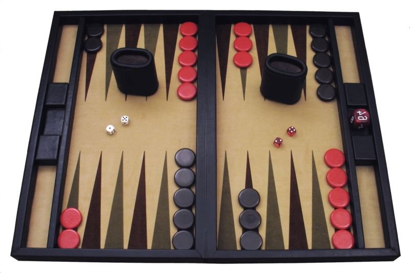

1: Bearoff expected rolls
{ .subtitle }

by Howard A. Peelle (hapeelle@educ.umass.edu)
{ .byline }

J programs are presented as analytical tools for expert backgammon [\[1\]](#ref1). Part 1 here develops a program to compute the number of rolls expected to bear off all pieces in a player’s inner board (with no contact).
{ .abstract }

{ style="width: 450px" }

The inner board is represented as a list of six integers. For example, `0 0 0 2 3 4` represents 0 pieces on the 1, 2, and 3 points, 2 on the 4-point, 3 on the 5, and 4 on the 6.

Assign a few utility names for readability:

```
ELSE =: `
WHEN =: @.
```

`Rolls`is defined for an inner board input, as in: `Rolls 0 0 0 2 3 4`. It is the master program and calls `Bearoff` or else returns a default result of `0` when all pieces are off the board:

```
Rolls =: Bearoff ELSE 0: WHEN AllOff
```

Subprograms are:

```
AllOff =: All@(Board = 0:)
  Board =: ]
  All =: *./
```

`Bearoff` is `1` plus the average of expected values for all 36 rolls:

```
Bearoff =: 1: + Average@AllRolls
  Average =: +/ % #
```

`AllRolls` computes the best expected value among all possible moves for each roll of dice – six doubles and two copies of the minimum of 15 pairs of singles rolls, as follows:

```
AllRolls =: Doubles , 2: # Min@Singles
doubles =: > 1 1 ; 2 2 ; 3 3 ; 4 4 ; 5 5 ; 6 6
singles =: > 1 2 ; 1 3 ; 1 4 ; 1 5 ; 1 6 ; 2 3;2 4;2 5;2 6;3 4;
                                       3 5 ; 3 6 ; 4 5 ; 4 6 ; 5 6
singles =: singles ,: |."1 singles
  Doubles =: doubles Best@AllMoves"1 Board
  Singles =: singles Best@AllMoves"1 Board
```

`Best` calls `Rolls` co-recursively to get expected numbers of rolls for each board and returns the minimum – effectively finding the best move:

```
Best =: Min@:(Rolls"1)
  Min =: <./
```

`AllMoves` generates alternative moves with the first die, then generates moves for each with the last die, or else moves four times repeatedly when the dice are doubles:

```
AllMoves =: (Last Moves First Moves Board) ELSE (First Moves^:4 Board)
                                           WHEN (First=Last)
  First =: {.@Dice
  Last =: {:@Dice
  Dice =: [
```

`Moves` produces a table of legal moves for each board given or else `0 0 0 0 0 0` as a default when all pieces are already off. `LegalMoves` calls `Move` and `Possibles` which calls `FromTo` to identify indices of each possible move from and to points:

```
  EACH =: &.>
Moves =: ;@(LegalMoves EACH <"1)
  LegalMoves =: (Possibles Move"1 Board) ELSE Board WHEN AllOff
    Possibles =: FromTo Where FromTo OK"1 Board
      FromTo =: On ,. On-First
      Where =: #~
        On =: Points Where Board > 0:
      OK =: Off +. Inside +. Highest
        Inside =: Last > 0:
        Off =: Last = 0:
        Highest =: First = Max@On
          Max =: <./
```

`Move` adds 1 to the point to move to and subtracts 1 from the point to move from:

```
Move =: Board + To - From
  From =: Points e. First
  To =: Points e. Last
  Points =: 1: + i.@6:
```

Although these programs generalize easily to the full 24-point backgammon board, they are intended only as prototypes – not for practical use. (See Appendix for an efficient program.)

`Rolls` may be used to compute the number of expected rolls for any number of pieces on any points in the inner board. For example:

```
   Rolls 0 0 0 1 1 1
2.48642
```

So, it takes about two and a half rolls to bear off these pieces on the 4, 5, and 6 points.

Beware: Since multiple recursion is extremely inefficient here, input boards with more than a few pieces will be impractically time-consuming. Accordingly, `Rolls` should be re-defined to look up expected values from a database produced by the script in the Appendix below.

## Problem

As a simple illustrative problem, compare the well-known end-game cases of bearing off one piece on the 1 point and one on the 6 point vs. one piece on the 2 and 5 points. Since

```
   Rolls 1 0 0 0 0 1
1.58642
   Rolls 0 1 0 0 1 0
1.47531
```

the latter is better.

Now consider using `Rolls` to decide the best move for a roll of `6 1` in the position `0 2 2 2 0 4`. (Problem 487 in [\[2\]](#ref2).)

Answer: Play 6-Off, 6-5 (not 6-Off, 2-1) since

```
   Rolls 0 2 2 2 1 2
5.30267
   Rolls 1 1 2 2 0 3
5.40427
```

## Acknowledgements

Thanks to the *Vector* reviewer for testing these programs and for helpful suggestions.

Special thanks to friend and colleague UMass Computer Science Professor Paul Utgoff for years of enjoyment and sparkling discussions of backgammon and programming.

## References

1. <a id="ref1"></a> For an introduction to backgammon, see [http://en.wikipedia.org/wiki/Backgammon](http://en.wikipedia.org/wiki/Backgammon)
2. <a id="ref2"></a> Bill Robertie, *501 Essential Backgammon Problems*, Cardoza Publishing, New York, 2000
3. For on-line backgammon gaming, see [www.GammonVillage.com](http://www.gammonvillage.com/)

## Appendix

Script for backgammon bearoff (with no contact) to build list of all 54264 `ncodes` and corresponding list of `ns` using base-16 coding for all inner boards (6 points):

```
Build =: verb define                            NB. Build (6)
boards =. (6#16) #: i.16^6
boards =. boards Where (+/"1 boards) <: 15      NB. select real boards
ncodes =: 16 #."1 boards                        NB. base-16 codes
ns =: (#ncodes) $ 0                             NB. Initialize
N"1 boards                                      NB. Update all ns
)
N =: verb define                                NB. N (6 integers)
code =. 16 #. y
index =. ncodes i. code
n =. index { ns
if. n=0 do. n =. Rolls y
             ns =: n index} ns                  NB. Update n in ns
end.          n
)
  ELSE =: `
  WHEN =: @.

Rolls =: Bearoff ELSE 0: WHEN AllOff
  AllOff =: All@(Board = 0:)
    Board =: ]
    All =: *./
  Bearoff =: 1: + Average@AllRolls
    Average =: +/ % #
    AllRolls =: Doubles , 2: # Min@Singles
doubles =: > 1 1 ; 2 2 ; 3 3 ; 4 4 ; 5 5 ; 6 6
singles =: > 1 2;1 3;1 4;1 5;1 6;2 3;2 4;2 5;2 6;3 4;3 5;3 6;4 5;
                                                           4 6;5 6
singles =: singles ,: |."1 singles
  Doubles =: doubles"_ BestN@AllMoves"1 Board
  Singles =: singles"_ BestN@AllMoves"1 Board

BestN =: Min@:(N"1)                      NB. calls N co-recursively
  Min =: <./
AllMoves =: (Last Moves First Moves Board) ELSE
                           (First Moves^:4 Board) WHEN (First=Last)
  First =: {.@Dice
  Last =: {:@Dice
  Dice =: [
  EACH =: &.>
Moves =: Unique@;@(LegalMoves EACH <"1)
  Unique =: ~. ELSE ,: WHEN (#@$ < 2:)
  LegalMoves =: (Possibles Move"1 Board) ELSE Board WHEN AllOff
    Possibles =: FromTo Where FromTo OK"1 Board
      FromTo =: On ,. On-First
      Where =: #~
        On =: Points Where Board > 0:
      OK =: Off +. Inside +. Highest
        Inside =: Last > 0:
        Off =: Last = 0:
        Highest =: First = Max@On
          Max =: >./
    Move =: Board + To1 - From1
      From1 =: Points e. First
      To1 =: Points e. Last
      Points =: 1: + i.@6:
Build 6                      NB. 43 minutes on Octiplex PC running J6.01
NB. Now #ns is 54264
NB. Next run bgn.ijs
```

Script `bgn.ijs` re-defines program `N` to compute expected number of rolls efficiently using `ncodes` and `ns` .

```
load 'jfiles'
jcreate 'bgns'
ncodes jappend 'bgns'
ns jappend 'bgns'
N =: verb define                         NB. N (inner board)
code =. 16 #. 6 {. y
index =. ncodes i. code
n =. index { ns
)
NB. Now use N for fast look up
NB. Example: N 0 0 0 0 0 1 is 1.25
NB. Example: N 0 0 0 2 3 4 is 6.56681
```
