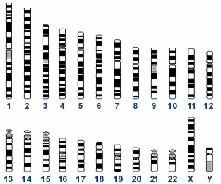
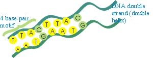
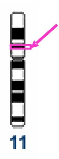
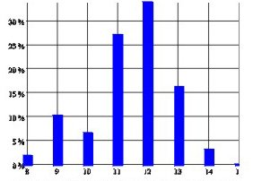
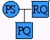
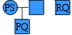

by Charles Brenner  
(chb@dna-view.com)
{ .byline }

**Abstract** Biology and biological data, unlike engineering data, are inherently irregular, incomplete, and inaccurate. The author exploits the nimbleness of APL to identify criminals, fathers, World Trade Center and tsunami victims, and determine race using DNA in a world of fast-changing DNA identification technology.
{ .abstract }

## Introduction

By the late 1980s DNA was well toward replacing serology as a far superior method of genetic testing, new technological frontiers were consequently opening up, and I was glad for the chance to put behind me ‘programming for hire’ in APL development, business applications, or whatever, and to turn exclusively to finding ways to merge my interests in computers, mathematics, and science.

The essence of the genome is a sequence of 3×109 base-pairs, the bases (nucleotides) being A, C, G, T and the pairs being A-T (or T-A) and C-G (or G-C).

Note that there is pairing at two levels: the chromosomes are paired in that there are two of each number, which is physically significant during cell division and reproduction and genetically significant because most genes occur in two copies. Second, the DNA strand in each chromosome is a double strand (double helix), with the sequence of A, C, G and Ts on one strand mirrored by a complementary sequence of T, G, C and As on the other by the pairing rule. During cell division the strands separate and each single strand then serves as a template to recreate a copy of the original double strand.

The human genome consists of 46 chromosomes. There are two each of 1-22, the autosomal chromosomes. XX or XY are the two sex chromosomes.

<figure markdown="1">

<figcaption markdown="span">The human genome</figcaption>
</figure>

An average chromosome is about 100,000,000 base pairs long. A gene is a small subset of a chromosome, typically a few thousand base pairs. Any random error in the sequence is likely to incapacitate the gene and in turn the organism; consequently there is relatively little variation in the genes among individuals.

<figure markdown="1">

<figcaption markdown="span">Fragment of a gene</figcaption>
</figure>

<figure class="right" markdown="1">
{ style="height: 105px" }
<figcaption markdown="span">Locus TH01 in chromosome 11</figcaption>
</figure>

By contrast the genome is replete with junk DNA, variations in which carry no survival penalty and therefore a lot of variation has accumulated over time and can be used to distinguish individuals. Traditional (time span = handful of years) [locations](http://dna-view.com/pcrtable.htm) [\[1\]](#ref1) (*loci*, singular *locus*) in the genome, sometimes called *pseudogenes* are thus employed. The locus TH01 (near the gene for tyrosine hydroxylase) is defined as a particular stretch of about 200 bases at 11p15.5 – chromosome 11, the p or short arm, within band 15.

The ‘business’ part of TH01 consists of 6 to 11 short tandem repeats (STRs) of the same 4-base motif (tetramer): AATG, e.g.

AATGAATGAATGAATGAATGAATG

The variant forms, called *alleles* (analogous to isotopes or isomers) vary between individuals and also between the two chromosomes of a pair within an individual. For example, a person can have a TH01 type of 8,10.

A DNA profile is typically 13 or so loci: (\{13,15\}, \{28,28\}, \{8,10\}, …). Alleles vary greatly in frequency, average being around 1/5. The average match probability between unrelated people is therefore 0.1 per locus, 10-13 for a profile. Hence near-certain association of criminals with crimes.

<figure markdown="1">

<figcaption markdown="span">Allele frequencies at D16S539 among 202 Caucasians</figcaption>
</figure>

Naturally all this leads to myriad opportunities for computer tools to assist the DNA analyst. Biology and biological data, unlike engineering data, are inherently irregular, incomplete, and inaccurate and software must therefore be forgiving. For this reason and others there are many technical complications.

### Programming note

[DNA•VIEW](http://dna-view.com/dnaview.htm) [\[2\]](#ref2)(the package containing my 20 years of software development) includes 1000 or so population samples for various populations and loci. There is a menu with names for each, each name of course multi-part. Therefore I have found it very convenient to use an idea I learned from [Eric Lescasse](http://www.lescasse.com/) [\[3\]](#ref3) and extended myself for menu selection.

- *context selection* – as the user types characters, the menu shrinks to items that contain – not merely begin – with the typed phrase. To this I have added some elaborations of my own:
- *multi-phrased* – if the next character creates an impossible phrase, then the program tries splitting the input into two phrases and limits the list to items containing both phrases. There is a user keystroke (Tab) to force phrase-splitting but in practice is never necessary. Stream-of-consciousness typing gets the job done. If I want to find the Iraqi data compiled by the Amsterdam lab on locus D18S51 named: *D18S51 STR Amsterdam Iraqi 70 03/03/27 2pm* I can type `amstd18iraq` or `iraqd18` or many other possibilities.
- *case-observant but forgiving* – the list shrinks irrespective of the case entered, but the bounce bar (indicating the entry that will be chosen if *enter* is pressed) prefers an entry that matches case.
- *wandering bar* – the bounce bar tends to move around as you type more characters, on the theory that if it were already sitting on the desired choice you would have stopped typing.
- *multi-mode operation* – mouse click or arrow movement are always permitted of course.

## Kinship identification

Besides individual variation, which DNA shares with fingerprints, DNA has another property of great utility for identification. It is inherited. Moreover, the rules of inheritance for DNA traits are extremely simple. Remember recessive genes? Incomplete penetrance? Forget them. With DNA you can see right down to the basics, every system is (well, nearly every – nothing in biology is regular) a co-dominant system. There is virtually no distinction between *phenotype* (what you can see) and *genotype* (what’s on the chromosome).

### Mendelian inheritance

Autosomal loci are inherited by the child from the parents, randomly getting one of the two alleles from each parent. That’s it. That’s the Mendelian model, though as G.E. Box said, all models are wrong (but some models are useful). Sometimes we need to acknowledge –

### Mutation

Occasionally (1/200 – 1/2000) an [\[4\]](#ref4) allele will gain or lose a single motif from parent to child. Rarely more. Very rarely, a less regular change.

## Paternity testing

The classic paternity question is to collect some genetic information (DNA profiles) and ask which of the two pedigrees below better explains the data. In the following, PS = mother, PQ = child and RQ = man.

<table>
			<caption style="font-size: 1.4em; font-style: normal; line-height: 2em;">
			</caption>
			<tbody>
				<tr>
					<td style="padding: 0.5em 1em; text-align: left;">
						
					</td>
					<td style="text-align: left">
						<em>Explanation 1</em> 
						<strong>man is father</strong>
					</td>
					<td style="text-align: left">
						(2ps)(2qr)(¼) event
					</td>
				</tr>
				<tr>
					<td style="padding: 0.5em 1em; text-align: left;">
						
					</td>
					<td style="text-align: left">
						<em>Explanation 2</em> 
						<strong>man is not father</strong>, his Q is coincidence
					</td>
					<td style="text-align: left">
						(2ps)(2qr)(½q) event
					</td>
				</tr>
			</tbody>
		</table>

The Likelihood Ratio for paternity is 1/(2q). If q=1/20, the data are 10 times more characteristic of the ‘father’ explanation

There are [a few simple formulas](http://dna-view.com/patform.htm) [\[5\]](#ref5), such as 1/q, for paternity analysis that are well known to people in the business.

## Kinship testing

Ten years ago I decided to try solving a more general problem – given any two pedigree diagrams relating any set of people, to decide with DNA data which set of relationship is supported by the data (and by how much). It was difficult and I was only able to make progress on it when I hit on the idea of making all the [computations algebraically](http://dna-view.com/kinship.htm#symbolic) [\[6\]](#ref6).

Implementation of this idea is simple. Whereever the original program might add two or more probabilities, for example `+/P`, the new program simply used instead a defined function: `Plus/P`. The formulas in question turn out to be polynomials in n+1 variables (p, q, … for the frequency of each mentioned allele P, Q, …, plus one symbol, z, for the total frequency of all other alleles), hence the data structure to represent a polynomial is two arrays: a matrix of exponents with a column per variable and a row for each term, and a vector of coefficients for each term. It is easy to write `Plus, Times, Simplify` (collapse like terms), Over (divide two polynomials and remove common factors) and one function that turns out to have remarkable properties, `UnZ`, which removes all the instances of the variable z in favor of the equivalent expression 1-p-q-… . This is necessary because z should only occur internally; the user doesn’t expect to see it. What is remarkable is that `UnZ` very much reduces the complexity of the polynomial. Dozens of terms reduce to a few. Still, the resulting expressions are funny-looking, wrapping to several lines when applied to an irregular collection of people who are hypothesised to be half-siblings, uncles, cousins, and inbred.

## Body identification

It turned out that my toy found numerous practical applications. One of them is body identification: is the DNA profile for this corpse related or unrelated to reference father, sister, and aunt profiles? By 2001 the program and I had a sufficient reputation for this kind of problem that on September 12, when I managed to check my e-mail in London, I had an inquiry from the New York Office of the Chief Medical Examiner explaining that they foresaw a problem on which I would be able to help. Thus began a long saga including hundreds of difficult kinship identifications.

A new problem that arose was to sort out the thousands of DNA profiles arising from the [World Trade](http://dna-view.com/wtcdiary.htm) [\[7\]](#ref7) attack – the victim profiles from anonymous bodies, versus the reference profiles from relatives or toothbrushes. Given a suspected identity it is all very well to use the Kinship program to test it, but kinship testing is inherently manual (the pedigree information is neither uniform nor accurate) so it is not practical to use the kinship program a million times with the wrong assumptions.

## Disaster screening

Therefore it was apparent that a special ‘screening’ program would be needed. Thousands of profiles – maybe only hundreds in the beginning – uncertain information about the true family structures, toothbrushes shared, poor quality DNA leading to deficient profiles – clearly experimentation would be needed in order to discover heuristics that would usefully find probable candidate identities. You are ahead of me: an application tailor-made for APL.

As would you, I said, “Give me the data and I’ll produce the identities in hours.” And so it was, though it took a week or two to surmount bureaucratic hurdles and procure the data.

A work flow soon developed wherein new DNA profiles, obtained by various contracted laboratories, were funneled to me bi-weekly, I ran them through the constantly revised screening program, and passed the results to another software firm that installed them into a database at the OCME where caseworkers used Kinship and other tools to make final decisions on identification. This pattern continued for two years; eventually the flow of new DNA profiles, new information, and new identifications dried up.

## Racial discrimination

I’ll mention one more among the many interesting ideas that arise from DNA analysis, and that is the idea to [determine race from DNA](http://dna-view.com/race.htm) [\[8\]](#ref8). The obvious idea may be to find the ‘black’ or ‘Chinese’ genes, but that is difficult, perhaps impossible, and entirely unnecessary.

Instead, several people besides myself noted that all of the minor or moderate variations of allele frequencies among populations are clues to source of origin. If a crime stain (e.g. semen of a rapist) includes an allele that is 20% more common among population X than population Y, then that is a slender clue supporting population X as the origin. Accumulated over 26 alleles this evidence is [likely to be very powerful](http://dna-view.com/news20.htm#racial%20origin) [\[9\]](#ref9).

Particularly, 10 years ago I had an advantage over other researchers, thanks to my wide international customer base, of having handy lots of population data. Plus I speak APL. Consequently I was able, mainly by rapidly going through many computer experiments, to find the successful way (whose theoretical basis in population genetics I didn’t then understand) to extract the racial inferences from DNA profiles. This is occasionally useful in police investigations, but more than that it is interesting in shedding light on human migratory history and also it turns out to have important application in regulating horse racing.

## Programming notes and acknowledgements

I am grateful for the generosity and selfless collegiality of the APL community. In particular, Don Lagos-Sinclair completed my inept attempt to write my menu selection method in APL+WIN, Davin Church has shared his SQL tools and has worked hard to help me understand as have Morten Kromberg, Eric Lescasse and Adrian Smith. In addition there are many individuals who contribute to and encourage my learning simply by their contributions at the conferences.

I don’t have a lot to offer in return. My days at the forefront of computer literacy probably expired about 1963. I would of course be glad to share the utilities or the ideas behind them that I have developed, though I don’t have any code in shape to include as a workspace. Adrian’s wry comment a few years ago that Rex’s utilities are typically about 90% complete would need to be revised negatively for my stuff as it stands.

I would, though, like to recommend a package that John Walker pointed out a few years ago, namely a free but very professional installer package called Inno Setup and a companion macro preprocessor called ISTool. Examination of the script file \[omitted\] that I use to create an install file for DNA•VIEW will give you an idea of its capabilities, and to the extent that I have learned some of the ins and outs of using it I will be glad to answer questions from any APLer who wishes to call or e-mail to me.

## References

1.  [http://dna-view.com/pcrtable.htm](http://dna-view.com/pcrtable.htm)
2.  DNA•VIEW [http://dna-view.com/dnaview.htm](http://dna-view.com/dnaview.htm)
3.  Eric Lescasse [http://www.lescasse.com](http://www.lescasse.com)
4.  [http://dna-view.com/mudisc.htm](http://dna-view.com/mudisc.htm)
5.  [http://dna-view.com/patform.htm](http://dna-view.com/patform.htm)
6.  [http://dna-view.com/kinship.htm#symbolic](http://dna-view.com/kinship.htm#symbolic)
7.  [http://dna-view.com/wtcdiary.htm](http://dna-view.com/wtcdiary.htm)
8.  [http://dna-view.com/race.htm](http://dna-view.com/race.htm)
9.  [http://dna-view.com/news20.htm#racial%20origin](http://dna-view.com/news20.htm#racial%20origin)
