by Ajay Askoolum
{ .byline }

APLNext has a brand new APL product, Visual APL (VA). My initial exploration of VA is based on version 1.0 of the released product; this is also available for evaluation as a free time-limited version – see [aplnext.com](http://www.aplnext.com/) and [apl2000.com](http://www.apl2000.com) for further details.

By way of clarification, the phrase ‘next generation’ in the title serves a dual purpose:

- It signals a radical new beginning for APL that does not lose sight of its origins.
- It heralds a new approach to APL application development, using managed code and the same integrated development environment (IDE) as the contemporary flagship development language C#.

VA heralds a revolutionary new generation of APL: its IDE is Microsoft Visual Studio 2008 (VS2008), it produces Common Language Runtime (CLR) assemblies, and, although it does not have a workspace, it retains mainstream compatibility with 32-bit Windows (legacy) APL+Win language semantics, including control structures. In short, VA takes to the .Net environment all the features of APL+Win except its special requirements such as the bespoke IDE, workspaces etc. At the same time, it confers the benefits of .Net to APL. VA is compliant with the ISO/IEC 13751 international standard for array languages.

The tag *legacy* is enigmatic since APL+Win is available with active support and undergoing further development; APL2000 released version 9.1 in June 2009.

## Visual APL and VS2008

As Figure 1 shows, VA offers two pathways into VS2008 for .Net assemblies, Cielo Explorer for Visual Studio (CE) and Visual APL (VA); *Cielo* translates as heaven or sky.

<figure markdown="1">
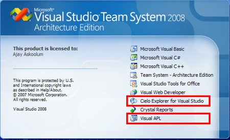
<figcaption markdown="span">Figure 1: Visual APL – a native .Net language (Yes, this is APL!)</figcaption>
</figure>

VA requires VS2008, which uses .Net Framework 3.5 by default. The VA installation automatically configures VS2008, including its menus and tools. VA requires activation via the Internet in order to enable code compilation to .Net assemblies. A permanent Internet connection is not a prerequisite after activation; this is a welcome feature, especially for laptop users.

There is a comprehensive set of help files on VA and VS2008; these are accessible via the help icon in the CE toolbar. The help files contain a tutorial on VA, which should appeal to existing and new APL developers alike. VA’s customisation of VS2008 is non-intrusive; that is, it does not override any standard features such as shortcut keys etc. I can understand the complexity of redefining a standard VS2008 shortcut key such as F1.

VA is like C# and its solutions[\[1\]](#ref1) can incorporate C# code. Any Component Object Model (COM) aware language can use an ‘interop’ class library (or Dynamic Link Library (DLL) written in VA; VS2008 projects can use assemblies (non-interop DLLs) directly.

It should come as no surprise that there is a new jargon to contend with; although this is not a tutorial, an elementary grasp of the recurring .Net/VS2008 jargon is relevant.

Namespace
:   A namespace is analogous to a directory but it contains other namespaces and classes. A VS2008 C# solution does not require a namespace but it is recommended as a means of organising a logical grouping of names or identifiers as this empowers the developer to keep control and to avoid name collisions. Unlike a folder, a namespace does not exist physically; it exists in memory at run time.

Class
:   A class is a child of a namespace. A class may contain other classes but always contains member elements. A class has properties, that is, data that the class exposes. A class also has behaviours, that is, functionality or methods/functions, and events.

Type
:   A class is a type; however, the term *type* describes modular units used to build an assembly, that is, classes, predefined or internal CLR types, delegates etc.

Object
:   An object is an instance of a class, that is, it exists at runtime only; an object cannot modify the class whose instance it is, rather, it uses the class as a black box.

Member
:   The properties and behaviours of a class are its members.

Solution
:   A solution is Microsoft’s term for the collection of all the building blocks that produce an assembly. Erstwhile, the common terminology was project.

Assembly
:   An assembly is what a solution produces, an EXE or a DLL, and what the CLR uses to execute the application.

Scope
:   This term defines the lifetime of a variable: that is, the scope of a variable is the block of code in which it exists. In C#, this means within the braces that follow a function name. A variable defined within a class but outside of any functions within it has the whole class as its scope; this is also known as a field.

### The Visual Studio factor

What does Visual Studio do for APL?

- It makes APL a mainstream programming language, in the same context as the flagship C# language.
- It removes the obstacle of the learning curve that a bespoke IDE imposes on developers of another .Net language who want to include APL in their arsenal of skills. There are more .Net than APL developers.
- It adds transparency to the management of APL source code: VS2008 deals with APL source code much as it deals with, say, C# code. This includes version management using any source code-management software that integrates with VS2008, including Visual Source Safe and Source Vault.
- It permits neither the saving of the runtime state of an application nor of arbitrary and complex data – in or out of scope. Notoriously, the APL workspace saves objects (such as namespaces), variables and even the dynamic execution stack – that is, the state of memory, which cannot be easily recreated.
- VS2008 has facilities for producing documentation in Extensible Markup Language (XML) format from inline code comments found in the code files; add-ins produce help (CHM) files from the XML files.

### Is it APL?

The salient characteristics of APL are that it is a language based on symbols, is a dynamically-typed language, has an interactive development environment, and processes vectors and arrays, simple or nested, naturally. Yes, VA is APL in all these respects but there are crucial differences: it does not have a workspace, the localisation rules are reversed, that is, the inclusion of a name in the header makes it global, and index origin is zero by default. Remarkably, it is possible to mix APL and C# code in APL functions: mixed-language programming is a reality with VA – see Figure 2.

<figure markdown="1">
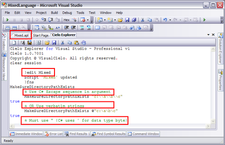
<figcaption markdown="span">Figure 2: Mixed-language programming</figcaption>
</figure>

The code for the function `MakeSureDirectoryPathExists` is shown in Figure 3.

<figure markdown="1">
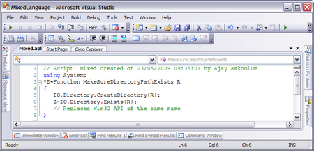
<figcaption markdown="span">Figure 3: Mixed code</figcaption>
</figure>

The mixed-language reality applies to *both* the APL code and the semantics for calling the code.

VA places APL squarely into the mainstream software development arena and without the handicap of built-in proprietary functionality such as a bespoke development environment, runtime system, and hybrid quad functions that act as wrappers for system resources.

### Legacy comparison

As mentioned, VA does not have a workspace; its code is stored in Unicode text files managed by VS2008. Native files are supported, albeit they are superfluous as the C# file management facilities are superior, and component files – renamed Share File System – are available but are incompatible with corresponding APL+Win component files. VA and APL+Win cannot read each other’s component files.

VA uses the same keyboard mapping for APL symbols as APL+Win but the APL fonts are different – VA uses a Unicode font. The IDE provides support for pasting APL+Win code into VA projects – the menu option `Edit | Paste` APL+Win copies APL+Win code from the keyboard and remaps the fonts seamlessly. This menu option is doing something subtle and intricate – it copies the code from other APL interpreters mostly correctly too.

Legacy APL uses the semicolon for one purpose alone, namely to separate names in function headers. Names included in the header disappear as soon as the function goes off the execution stack; names not included in the header but created within the function persist. VA retains this convention but in reverse: names included in the header persist and all other variables are local. In other words, in VA the semicolon reverses the localisation rules.

In legacy APL, index origin, `⎕io`, is 1 by default. In VA, it is 0 by default, in common with C#. Variables are local by default; however, there is a new syntax – that is, deliberate coding is required – for creating global variables.

Contrary to what might be the initial reaction to these changes, the impact on migration can be minimal, depending on the quality of the existing code. There are tools provided when Visual APL is installed for migrating legacy applications, workspaces, and component files into the managed code environment.

<dl>

			<dt>APL Font</dt>
			<dd>
				VA uses a Unicode font that supports all the APL characters; there are two
				new symbols, <code>≅<!--approx =--></code> (<em>approximately equal to</em>) and
				<code>ƒ</code> (<em>guilder</em>). In addition, <code>=</code> (<em>equal
				to</em>) is no longer a comparison but an assignment operator – the comparison
				operator is <code>==</code>, as in C#. As far as I can see, there is a
				single instance where APL symbols create a conflict within VS2008. APL uses
				semicolon both to separate names in APL function headers and as a statement
				terminator in C#.
			</dd>

			<dt>APL keyboard</dt>
			<dd>
				VA uses the same keyboard layout and shortcuts as APL+Win and the APL
				symbols are accessible via the Alt key. The key combination
				<code>Alt+F</code> produces <code>ƒ</code> and <code>Alt+5</code> produces
				<code>≅<!--approx =--></code>.
			</dd>

			<dt>Data typing</dt>
			<dd>
				<p>
					VA introduces a number of new data types – see Table 1 - and manages the
					interface between the dynamically- and strongly-typed arenas seamlessly;
					however, this presents a new learning curve for the developer accustomed
					to legacy APL.
				</p>
				<table class="left">
					<caption>Table 1: Visual APL data types</caption>
					<thead>
						<tr><th>Code</th><th>Description</th><th>Comment</th></tr>
					</thead>
					<tbody>
						<tr><td>11</td><td>Boolean (true/false, not bit)</td><td>No longer indicates binary data</td></tr>
						<tr><td>81</td><td>Bytes</td></tr>
						<tr><td>82</td><td>chars (compatible with 82 in existing system)</td></tr>
						<tr><td>83</td><td>String (compatible with 82 in existing system)</td><td>These types correspond to the CLR predefined types.</td></tr>
						<tr><td>163</td><td>short (Int16, 16-bit integer)</td></tr>
						<tr><td>164</td><td>Ushort (UInt16, unsigned short)</td></tr>
						<tr><td>323</td><td>int (Int32, 32-bit integer, default)</td></tr>
						<tr><td>324</td><td>uint (UInt32, unsigned int)</td></tr>
						<tr><td>325</td><td>float (Single, 32-bit real)</td></tr>
						<tr><td>643</td><td>long (Int64, 64-bit integer)</td></tr>
						<tr><td>644</td><td>Ulong (UInt64, unsigned long)</td></tr>
						<tr><td>645</td><td>double (Double, 64-bit real, default)</td></tr>
						<tr><td>1285</td><td>Decimal (128 bit real)</td></tr>
						<tr><td>807</td><td>Object (serialized object)</td></tr>
						<tr><td>99999</td><td>no code available for data type</td><td>This facilitates error trapping.</td></tr>
					</tbody>
				</table>
				<p>
					The type of a variable can be queried using the C# method
					<code>GetType()</code> or <code>⎕dr</code>; the latter is incompatible
					with its legacy counterpart. Consequently, there is another hurdle to
					porting legacy applications, namely, <code>'wrapl' ⎕dr</code> and
					<code>'unwrapl' ⎕dr</code> cannot be used to transfer data
					because the APL+Win serialisation is proprietary to the Win32 environment.
					However, VA
					offers the facility for representing its data, including numeric and
					heterogeneous arrays, in XML format; therefore, if migration is an issue,
					APL+Win needs to render its data using the same schema so that VA can read
					it. The XML form of variables is held in a file and can be edited within
					VS2008 and any changes are automatically reflected in the session. Refer
					to the <code>)xmlout</code> system command in the VA help file or research
					<em>serialization</em> in C# for background information.
				</p>
			</dd>

		</dl>

### Benefits of the radical departures from legacy APL

An experienced APL developer might instinctively condemn the design of VA as a betrayal of the legacy of APL. However, I take a very different stance – I applaud the design decisions for the following reasons:

<figure class="left" markdown="1">
{ style="width: 90px" }
</figure>

- The direct implication of the design is that legacy applications cannot simply be migrated into the new environment; that is the catalyst for modernising legacy applications.
- For too long APL developers have indulged in creating applications that are a homogeneous tangle of the presentation, data, and business tiers which have proved notoriously difficult to maintain and modernise.
- APL developers need to learn to integrate standard solutions – written, debugged, and maintained by Microsoft and others at their own cost – into APL applications in order to give the applications a generic look and feel. It is time APL utility functions that re-invent readily available solutions were relegated to history.
- It is no longer economically viable for APL applications do things in a different way; modern applications have a transparent design that focuses on the ease of maintenance, or evolution, and the acquisition and transfer of data.
- The intrinsic credentials of legacy APL, strong and legitimate as they are, has long ceased to sway decisions in favour of APL.
- This APL fully acknowledges the prior experience of newcomers to the APL language. For example, .Net developers’ understanding of VS2008, application design, scoping, and general experience of .Net classes transfers directly to VA.
- Equally, APL developers can use their experience of core APL with VA. The Cielo Explorer provides an interactive immediate mode for APL as a tool of thought. Support for legacy features such as component files and `⎕wi` means that APL developers can be readily productive in the new development environment. With experience, developers should gradually learn to favour and adopt platform solutions.
- With VA, applications have the same characteristics as any other VS2008 application; the specialist requirements of legacy APL, such as workspaces, component files and a dedicated runtime system, simply do not apply; there is no stick with which to bludgeon APL. VA assemblies require .Net Framework 3.5 and other DLLs.
- Perversely, the incompatibility of the Share File System with component files is also welcome. The .Net platform offers ADO.NET for access to databases, which provide open access to application data whereas component files blocked open access; this will prompt a redesign of legacy APL applications. Although it is expedient to hold data as arrays within an APL, the nature of data is scalar in other languages that are growing in influence.

#### Getting started

VA is a new product working within an IDE that may also be completely new to traditional APL developers.

<figure class="right" markdown="1">
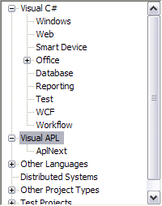{ style="width: 200px" }
<figcaption markdown="span">Figure 4: Language options</figcaption>
</figure>

In VS2008, `File | New Project` offers the language options shown in Figure 4.

Installation places documentation for VA in a folder `Documentation`. The document `tutorial.chm` provides a general overview of VA.

Webcasts and other worked examples can be found on the APL2000 Forum. [\[2\]](#ref2)

#### Visual APL pathways

As far as I can make out, VA offers several options for using APL in VS2008.

- The migration of existing APL applications to a managed code environment with little disruption; this includes native and component files and Win32 Graphical user interfaces. VA supports all the quad functions, including `⎕wi`, with the same familiar syntax; however, such functionalities are implemented in new managed code class libraries – the Visual APL foundation class libraries.
- The Lightweight Array Engine (LAE) describes the core VA foundation classes that can be included in .Net projects; this makes APL array facilities directly available to non-APL VS2008 projects.
- Cielo Explorer is available from any VS2008 project with the menu option `View | Other Windows | Cielo Explorer`. This option provides interactive APL and the facility for producing script files. Code that is written in script files can be debugged and tested in CE and pasted into files belonging to other VA templates.

VA provides templates for types of projects; see Figure 5.

<figure markdown="1">
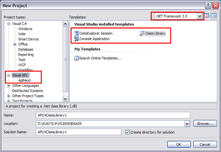
<figcaption markdown="span">Figure 5: Visual APL templates</figcaption>
</figure>

The CieloExplorer Session exposes another set of templates, see Figure 6. This is slightly confusing as it is another type of project: see Figure 4.

<figure markdown="1">
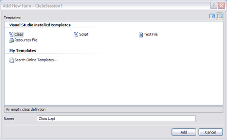
<figcaption markdown="span">Figure 6: CieloExplorer Session templates</figcaption>
</figure>

#### Cielo Explorer

With an active installation (an Express version that has not expired or the commercial product) of VA, CE is available with `View | Other Windows | Cielo Explorer` in VS2008 at any time, even when the project is not based on VA.

CE is the closest thing that is available to an interactive APL session with an important difference: the session itself *cannot* be saved as the ubiquitous workspace but only as a Unicode text file. However, functions and variables may be defined in script files, which can be opened and saved, and with the use of the Visual APL Lightweight Array Engine (LAE), incorporated as late-bound executables in any .Net project. CE serves as an interactive APL workbench for developing and debugging APL code destined for incorporation into a class file, consistent with the way VS2008 works. Figure 7 shows an interactive session.

<figure markdown="1">
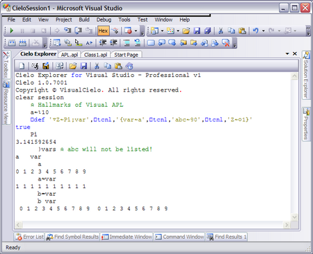
<figcaption markdown="span">Figure 7: Hallmarks of Visual APL</figcaption>
</figure>

The major surprises are:

- Index origin `⎕io` is zero by default; see the value of variable `a`.
- Semicolon globalises variables; `var` appears in the header of function `Pi` but is available in the session after the function has run.
- A pair of braces following the header defines the scope of variables; thus, the scope of `abc` does not extend into the session.
- The comparison operator `=` serves a new purpose, see ‘[Assignment by value and by reference](#145)’.

#### A note on multi-language programming

Although VS2008 hosts a number of different languages, any project can incorporate literal code from just one language at a time; compiled code from another language can be incorporated either by including a reference to its assembly or by including the project itself.

This applies to VA too. However, VA shares the characteristics of C# and does allow the incorporation of C#-like code into VA script and project files. Although C# does not understand anything about APL, VA does integrate C# concepts.

- C# and VA are both case-sensitive.
- The order of execution is different. VA works from right-to-left but C# has a hierarchy of operator precedence and is more complex. Figure 8 shows the evaluation of the same expression in Cielo Explorer and the Immediate Window of VS2008: tempting as the conclusion is, VA and C# do not work in the same way.

<figure markdown="1">
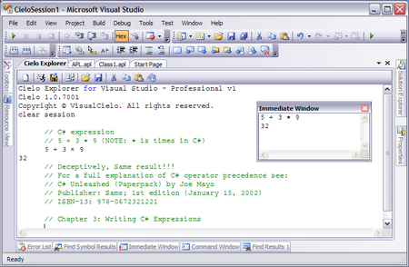
<figcaption markdown="span">Figure 8: Order of execution</figcaption>
</figure>

- Both languages have reserved typewriter symbols (C# has `/*`, `@` etc) and VA has its own symbol set. In a VA project incorporating C#-like code, the APL symbols override the C# meaning. Thus, `/` is *scan/select* and never *divide* as in C#.

- C# uses `\` for starting an escape sequence; for example, `\r\n` embedded within a string will be interpreted as carriage return followed by linefeed.

- Verbatim strings – that is, strings declared with prefix `@`, see below – confer no intrinsic meaning to escape sequence characters.

- C# uses `//` for a comment; this works like the APL. Multi-line comments are enclosed within the `/* */` pair. With VA ensure that either pairs of characters are followed by a space in order to avoid confusion with the corresponding APL operators.

- Both VA and C# use square brackets for indexing but VA uses semicolons to separate the indices, whereas C# uses comma.

- C# uses double quotes for enclosing literals of type *string* and single quote for enclosing data of type *char*. VA can use single and double quotes interchangeably within an APL context but in some contexts, it needs to follow the C# convention. Consider the following examples:

    C#
    :   <code>System.IO.Directory.GetFiles("C:\\AJAY","\*.\*",<br>
        							     
        							     
        							     
        							System.IO.SearchOption.AllDirectories)</code>  
        Unrecognized escape sequence  
        Errors because the first argument should be either `"C:\\AJAY"` or `@"C:\ AJAY"`

    VA
    :   <code>⎕System.IO.Directory.GetFiles("C:\\AJAY","\*.\*",<br>
        							     
        							     
        							     
        							System.IO.SearchOption.AllDirectories)
        						<br>686</code>

- C# has vectors (single-dimensional arrays), arrays (multi-dimensional arrays) and jagged arrays. Jagged arrays are arrays of arrays like VA’s nested arrays: however, arrays in a C# jagged arrays must all be of the same type, although not necessarily the same shape or dimension, whereas VA’s nested array can mix types. With an APL two-dimensional character array, the second index specifies a single column; with C#, the second index specifies the whole element: see Figure 9.

<figure markdown="1">
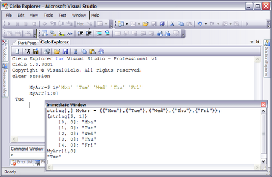
<figcaption markdown="span">Figure 9: Simple or nested array?</figcaption>
</figure>

#### <a id="145"></a>Assignment by value and by reference

In legacy APL, the interpreter manages the process of assignment and reassignment internally. With VA, like C#, the developer can control whether an assignment takes place by value or by reference. In C#, value types derive from `System.ValueType` whereas reference types derive from `System.Object`: value types are managed on the stack and object types on the heap. A good grasp of the trade-offs between assignment by value and reference comes with experience and is highly relevant from the point of view of debugging and fine-tuning the performance of an application.

Although the consequences of this notion are far-reaching, for the moment, it will suffice to have a basic understanding:

A variable of type value
:   contains a value and if that variable is reassigned to another variable of type value, the value is replicated: subsequent changes to one variable do not affect the other. This happens on the stack. With VA, `←` makes an assignment by value.

A variable of type reference
:   points to (refers to) the memory location where the actual variable (object) is contained. And if that variable is reassigned to another variable of type reference, the second copy inherits the reference (held on the heap) to the same memory location. The memory location is not replicated, therefore, a change to one is reflected in the other and both copies remain identical. With VA, `=` makes an assignment by reference.

Figure 10 shows a simple example that illustrates the basic difference between the two assignment methods. Although APL+Win used assignment by reference for copies of variables, the difference is that APL+Win managed the transition to value implicitly but the developer has to manage this with VA.

<figure markdown="1">
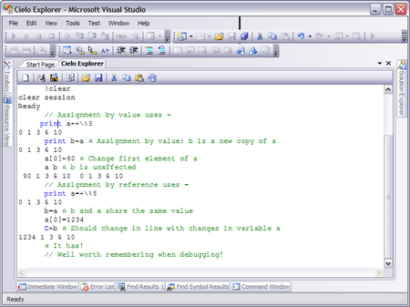
<figcaption markdown="span">Figure 10: Assignment by value and reference</figcaption>
</figure>

#### New quad functions: division by zero

Besides a number of new keywords like print, VA adds a number of new quad functions to the language vocabulary and discards a number of others such as `⎕cr` and `⎕vr`.

By default, legacy APL yields `DOMAIN ERROR` on encountering a division by zero where the numerator is not `0`, and `0÷0` is `1`. In contrast, VA adopts the .Net behaviour: any division by zero returns `0` by default. However, this behaviour can be overridden. The legacy behaviour can be implemented by the following assignment `⎕dbz←1`; this system variable can take five possible values, which help to customize the output of division by zero (the help file shows the available options).

#### The CE toolbar

An acquaintance with the CE toolbar is necessary to be able to manage the log files with ease and to access the help files. The toolbar has ten icons, whose functions are explained in Table 2.

<table class="left">
			<caption>Table 2: The Cielo Explorer toolbar</caption>
			<col span="1">
			<col span="1" style="width: 10em">
<!--
			<thead>
				<tr><th>Icon</th><th>Tooltip</th><th>Action</th></tr>
			</thead>
-->
			<tbody>
				<tr>
					<td></td>
					<td>New</td>
					<td>
						Clear the Explorer session. The system command <code>)clear</code>
						achieves the same purpose, as does the undocumented command
						<code>)off</code>.
					</td>
				</tr>
				<tr>
					<td></td>
					<td>Run Cielo Script</td>
					<td>
						Prompts for a script file and fixes its content in the current
						Explorer session. It does not add the file to the current VS2008
						project.
					</td>
				</tr>
				<tr>
					<td></td>
					<td>Load Cielo File</td>
					<td>
						Like <code>Import Assembly</code> but it also adds several other
						using directives requiredby the assembly that is imported to the
						session.
					</td>
				</tr>
				<tr>
					<td></td>
					<td>Import Assembly</td>
					<td>
						Adds a reference to an existing assembly into the current session as follows:<br>
						<code>refbyfile@"C:\Program Files\AplNext\<br>VisualAPL\APLNext.APL.dll"</code>
					</td>
				</tr>
				<tr>
					<td></td>
					<td>Load Session Log</td>
					<td>
						Prompts for the log file name and brings its textual content into the CE session.
					</td>
				</tr>
				<tr>
					<td></td>
					<td>Save Session Log</td>
					<td>
						Prompts for the log file name and saves the textual content of the session to it.
					</td>
				</tr>
				<tr>
					<td></td>
					<td>Cut</td>
					<td>
						Copy highlighted section of the session to the clipboard and then
						delete selection.
					</td>
				</tr>
				<tr>
					<td></td>
					<td>Copy</td>
					<td>Copy the content of the clipboard at the cursor location.</td>
				</tr>
				<tr>
					<td></td>
					<td>Paste APL+Win</td>
					<td>
						Copy APL+Win code: transparently remaps the APL fonts.
					</td>
				</tr>
				<tr>
					<td></td>
					<td>Invoke help files</td>
					<td>
						Opens the VA help files. (This is also available as a menu option:<br>
						<code>Start | Programs | APLNext…</code>
					</td>
				</tr>
			</tbody>
		</table>

In addition, CE has a new set of system or session commands such as `)classes`, `)cd` etc.; these are documented in the help file which includes a chapter on CE. A particular command is noteworthy: if you are building a class library in VS2008 and testing it within CE; any attempt to rebuild the library will cause VS2008 to complain because the DLL will be in use. The command `)clear` frees the DLL for recompilation; you do not have to close the session as with APL+Win.

<figure class="right" markdown="1">
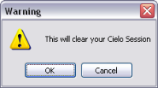{ style="width: 200px" }
<figcaption markdown="span">Figure 11: Clearing the Cielo Session</figcaption>
</figure>

If it is desirable to clear the session at any time, the command `)clear` resets the active session with a warning, shown in Figure 11.

In fact, when working with script files, it is recommended that the CE session is cleared before pressing `Ctrl+E,E` to fix their content; this will ensure that the objects in the session are from the current script files; if a script file fails, the session will continue to hold the objects last created successfully.

If you are inclined to type `)off` by force of habit, CE supports the command: it provides the same warning as `)clear` but it is much more destructive as it closes the current project. All windows in VA projects work with the VS2008 IDE.

The Cielo Explorer or Editor windows are configurable as a Dockable, Floating, or Tabbed Document within VS2008, as shown in Figure 12; note that this is shown with a C# project open, as evident by the `.cs` file extensions.

<figure markdown="1">

<figcaption markdown="span">Figure 12: Windows in VS2008</figcaption>
</figure>

Although it is surprising to see `Load` instead of `Open`, the extent of integration is very impressive: see Figure 13.

<figure markdown="1">
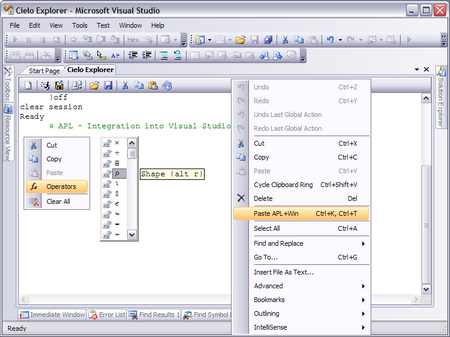
<figcaption markdown="span">Figure 13: Integration in Visual Studio IDE</figcaption>
</figure>

VA uses a Unicode font, which is not compatible with the font used by APL+Win; therefore, `Ctrl+C` will not paste APL+Win (or other APL’s) code correctly: this facility is doing something subtle and getting it right! VA and APL+Win use the same keyboard mapping for APL characters.

### Cielo script files

Although CE’s inability to save sessions, except as log files, may appear highly restrictive at first, this is in fact a bonus for two sound reasons:

- Script files store variable and function definitions in the base or named classes independently of session activity. This creates a higher degree of transparency in application code and better documentation.
- The clutter of the session activity is not saved as might (or does!) happen with `)save`. In other words, the scope of a session cannot span across sessions.

#### Using script files

A script file has extension `apl`; this is recognised by VS2008 in that double-clicking the file within Explorer will launch VS2008 and open the file. Figure 14 shows a script file within VS2008.

- The code in a script file is fixed in CE by the keyboard shortcut `Ctrl+E,E`. This has the effect of overwriting synonymous functions and variables in the base or named classes; other session objects are unaffected.
- A script class is created using the session command `)ed MyScript` within CE; this either creates the file and opens it or simply opens it if it exists. The file name that is created has extension `apl`.
- The easiest way to grasp the concept of a class is to visualize it like a subfolder in the filing system. Functions and variables defined outside of a class are akin to being in the root folder. In the example, shown in Figure 14, the script defines `abc` and `Area` in the root and two other classes `ajay` and `askoolum`, where the latter cross references the former.
- Note the valence (signature in C# parlance) of the function `ajay.add` and `askoolum.Addition`; see ‘[Valence and signatures](#153)’ for more details.
- Note lines `[7]` and `[19 20]`: the last has the C# statement terminator (;) and the first does not. Unlike C#, where they are mandatory, VA statement terminators are optional for statements on the same line. My own preference is to use the statement terminator, as it is good practice. The difference between a terminator and a separator (`⋄` or diamond) is that a terminator denotes the end of a statement, shown in lines `[20]` and `[21]`, which may span several lines, and a statement separator denotes the start of another statement on the same line.

<figure markdown="1">
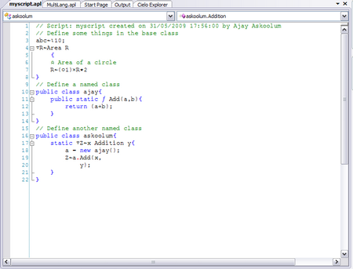
<figcaption markdown="span">Figure 14: A simple script file</figcaption>
</figure>

**Watch out** If, having successfully fixed the contents of a script file, you introduce new errors while making further changes, the definitions based on the older file remain in the session.

As with legacy APL, a system command cannot be followed by a comment; however, a command `)edit MyScript ⍝`  treats the comment as part of the file name. This should be fixed, as it causes difficulty in referring to the file by name.

#### MyScript.apl in CE

The keyboard shortcut `Ctrl+E,E` fixes or updates the contents of the script file into the session; see Figure 15.

<figure markdown="1">
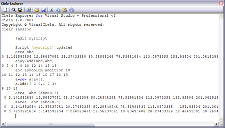
<figcaption markdown="span">Figure 15: `myscript.apl` in session</figcaption>
</figure>

Some observations on what Figure 15 shows:

- Reference to classes can be relative, e.g. `ajay.Add`, or use an alias e.g `a = new ajay();`.
- The session (or root) objects are universally available, that is, in the session and to classes using relative reference.
- The APL functionality works exactly as expected with conformable scalar, vector, and nested arguments.

#### <a id="153"></a>Valence and signatures

The valence of legacy APL functions classifies them into *niladic* (no arguments), *monadic* (one argument, always on the right), or *dyadic* (one on the left and one on the right).

Dyadic functions can be ambivalent: the left-hand argument can be omitted. The code must test this using `⎕nc`. VA also has `⎕monadic` and `⎕dyadic` and allows for an argument’s absence by using a default value. This has proved restrictive for the following reasons:

- In an APL environment, multiple arguments are passed via a nested variable, thereby coercing a schema where the arguments are anonymous and positional.
- In a non-APL environment, functions calls never take a left argument; all arguments are specified on the right. Indeed if VA is used to build a class library for use with other languages, it is preferable to have all arguments on the right.
- With other languages, some arguments are optional. With C#, the concept is called *overloading*, whereby a function can be defined a number of times with different arguments – with the missing ones being given default values. Additionally, with VB.NET a calling function can supply an argument by name.

VA removes all the restrictions on function arguments and complies with the condition that arguments are specified either by position or by name, not a mixture. VA functions can use either the classic valence or the .Net-compliant signatures. This is a major enhancement in APL but can be quite confusing, even frustrating. The confusion (or is it excitement?) gets worse because:

- It is possible to code a function using the classic valence and call it using the .Net signature!
- Primarily for the benefit of strongly-typed target languages, it is also possible to specify the types of arguments and return values of APL functions.

The following sections from the help files are vital reading:

| Section | Topic |
| --- | --- |
| Visual APL Programming Guide | The AplFunction Attribute |
| Visual APL Tutorial | 15 Defining Functions |
|   | 16 More about defining functions |
|   | 17 Typing Arguments to Functions |
|   | 18 Data Types and Collections |

#### <a id="154"></a>Multi-language coding

It is possible to mix APL and C# code within a class. In fact this is a critical advantage in using VA, namely, the whole of the .Net functionality is available. There are over 12 million C# developers – and this is growing – and but a handful of APL developers – and this is shrinking. Refer to Figure 16 for some examples.

<figure markdown="1">
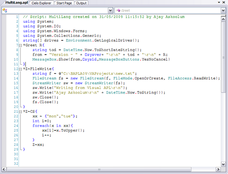
<figcaption markdown="span">Figure 16: Multi-language coding</figcaption>
</figure>

#### Some observations on mixing code

Refer to Figure 17 for the actual CE session.

- Lines \[2\] – \[5\] show the `using` directives; in this case, only the ones used by the functions are included. However, there is no harm in including the typical class on libraries that a C# solution includes by default.
- Line \[6\] creates a global variable, which is a nested vector in APL.
- Lines \[7\] – \[11\] create a message and displays it; aside of the function header and the reference to APL system constants, the code in C#.
- Lines \[12\] – \[20\] illustrate how C# worked examples can be used with VA almost unchanged. On line \[13\], note the double backslash: backslash is an escape character in C#. On line \[16\], `\r\n` represents carriage return and linefeed. Unlike VA, which uses the delimiters interchangeably, C# uses double quotes to enclose data of type *string* and single quotes for data of type *char*. However, in order to avoid stray errors, follow the C# convention for passing data into mixed code.
- Lines \[21\] – \[29\] create a trivial example to illustrate how C# can manipulate and return what APL sees as a nested vector (and arrays with suitable modification). Note also that this APL function is using a control structure that belongs to C#. The control structure keywords in VA begin with colon as in APL+Win. (Did you notice the anomalies?)
- The version number shown in the message box is different from that shown in a new CE session. APLNext has confirmed that CE and VA projects use the same APL black box, so I would have expected the versions to match, as I am using the same version throughout.
- Although I am using VS2008 with the default framework set to 3.5, the message box suggests that VA is using Framework 2.0.

<figure markdown="1">
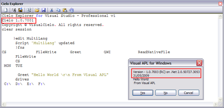
<figcaption markdown="span">Figure 17: Mixed code running in Cielo Explorer</figcaption>
</figure>

## Legacy features

During the beta testing phase, APLNext made a concession, namely, added back support for native (`⎕n*`) and component (`⎕f*`) files, `⎕fmt` and `⎕wi` – at a price. These features are not available by default; express references to class libraries are required to enable them.

Figure 18 gives an insight into how legacy functionality can be deployed. The first function, `ReadNativeFile`, reads the file created by the method `FileWrite` (using C#) in ‘[Multi-language coding](#154)’.

<figure markdown="1">
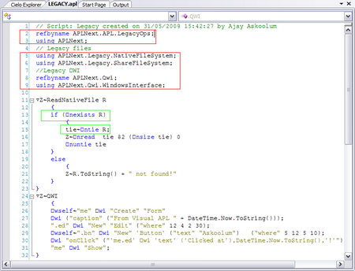
<figcaption markdown="span">Figure 18: Legacy support</figcaption>
</figure>

My personal view is that this was a retrograde step, a mistake – it shows how strong the legacy lobby can be – because:

- Much better corresponding functionality – with documentation – exists in the .Net platform (except perhaps for component files).
- There is no guarantee that existing code using these quad functions will work in the same way as these have been reverse engineered for the .Net platform.
- Component files hide data and create special bespoke requirements; this is bad news from the point of view of securing industry-wide peer endorsement.
- There is no automatic migration option for legacy APL applications.

However, on the positive side:

- Some of these quad functions have been enhanced. For example, `⎕nexists` is a new function that returns true if a file does not exist (long overdue although simply done in C#) and `⎕ntie` has a new syntax that returns the next available tie number. The help files document all the changes and exceptions.
- The excesses of extended and colossal native and component file functions have not been implemented.
- The native and component files created by VA and APL+Win are not interchangeable across the two environments. It is time to embrace more modern data-tier handling using ADO.NET.

Might it have been more appropriate to court the legacy applications built with competing APLs than to provide legacy support?

Figure 19 shows the results of the code.

<figure markdown="1">
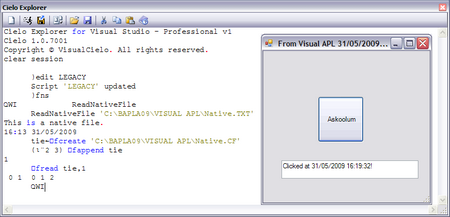
<figcaption markdown="span">Figure 19: Working legacy features</figcaption>
</figure>

### Managed code support

Although VA supports APL+Win native and component file operations, the code that provides this support is managed code. The VA and APL+Win component files themselves are not compatible and the component file functions cannot read APL+Win component files. A freestanding utility is available to port the APL+Win component files to VA.

Note that there are some enhancements in the supporting functions; notably, the tie numbers of files can be determined automatically and there is a function for determining whether a file exists.

The VA `⎕wi` function does not support the APL+Win COM interface, because .Net has its own (interop) method of interacting with legacy COM or ActiveX DLLs.

## APLNext project templates

Among the several project templates that are available with this version, I’ll consider just two, namely Windows Application and Class Library.

Windows applications would have a user interface. For a VA windows application, VA takes over the form design and runtime handling. For me, this decision is anomalous for the following reasons:

- On the one hand, the designers have settled for the standard VS2008 IDE with little adaptation for VA and on the other they have made the code generation for forms bespoke (or is it simply using VS2003?) – the actual process of putting together a form is driven via the IDE.
- One of the ‘benefits’ of VA handling the code behind forms is that statement terminators are omitted; for me this is of dubious value. A C# project puts the system-related and user-defined code for forms into separate files, e.g. `Form1.Designer.cs` and `Form1.cs`, respectively. VA puts all the code in the same file, e.g. `Form1.apl`. I think this makes the application design and maintenance processes much harder.

I concede that I have very likely missed the finer subtleties of integrating APL into VS2008 but I am inclined to believe APLNext have missed a couple of opportunities here.

First, there is no `APLNext Class` option in the rich list of options available from the `Project | Add Class…` menu item.

Second, I would have settled for the same form designer as C# – and lived with the default `cs` extension (VA uses `apl` as the extension) – and added an `APLNext` class with a reference to this class into the form’s file. Why? Form handling essentially involves the handling of scalar data and I would not expect much call for VA’s array facilities. This arrangement would have some significant advantages:

- It might entice C# developers more persuasively and externalise the support issues relating to form handling. The partitioning of an application into distinctive tiers has significant advantages in terms of the number of people who can work on it and the debugging process.
- It would permit form design and runtime handling using both native C# and APLNext code in the separate class.
- It would minimize the incidence of problems relating to data typing, bearing in mind that C# is strongly typed and VA is not.
- It would make the `APLNext` class available at all times within the same project; that means that all the debugging facilities are to hand. The alternative is to have an APLNext DLL for code handling from the form; while this is still a highly viable option, especially for core and debugged functionality, it would make the process of debugging the application that uses the DLL a rather disparate process.

## APL+Win

APL2000 actively support APL+Win and provide ongoing development. In June 2009, they released version 9.1 of the product. At version 9, as you would expect, the maintenance cycle no longer includes the fixing of any significant flaws or bugs in the product. It consists primarily of an effort to maximize efficiency gains via better or clearer documentation, the provision of worked examples, and the fine-tuning of particular functionalities to make them faster. In other words, you would not expect radical new features in a product that has a large base of existing applications.

There are, however, some very interesting uses of existing functionality.

### ActiveX interface

<table class="bdr fright left">
			<caption>Table 3: APL+Win Data Type Support</caption>
			<thead>
				<tr><th>VB Type Name</th><th>Scalar Type</th><th>Array Type</th></tr>
			</thead>
			<tbody>
				<tr><td>Empty</td>		<td>0</td>		<td>-</td></tr>
				<tr><td>Null</td>			<td>1</td>		<td>-</td></tr>
				<tr><td>Integer</td>	<td>2</td>		<td>8194</td></tr>
				<tr><td>Long</td>			<td>3</td>		<td>8195</td></tr>
				<tr><td>Single</td>		<td>4</td>		<td>8196</td></tr>
				<tr><td>Double</td>		<td>5</td>		<td>8197</td></tr>
				<tr><td>Currency</td>	<td>6</td>		<td>8198</td></tr>
				<tr><td>Date</td>			<td>7</td>		<td>8199</td></tr>
				<tr><td>String</td>		<td>8</td>		<td>8200</td></tr>
				<tr><td>Object</td>		<td>9</td>		<td>8201</td></tr>
				<tr><td>Error</td>		<td>10</td>		<td>8202</td></tr>
				<tr><td>Boolean</td>	<td>11</td>		<td>8203</td></tr>
				<tr><td>Variant</td>	<td>12</td>		<td>8204</td></tr>
				<tr><td>DataObject</td><td>13</td>	<td>8205</td></tr>
				<tr><td>Byte</td>			<td>17</td>		<td>8209</td></tr>
			</tbody>
		</table>

APL+Win has a robust ActiveX interface that permits its deployment both as a client and as a server. The client can be APL+Win itself or any other Component Object Model (COM) compliant software, including C#. APL+Win can be the server to APL+Win as a client.

Routinely, APL+Win copes with incoming and outgoing data types seamlessly; however, there are occasions when this does not quite work because some data types do not exist in APL. Many ActiveX objects use values that are typed; that is, a variable can hold a value, which has a special representation of the raw value. For example, one special type is currency. For such situations, there are means of translating the data explicitly.

Other examples include null, empty or missing values: the system object `#` can create such values.

#### APL+Win as COM Server and Client

APL+Win can act as both a COM client or as a server; in other words, it can work with itself in a COM configuration. For example:

```
      ⎕wself←'APLW' ⎕wi 'Create' 'APLW.WSEngine'
      ⎕wi 'XExec' '+/⍳10'
55
```

If the client is other than APL+Win, it will not be possible to pass APL expressions for evaluation because of the nature of the APL keyboard; however, there would be little point in using APL+Win as a COM server in immediate mode. The properties, methods, and events that are exposed are:

```
      (∊'x'=1↑¨x)/x←⎕wi 'properties'
xSysVariable xVariable xVisible
      (∊'X'=1↑¨x)/x←⎕wi 'methods'
XCall XExec XSetOrphanTimeout XSysCall XSysCommand
      (∊'X'=1↑¨x)/x←⎕wi 'events'
XNotify XSysNotify
```

#### ActiveX interface – using redirection

One feature of the APL+Win ActiveX interface is the ability to create objects using redirection.

Imagine that you have an existing session of Excel – perhaps one orphaned by a client that terminated abruptly – and you want to use that session as a COM server. How do you do it?

```
      'xl' ⎕wi 'Create' 'Excel.Sheet'
xl
      'xl' ⎕wi 'xApplication>xl'
```

Now `xl` is an instance of the oldest existing Excel session. Note:

- This technique requires error trapping as it will fail if there are no existing Excel sessions.
- It corresponds to the `GetObject` function that exists in Visual Basic.

#### ActiveX – events

APL+Win enables seamless event handling.

```
      'xl' ⎕wi 'onXSheetSelectionChange' '⍳10'
```

The event fires when another cell is selected; either an APL expression or an APL function may be specified as the event handler.

Two system variables are available to event handlers:

⎕warg
:   contains the arguments passed by the event.

⎕wres
:   contains the behaviour passed back to the server.

#### ActiveX – syntax

APL+Win uses a prefix of `?` to query the signature of the properties, methods, or events of ActiveX objects. For example:

```
      'xl' ⎕wi '?Range'
xRange property:
  Value@Object_Range ← ⎕WI 'xRange' Cell1 [Cell2]
```

```
      'xl' ⎕wi '?onXSheetSelectionChange'
onXSheetSelectionChange event:
  ⎕WEVENT ←→ 'XSheetSelectionChange'
  ⎕WARG ←→ Sh@Object Target@Object_Range
  ⎕WRES[2] ← Target@Object_Range
```

Note that in the latter example, the event passes an object to the client.

A prefix of `??` invokes the help file of the ActiveX object and displays the relevant topic; if this fails, the signature is returned.

#### ActiveX interface - passing objects as arguments

Usually, the `progid` of an ActiveX object has two levels, e.g. `Excel.Application` and the syntax for creating instances of such objects is straightforward. However, some properties expose child objects; for example:

```
      'xl' ⎕wi 'Range()' 'A1:F5'
88430676
```

For such properties, it is necessary to create an instance of the object returned; however, all that is available is an object pointer and not a progid. APL+Win can create an object from the object pointer. The following two techniques return the same result:

```
      'xl.rng' ⎕wi 'Create' ('xl' ⎕wi 'Range()' 'A1:F5')
xl.rng
      'xl' ⎕wi 'Range()>xl.rng' 'A1:F5'
```

APL+Win, as client, creates instances of objects passed by events in the same manner.

```
      'xl' ⎕wi 'onXSheetSelectionChange' 'MyFn'
```

The syntax query indicates that two objects are returned by the event; hence, the handler may need to create two objects.

```
    ∇ MyFn
[1] ('obj1' 'obj2') ⎕wi¨ (⊂⊂'Create'),¨⊂¨⎕warg
    ∇
```

### Win32 API

A tradition that started in the halcyon days of the Disk Operating System (DOS), APL secured a unique competitive advantage by providing quad functions for accessing operating system resources. With operating systems becoming more complex, the APL strategy has simply failed as it is not possible to provide a quad function for everything. Microsoft provides an Application Programming Interface (API) that is much more comprehensive and is widely adopted by developers of other languages. APL can deploy the same techniques.

APL+Win can deploy Win32 API too and it does so in a unique manner: the bridge to the API calls is independent of the workspace. Therefore, APL2000 has been able to ship APL+Win with a large number of popular API calls with the interpreter. Workspace independence also implies that means that any newly definition becomes universally available to all workspaces.

#### Defining new API calls

Developers are able to define API calls if they are found missing in the predefined set supplied by APL2000. One of the requisites for defining any particular API call is the ability to query whether that definition exists already. The following expression, if true, indicates whether a definition is available:

```
0≠⍴⎕wcall 'W_Ini' '[Call]MakesureDirectoryPathExists'
```

This API is documented as follows:

```
Declare Function MakeSureDirectoryPathExists Lib "imagehlp.dll"
             (ByVal lpPath As String) As Long
```

It can be defined conditionally as follows:

```
   ∇ API
[1] ⍝ Define MakesureDirectoryPathExists conditionally
[2] :if 0=⍴⎕wcall 'W_Ini' '[Call]MakesureDirectoryPathExists'
[3]     ⎕wcall 'W_Ini' '[Call]MakesureDirectoryPathExists=L(*C lpPath)
             ALIAS MakeSureDirectoryPathExists LIB imagehlp.dll'
[4] :endif
   ∇
```

This API call is capable of creating a hierarchical directory in a single pass: for example,

```
⎕wcall 'MakeSureDirectoryPathExists' 'c:\ajay\askoolum\Finance\Qtr1\'
```

API calls are efficient.

#### API callbacks

Some API calls involve callback functions. For example,

```
Declare Function EnumWindows Lib "user32.dll"
             (ByVal lpEnumFunc As Long, ByVal lParam As Long) As Long
```

The parameters are:

lpEnumFunc
:   Points to an application-defined callback function.

lParam
:   Specifies a 32-bit, application-defined value to be passed to the callback function.

##### Which applications are running?

This API can return a list of application that are running:

```
      EnumWindows
C:\PROGRA~1\AVG\AVG8\avgtray.exe
C:\Program Files\API-Guide\API-Guide.exe
C:\Program Files\APLWIN8\APLW.EXE
C:\Program Files\APLWIN8\aplw.exe
C:\Program Files\Creative\SBAudigy2\DVDAudio\CtdVDDet.EXE
C:\Program Files\Creative\SBAudigy2\Surround Mixer\CTSysVol.exe
C:\Program Files\Dell\Media Experience\PCMService.exe
C:\Program Files\IBM\SQLLIB\BIN\db2systray.exe
C:\Program Files\Microsoft Office\Office12\EXCEL.EXE
C:\Program Files\Microsoft Office\Office12\GrooveMonitor.exe
C:\Program Files\Microsoft Office\Office12\WINWORD.EXE
C:\Program Files\Microsoft SQL Server\80\Tools\Binn\sqlmangr.exe
C:\Program Files\NetMeeting\conf.exe
C:\Program Files\ScanSoft\PaperPort\pptd40nt.exe
C:\WINDOWS\BCMSMMSG.exe
C:\WINDOWS\Explorer.EXE
C:\WINDOWS\System32\Ati2evxx.exe
C:\WINDOWS\System32\DSentry.exe
C:\WINDOWS\system32\CTHELPER.EXE
C:\WINDOWS\system32\ctfmon.exe
C:\WINDOWS\system32\dla\tfswctrl.exe
C:\WINDOWS\system32\rundll32.exe
C:\WINDOWS\system32\wscntfy.exe
```

The functionality is defined as follows:

```
   ∇ Z←EnumWindows;ptr;hdc
[1] Z←''
[2] ⍝ the filter appends the name to Z
[3] ptr←⎕wcall 'W_CreateFilter'
                    ('EnumWindows' 'Z←Z,⊂EnumWindowsCallback2')
[4] →(ptr=0)/0                            ⍝ unable to create the filter
[5] 0 0⍴⎕wcall 'EnumWindows' ptr 0        ⍝ make the call
[6] 0 0⍴⎕wcall 'W_DestroyFilter' ptr      ⍝ free the ptr
[7] Z←((Z⍳Z)=⍳⍴Z)/Z                       ⍝ remove duplicates
[8] Z←⊃Z                                  ⍝ convert to a matrix
[9] Z←Z[⎕AV⍋Z;]                           ⍝ sort alphabetically
   ∇
```

An alternative callback function that might be used to return, say, Windows captions etc. – is defined thus:

```
   ∇ Z←EnumWindowsCallback2;procid;proc_hwnd
[1] procid←2⊃⎕wcall 'GetWindowThreadProcessId' (⍬⍴⎕warg) ⍬
[2] proc_hwnd←⎕wcall 'OpenProcess'
          'PROCESS_QUERY_INFORMATION PROCESS_VM_READ' 0 (↑procid)
[3] Z←↑↑/⎕wcall 'GetModuleFileNameEx' proc_hwnd 0 (256⍴⎕tcnul) 256
   ∇
```

The API definitions are stored in an INI file, typically `aplw.ini`; that file can also store predefined constants such as the ones used in `EnumWindowsCallback2[3]`.

### APL+Win and .Net

A frequent request in the support forum is for a `⎕NET` functionality for harnessing .Net classes. I have no idea what APL2000 plans to do in the future.

My own view is that the deployment of such a function – that is, mixing managed and unmanaged code – would make applications harder to maintain.

#### ActiveX

The alternative route is to build Interop ActiveX components in .Net and then use them with APL clients. From a personal point of view, this approach has merit for the following reasons:

- ActiveX promotes code re-use.
- Although there are murmurs about the continued use of ActiveX technology, it remains viable for the near future because of it prevalence. The Windows operating system, including Vista, uses this technology extensively.
- Separating ActiveX components, that is, servers, from clients (APL) makes it easier to maintain both, using developers with corresponding skill sets.

#### NetAccess

APL+Win now offer NetAccess, a user interface that simplifies the task of building the elements of a .Net ActiveX component, from [lescasse.com](http://www.lescasse.com). [\[3\]](#ref3)

Current APL2000 subscribers can acquire NetAccess free.

## APL and .Net – options

As far as I can see, there are three (possibly four) options for bringing APL and .Net together.

- APL+Win – Use Visual C# 2005/2008 Express (free) and APL+Win. The possible arrangements are either to build the application in C# and use APL code as a black box or to build DLLs using C# to make .Net facilities such as ADO.NET available to APL+Win.
- Visual APL – requires Visual Studio 2008; I believe the version for Visual Studio 2010 is in preparation.

VA has significant advantages.

- It has greater wider appeal to other .Net developing communities because it shares the same IDE and especially to C# developers because it is not only C#-like but can also integrate C# code. In case you are inclined to dismiss this, imagine what an uptake of APL by just 1% from the growing 12 million C# developers would mean for APL.
- It makes it possible to adapt worked examples from the Internet and other printed material into APL projects, almost without change. This APL does not lock its developers into a closet.
- It is a modern and up-to-date product and part of the flagship range of development tools; it will benefit directly from enhancements that Microsoft makes to Visual Studio in the future.

## Conclusions

VA is a completely new APL for contemporary software development; it is hosted by the flagship IDE of today. I have participated in the beta and Release Candidate cycles of the development of VA. It has been exciting to see the product develop to the current release. For ongoing success, the vendor must provide a hefty manual with worked examples for the types of application that can use VA; this will not only provide a means of exposing what VA can do (i.e. training) but also provide a template for software developers.

### Would I use VA to build applications?

The answer is emphatically in the affirmative. VA takes APL to .Net, in my opinion, very successfully. This has significant advantages, especially the opportunity to adopt worked examples from the .Net world. However, the designers seem a little reticent when it comes to GUI-based applications: if the designers are going to adopt the C# form design approach, that is better done before the product has a legacy of applications.

### Would I migrate applications to VA?

Yes! Legacy APL has a lot of clutter, which makes maintenance very expensive:

- This includes the myriad utility functions developed over 40 years. Most of them can be easily replaced either by improved nested APL functionality or by access to platform resources such as API calls.
- It is dependent on highly specialised infrastructure that includes component files and a bespoke GUI designer and code editor (cannot seriously call it an IDE). Such dependencies make APL inaccessible and deny the acquired experience with standard platform tools and resources.

VA overcomes the stigma: it offers a modern APL that is free of clutter. More tellingly, it does *not* offer an automated migration path – which I applaud. The .Net facilities are very comprehensive.

#### Opportunity to re-engineer applications

Therefore any migration has to be a manual process that may seem onerous and expensive but it also heralds a new opportunity, namely, to re-engineer applications that, in many cases, are decades old. My own experience is that some 70% of a typical APL+Win post-V3.5 application can be migrated very quickly but this is a highly subjective assessment and will depend on the nature of the code. The remaining 30% usually raises fundamental issues relating to scope, which can be tricky.

I would recommend the re-engineering process take the opportunity to separate the application into tiers, at least, into three tiers, namely, presentation, business and data. ADO.NET can be deployed easily from VA.

### Is there anything that I do not like about VA?

This is a highly subjective criterion. Being accustomed to C#, I notice the differences with VA. An example is that with C#, scope delimiters, i.e. braces, are always on new lines with the possible exception of properties; VA puts only the closing brace on a new line. This is highly perceptible when switching between the two. I prefer the C# arrangement. The VA font is less pleasing than the standard VS2008 fonts; the VA font is required for IDE pop-ups, such as code completion, to display correctly. Can VA switch this on or off dynamically depending on whether VS2008 is opening an VA application or not?

Although VA has a forum site and online documentation, the documentation is not adequate for a new product that calls on knowledge acquired from legacy APL but that works in a completely different way. The webcasts during the development cycle proved an invaluable supplement and still have a role to fulfil; unfortunately they seem to have stopped. Moreover, the vendor has to address the fact that there is little or no information on the deployment of VA applications; this was not a problem before the commercial release but it has some urgency now.

### .Net competition

<figure class="right" markdown="1">
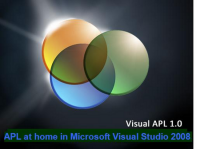{ style="width: 200px" }
<figcaption markdown="span">Figure 20: The revolution starts now?</figcaption>
</figure>

I think the critical difference is that VA is .Net: it works in tune with .Net as opposed to tuning .Net to work like APL; the latter is an expensive ongoing endeavour always playing ‘catch up’.

Therefore, VA can concentrate on enhancing the language whereas the competition also needs to bring new developments into the workspace.

I believe the VA approach holds a better promise for the future of APL: an APL without workspaces is a valiant start.

## Notes and references

1. <a id="ref1"></a> A *solution* is Microsoft’s term for a collection of projects. A project contains a namespace definition and the classes associated with that namespace. Each project can produce a .Net assembly.
2. <a id="ref2"></a> [http://forum.apl2000.com/viewforum.php?f=4  
    &sid=ad9188db7f262590715157d0c34ad0be](http://forum.apl2000.com/viewforum.php?f=4&sid=ad9188db7f262590715157d0c34ad0be)
3. <a id="ref3"></a> “Interface APL+Win and .Net (C#)”, Eric Lescasse, [http://www.lescasse.com/InterfaceAPLandCSharpA4.pdf](http://www.lescasse.com/InterfaceAPLandCSharpA4.pdf)

## Further reading

1. Visual APL electronic help files and public newsgroups
2. “Building C# COM DLLs for APL”, Ajay Askoolum, *Quote Quad* **34**, 4
3. *System Building with APL+Win*, Ajay Askoolum, John Wiley & Sons Ltd, 2006, ISBN 10-0-470-03020-8
4. *APL An Interactive Approach*, 3rd edition, Leonard Gilman & Allen J Rose, John Wiley & Sons, 1984, ISBN-10-0-471-09304-1
5. *Les APL étendus*, Bernard Legrand, MASSON, 1994, ISBN 10-2-225-84579-4
6. *Professional C# 2005*, Nagel, Evjen, Glynn, Skinner, Watson & Jones, WROX, 2006, ISBN 10-0-7645-7534-1
