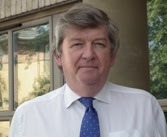
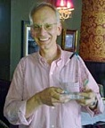

by Paul Grosvenor – October 2010
{ .byline }

<figure markdown="1">

<figcaption markdown="span">Paul Grosvenor, BAA’s old and new chairman</figcaption>
</figure>

As I write I detect a very positive momentum beginning to build up once more. The vendors seem to have a range of exciting initiatives that are ongoing and the market seems to be quite buoyant generally. As always our big challenge is to keep on waving the APL flag and making sure that even more people know we are here.

I am thinking about the possibility of another conference next year along similar lines to BAPLA09 but this time (you’ve guessed it) BAPLA11. It all rather depends on time and sponsorship as this time I would want to get the costs right down and try to make it three days not two. Anyhow, watch this space and we shall see what comes.

Our AGM this year at the Albion went well and attracted some 25 or so people. Thanks to our sponsors (Dyalog, MicroAPL and Optima Systems) for providing the food and drinks. The venue turned out not to be ideal but nevertheless allowed us to undertake the formalities of an AGM and have talks from two invited speakers afterward.

This year for the first time in many years we had three long standing members of the committee stand down. Anthony Camacho (secretary), Ray Cannon (activities) and Stephen Taylor (Webmaster and Editor) all moved aside to allow for new blood to move in. I personally cannot remember a time when Anthony and Ray were not on the committee and rumour has it that their involvement goes back almost to day one! Stephen was a more recent member of the team but has invested much time into *Vector* and our website; time he no longer has. I hope you can all join me in offering our thanks for their combined efforts over the (many) years and hope they will keep in touch. Stephen in fact remains on the Committee looking after the *Vector* Editor role. Since our AGM, Peter Merritt, Kai Jaeger and Phil Last have joined the team so now we are once again back up to full strength. Thank you one and all. Full details of the new Committee can be seen elsewhere within this issue of Vector.

Very little progress has been made with the BCS regarding our withheld funds. Some £14,000 remains within their grasp and they still consider it their money. As the AGM minutes point out we do not agree with this position and will try over the coming months to get our sustaining members to apply pressure on them. The decision to break away from the BCS was made in the knowledge that this situation was likely to arise but it should be pointed out that even without this money our existence is not threatened.

Since our BAPLA09 conference last year we have been in some lightweight conversations with Catherine Lathwell regarding the documentary film she wants to make about APL. Our responses to her have not been all that satisfactory thus far as without the money from BCS we are not in the position to be able to offer her very much towards this project. Nevertheless I do intend to keep a dialogue with her going and will report back to the membership as matters transpire.

The BAA London group have managed to keep on track with their meeting each month and I hope that this continues on. Phil Last will be announcing each meeting through various forums including comp.lang.apl so if you are in the area, please feel free to drop in on them. The group held an ‘away-day’ meeting on 23 July at Dyalog’s new offices in Bramley which was a great success. As always discussions were fast and furious (15 APLers, 15 different solutions).

The *Vector* production team pulled out all the stops to produce Volume 24 nos 2&3 in time for the Berlin APL conference. We now hope to keep the *Vector* production process under control and outputting regular issues throughout 2011.

This year we decided to award a new ‘Outstanding Achievement Award’. The award is designed to acknowledge the efforts of an individual, or organisation, within the world of APL where a particularly high level of achievement has been made. This year I was very pleased to be able to award it to Kai Jaeger for his work promoting APL and in particular for his efforts building the APL Wiki. Kai has spent more than just a few hours putting together the Wiki and has tried to make it as vendor-independent as possible. Today the Wiki contains a wealth of information and could be an invaluable starting point for the APLer both old and new. As always with these developments they rely upon content and so I know that Kai would very appreciate anyone who would be prepared to add a page or two for him.

It should be noted at this point that on receiving his award Kai was lost for words. An event that I do not think has happened before or since.

Please go on line and take a look or even better, create an account and add to the content at [aplwiki.com](http://aplwiki.com/)

<figure class="right" markdown="1">

<figcaption markdown="span">Congratulations, Kai!</figcaption>
</figure>

Thank you once again to all our sponsors for contributing towards the cost of this award. We hope to able to make a similar award next year.

The award reads:

<b><i>The Outstanding Achievement
Award 
For Services to APL 
Presented to Kai Jaeger 
21st May 2010 
	</i></b>

Finally, many of us will have just returned from the Berlin APL2010 conference. It was an interesting event with loads of ‘good stuff’ going on. Almost as importantly it was refreshing to see 150 plus APlers all in the same place. We were reminded that 2016 will be the 50th anniversary of APL so I guess we should start planning for something a little bit special.
