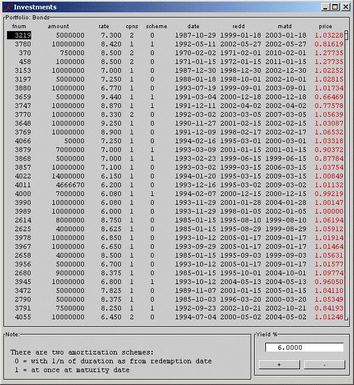

or: APL is not for programmers
{ .subtitle }

by Jan Karman (jkarman@planet.nl)
{ .byline }

## Abstract

Valuation of bond prices is a big thing at Wall Street and at investment departments of every institutional investor, like insurance companies, pension funds, etc. Buying bonds entitles one to receiving the principal at a given date, plus the contractual interest payments, i.e. coupons. This, being called the *cashflow*, has a value that depends on several parameters. These include the principal, the contractual interest rate, frequency of coupons (usually 2), redemption scheme (at once, linear, annuity, etc), date of closure, date of (starting) redemption and maturity date. Hundreds, even thousands, of institutions deal in bonds and equities: national governments states and provinces; even communities, larger corporations, polder-boards, utility companies, hospitals, schools and many others. Most of those institutions are served by their banks for technical details, but even banks fall back on estimates rather than mathematically exact calculations, because of lack of the relevant knowledge.

## Introduction

> Financial transactions invariably involve numerical calculations, and, depending on their complexity, may require detailed mathematical formulations. It is therefore important to establish fundamental principles upon which these numerical calculations and mathematical formulations are based.  
> (Samuel A. Broverman, *Mathematics of Investment*)

We will focus for a while on those mathematics.

Given

x
:   the required price, i.e. the exchange rate

i
:   the nominal interest rate

r
:   the current revenue on the capital market (yield)

H
:   the present value of the redemptions per unit of capital

L
:   the present value of the amounts on which interest is to be paid

then we may formulate the price of any loan as follows:

(1)
{ .right }

x = H + rL
{ .math }

If the nominal interest equals the current interest then the exchange rate is at par, thus

1 = H + rL
{ .math }

and it follows, by definition, that in that case

H = 1 – rL
{ .math }

We could substitute this value of H in (1) getting

(2)
{ .right }

x = 1 – (r–i).L
{ .math }

It follows immediately that, when r = i, par shows up.

From the same expression, L is defined by

<table class="center math">
      <tr>
        <td rowspan="3">L =</td>
        <td class="small">1</td>
        <td rowspan="3">(1 – H)</td>
      </tr>
      <tr><td>—</td></tr>
      <tr><td class="small">r</td></tr>
    </table>

and this value substituted in (2) produces

(3)
{ .right }

<table class="center math">
      <tr>
        <td rowspan="3">x =</td>
        <td class="small">i</td>
        <td rowspan="3">+ (1 – </td>
        <td class="small">i</td>
        <td rowspan="3">).H</td>
      </tr>
      <tr>
        <td>—</td>
        <td>—</td>
      </tr>
      <tr>
        <td class="small">r</td>
        <td class="small">r</td>
      </tr>
    </table>

(1), (2) and (3) may be considered as the three general formulas for determining the price of bonds. This trinity forms a ‘closed algebra’ for the entire theory of mathematics of finance. The reasoning of those formulas requires some not too difficult considerations. Further we may choose the appropriate formula for a particular type of a loan, the one which suits best, with one apparent exception: the annuity loan. The price of this type of loan is simply:

x= a<sub>(r)</sub> / a<sub>(i)</sub>
{ .math }

or, the quotient of an annuity (a) based on r and the same one based on i. Although the reasoning of this form of loan is obvious, expressing this one in any of the three types is an exercise for the final exam, and far beyond the purpose of this article (just note the development of the redemption components of an annuity loan).

From (2) and (3) it is clear, that, in general, the price of a (financial) commodity is decreasing when the price of money is increasing, and the other way around. Finally, from formula (3) it is easy to see that the price of a non-redeemable loan equals to

i / r
{ .math }

since H = 0.

The general formulas can be considered from different view points:

- sum of present values of redemption and interest (1)
- price as deviation from par, i.e. the present value of the difference between yield and interest rate (2)
- price related to a non-repayable loan; here the formula will always show up as: i/r +…, since i/r is the price of a non-repayable loan (3)

Type (3) is the most practical one for calculations, since it only needs flat annuities, rather than incremental or decremental ones, which are needed in Type (1) and (2). Therefore I used Type (3) for the functions in the programming.

**Justification of the subtitle** At this point the average programmer turns off, drops out, gets his coat and leaves the building, heading for mom and the kids. We, on the other hand, will continue.

**The Portfolio** Let us take for an example the bond portfolio of government or private bonds, being hold by a pension fund. The data is neatly being stored in a computer file like this:

| Number | Principal | Interest % | Nr. of coupons | Redemp scheme | Date of closure | Redemp date | Maturity date |
| --- | --- | --- | --- | --- | --- | --- | --- |
| 1234 | 20000000 | 5.00 | 2 | 1 | 19990901 | 20090901 | 20090901 |
| 1235 | 10000000 | 4.25 | 2 | 2 | 19990401 | 20040401 | 20100401 |

Note that the first loan is redeemable at once at maturity date and the second one in 10 equal parts starting at 1st of April 2004. Also keep in mind that there may be more characteristics, like changing the interest rate halfway, or changing the number of coupons, and that it can become quite complicated. I hope this example will do for our purpose.

Suppose that for the yearly report (or for other reasons, e.g. a quarterly pooling of the data with a statistical institute like WM-Company) we need to calculate the value of the entire portfolio, then estimates are of no harm and may be allowed.

If we, on the other hand, want to watch the performance of the portfolio, entirely or parts of it, under volatile movements of the yields on the capital market, or that an other institution is interested in buying a particular fund or bundle of funds, or that the debtor wants to convert his loan or to redeem it at once, life is not that easy. In those cases the price needs to be established exactly, according to the principles as described in the textbooks under “References”. But even in those cases banks often make no bones about estimating (the famous ‘wet finger’).

Only two categories of experts are at our disposal: actuaries and, to some extent, econometrists.

## The K-script

It is impossible to expose the entire script here. A few topics will be selected. First, there will be a frequent use for basic functions like present value, annuity, etc. So, we might design special auxiliary functions for those (decreasing annuity just for curiosity).

```
v:{[r;n](1+r)^-n}         / present value
an:{[r;n](1-v[r;n])%r}    / annuity
Dan:{[r;n](n-an[r;n])%r}  / decreasing annuity
```

Also we may design functions beforehand for the different loan types:

```
a:{i%x}                               / non-repayable
b:{[i;x;n](i%x)+(1-i%x)*v[x;n]}       / repayable after n years at once
c:{[i;x;n](i%x)+(%n)*(1-i%x)*an[x;n]} / repayable yearly 1/nth
d:{[i;x;n]an[x;n]%an[i;n]}            / annuity
```

Date conversion:

```
aymds:{+-1_ ,/(0 4 6 _+$x),'"-"}    / "yyyymmdd" to "yyyy-mm-dd"
```

The data on the file is in flat ASCII, delimited by HT, so we need a splitter:

```
frd:{pos:&(*q:0:x)=_ci 9
  +:'(0,pos-!#pos) _ +q _dv'"\t"}
```

We will need a function for the appropriate handling of the data (making known the variable names, reading the data and formatting them):

```
conv:{[x;y;z]      / x y z being var nms, data, formats
  t:.+(x;0$y;.,(`e;0))
  .[t;(~x;`f);:;z]}
```

Finally we come to the main function , in which all the work is done:

```
p:{[cr;cp;y;id;md;rd;sc]
  j:-1+(1+cr%100000*cp)^cp
  m:(%360)*0|(ds'aymds rd@&~sc)-__t%86400
  n0:(%360)*(-/(ds''aymds' (,md),,rd))@&~sc
  n1:(%360)*(ds'aymds md@&sc)-__t%86400
  a:.+(`e`f;(0;8.5$))
  t:+(`_n;&#cr;a)           / courtesy Arthur
  x0:(j@&~sc)*an[y;m]       / deferral of red.
  x1:v[y;m]*c[j@&~sc;y;n0]  / type c
  x2:b[j@&sc;y;n1]          / type b
  .[t;();:;((x0+x1),x2)[<<sc]]}

  / watch that little gem at the end of the bottom line!
  / it's meshing catenated strings when final order is known
```

The meshing function, `x[<<sc]`, is used because the loans of types b and c were split and processed separately. Afterwards they need to be catenated in the order we started in and we saved. The original function comes from Stephen Jaffe, *Topics for a Second Course in APL* (Manchester 1986).

There is only one control: that for the current yield.

```
\d .k.Y
yld:0.06;yld..l:"";yld..f:8.4$100*
yldi:"yld+:%800";yldd:"yld-:%800"
yldi..c:yldd..c:`button
yldi..l:"+";yldd..l:"-"
.k.Y..l:"Yield %"
.k.Y..a:(`yld;`yldi`yldd)
```

## Picture

<figure markdown="1">

<figcaption markdown="span">Fig. 1 - There is only one control: the current yield; the exactness is 1/8%. The prices of the loans are being displayed in the rightmost column and adjusted timelessly on every click on yield. Note the little scroll button top-right.</figcaption>
</figure>

## Show

This picture is the result of

```
/ *** The show
\d ^
.k..l:"Investments"
.k..a:(`D;(`Comment;`Y))
/ .k.D.[`y]: 13
`show$`.k
```

## Online

The entire application is online available and can be downloaded freely from my website. [http://www.ganuenta.com](http://www.ganuenta.com) – please, follow samples | K | Script or Show | Bonds from the control panel.

## References

1. Broverman, Samuel A. *Mathematics of Investment and Credit*  1991, 1996, ACTEX Publications, Inc. Toronto
2. Haaften, Dr. M. van *Leerboek der interestrekening* 1929, P. Noordhoff N.V. Groningen
3. Hage, Joh. *Koersberekening* 1941, P. Noordhoff N.V. Groningen
