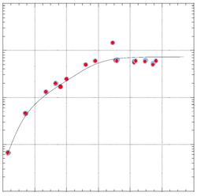
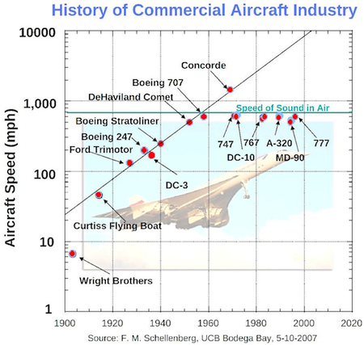

by Devon McCormick
{ .byline }

This report first appeared on the NYCJUG pages at the J Wiki.
{ .ednote }

## Multi- and many-cores: array programming at the heart of the hype!

Dr habil. Sven-Bodo Scholz (University of Hertfordshire, UK) gave an enthusiastic talk about his work with the functional array-programming language Single Assignment C (SAC)[\[1\]](#ref1).

The current SAC compiler, called sac2c, is developed and runs on UNIX systems. Binary distributions are available for the following platforms:

- Solaris (Sparc, x86)
- Linux (x86 32bit, x86 64bit)
- DEC Alpha
- Mac OS X (ppc,x86),
- netBSD (under preparation)

Unfortunately for us in the Windows community, these are the only offerings.

He had a somewhat amusing story to tell about one of his students who had a paper rejected by a parallel-programming conference because it was based on using an array notation and this was said by one reviewer to be too unconventional – a more proper paper would be to have written about discovering parallelism within loops. It was considered a kind of ‘cheating’ to avoid this problem by using a notation that renders this consideration moot.

Sven-Bodo’s work on SAC targets numerically-intensive programs, particularly those involving multi-dimensional arrays. He claims to get performance comparable to that of hand-optimized Fortran. Some of his exciting recent work targets GPGPUs[\[2\]](#ref2).

## Multi-core and hybrid systems – new computing trends

IBM’s Dr Helmut Weber gave a very thoughtful, informed, and forward-looking keynote exploring contemporary trends in performance improvements with the current generation of multi-core and hybrid systems. He started by outlining the physical limitations driving the new directions of chip architecture, which are:

- higher n-way
- more multi-threading
- memory access optimization

<figure class="right" markdown="1">

<figcaption markdown="span">Fig.1 What does this plateauing graph represent?</figcaption>
</figure>

He showed a misleading graph without labels and asked us to guess what it represents. Of course, most people thought it might show processor performance over time.

Once the labels were revealed, we saw this was not the case. However, Dr Weber was making a point about the natural evolution of performance of any technology over time – that there will eventually be a plateau after a period of exponential growth for a given technology without some fundamental change.

<figure markdown="1">

<figcaption markdown="span">Fig.2 What the plateauing graph represents</figcaption>
</figure>

Some of the technology trends he sees coming up are:

- increasing CMOS density – from current 22 nm to 15 nm or better
- more instruction-level parallelism
- more cores per die and threads per core
- perhaps leading to many small cores – microservers
- I/O link bandwidth growing to 100 Gb
- optical links becoming a commodity

Other trends include power consumption limiting future DRAM performance growth and the increasing prevalance of solid-state disks. Further in the future, he sees increasing use of “storage class memory” (large non-volatile memory), which could lead to a new memory tier. Some recommendations on how to compute more efficiently from a perspective of power consumption:

- Run many threads more slowly for constant power and peak performance
- SIMD power benefit proportional to width but diminishes for very wide
- Data movement management using reduced cache and simpler core design with multiple, homogenous processors
- Add hardwired function specialisation to allow bandwidth targeting

He also had some ideas about how software can improve to be better integrated with hardware and work within a power budget. Part of this improvement will make use of hardware function accelerators, perhaps as part of special purpose appliances. A suggested plan for building these appliances includes adding open-source technology to off-the-shelf hardware and using “builder tools” (e.g. rPath) to tailor software stacks to take advantage of this, along with FPGA and “IP-cores” to improve performance for key functionality. Example appliances include Tivo, the IBM SAN volume controller, and the Google Search Appliance. Some suggestions to help programming models take advantage of these trends:

- support efficient parallelism
- be at higher level of abstraction
- match the mental model of the programmer

This leads to the conclusion that the time is ripe for languages to adapt to the multicore future. Dr Weber suggests that most of these efforts aim at C derivatives, which restricts the number of programmers able to exploit parallelism by losing the productivity gains of languages like Java. This prompted IBM to develop X10 which is an adaptation of Java for concurrency.

In addition to the better-known mature parallel models of MPI and OpenMP, he mentions OpenCL, which has support for accelerators like GPGPUs. He also showed off some new IBM processor technology: a 5.2 GHz Quad-core processor with 100 new instructions to provide support for CPU intensive Java and C++ applications. It also includes data compression and cryptographic processors on-chip.

## Awards to winners of the Dyalog Programming Competition

The talks by two of the winners were refreshing and it was valuable to see how novices view their first experiences with the language. One thing that puzzled me was that both speakers criticised the lack of type handling in APL – to me, this has always seemed to be a positive feature of the language. I don’t understand how this kind of restriction provides a benefit that outweighs the limitations it imposes. Can anyone explain? Or better yet, provide a short program illustrating the desired behavior and expound on why this would be helpful?

## References

1.  [www.sac-home.org](http://www.sac-home.org/)
2.   [www.sac-home.org/publications/RollSchoJoslStav.pdf](http://www.sac-home.org/publications/RollSchoJoslStav.pdf)
