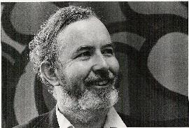
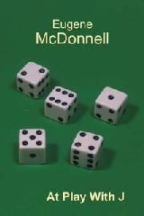

Roger Hui
{ .byline }

{ style="display: block" } **Eugene McDonnell  
1926 – 2010**

Originally presented by Roger Hui at the APL2010 conference in Berlin, 13 Sep 2010.
{ .ednote }

When I met Eugene McDonnell in 1981, there were traces of humidity behind my auricular orifices.

Since my pronunciation may be a bit off, and since I don’t want you to think that I thought of the witticism all by myself, let me show you where it comes from:

> When I met Clark Wiedmann in 1968, there were traces of humidity behind his auricular orifices.
>
> Eugene McDonnell  
> Minnowbrook APL Workshop 1985  
> *APL Quote-Quad*, 16.3, 1986-03

## Recreational APL

- Magic Squares and Permutations
- Spirals and Time
- How Shall I Transpose Thee? Let Me Count the Ways
- The Story of `○`
- How the Roll Function Works
- The Caret and the Stick Functions
- The Point of No Return
- Sauce for the Gander (or Adding a Vector to a Matrix)
- Making a Calendar
- 1980 Year’s Digits Problem
- Puzzle of the Year 1980 (solution)
- Pyramigram
- Numbering Crossword Squares
- Pyramigram (solution)

I first knew of Eugene as the “Recreational APL” editor. In those days, on receiving an issue of the *APL Quote-Quad*, I would inevitably and eagerly first turn to the “Recreational APL” column. Through these columns I learned that it was possible for technical writing to be erudite, educational, and entertaining, and through them I learned a lot of APL. Jeffrey Shallit, professor of mathematics at the University of Waterloo, recently [wrote](http://www.jsoftware.com/papers/eem/anecdotes.htm#jos)[\[1\]](#ref1) of his similar experience with “Recreational APL”.

## Language contributions

- circle `x○y`
- signum `×y`
- extension of `x|y x⊤y` for negative `x`
- `⌈y ⌊y x|y x⊤y` for complex `x` and `y`
- extension of `x∨y x∧y` as GCD and LCM
- `0 = 0 ÷ 0`
- infinity and infinite arrays
- hook and fork

Later, I found out that Eugene was also a key contributor to the development of APL. I don’t have time here to go into the details of all the language contributions, so I’ll just touch on two.

### The Story of `○`

<table>
		<tr>
			<td><strong><code>x○y</code></strong></td>
			<td><strong><code>x</code></strong></td>
			<td><strong><code>(-x)○y</code></strong></td>
		</tr>
		<tr>
			<td><code>(1-y*2)*0.5</code></td>
			<td><code>0</code></td>
			<td><code>(1-y*2)*0.5</code></td>
		</tr>
		<tr>
			<td><code>sin y</code></td>
			<td><code>1</code></td>
			<td><code>arcsin y</code></td>
		</tr>
		<tr>
			<td><code>cos y</code></td>
			<td><code>2</code></td>
			<td><code>arccos y</code></td>
		</tr>
		<tr>
			<td><code>tan y</code></td>
			<td><code>3</code></td>
			<td><code>arctan y</code></td>
		</tr>
		<tr>
			<td><code>(1+y*2)*0.5</code></td>
			<td><code>4</code></td>
			<td><code>(¯1+y*2)*0.5</code></td>
		</tr>
		<tr>
			<td><code>sinh y</code></td>
			<td><code>5</code></td>
			<td><code>arcsinh y</code></td>
		</tr>
		<tr>
			<td><code>cosh y</code></td>
			<td><code>6</code></td>
			<td><code>arccosh y</code></td>
		</tr>
		<tr>
			<td><code>tanh y</code></td>
			<td><code>7</code></td>
			<td><code>arctanh y</code></td>
		</tr> 
	</table>

Anyone who has ever used the circle function probably wondered about the numbering of the left argument `x`. The explanation usually hinges on the fact that `x○y`is an odd or even function depending on whether `x` is an odd or even integer, then goes on to explain what is an odd or even function. But the *real* explanation is as follows. In Eugene’s own words in [*The Story of* `○`](http://www.jsoftware.com/papers/eem/storyofo.htm)[\[2\]](#ref2):

> Actually, 1 and 3 were chosen first, more or less by accident, for the sine and tangent, along with 2 for the cosine function, by listing the functions in the order in which they were taught me in high school, and then the observation was made about sine and tangent being odd functions. The hyperbolic functions simply fell into place afterwards.

### Extending APL to Infinity – McDonnell and Shallit, APL80.

- infinity
- infinite arrays

The other language contribution that I want to touch on was proposed by Eugene and Jeff Shallit in the APL80 paper “Extending APL to Infinity”. The proposal had two parts: infinity as a number, and infinite arrays.

<table>
		<tr>
			<td class="bold left">NARS2000</td>
			<td class="bold left">J</td>
		</tr>
		<tr>
			<td class="left">
				<pre>
      ⌊/ ''
<span class="plain">∞</span>
      ÷0
<span class="plain">∞</span>
      2 * 3333
<span class="plain">∞</span>
                                </pre>
			</td>
			<td class="left">
				<pre>
   &lt;. / ''
_
   %0
_
   2 ^ 3333
_
                                </pre>
			</td>
		</tr>
	</table>

To date, infinity has been implemented in NARS2000 and J, denoted as a ‘sideways 8’ (∞) in NARS2000 and as the underscore (`_`) in J. For example, the identity element of *minimum* is infinity instead of a finite number; the reciprocal of 0 is infinity instead of an error; and 2 to a large power is infinity instead of an error.

```
    i. 4
 0 1 2 3

    i. _
 0 1 2 3 4 5 ...

    +/ 3 ^ - i. _
 1.5
```

To date, no APL has implemented infinite arrays. When they are implemented, you can do the following: The index generator function on `n` gives the natural numbers less than `n`; the same function on infinity gives all the natural numbers. Having infinite arrays facilitates working with infinite series and limits of sequences.

```
   p: i. _
2 3 5 7 11 13 ...

   R=: +/ (1 + i. _)^-s
   E=: */ % 1 - (p: i. _)^-s

   R = E
1
```

In J, `p:`is a function and `p: n`is the `n`-th prime, therefore `p:`on the index generator on infinity are all the primes. So the Riemann zeta function can be computed as

```
R=: +/ (1 + i. _)^-s
```

and the Euler product of all the primes can be computed as

```
E=: */ % 1 - (p: i. _)^-s
```

That these are equal was shown by Euler in 1737 using high-school mathematics. The identity is one of the most beautiful things that humanity has to offer. (Suitable for [presentation to the Galactic Emperor](../art10500200/)[\[3\]](#ref3).)

{ style="display: block" } <strong>At Play With J</strong>  
41 columns in <cite>Vector</cite>  
Written between 1993 and 2006  
Published by  in 2009

Eugene remained active after he retired from paid employment in 1990. He wrote 41 *At Play With J* columns for *Vector* between 1993 and 2006. These columns have been collected together and published as a book. For the duration of the conference you can order this book from [Lulu](http://www.lulu.com/product/paperback/at-play-with-j-%5Bedn-2%5D/6073726)[\[4\]](#ref4) at cost, or download the electronic version for free. (Thank you, British APL Association and Vector Books, for this generous offer.)

```
   eem=: 1926 10 18 ,: 2010 8 17
   daynum eem
46310 76929
   -~/ daynum eem
30619

   kei=: 1920 12 17 ,: 2004 10 19
   daynum kei
44179 74801
   -~/ daynum kei
30622
```

Eugene wrote about calendar calculations in a [*Recreational APL* column](http://www.jsoftware.com/papers/eem/qq101.htm)[\[4\]](#ref4). Using a descendant of those functions, we see that Eugene’s lifespan was 30619 days. For Ken Iverson, it was 30622 days. So Eugene and Ken, whose careers and lives are so interwined, have one more connection.

I smile in my heart when I think that in heaven, Ken now has an ally in his debates with the Almighty on the finer points of language design. I positively chuckle at the thought that, in the extremely unlikely event that they are in that other, warmer, place, 0-origin indexing now has another advocate against the entity in charge.

## References

1. <a id="ref1"></a> Jeffrey Shallit, “Remembering Gene McDonnell”, quoted in  [http://www.jsoftware.com/papers/eem/anecdotes#jos](http://www.jsoftware.com/papers/eem/anecdotes#jos)
2. <a id="ref2"></a> Eugene McDonnell, “The Story of `○`”,  [http://www.jsoftware.com/papers/eem](http://www.jsoftware.com/papers/eem)
3. <a id="ref3"></a> Roger Hui, “Bring something beautiful”, *Vector* 24.3,  [http://www.vector.org.uk/?vol=24&no=3&art=hui](../art10500200/)
4. <a id="ref4"></a> *At Play With J* (2nd edn) at Lulu.com  [http://www.lulu.com/product/paperback/at-play-with-j-\[edn-2\]/6073726](http://www.lulu.com/product/paperback/at-play-with-j-[edn-2]/6073726)
5. <a id="ref5"></a> Eugene McDonnell, “Making a Calendar”, *APL Quote-Quad* 10.1,  [http://www.jsoftware.com/papers/eem/qq101.htm](http://www.jsoftware.com/papers/eem/qq101.htm)
