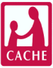
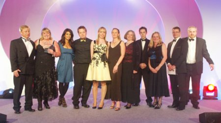

Stephen Taylor (editor@vector.org.uk)
{ .byline }

{ .lead-image }

*Editor’s note* The story below of what happened to The Childcare Company recounts events which have been the subject of legal proceedings. For this reason, the previous partners of The Childcare Company are not named here. Nor has *Vector* checked this account with them: the subject of our story is not how The Childcare Company got into difficulties, but how it got out.
{ .ednote }

They say it’s never too late to have a happy childhood. But who gets to have their second childhood right after their first? Chris and Sally Eaton of The Childcare Company did, with a little help from an APL developer.

When trouble comes calling, best go out to meet it. But what do you do when the storm you saw on the horizon arrives as a hurricane? You’d been planning how to stay dry when you should have been planning how to save your house.

Sally walked white-lipped out of the conference room for a bathroom break. Outside she saw her IT consultant.

—“Ziggi, leave the building. Go home – we’ll talk tomorrow. Do it now. Everybody out – fast!”

She rejoined her husband in the conference room. It was 7 March 2008, their very own Black Friday.

## Starting out

Their company had been started to offer a higher standard of training to childcare workers. They both had long experience in this business and had seen that the Web could be used both to make training more easily accessible to workers, many of whom worked irregular hours, and to help their employers and assessors keep in touch with their progress.

The business plan had been straightforward. A services company, (here called ‘the service company’) had already established an ‘e-portfolio’ infrastructure for delivering vocational training over the Web. Chris and Sally’s company would develop content for vocational training for childcare workers. To do this, and to market the results, they had formed a partnership with a major vendor of nursery software and services, which we shall refer to as ‘the parent company’, becoming directors of ‘The Training Company’.

No one expects even the best-laid plans to run smoothly. By the summer of 2007, product development seemed to the Eatons to have stalled. The service company had the delivery mechanism they needed, but it also had much larger clients; and jobs for larger clients kept bumping The Training Company’s work back down the queue. The service company’s delivery framework was well-established and its care divided between numerous specialists. The Training Company’s requests for changes and new features seemed to circulate endlessly without result.

Chris & Sally hired Chris ‘Ziggi’ Paul, an APL developer, to see what he could do to get the lesson content moving forward. He confirmed they had problems.

> Yes, development *was* stalled, for a number of reasons. The company providing the framework were asked to develop the site and put more colour into it – we wanted lots of colour, lots of imagery. They had a very traditional-looking system, if you like. Our development there *wasn’t* going fast, because they had some very big clients who were asking for things as well, and we were just a little sideshow. So they didn’t really have the time, and our requests seemed always to be at the back of a priority list. Things were going very slowly there.
>
> A start-up company can’t take three-month delays. But I can understand their point of view. They saw the big client, the big bucks, and initially, when they had taken us on they must have seen us as the icing on the cake. In theory that would work very well. In practice, the big client clicked its fingers, they jumped.

Lisa Sutlieff joined The Training Company about this time, developing content for the new system.

> I think that was the point I joined the company. And I just remember – it was such a battle to get anything done, because we would be doing all this work and none of it was actually going live. On the other hand, they had this framework and were expecting us to supply content to a certain formula, and when we said, well, we’ve done that now, we’d like to do something a bit different, we want to offer a new qualification through your system, then the conversations that we had just went on for weeks. The framework handled one kind of qualification very well, it was just so hard to get anything *else* done.
>
> <em>Ziggi</em>—The parent company’s security regime was also a problem for us. They were getting hacked a couple of times a year, so they were naturally concerned. Each of our many, many changes had to pass through their security checks – which still weren’t stopping the intrusions. They had all the resources they needed to support our development but they just couldn’t get out of their own way.

Ziggi was able to get things moving again. The service company writes its software in VB, not APL, but APL developers commonly handle *all* aspects of an application, and Ziggi’s experience enabled him to work effectively between the content creators and the VB programmers, getting logjams unblocked. As an experienced developer he was able to support the project with an SQL-based content-management system that reduced much custom coding to a collection of templates. He arranged for a development system to be set up on a server at The Training Company, so they could add content without elaborate security checks. By the end of February 2008 the site was already being used by learners and a major nursery chain was about to sign up.

Unfortunately, as the partnership with the service company was beginning to go well, the Eatons were increasingly concerned about their other partnership – with the parent company. In theory its substantial market presence was the ideal complement to the tiny start-up company. In practice, there seemed to be significant incompatibilities. In November 2007 the Eatons proposed an amicable separation, reversing the share swaps and going their separate ways. Negotiations started. Rainy days, perhaps, but the parties might stay dry under separate umbrellas.

## Black Friday

That was the agenda for the meeting on 7 March. But Sally had guessed the rainstorm might turn out to be a hurricane. Anticipating an acrimonious meeting and raised voices, she arranged for all staff to be out of the office that afternoon except Ziggi who stayed to take phone calls. She was not mistaken. At the meeting, directors from the parent company announced that the Eatons were suspended from their posts running The Training Company and flourished letters for all their staff, suspending them too and inviting them to the parent company offices to review their contracts. Outside, a van waited to remove all the computers. Sally excused herself from the meeting and secured the computer equipment, all of which belonged to the Eatons personally. None of the employee letters would be delivered that day.

Two weeks later the Eatons sat at the same table with seven of their staff. They had regained some ground. The premises were in their names; the PCs remained. (The separation would later be settled with compensation from the parent company.) But the development server and all their work had disappeared and inquiries at The service company about resuming their project without the parent company did not seem to be making any progress.

The meeting could have been a wake, and perhaps it would have been if the people there had felt they had been treated with greater respect. But the Training Company’s employees did not feel like workers laid off from a failed project. They felt mugged; their prize snatched away just before they grasped it. Worse, they feared the system would be poorly supported by the parent company, their work wasted and discredited.

But Ziggi had a proposal.

> If you let me – get me APL – and I can write it. And I can write the whole thing, including all the service company parts, and we’ll have complete control over it. We can develop it how we want to develop it, we can adapt very quickly when you want something changed or you don’t like something. We won’t have to make phone calls or wait for them to get back in a week, we can do it. If we get feedback from our clients we can do it. If any of the nursery chains we start dealing with want different bits we can react at a much faster pace. We can get the product we want – we can do all this.

On the face of it this was an outrageous idea. The service company’s infrastructure represented a huge development effort. Even if his colleagues could recreate the training content, how could Ziggi, working alone, possibly create the infrastructure to deliver it over the Web?

Worse, they were out of time. The parent company had its first learners already using the lessons. Web-based training would cause a sea change in training nursery workers. The first firm to bring it to market it would reap a huge first-mover advantage – or, as those around the table feared, wreck the marketplace for it.

But Ziggi wasn’t entirely crazy. He was familiar with web applications developed using ASP.Net and VB.Net. He knew how fast he could work using APL. And he had seen the interfaces available from Dyalog. Moreover, he didn’t plan to recreate the service company’s entire e-portfolio framework, but a subset tailored and enhanced for this training content.

It was a crucial offer. If Ziggi could provide the delivery mechanism then, for the first time, all the skills required to produce the Eatons’ new business service were gathered at the same table. They had a chance – however slim – to get to market without partners.

But it was still an outrageous proposal. How did the Eatons come to accept it?

> <em>Sally</em>—After our experiences with our partners, the prospect of *total control* – from content to delivery – was very enticing. If it worked, we would be able to react and respond to our customers very fast – crucial for a start-up company.
>
> <em>Chris</em>—It came down to trust. For the previous nine months Ziggi had delivered what he’d said he could deliver, and we had learned to rely on him. If he said he could do it, then he probably could. We’re only now starting to appreciate what an extraordinary suggestion it was. So part of it was a character assessment, and part of it was – let’s see how far it goes, and if it doesn’t work out we can always correct it later.

## Starting over

The Childcare Company was formed with fresh memories of work in progress, and a desire to do it better this time around. They started writing their content with improvements suggested by feedback from their earlier material. And Ziggi got busy with Dyalog APL.

It was his first web application with APL on the server side. After nine months of learning about NVQ training he had a clear view of what was needed and soon had a simple version working.

This produced some interesting feedback. Ziggi knew the application from the conversations and meetings he’d been in, not from studying a formal specification. If the application had important capabilities that had not been discussed since he joined the project, he would know nothing of them. And so it proved. The service company framework provided for internal and external assessors. Established long ago, these had never been on the agenda of any meeting Ziggi attended.

> <em>Ziggi</em>—Although I knew the terms I did not really appreciate the complexity. When I first demo’d the Internal Verification tools I was told “This is re-assessing, not IV-ing!” I had to ask what the difference was and then go back and start that part again.

On the face of it, this was a serious flaw in his approach. Without a formal specification, how could he hope to meet the requirements? In practice, once he knew what was wanted he was able to add the extra function quickly.

> <em>Ziggi</em>—Bits did come and bite me somewhat. Having knowledge of the lesson aspects of the system, and having seen the service company people demonstrate the learners’ upload and download facilities, what I *didn’t* know was the complexity on the Assessors’ side, or the Internal Verifier or External Verifier roles. I didn’t know how they were going to work – I didn’t know they were *needed*, actually, when I first agreed to things.
>
> <em>Chris</em>—No, we never said to you that there was an External Verifier page required. We sort of assumed that – we all knew that and it didn’t need saying. So we’d never told *you* that. But we came across problems like that and you solved them.
>
> <em>Ziggi</em>—It’s one of the other aspects of APL here. I couldn’t have changed direction and jumped back and forth so easily if I had had a very rigid SQL file structure and so on. Using APL component file structures and being able to change the programs that use them allowed me to adapt very quickly.

Clearly the Eatons had a judgement call to make. Every programming nerd is happy to be left undisturbed to write code. How long to leave Ziggi? Without technical skills of their own, how to judge whether he was making progress – or stuck in a dead end?

> <em>Sally</em>—I knew he was getting somewhere when I began to see ideas and contributions from other team members turning up in the application.

Ziggi’s approach to development depended on close collaboration with the rest of the team to complete his understanding, and to identify and solve problems. It assumed he could write and rewrite code fast enough to expose and fix the inevitable errors and misunderstandings – and that this would produce a usable system faster than formal development methods would. The prompt appearance in the application of ideas from his team mates was a strong signal he was succeeding.

## Delivering

As it turned out, the Eatons did not have to wait long. Ziggi had no code when he started redeveloping in April 2008. The service was launched the following month and went live in July with 75 users. By the end of 2008 [The Childcare Company](http://www.thechildcarecompany.com/) was supporting 250 users; a number expected to double by the system’s first anniversary. Gratifyingly, the customers include the major prospect they thought they had lost in the rupture of March.

{ .right }

Ziggi’s ‘direct development’ approach had discovered and produced everything required to use the system. In November 2008 the industry awarding body [CACHE](http://www.cache.org.uk/) visited and confirmed that all of the key components needed for assessment and internal and external verification were in place and, in fact, easy to use and view.

Does he have a scaling problem ahead? Having built the system at a gallop will he have to rewrite large portions to accommodate thousands of users? Apparently not. Ziggi:

> I can monitor in real time who is on the system. I can see the whole time what is going on. The load on the system, and how it impacts the system, is something that I was very nervous about in the early days. I’m less so now. It can grow quite considerably before it becomes an issue. At the moment, we really… I think we can easily go to two thousand users.

As the eminent application developers [37 Signals](http://www.37signals.com/) write in *Getting Real*, their guide to developing web applications:

> In the beginning, make building a solid core product your priority instead of obsessing over scalability and server farms. Create a great app and then worry about what to do once it’s wildly successful. Otherwise you may waste energy, time and money fixating on something that never even happens.
>
> Believe it or not, the bigger problem isn’t scaling, it’s getting to the point where you have to scale. Without the first problem you won’t have the second.

{ .right }

The Eatons have already achieved their goal of setting a new standard of quality in training childcare workers. In November 2008, seven months after Ziggi wrote their first line of code, their industry magazine, Nursery Management Today, awarded The Childcare Company its Supplier Innovator prize for the year. CACHE has given them its highest rating. The Childcare Company is now collaborating with Sir Christopher Ball, author of the 1994 “Start Right” report, and is becoming a channel for content from [Teachers TV](http://www.teachers.tv).

## Looking back

The Eatons have had the unusual experience of successfully developing two very similar applications using entirely different methods: on the one hand, conventional IT development, on the other, the Direct Development style more common with the APLs. What lessons do they draw?

> <em>Sally</em>—Ignorance is bliss. Thank goodness we had no idea what a radical path we had chosen! But if we had to do it again – or another project – without Ziggi, we’d have to find someone like him, with the character and the people skills to listen and collaborate. He’s not the usual sort of person you find working in IT.
>
> <em>Ziggi</em>—The teamwork made it possible. We knew what we wanted to do, we had a huge focus, and a common purpose. The intensity was terrific, and the team just gave me their trust.

<figure markdown="1">

<figcaption markdown="span">Award winning team – the Eatons at left, Ziggi far right</figcaption>
</figure>

> <em>Chris</em>—Compared to working with regular IT, the control – the responsiveness – was unbelievable. Ziggi has completely spoiled us for conventional IT development.
