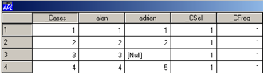
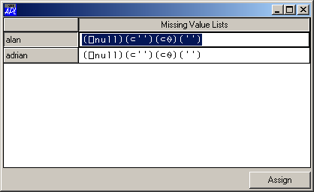
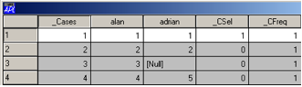
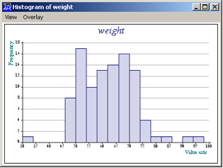
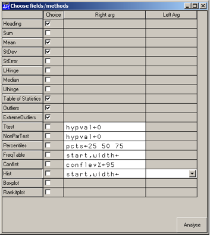
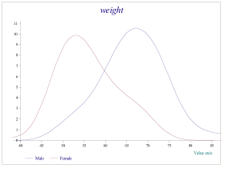
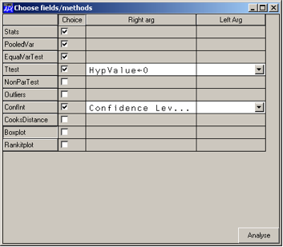
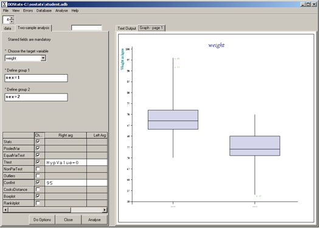
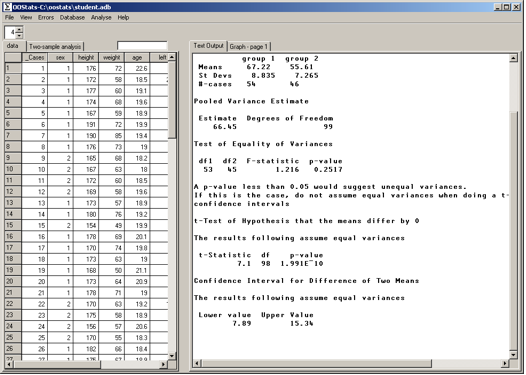

Alan Sykes
{ .byline }

At the Dyalog Users Conference (Elsinore 2008) I reported my first efforts at providing facilities for statistical computing using Dyalog APL’s object-oriented facilities. Since then, the software has expanded and consolidated to such a point that I would like to invite others to use it, suggest suitable extensions to it (and even provide them). This article is therefore a brief introduction to it.
{ .abstract }

## The starting point

From the beginning, I knew that if the software were to be used for real, then it had to cope with missing values. Post retirement, I did some consultancy work, and was invariably given a very messy Excel sheet of data purporting to be a database! Importing this into APL and hitting a column of figures with a simple Mean program had about a 0.1% chance of working! Also, having worked with colleagues into analysing survey data, I knew that as well as system missing values, it was useful to have user-declared missing values for a particular variable (so that analyses of what type of respondents tended to leave a particular database field empty are possible).

So the starting point was the development of a simple database object that allowed the user to do the usual database operations e.g. selecting cases, computing new variables, deleting cases *et cetera*. In doing this early work, I soon felt it important to be able to use the graphical user interface (e.g. for declaring variable formats) as well as using the session. (This was fortuitous, as later on, they were incorporated into a full GUI wrap-round that emerged naturally from the object-oriented approach adopted.)

## Creating a database from APL

Creating a database from APL should be easy – it is. Using the object code `s_db` in the workspace `oostats`:

```
      db←⎕new s_db (('alan' 'adrian')(alan adrian))
```

The user variables are referred to by names as listed in the public field:

```
      db.UserNames
 alan  adrian
```

In addition, however, there are three variables that keep a track of the case number, whether that case is selected, and the case frequency:

```
      db._Cases
1 2 3 4
      db._CSel
1 1 1 1
      db._CFreq
1 1 1 1
```

(Occasionally, it is helpful to be able to declare a case frequency – for example if analysing a contingency table given from external sources.)

To look at the database:

```
      db.View
```

<figure markdown="1">

<figcaption markdown="span">Figure 1</figcaption>
</figure>

System missing values are kept in a field: `db_SM`

```
      (⎕null)(⊂'')(⊂⍬)('')∊db._SM
1 1 1 1
```

and the collection of missing values for each of the user variables is contained in

```
      db.MissVals
 (⎕null)(⊂'')(⊂⍬)('')  (⎕null)(⊂'')(⊂⍬)('')
```

Each of these lists is a string (to make it easier to see just what the missing values are) and may be added to:

```
      db.MissVals[1],←⊂'(2)'
      db.MissVals
(⎕null)(⊂'')(⊂⍬)('')(2)  (⎕null)(⊂'')(⊂⍬)('')
```

Alternatively, the method `db.GetMissVals` provides a grid object for entering further values:

<figure markdown="1">

<figcaption markdown="span">Figure 2</figcaption>
</figure>

After such an allocation, any statistical method using the variable `alan` would filter out values equal to 2.

Selecting cases is programmed as a method in `s_db`, and is straightforward:

```
     db.SelectCases '(alan<4)^adrian<5'
Cases selected by (alan<4)^adrian<5
3 cases not selected
     db.View
```

<figure markdown="1">

<figcaption markdown="span">Figure 3</figcaption>
</figure>

In the grid view of the database, cases not selected are in grey – note that case 3 has not been selected because I take the view that a null value cannot be included in the comparison.

## Statistical Methods

As well as the above (and other) database methods, the object code `s_db` contains a number of statistical methods:

```
      db.StatsMethods
UniqueFrequency  Unistats  Regress  TwoSampleMeans  CrossTabs  Multistats
MatchedPairs  OneWayAnova  Scatterplot  Table Boxplot  TimeSeries
OneWayManova
```

With one exception (the `Unistats` method) each statistical method creates a sub-object `db.s` which has its own fields and methods. For our first example, consider `UniqueFrequency`, useful when investigating a database for the first time – it lists unique values of a variable and their frequency (missing values are included here):

```
      db.UniqueFrequency 'adrian'
Sub-object s created from all cases
      )cs db
#.[s_db]
     s.UniqueValues
1 2 5  [Null]
     s.Frequencies
1 1 1 1
```

```
     #.Tab s.FrequencyTable
 ValueLabels  Values  Frequency  Percentage
              1               1          25
              2               1          25
              5               1          25
              [Null]          1          25
```

(With a view to printing out tables later, a table is returned as a vector of column headings and then the body of the table – `#.Tab` simply glues them together adjusting lengths as necessary.)

## The Unistats sub-object

Perhaps the most frequently used statistical method in `s_db` is the `Unistats` object which allows you to calculate means and standard deviations etc for a single variable. Using this from the session, I took the view that one might want to do this for more than one variable, so I decided to create an object at the root level called by the name of the variable.

```
      db.SelectCases 1
(re-instates all cases)
      db.Unistats 'adrian'
Created object #.adrian.?
Currently, # cases excluded = 1
```

(In creating this object, any value that is in the list of missing values for the variable is filtered out. The ability to do this automatically when creating a statistical object is really important. For example, when fitting different competing regression models, cases will be included or excluded as each new model is specified.)

We can now type:

```
      adrian.Mean
2.66667
      adrian.StDev
2.08167
```

The choice of options for the `Unistats` method reflects my own personal outlook on the process of statistical data analysis – in particular the important role that graphics plays in understanding what is going on and therefore what analysis is (or is not) relevant. So, for example, with `Unistats` – there are three graphs – a histogram (`Hist`), a `Boxplot` (useful for identifying cases that are outliers) and a `Rankitplot` (a visual check on whether or not the data is Normally distributed). Other options are easily added.

## Finding out about the options available

With any statistical object, it is useful to document what options are available, and also to provide a *Script* (a nested matrix) for documenting output. This is driven by the function `#.Explore`. For example, the statistical method `UniqueFrequency` has a Script matrix

```
      #.Ed.freq
1 1  Heading              1   2  Heading
1 0  UniqueValues         1   2  'Unique Values'
                          1   3  UniqueValues
1 0  Frequencies          1   2  'Frequencies'
                          1   3  Frequencies
1 1  FrequencyTable       1   2  'Frequency Table of all Unique Values'
                          1   4  FrequencyTable
```

listing options (plus information on left and right arguments) with the last column specifying executable commands for output if that option is selected. (The matrix itself may be constructed through a specially designed GUI nested matrix editor `#.Ed.Edit`.)

The object itself accesses this information through a field `s.Options`:

```
      s.Options
 Left arg  Option          Right arg
           Heading
           UniqueValues
           Frequencies
           FrequencyTable
```

To see this working more effectively,

```
     Open 'c:\oostats\student.adb'
Object 'db' has been created using s_db from file c:\oostats\student.adb
```

(A database is saved in an APL component file together with its attributes.)

```
      db.UserNames
 sex  height  weight  age  left  react  sort
      db.Unistats 'weight'
Created object #.weight.?
Currently, # cases excluded = 0
```

```
      weight.Options
 Left arg                   Option               Right arg
                            Heading
                            Sum
                            Mean
                            StDev
                            StError
                            LHinge
                            Median
                            Uhinge
                            Table of Statistics
                            Outliers
                            ExtremeOutliers
                            Ttest                hypval←0
                            NonParTest           hypval←0
                            Percentiles          pcts←25 50 75
                            FreqTable            start,width←
                            ConfInt              conflev%←95
 Normal,Exponential,Gamma…  Hist                 start,width←
                            Boxplot
                            Rankitplot
```

Right arguments (numeric) are indicated through a text vector, thus the `Ttest` option has a right argument which specifies the hypothesis value required. Left arguments, where they exist, are a list of names indicating categorical options – thus for the `Histogram` method, a left argument of `'Normal'` would add a normal-density overlay to the histogram.

Here are some examples of the options:

```
      weight.Min
33
      weight.Max
96
      weight.Hist 30 4
```

<figure markdown="1">

<figcaption markdown="span">Figure 4</figcaption>
</figure>

Note the menu item `View` which activates the Causeway viewer, and `Overlay` which gives you a choice of fitting to the data a Normal, Exponential, Log-Normal, Gamma distribution or a smoothed version of the histogram (the left argument options to `Hist`).

If you are unsure of which options to use, then you can use `#.Explore` with right argument equal to the object to be explored. This allows the user to tick appropriate options and obtain suitably annotated output:

```
      #.Explore weight
```

<figure markdown="1">

<figcaption markdown="span">Figure 6</figcaption>
</figure>

```
Univariate statistics for weight

 Statistic    Value
 #-cases     100
 Sum        6188
 Mean         61.88
 StDev         9.98107
```

```
Outliers

There are 2 outliers

 Case  Value
   77     92
   95     96
```

```
Extreme Outliers

There are 0 extreme outliers
```

If we pursue the information on weight of students further, we can recognise that there are male and female students in the same data set, so this histogram is a mixture of two distributions (one for each sex). To investigate how they differ, we need either a boxplot (see later), or two histograms on one axis (not advisable and so not provided) or two smoothed histograms. Both options are available if we use the statistical method `TwoSampleMeans`:

```
      db.TwoSampleMeans 'weight' 'sex=1' 'sex=2'
Sub-Object s created using s_twosamt
      db.s.FreqDensities 4
```

(The parameter is a smoothing parameter – think of it as a class-width for a histogram.)

<figure markdown="1">

<figcaption markdown="span">Figure 6</figcaption>
</figure>

Note that the labels in the key are produced from the database, which has a field `db.ValueLabels` – a vector of matrices, one for each user variable:

```
      db.ValueLabels
 1  Male
 2  Female
```

(n.b. there is only one variable here with value labels)

The resulting graph gives a clear picture of how the distributions of male and female weights differ – a formal test of the equality of means may be performed (either assuming approximate normality or using a non-parametric test):

```
      Tab db.s.EqualVarTest
 df1  df2  F-statistic   p-value
  53   45      1.21619  0.251715
```

which tells us that we can assume equal variances (as suspected from the two densities above)

```
      Tab db.s.Ttest 0
 t-Statistic  df      p-value
     7.10045  98  1.99094E¯10
```

If you prefer to use the `#.Explore` method, then it is a little easier to see what is going on

```
      #.Explore db.s
```

<figure markdown="1">

<figcaption markdown="span">Figure 7</figcaption>
</figure>

The chosen options are then performed and reported back with annotations:

```
Two-sample analysis for variable weight

Group 1 is defined by the statement sex=1
Group 2 is defined by the statement sex=2

Sample Statistics

          group 1  group 2
 Means     67.22    55.61
 St Devs    8.835    7.265
 #-cases   54       46
```

```
Pooled Variance Estimate

 Estimate  Degrees of Freedom
    66.45                  99

Test of Equality of Variances

 df1  df2  F-statistic  p-value
  53   45        1.216   0.2517
```

```
t-Test of Hypothesis that the means differ by 0

The results following assume equal variances

 t-Statistic  df    p-value
         7.1  98  1.991E¯10

95% Confidence Interval for Difference of Two Means

The results following assume equal variances

 Lower value  Upper Value
        7.89        15.34
```

## The Graphic User Interface

Whilst driving a statistical analysis from the keyboard is a familiar environment for statisticians, a GUI interface is also desirable. This is provided by the object code `s_guidb`, which inherits the properties and methods of `s_db`. Because of the inheritance, and because all the database facilities already have a GUI interface (e.g. `db.GetMissVals`) it is straightforward to incorporate them into a menu-driven system.

For the statistical methods, forms are necessary to declare the appropriate variables to spawn the statistical object – once the object has been created, the grid object used in `#.Explore`, provides the user choice for the statistical options required from that object, and the output from Explore gives the output required for an RTF-viewer. This is illustrated by using the male and female weights example again.

Having selected from the `Analyse` menu, the option `Two-sample analysis`, we can select the target variable, specify the two groups, and create the object using the `Analyse` button. The default options can then be executed by pressing `Do Options` on the tabbed subform. The boxplot is generated on the right-hand tabbed subform as seen below.

<figure markdown="1">

<figcaption markdown="span">Figure 8</figcaption>
</figure>

The hidden tabbed sub-forms reveal the database grid object and the text output:

<figure markdown="1">

<figcaption markdown="span">Figure 9</figcaption>
</figure>

Users wishing to extract output into, say Microsoft Word, can

1. copy and paste from the RTF Viewer,
2. paste any of the graphs produced (some objects may have up to three different graphs) from the Causeway Viewer available on the `View` menu and
3. print a Newleaf report of all (or selected parts) of the activity in a session.

The `Help` menu provides a set of Help files (standard compiled html) produced using Adrian Smith’s documentation software. Other database features not mentioned include formatting the variables (including showing dates and value labels), ordering cases, ordering the variables, using colour in the grid to indicate the spectrum of small to large values, and the ability to edit the grid if required.

## The scope of OOStats

Currently, OOStats is for APLers using Dyalog 12.1. Some options for further development are obvious:

- the addition of further statistical methods to `s_db`
- the addition of further options to any of the existing statistical methods
- packaging it up to provide a stand-alone product (it would be necessary to provide some cover functions for use in e.g. Case Selection or Computing a new variable)
- Regularising the extended output by the creation of a dictionary thus allowing output in different languages.

(Readers may wish to extend the list!)

The table below lists the statistical scope to date – note that all the analytic power of ASLGREG is available (facilitating some quite advanced analyses on multi-way contingency tables, logistic regression etc.) and I would hope that there is much here that statistical APLers could use.

<table class="left" style="border-collapse: collapse">
            <tr>
                <th>Statistical Method</th>
                <th colspan="3">Options</th>
            </tr>
            <tr>
                <td style="border-top: 1px solid gray; vertical-align: top"><strong>Boxplot</strong></td>
                <td style="border-top: 1px solid gray; vertical-align: top" colspan="3">
                    <em>Facilitates boxplots for one or more variables including classifying variables</em>
                    (This is a cover-method to interface with boxplots provided on other sub-objects)
                </td>
            </tr>
            <tr>
                <td style="border-top: 1px solid gray; vertical-align: top">
                    <strong>CrossTabs</strong><br>
                    <em>Analysis of two-way frequency tables</em>
                </td>
                <td style="border-top: 1px solid gray; vertical-align: top">
                    Observed<br>
                    Table<br>
                    ProportionsVar1ByVar2<br>
                    ProportionsVar2ByVar1
                </td>
                <td style="border-top: 1px solid gray; vertical-align: top">
                    Expected<br>
                    StandResid<br>
                    ChiSquareTest<br>
                    FullTable
                </td>
                <td style="border-top: 1px solid gray; vertical-align: top">
                    ViewFullTable<br>
                    BarchartVar1ByVar2<br>
                    BarchartVar2ByVar1<br>
                    TowerChart
                </td>
            </tr>
            <tr>
                <td style="border-top: 1px solid gray; vertical-align: top">
                    <strong>Table</strong><br>
                    <em>Provides a table of univariate statistics within groups
                    specified by one or two variables</em>
                </td>
                <td style="border-top: 1px solid gray; vertical-align: top">
                    Table<br>
                    Boxplot
                </td>
            </tr>
            <tr>
                <td style="border-top: 1px solid gray; vertical-align: top">
                    <strong>MatchedPairs</strong>
                </td>
                <td style="border-top: 1px solid gray; vertical-align: top" colspan="3">
                    <em>Creates a Unistats object on the difference of two variables – see below</em>
                </td>
            </tr>
            <tr>
                <td style="border-top: 1px solid gray; vertical-align: top">
                    <strong>MultiStats</strong><br>
                    <em>Creates an object for the univariate or multivariate
                    analysis of a group of variables</em>
                </td>
                <td style="border-top: 1px solid gray; vertical-align: top">
                    #.Cases<br>
                    Mean<br>
                    Std Dev<br>
                    5%ile<br>
                    25%ile<br>
                    50%ile
                </td>
                <td style="border-top: 1px solid gray; vertical-align: top">
                    75%ile<br>
                    95%ile<br>
                    UnivariateStats<br>
                    MultivariateStats<br>
                    CovarianceTable<br>
                    Outliers
                </td>
                <td style="border-top: 1px solid gray; vertical-align: top">
                    ExtremeOutliers<br>
                    TsquareTest<br>
                    TestHypEqualMeans<br>
                    CorrelationMatrix<br>
                    CorrelationTable
                </td>
            </tr>
            <tr>
                <td style="border-top: 1px solid gray; vertical-align: top">
                    <strong>OneWayAnova</strong><br>
                    <em>Analysis of one variable split into two or more groups</em>
                </td>
                <td style="border-top: 1px solid gray; vertical-align: top">
                    MeansTable<br>
                    EqualVarTest<br>
                    AnovaTable<br>
                    Ftest
                </td>
                <td style="border-top: 1px solid gray; vertical-align: top">
                    GroupContrasts<br>
                    CooksDistance<br>
                    Outliers
                </td>
                <td style="border-top: 1px solid gray; vertical-align: top">
                    FreqDensities<br>
                    Boxplot<br>
                    Rankitplot
                </td>
            </tr>
            <tr>
                <td style="border-top: 1px solid gray; vertical-align: top">
                    <strong>OneWayManova</strong><br>
                    <em>As above, but for a group of correlated variables</em>
                </td>
                <td style="border-top: 1px solid gray; vertical-align: top">
                    MeanVector<br>
                    GroupMeanMatrix<br>
                    GroupMeansTable<br>
                    WGCovarianceMatrix
                </td>
                <td style="border-top: 1px solid gray; vertical-align: top">
                    BGCovarianceMatrix<br>
                    HonogeneityTest<br>
                    WilksLambda<br>
                    HotellingsTsquare
                </td>
                <td style="border-top: 1px solid gray; vertical-align: top">
                    ParallelProfileTest<br>
                    GroupContrasts<br>
                    MeansPlot<br>
                    CanonicalPlot
                </td>
            </tr>
            <tr>
                <td style="border-top: 1px solid gray; vertical-align: top">
                    <strong>Regress</strong><br>
                    <em>Regression and Generalized Linear Modelling</em>
                </td>
                <td style="border-top: 1px solid gray; vertical-align: top">
                    CurrentModel<br>
                    AnovaTable<br>
                    Ftest<br>
                    DevianceTable<br>
                    EstimateTable<br>
                    CovarianceMatrix
                </td>
                <td style="border-top: 1px solid gray; vertical-align: top">
                    CorrelationMatrix<br>
                    Outliers<br>
                    Diagnostics<br>
                    FittedValues<br>
                    StandardisedResiduals<br>
                    TResiduals
                </td>
                <td style="border-top: 1px solid gray; vertical-align: top">
                    Leverage<br>
                    CooksDistance<br>
                    Stepwise<br>
                    Parityplot<br>
                    Fitplot<br>
                    RankitPlot
                </td>
            </tr>
            <tr>
                <td style="border-top: 1px solid gray; vertical-align: top">
                    <strong>Scatterplot</strong>
                </td>
                <td style="border-top: 1px solid gray; vertical-align: top" colspan="3">
                    <em>Allows the building of any regression or generalized
                    linear model involving a y-variable, one regressor variable,
                    and one factor variable showing a scatterplot with fitted
                    model</em>
                </td>
            </tr>
            <tr>
                <td style="border-top: 1px solid gray; vertical-align: top">
                    <strong>TimeSeries</strong><br>
                    <em>Fits auto-regression or moving average time-series models</em>

                </td>
                <td style="border-top: 1px solid gray; vertical-align: top">
                    Acf<br>
                    Pacf
                </td>
                <td style="border-top: 1px solid gray; vertical-align: top">
                    ARModel<br>
                    MAModel
                </td>
                <td style="border-top: 1px solid gray; vertical-align: top">
                    ARMAModel<br>
                    Plot
                </td>
            </tr>
            <tr>
                <td style="border-top: 1px solid gray; vertical-align: top">
                    <strong>TwoSampleMeans</strong>
                </td>
                <td style="border-top: 1px solid gray; vertical-align: top">
                    Stats<br>
                    PooledVar<br>
                    EqualVarTest<br>
                    Ttest
                </td>
                <td style="border-top: 1px solid gray; vertical-align: top">
                    NonParTest<br>
                    Outliers<br>
                    ConfInt<br>
                    CooksDistance
                </td>
                <td style="border-top: 1px solid gray; vertical-align: top">
                    FreqDensities<br>
                    Boxplot<br>
                    Rankitplot
                </td>
            </tr>
            <tr>
                <td style="border-top: 1px solid gray; vertical-align: top">
                    <strong>UniqueFrequency</strong><br>
                    <em>Frequencies of unique values</em>
                </td>
                <td style="border-top: 1px solid gray; vertical-align: top">
                    UniqueValues
                </td>
                <td style="border-top: 1px solid gray; vertical-align: top">
                    FrequencyTable'
                </td>
                <td style="border-top: 1px solid gray; vertical-align: top">
                    Frequencies
                </td>
            </tr>
            <tr>
                <td style="border-top: 1px solid gray; vertical-align: top">
                    <strong>Unistats</strong><br>
                    <em>Statistics for one variable</em>
                </td>
                <td style="border-top: 1px solid gray; vertical-align: top">
                    Sum<br>
                    Mean<br>
                    StDev<br>
                    StError<br>
                    Min<br>
                    Lhinge<br>
                    Median
                </td>
                <td style="border-top: 1px solid gray; vertical-align: top">
                    Uhinge<br>
                    Max<br>
                    Outliers<br>
                    ExtremeOutliers<br>
                    BoxCoxLL<br>
                    Ttest<br>
                    NonParTest
                </td>
                <td style="border-top: 1px solid gray; vertical-align: top">
                    Pctile<br>
                    FreqTable<br>
                    ConfInt<br>
                    Hist<br>
                    Boxplot<br>
                    Rankitplot
                </td>
            </tr>
        </table>

## Acknowledgements

I am indebted to Morten Kromberg and Gitte Christensen of Dyalog Ltd for encouraging the work on this project and for the opportunity to present a preliminary version at the 2008 Users Conference. As with nearly all my endeavours in APL, I have benefitted enormously from the large APL toolkit of Adrian Smith. Specifically here, is the use of Rainpro, Newleaf and the Documentation software, but not Causeway – the GUI coding, however inept, is my own!

## Attachments

1. Dyalog APL workspace, and examples of datasets: [`oostats.zip`](oostats.zip)
2. Compiled HTML Help file: [`oostats.chm`](oostats.chm)
